# FlickPond: a reusable cloud media processing platform

Team 17, SWE5001 Architecting Scalable Systems Practice Module (NUS, September to November 2026).
Start here. This page describes the system as built (V1, git tag `project2-v1`). Earlier planning and
Project 1 material is labelled historical and listed at the end.

## What it is

FlickPond lets an application upload a video, have it converted to MP4 and adaptive HLS (360p, 480p,
720p, never above the source height), follow the job, and play the result through an owner-checked
link. Applications use one documented HTTP API and never touch storage, queues or FFmpeg. Two clients
exist: the FlickPond web app (`frontend/`) and an independent Publisher CLI (`publisher/`).

It runs on AWS in one region (ap-southeast-1): CloudFront, API Gateway, Lambda container images, SQS,
Aurora PostgreSQL Serverless v2, S3, and finite Fargate tasks for the encoder.

**Two operating modes exist; the text below says which one it means.**

- **V1 as accepted (`project2-v1`, immutable): per-run stacks.** One stack per run id, closed outside a
  booked session, deleted afterwards. Nothing runs while it is idle except storage. The AWS proofs
  (`r1017b`, `r1018b`, `r1019a`) were run this way.
- **V2-live on Main (AD-27): one persistent, always-on environment.** Stack `dc2-live`, deployed once
  and updated in place after every green CI run on Main; it scales to zero when idle (about 3 to 5 USD a
  month fixed, by design, not yet measured). The API prefixes are the same (`/api/media/*`,
  `/api/processing/*`); the difference is operations, not the contract.

**Status snapshot, 18 October 2026** (Main `d2070db`, source of every row linked):

| Item | Status | Source |
|---|---|---|
| `project2-v1` tag | Accepted, immutable | [V1 README, "What remains"](docs/execution/aws/v1/README.md) |
| `r1017b`, `r1018b` AWS runs | Proved V1; results include two FAILs (2-worker 1.449x vs 1.6x; Processing release 10.1 to 10.3 min vs 10 min) | [evidence index](docs/evidence-index.md) |
| `r1019a` CD run | Deploy, Processing release with upload smoke and teardown `CLEAN` all **succeeded** | runs [39085599276](https://github.com/Collaboration95/dc2/actions/runs/39085599276), [39087966647](https://github.com/Collaboration95/dc2/actions/runs/39087966647), [39089615147](https://github.com/Collaboration95/dc2/actions/runs/39089615147); [archive](docs/execution/aws/v1/evidence/archive-20261018/README.md) |
| CD bad-candidate rollback test | Dispatched, **cancelled**, no result | run [39089045496](https://github.com/Collaboration95/dc2/actions/runs/39089045496) |
| V2-live deploy from Main | Succeeded with an upload-to-playback smoke; **not** all of #238 (in-place update, scaling, pause, idle cost), and #229 AWS security negatives are NOT_RUN | run [39105817431](https://github.com/Collaboration95/dc2/actions/runs/39105817431) |
| V2-live verification, 19 October | In-place update PASS; Processing release PASS; rollback proof PASS (`restored`, job green); 0 -> 3 -> 0 PASS but queue wait about 37 s against a 20 s target; 9-clip backlog 239 s at cap 3; **Aurora pause not observed**; CD release path needed two `cd.sh` fixes (#265, #267) | [receipts](docs/execution/aws/v1/evidence/v2live-verify-20261019/README.md) |
| Full CI on Main | Success; Sonar advisory and skipped; DAST findings report-only | run [39107762106](https://github.com/Collaboration95/dc2/actions/runs/39107762106) |
| Actual versus target | One table and figure, misses and unmeasured items stated | [`docs/results/actual-vs-target.md`](docs/results/actual-vs-target.md) |

Whether `dc2-live` is running at this moment is not recorded in the repository.

## Architecture



Logical view, domain model and sequence diagrams are in [`docs/architecture/`](docs/architecture/README.md):
[logical and physical views, persistence, upload-to-play sequence](docs/architecture/views.md),
[DDD model](docs/architecture/ddd.md), and the [ADR register, deviations from the proposal and
limitations](docs/architecture/decisions.md).



## Two services

| Service | Owns | Code |
|---|---|---|
| **Media Management** | Accounts, ownership, upload intake, playback links, the public job view | [`media/`](media/) |
| **Processing** | Jobs, attempts, leases, retry and cancel, output descriptors, the finite encoder | [`processing/`](processing/), [`media_engine/`](media_engine/) |

Why these are microservices and not one app split into folders (each point has a code or receipt link in
[`decisions.md`](docs/architecture/decisions.md)):

- Each has its own container image, its own Lambda functions and IAM roles, and its own CI lane
  (`.github/workflows/ci.yml`, `.github/CODEOWNERS`).
- Each owns its database and migrations on the shared Aurora cluster. A runtime login for one cannot
  connect to the other's database (live receipt `cross-database`).
- They never call each other. They exchange five message kinds over three SQS queues, with an outbox
  and inbox in each database; Media keeps its own read model of Processing's state.
- Each can be released alone (Lambda image digest and alias): the live release receipt shows the peer
  unchanged at every snapshot. `deploy/v1/check_runtime.py` fails an image build if the other
  service's package or any retired peer-HTTP module is present.
- The published language is [`contracts/`](contracts/README.md) with a versioning policy and
  consumer-driven tests.

Honest limits: one CloudFormation stack, a monorepo with one lockfile, and **three** source directories
copied into every image (`contracts/`, `delivery/` and `runtime_support/`, see the Dockerfiles in
[`deploy/v1/`](deploy/v1/)). Database ownership is logical: Media and Processing each own a database and
migrations, but both live on **one Aurora cluster**, which is a shared failure and capacity boundary
that role separation does not remove. Processing also depends on the **Media-owned Lambda authorizer**
for caller identity (AD-09): every Processing request is authenticated by Media's code, although Processing holds neither Media's secret nor its database. See
[limitations](docs/architecture/decisions.md#6-architectural-limitations).

## Run it locally

Local V1 uses real PostgreSQL 16, FFmpeg and Docker, with Moto standing in for S3 and SQS and an
in-process API Gateway bridge. It does not exercise IAM, Lambda, Fargate or Aurora. Prerequisites:
Docker Compose, FFmpeg/FFprobe, `uv` and Node 20+. `make setup-v1` installs the locked environment, an isolated
`moto[server]==5.2.4` environment in `.cache/v1-moto` (found automatically; override with
`V1_MOTO_PYTHON`) and the Chromium that the V1 browser leg launches. On a disposable Linux host add
`WITH_DEPS=1` (apt, needs root) for Chromium's system libraries; otherwise install them yourself.
`make browser-install` alone is the legacy trust workflow and installs Firefox on Linux. Details and
what is emulated: [`local-runtime.md`](docs/execution/aws/v1/local-runtime.md).

```sh
make setup-v1
make test-v1                                                     # offline contract tests, no services
make v1-up V1_RUN_ID=demo1                                       # PostgreSQL + loopback Moto
make verify-v1 V1_RUN_ID=demo1 FLOW=all V1_BROWSER=1             # every flow plus the browser leg
make v1-demo V1_RUN_ID=demo1 OPEN=1                              # interactive web UI + work pump (Ctrl-C stops)
make v1-serve V1_RUN_ID=demo1                                    # API-only loopback Gateway bridge (no UI, no pump)
make v1-down V1_RUN_ID=demo1 DELETE_DATA=1                       # remove only this run's data
make help                                                        # every target
```

`make v1-demo` prints an `https://127.0.0.1:<port>` URL serving the shipped frontend, the Media and
Processing handlers and a pump that delivers queue messages and runs one real FFmpeg encode per job.
Its certificate is generated locally, so a normal browser warns; `OPEN=1` opens a Chromium that trusts
only that certificate, or start Chrome with the printed `--ignore-certificate-errors-spki-list=` flag
and a throwaway `--user-data-dir`. It is emulated, not AWS evidence, and each start resets that run's
buckets and queues. It does not keep Moto state across restarts or start dependencies for you.

Other useful targets: `make lint`, `make test` (fast Python and frontend suites), `make lint-cfn`
(renders and lints the CloudFormation template offline), `make v1-images` (builds and verifies the three
images; local evidence only).

## Deploy to AWS

Deployment is operator-run and costs money. Nothing is applied unless `execute=true`. Cloud sessions
use an explicit AWS profile, never `default`: `dc2-agent` (the dedicated agent user) for agent-run work or
the operator's `dc2-project2-mfa` session; see the profile note in the
[runbook](docs/execution/aws/v1/deploy-runbook.md).

- **Pipeline:** the CD workflow [`.github/workflows/cd.yml`](.github/workflows/cd.yml) (preflight,
  deploy, release, teardown) over a GitHub OIDC role
  ([`deploy/aws/v1/github-oidc.yaml`](deploy/aws/v1/github-oidc.yaml)). It refuses a commit without green
  CI. Current inputs target the persistent environment (`environment`, default `live`), for example
  `gh workflow run cd.yml -f operation=preflight` (read-only). The `run_id` input of the per-run
  `r1017b` to `r1019a` proofs no longer exists; the runbook keeps those examples labelled historical.
- **Runbook:** [`deploy-runbook.md`](docs/execution/aws/v1/deploy-runbook.md) covers the deploy ladder,
  sessions, the cloud proof steps, release and rollback, teardown, and the section
  "Operator handoff: CD deploy, then session and evidence from a laptop".
- **Template:** `scripts/aws/v1/definitions.py` renders `deploy/aws/v1/template.json`;
  [`deploy/aws/v1/README.md`](deploy/aws/v1/README.md) explains the two phases and the closed-by-default
  session model. Account, quotas and authorization: [`account-receipt-20261017.md`](docs/execution/aws/v1/account-receipt-20261017.md).
- **Status:** per-run V1 stacks `r1017b`, `r1018b` and `r1019a` were all torn down. `r1017b` (17 October,
  operator CLI) proved V1 on AWS. `r1018b` (17 to 18 October, deployed through the CD workflow) added
  backlog scaling, independent releases, the Processing-down proof and the unattended launcher; its
  results include two FAILs reported as FAILs (2-worker scaling at 1.449x against 1.6x; Processing
  release at 10.1 to 10.3 min against 10 min) and a post-release smoke that never passed. `r1019a`
  (18 October) then ran CD green end to end: deploy, Processing release with a passing upload smoke
  (`Release` step 9m39s, smoke 5m59s, separate steps) and a `CLEAN` teardown. See the status snapshot
  above and the evidence index.

## API specifications

- [`docs/api/media.openapi.json`](docs/api/media.openapi.json): accounts, direct-to-S3 upload
  reservations, owned jobs, edit, HLS delivery (`/api/media/*`).
- [`docs/api/processing.openapi.json`](docs/api/processing.openapi.json): owner-scoped job status, retry
  and cancel (`/api/processing/*`).
- Queue messages: [`contracts/`](contracts/README.md) (envelope, source descriptor, trusted actor).

## Evidence

- Live AWS receipts (runs `r1017b` and `r1018b`, redacted): [`docs/execution/aws/v1/evidence/`](docs/execution/aws/v1/evidence/).
  Each receipt lists what it does not prove. The `r1019a`, V2-live smoke and exact-source CI receipts,
  with hashes and source SHAs, are in
  [`evidence/archive-20261018/`](docs/execution/aws/v1/evidence/archive-20261018/README.md).
- Actual against target, one table and figure: [`docs/results/actual-vs-target.md`](docs/results/actual-vs-target.md).
- Local image receipts are in the same folder; local acceptance output is described in
  [`local-runtime.md`](docs/execution/aws/v1/local-runtime.md). Local results are not AWS results.
- Quality scenarios and security controls against the proposal targets, with local and cloud results
  labelled and FAILs stated: [`docs/evidence-index.md`](docs/evidence-index.md).
- Running log: [`docs/project2-worklog.txt`](docs/project2-worklog.txt).

## Publisher CLI

[`publisher/`](publisher/README.md) is an independent client of the public HTTPS API: it imports no
service code and holds no database or storage credentials. It registers or logs in, bulk-publishes a
folder, and polls status and output. Because V1 encoders are started by an operator, a published job
waits in the queue until a batch is started.

```sh
make publisher ARGS='--help'
python -m publisher --base-url https://<frontend-host>/api/media --json login you@example.com
python -m publisher --base-url https://<frontend-host>/api/media --json publish ./videos --wait --max-polls 180 --interval 2
```

## Repository map

| Path | Contents |
|---|---|
| `media/`, `processing/`, `media_engine/` | The two services and the FFmpeg command builders |
| `contracts/`, `delivery/`, `runtime_support/` | Shared kernel copied into both images: message contracts, outbox/inbox and SQS adapter, Lambda runtime helpers |
| `frontend/`, `publisher/` | Web app (static, no bundler) and the Publisher CLI |
| `scripts/aws/v1/` | Template builder, deploy, session, release and evidence tooling for the AWS stack |
| `scripts/dev/`, `scripts/ci/` | Local V1 runtime and verification; CI policy |
| `deploy/aws/v1/`, `deploy/v1/` | Rendered template, OIDC stack, image recipes and `check_runtime.py` |
| `.github/workflows/` | `ci.yml` (per-service lanes, scans), `cd.yml` (deploy, release, teardown), `v1.yml`, `dast.yml` |
| `tests/` | `v1/` (messaging, gateway, workflow), `aws/v1/` (control plane), `media/`, `processing/`, `contracts/` |
| `docs/architecture/` | DDD model, decisions, views, diagrams |
| `docs/execution/aws/v1/` | V1 runbooks, receipts, evidence, local runtime |
| `docs/api/` | OpenAPI documents |
| `project-documentation/` | Course proposal, briefing, report template notes, proposal images (do not edit) |
| `legacy/` | Retired peer-HTTP and Redis/RQ code, kept out of the V1 images |
| `app/`, `compose/`, `docker-compose*.yml`, `nginx.conf`, `migrations/` | Project 1 baseline and the pre-AWS local stack (CI's legacy lane) |
| `docs/history/` | Superseded root documents (old README, hand-off briefs) |

## Historical material

Planning packets, local-delivery records, Project 1 sprint documents and the old root README are kept
for provenance and carry a "Historical" banner on their first line. Index: [`docs/README.md`](docs/README.md).
The old root README, with the Project 1 architecture and the pre-AWS local stack commands, is
[`docs/history/README-project1-and-pre-aws-local-stack.md`](docs/history/README-project1-and-pre-aws-local-stack.md).

## Project wrap-up timeline — Team 17

Only course dates are shown. The other activities are listed in sequence for the team to schedule.

| Course date | Milestone | Work to complete |
| --- | --- | --- |
| — | Finish and review | Complete the final code changes, review the integrated workflow and resolve submission-critical defects. Draft the deck, report outline and member-effort ledger in parallel. |
| — | Feature freeze | Stop adding capabilities. Decide whether the always-on environment changes make the demo release; defer unfinished additions and retain the working V1 baseline. |
| — | Capture evidence | Finish cloud proof, scaling and recovery results, security checks, and pipeline deploy, release and rollback receipts. Record the web and CLI demo; link each claim to its evidence. |
| — | Code and demo release freeze | Pin the tested commit, images, configuration and fixtures. Save the demo recording and rollback path. Only a blocker fix can reopen this release; rerun affected checks and refresh its evidence. |
| — | Rehearse and package | Finish slides and speaker ownership. Run a timed full-team rehearsal, including the demo fallback and Q&A. Verify submission links and upload instructions. |
| 26 October 2026, 14:35–15:15 | Team 17 presentation | The allocated 40 minutes include Q&A. Present the frozen release, actual results, known limitations and each member's contribution. |
| 31 October 2026, 23:59 (tentative) | Code submission | Internal team date, not a course date. Submit the code reference, pipeline scripts and test scripts. |
| — | Complete report draft | Incorporate presentation feedback and assemble the complete report using the course template. |
| — | Review report and evidence | Check the architecture against the delivered system, reconcile effort and results, test repository and recording links, and have every member review the report. |
| — | Report and submission freeze | Lock the report, code reference, scripts and evidence index. Check the exported document and final submission package. |
| — | Submit early | Upload the final package and retain the submission receipt, allowing time to resolve upload problems before the course deadline. |
| 16 November 2026 | Final report due | Submit the final project report, incorporating presentation feedback. |

Sources: [presentation guidelines and schedule](project-documentation/original-reference/04%20Project%20Presentation%20Guidelines%20%26%20Schedule.pdf) and [course briefing](project-documentation/original-reference/01%20Briefing.pdf).

The supplied course documents do not specify a separate code-freeze date or exact upload cutoffs. Refer to Canvas for current submission instructions, including any separate code or slide deadlines.

Also check the progress-report receipt and the individual peer-assessment deadline in NUS email.
