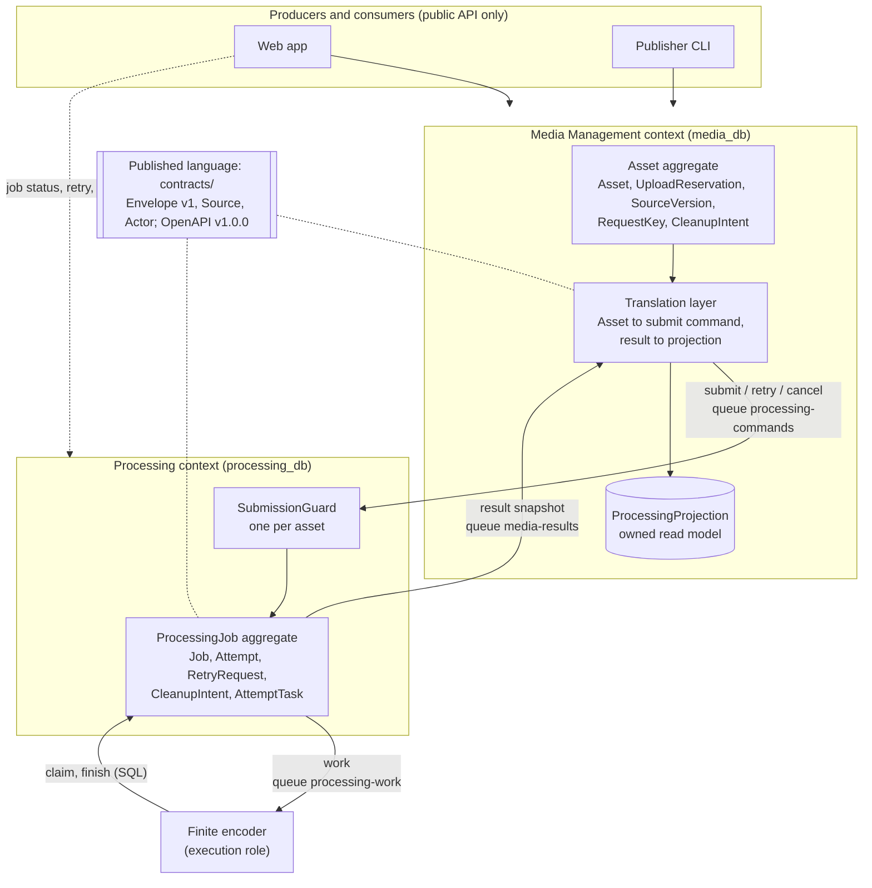

# As-built DDD model (V1)

Backs report section 3.1.4 (Platform Design) and slide 3c. Closes #187. This describes the code at
the commit that adds this file. The proposal's Figure 3 and contract table describe the **pre-AWS**
design (synchronous REST `SubmitJob`, Redis/RQ, service token); the differences are in
[section 8](#8-delta-from-the-proposal). Decisions and trade-offs are in [decisions.md](decisions.md),
nodes and persistence in [views.md](views.md).

Evidence labels: **[Code]** read from source or the rendered template only, **[Local]** exercised
by tests on real PostgreSQL 16 and FFmpeg with Moto standing in for S3/SQS (not AWS), **[AWS]**
recorded in the live receipt
[`cloud-proof-r1017b.json`](../execution/aws/v1/evidence/cloud-proof-r1017b.json) (run on
2026-10-17; the stack has since been torn down).

## 1. Context map

Rendered: [`img/ddd-context-map.svg`](img/ddd-context-map.svg).

## 2. Ubiquitous language

| Term | Meaning in this system | Owning context | Enforced by |
|---|---|---|---|
| Owner | An account (`users.id`); the only principal that may read, retry, edit, delete or play its assets. Processing holds the id as a plain UUID, never a foreign key. | Media | `media/models.py:User`; `media/authorizer.py:authorize` (JWT + current user row); `contracts/v1.py:Actor` (trusted identity); `processing/service.py:owned_jobs` (filter on the Processing side) |
| Asset | An owned video and the edit operations to apply. Its UUID is also the public `job_id`. | Media | `media/models.py:Asset`; `media/repositories/assets.py:get_asset` (owner filter, 404 otherwise) |
| Upload reservation | A 15-minute, owner-scoped grant to write one S3 object under a server-chosen key. | Media | `media/upload_models.py:UploadReservation`; `media/services/direct_intake.py:reserve` |
| Source revision | The immutable bytes Processing may read: `{bucket, key, version_id, sha256, size_bytes, content_type}`. Identity is the pinned S3 VersionId. `assets.source_revision` is an integer that is always 1 in V1 code. | Media (defines), Processing (consumes) | `contracts/v1.py:Source.from_dict`; `direct_intake.py:source_for_asset`; CHECK `ck_upload_reservations_finalized_has_pin` |
| ProcessingJob | The unit of work for one asset: operations, status, outputs. Exactly one per asset. | Processing | `processing/models.py:Job` (`asset_id` unique); `processing/messaging.py:handle_command` |
| Attempt | One try at a job. Numbered, never reused; a retry creates a new one. | Processing | `processing/models.py:Attempt` (unique `job_id, attempt_number`); `messaging.py:_retry_locked` |
| Lease | Time-limited right of one worker to complete one attempt: `lease_token`, `lease_expires_at`, `deadline_at`, judged on the database clock. | Processing | `processing/lifecycle.py:claim`, `heartbeat`, `finish`, `live` |
| Output descriptor | `{kind: primary or hls_manifest, object_key, media_type, size_bytes, sha256}`. | Processing (produces), Media (re-validates) | `processing/schemas.py:Output`; `lifecycle.py:finish`; `media/projections.py:apply_result` |
| Submission guard | Per-asset row that serialises submit, retry and cancel and records cancel-before-submit. | Processing | `processing/models.py:SubmissionGuard`; `messaging.py:_guard` |
| Tombstone | Deletion as state: `assets.deleted_at` plus a cleanup intent in Media, `deleted_at` on guard and job in Processing. | Both | `media/services/v1_lifecycle.py:tombstone`; `processing/messaging.py:_cancel_locked` |
| Command | A request from Media to Processing: `submit`, `retry`, `cancel`. | Media (producer) | `contracts/v1.py:PRODUCERS`; `delivery/sqs.py:PRODUCERS, LANES` |
| Work | The message that wakes an encoder for one attempt. | Processing | `processing/messaging.py:envelope`; `processing/worker/sqs.py:decode_work` |
| Result | A full state snapshot of a job at a `state_version`, sent to Media. | Processing (producer) | `processing/messaging.py:emit_state`; `media/projections.py:apply_result` |
| Projection | Media's own copy of Processing state, one row per asset. | Media | `media/projection_models.py:ProcessingProjection` |
| Operator | In the application: `users.role = 'operator'`, admin routes only. In operations: the person running the session and release CLIs. | Media / platform | `media/api/deps.py:operator_user`; `scripts/aws/v1/session.py` |

## 3. Bounded contexts

| Context | Owns | Does not own |
|---|---|---|
| **Media Management** | Accounts and login, ownership, upload intake, source versions, playback signing, the public job view, deletion and source cleanup. Database `media_db`, role pair `media_runtime` / `media_migrator`. | Job state, attempts, leases, outputs. It only holds a projection. |
| **Processing** | Jobs, attempts, leases, retry and cancel, output descriptors, late-output cleanup, encoder claims. Database `processing_db`, roles `processing_runtime` / `processing_migrator`. | Users, assets, source bytes (read-only S3 grant), playback links. |

Why Identity and Delivery are inside Media (the proposal's reasoning, checked against the code):
every playback or retry decision needs the owner and the asset together, and in `media_db` they
are one transaction: `assets.owner_id`, `upload_reservations.owner_id` and `request_keys.owner_id`
are foreign keys to `users` (`media/models.py`, `media/upload_models.py`). The authorizer, the
upload grant and the playback signer all read those same rows. Splitting Identity or Delivery out
would turn those joins into cross-service calls without giving either piece its own rules or its
own release cadence. **[Code]**

Why these are execution roles, not services. A service here means its own data, its own rules and
its own release unit. The following have none of these; each runs one context's code under that
context's database role, image and IAM role (`scripts/aws/v1/definitions.py`, `privileges`):

| Execution role | Runs | Belongs to |
|---|---|---|
| API Gateway routes (`/api/media/*`, `/api/processing/*`) | Routing only | Neither |
| Authorizer Lambda `MediaAuthorizer` | `media/authorizer.py` against `users` | Media (reads Media's table) |
| Command consumer `ProcessingCommands` | `processing/handlers.py:command_handler` | Processing |
| Result consumer `MediaResults` | `media/handlers.py:result_handler` | Media |
| Repair and event handlers `MediaRepair`, `ProcessingRepair`, `ProcessingEcsEvents`, `ProcessingS3Events` | Outbox publish, expiry, cleanup | Media or Processing |
| Finite Fargate encoder | `processing/worker/sqs.py` using Processing's runtime role | Processing |

Image evidence supports it: `deploy/v1/check_runtime.py` fails a build if the opposite domain package or any module under `legacy/` is importable. Release evidence supports the grouping too: the release baseline reports 4 Media functions and 5
Processing functions moving together per owner, with the peer unchanged
(`cloud-proof-r1017b.json`, #65 `baseline`, `promote-good`). **[AWS]**

## 4. Aggregates and the invariants the code enforces

### 4.1 Asset (Media)

Root `Asset`; `UploadReservation` and `SourceVersion` pin its source, `RequestKey` makes edit and
retry idempotent, `CleanupIntent` and `StagedObject` carry deletion and orphan cleanup.

| Invariant | Enforced in |
|---|---|
| Only the owner can read or change an asset; others get 404. Admin routes pass no owner and require the operator role. | `repositories/assets.py:get_asset`; `api/deps.py:operator_user`; reservation lookup by `(id, owner_id)` in `direct_intake.py:finalize` |
| Reserve is idempotent per `(owner_id, request_id)`; same key with a different body is 409. | unique constraint on `upload_reservations`; `direct_intake.py:reserve` (request hash) |
| Type and size: allowed video types, at most 100 MiB, and the stored bytes must match the declared size, SHA-256 and magic bytes. Unversioned buckets are refused. | `ReserveRequest`; `media/services/storage.py:verify_direct_upload` |
| An adopted source cannot change. A finalized reservation must carry a real VersionId, and a reader whose key differs from the asset gets 409. | CHECK `ck_upload_reservations_finalized_has_pin` (migration `media_0007`); `direct_intake.py:source_for_asset` |
| Adopting a source and staging its `submit` command are one commit. | `direct_intake.py:finalize` calls `messaging.enqueue_submit` inside the adoption transaction |
| Retry only when the projection says `failed`; edit only from a `done` parent. | `v1_lifecycle.py:retry`, `edit` (409 otherwise) |
| Delete is a tombstone plus a `cancel` command in one transaction. Source bytes are removed only after Processing's acknowledgement is consumed. | `v1_lifecycle.py:tombstone`; `projections.py:confirm_cancellation`; `media/recovery_v1.py:cleanup_tombstones` (selects `processing_deleted_at IS NOT NULL`) |
| A result can never move the projection backwards or apply to another job, source or attempt namespace. | `projections.py:validate_transition`, `apply_result` (key must start `jobs/{job}/attempts/{attempt}/`; `done` needs exactly one primary output) |

### 4.2 ProcessingJob with its Attempts (Processing)

Root `Job` (unique `asset_id`); children `Attempt`, `RetryRequest`, `CleanupIntent`, `AttemptTask`,
`JobMessaging` (the version counter). `SubmissionGuard` is keyed by asset and is locked first.

| Invariant | Enforced in |
|---|---|
| One job per asset. A repeated identical submit is a no-op; a different request for the same asset is 409. | `Job.asset_id` unique; `messaging.py:handle_command` (guard lock, `request_hash`) |
| Owner-only. A foreign owner gets 404; commands must match the stored owner, asset, job and source; actors come only from the Gateway adapter and retry or cancel need the `publisher` role. | `messaging.py:validate_identity`, `_guard`; `processing/auth.py:gateway_actor`; `v1_api.py:publisher, owned_pair` |
| Transitions are one-way per attempt: `queued` to `processing` to `succeeded`, `failed` or `abandoned`; `cancelled` from `queued` or `processing`. A job returns to `queued` only through a **new** attempt created by retry. The database constrains the value sets only; the order is enforced by code that locks Job then Attempt. | CHECKs `ck_jobs_status`, `ck_attempts_state`; `lifecycle.py:claim`, `finish`; `recovery.py:interrupt`; `messaging.py:_retry_locked`, `_cancel_locked` |
| A valid lease is needed to start and to finish. Claim requires job and attempt `queued`, the attempt current, and the guard not deleted. Finish and heartbeat require the same `lease_token`, an unexpired lease and deadline, judged by `clock_timestamp()`. | `lifecycle.py:claim`, `live`; `messaging.py:claim` (`authorize`) |
| One finite task can claim at most one attempt, and an attempt binds to one task. | `AttemptTask` (PK `attempt_id`, unique `task_name`); `TaskBindingError` |
| Retry only from `failed`, idempotent per `(job_id, request_id)`. A retry that arrives before its submit is rolled back (including its inbox row) so a reordered delivery can succeed later. | `RetryRequest` unique; `messaging.py:handle_command`, `_retry_locked` |
| Cancel before submit is permanent: the guard is tombstoned and a later submit is accepted as a no-op, not resurrected. | `messaging.py:handle_command` (`guard.deleted_at`) |
| Outputs are accepted only with exactly one primary, keys under `jobs/{job}/attempts/{attempt}/`, and size and SHA-256 present. | `lifecycle.py:finish` |
| Every state change and its messages commit together, and `state_version` only increases. | `messaging.py:emit_state` (`JobMessaging.state_version += 1`, stages outbox rows) |

Local proof for the Processing rules: `tests/v1/test_messaging_sql.py` (duplicate and conflicting
submit, cancel-before-submit, cross-owner rejection, stale completion, task binding) on real
PostgreSQL. **[Local]** Cross-database refusal at the role level: `cross-database` step, #63.
**[AWS]**

## 5. Commands and events (the real messages)

All five message kinds share one envelope, validated by `contracts/v1.py:Envelope.from_dict`:
`schema_version` (an accepted version: 1 today, plus N-1 once there is one), `message_id`, `kind`, `owner_id`, `asset_id`, `job_id`, `attempt_id`,
`state_version`, `source`, `payload`. Payload keys and values that look like secrets or URLs are
rejected (`_safe_payload`), so queues never carry bytes, credentials or signed URLs.

| Message | Queue (and DLQ) | Producer | Consumer | Required fields and payload |
|---|---|---|---|---|
| `submit` | `processing-commands` | Media outbox, sent by the `MediaRepair` Lambda | `ProcessingCommands` Lambda | `source`; `payload.operations` |
| `retry` | `processing-commands` | Media | `ProcessingCommands` | `source` (stored source); optional `payload.request_id`, else `message_id` |
| `cancel` | `processing-commands` | Media | `ProcessingCommands` | `job_id`, `source` may be null (cancel before submit) |
| `work` | `processing-work` | Processing outbox | Finite Fargate encoder (polls SQS) | `job_id`, `attempt_id`, `source`; `payload.operations`; `message_id` is stable per `(attempt, state_version)` |
| `result` | `media-results` | Processing outbox | `MediaResults` Lambda | `payload.status` (`queued`, `processing`, `done`, `failed`, `cancelled`), `attempt_number`, `outputs[]`, `error`; special no-job acknowledgement for cancel-before-submit |

Producer authority is not in the schema. It is the queue policies (`DenyUnlistedProducers`,
`DenyUnlistedConsumers` in `definitions.py`) plus `delivery/sqs.py:PRODUCERS, CONSUMERS`. A direct
`SendMessage` from outside the listed roles returned 403 on all three queues. **[AWS]**
(`sqs-direct-send`, #63)

**Domain events.** V1 has no separately named events such as `JobStarted`. The `result` message is
a state snapshot with a monotonically increasing `state_version` (event-carried state transfer).
Each claim, completion, failure, retry or cancel produces one snapshot.

**Outbox and inbox.** Each database has `message_inbox(message_id, body_hash, received_at)` and
`message_outbox(message_id, body_hash, queue, body, next_try_at, tries, claim_token, sent_at,
last_error)`.

| Step | Code |
|---|---|
| Stage a message in the same transaction as the state change | `delivery/sql.py:stage` |
| Dedupe on receipt; same id with different content raises `MessageConflict` | `delivery/sql.py:accept` (called inside the domain transaction) |
| Send after commit: claim a due row with `SKIP LOCKED`, send outside the lock, acknowledge fenced by `claim_token`; sent rows are re-armed for replay | `delivery/sql.py:publish_due` |
| Consumers return only after commit; Lambda deletes successful records, failures go back for redrive | `delivery/sqs.py:consume_batch` |
| Lost work is recreated from SQL | `processing/recovery_v1.py:repair_work` |

Local proof: `tests/v1/test_messaging_sql.py`, `tests/v1/test_delivery.py`,
`tests/v1/test_domain_sql_boundary.py`. **[Local]** A poison message reached the DLQ after 2101 s
(consistent with 5 receives at a 420 s visibility timeout) and was removed. **[AWS]** (`dlq`, #64)

**Owned projection.** Media answers `GET /jobs` from `processing_projections` and never queries
Processing (`media/projections.py:public_job`, `read_job`; docstring of
`media/projection_models.py`). Applying a result is guarded by `validate_transition`: an older
`state_version` is ignored, the same version with different content is a 409, an older attempt is
ignored, and a terminal attempt cannot change. Media also maps Processing's statuses to its own
public one: before the first result the asset shows `accepted`, a state Processing never emits.

## 6. Context map relationships

| Relationship | As built |
|---|---|
| Customer / supplier | Media is the customer: it states what to process (`submit`, `retry`, `cancel`). Processing is the supplier and owns the answer (`result`). Neither calls the other synchronously. |
| Anti-corruption (Media side) | Media never forwards its `Asset` rows. It builds a `submit` envelope from the asset plus its pinned source (`messaging.py:enqueue_submit`, `v1_lifecycle.py:command`, `direct_intake.py:source`) and turns each `result` into its own projection and public status (`projections.py:apply_result`, `public_job`). |
| Translation (Processing side) | A command becomes `Job`, `Attempt` and `SubmissionGuard` rows (`messaging.py:handle_command`). Processing does not import any Media package, which its V1 API module states (`processing/v1_api.py` docstring). |
| Published language | `contracts/v1.py` (envelope, source, actor) and `contracts/gateway.py` (Gateway adapter), the OpenAPI documents `docs/api/media.openapi.json` and `processing.openapi.json` (both `1.0.0`), and the frozen fixtures `tests/v1/fixtures/contracts/*.json`. A contract change must edit the fixtures in the same pull request ([`contracts/README.md`](../../contracts/README.md)). |
| Versioning | `contracts/README.md` sets the policy: changes are additive within a version; consumers accept N and N-1 (`accepted_versions()`) and ignore unknown fields; producers emit `EMIT_VERSION`, which trails `SCHEMA_VERSION` until every consumer reads the new one. Each consumer owns a fixture file (`tests/contracts/consumers/`) and the producer's tests check against it. `contracts/` is copied into both images, so it is a **shared kernel**; a breaking change takes two releases. The release compatibility gate is still an operator attestation. Only version 1 exists, so N-1 is tested by raising the version in tests. **[Local]** |
| Failure isolation | Neither context calls the other, and `deploy/v1/check_runtime.py` asserts that each image lacks the opposite domain package and every legacy peer module. A proof that Media keeps accepting uploads while Processing's command consumer is off exists as `evidence isolation` (`scripts/aws/v1/proof/isolation.py`, #196) and passed on AWS in `r1018b` for the consumer only (the Processing API stayed up). |

## 7. Platform view

| Role | Who or what, as built | Evidence |
|---|---|---|
| Seed | An owned video asset and its processing job (`Asset` plus `Job`, linked by `asset_id`). | models above |
| Producers | The web app (`frontend/app.js`: reserve, direct S3 POST, finalize) and the Publisher CLI (`publisher/`: public API only, no service imports or DB credentials). The CD smoke does not use Publisher, because in V1 an operator must start the encoder; it uses the evidence harness instead (`deploy-runbook.md`, "CD workflow"). | `publisher/README.md`; `frontend/app.js` |
| Consumers | Owners playing their own output: presigned MP4 (range requests answered 206) and HLS (playlist through Media, segments by 307 to a presigned S3 URL). The Gateway contract accepts a read-only `viewer` role, but Media never issues it, so there is no separate viewer identity in V1. | `media/api/v1_hls.py`; `contracts/v1.py:Actor`; `media/authorizer.py:gateway_role` (always `publisher`); #63 `direct-upload-e2e` **[AWS]** |
| Integrators | Developers using the two OpenAPI documents, `contracts/` and the Publisher as reference client. | `docs/api/`, `contracts/` |
| Operators | The team, through the session, release and evidence CLIs and the CD workflow: open and close a session, start up to 3 encoders, promote or restore one owner's release. | `scripts/aws/v1/session.py`, `release.py`; `.github/workflows/cd.yml` |

## 8. Delta from the proposal

| Proposal (Figure 3 and contract table) | As built | Why / evidence |
|---|---|---|
| `SubmitJob`: synchronous REST, service token, idempotent on `asset_id` | Asynchronous `submit` command on SQS, idempotent through the submission guard, a deterministic message id for edit-derived assets, and the inbox | Removes the cross-service call from the upload path; AD-11 |
| `GetJob` / `ListJobs`: Media calls Processing with the forwarded owner | Media reads its own projection. Processing also serves owner-filtered `GET /jobs` to clients directly through the Gateway. | AD-11; `media/projections.py` |
| `RetryJob`: Media calls Processing, allowed from `failed` | `retry` command; precondition checked on Media's projection and again on the Processing job | `v1_lifecycle.py:retry`; `messaging.py:_retry_locked` |
| Service token plus forwarded owner identity on a private network | Gateway-trusted `Actor` from the Media authorizer, queue policies scoped by IAM role; Processing holds no Media credential | AD-09; `definitions.py` (JWT parameter only on Media roles) |
| Asset `uploaded -> submitted`; upload multipart through the API | Asset exists only after a verified direct-to-S3 upload; "submitted" is set when the first result is projected, not when the command is sent | AD-14; `projections.py:apply_result` |
| `SubmitJob` carries a source URL | Envelope carries an immutable `Source` descriptor (bucket, key, VersionId, SHA-256); no URL, no bytes | `contracts/v1.py:Source`, `_safe_payload` |
| `JobStatus` carries an output URL | `result` carries output keys; Media signs the URL at read time | `media/services/storage.py:sign_output` |
| Output: MP4 plus HLS 360/480/720 | Same, but the ladder never exceeds the source height (`variants_for`); HLS is best effort and a failure does not fail the job | `media_engine/hls.py`; `processing/worker/tasks.py:pipeline` |
| Job lifecycle `queued, processing, done, failed` | Adds `cancelled` (attempt and projection) and attempt state `abandoned` for expired leases | `processing/models.py` |
| Not in the proposal | `edit` (clip, crop, scale, convert) creating a derived asset; `DELETE` as tombstone; operator `admin` routes | `v1_lifecycle.py:edit`, `tombstone`; `media/api/v1_jobs.py` |
| Two aggregates, no FK across services | Same. No table or key crosses databases. | `media/models.py`, `processing/models.py`; `cross-database` **[AWS]** |

Leftovers from the earlier design still present in the V1 schema, noted so nobody mistakes them for
V1 behaviour (retained on purpose, see [views.md](views.md) section 4.5): the Media tables `retry_intents` and the `assets.submission_state`, `submit_attempts`,
`next_submit_at` columns (V1 writes only `submission_state`, `submitted_at` and `last_submit_error`, from `apply_result`), and the Processing
columns `jobs.source_url` and `source_url_expires_at` (V1 writes an empty string and the current
time in `handle_command`).
