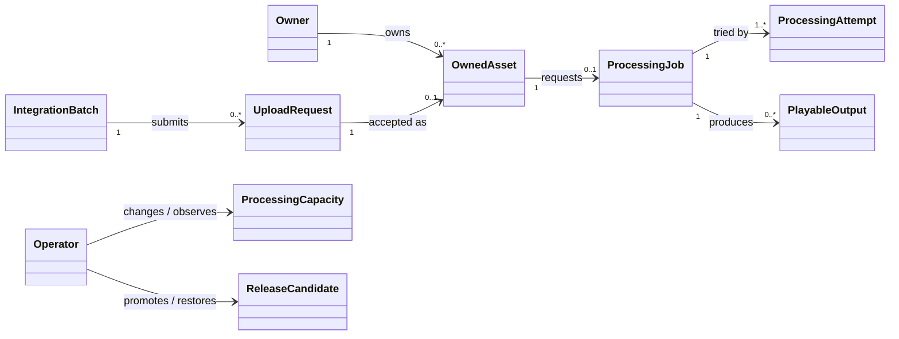
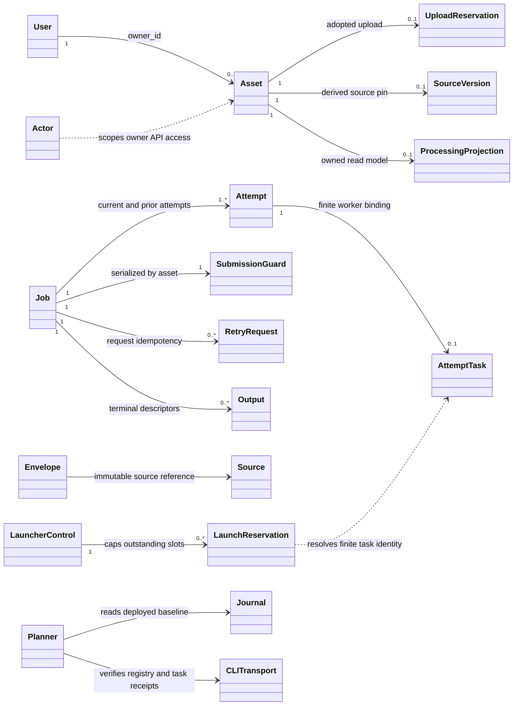
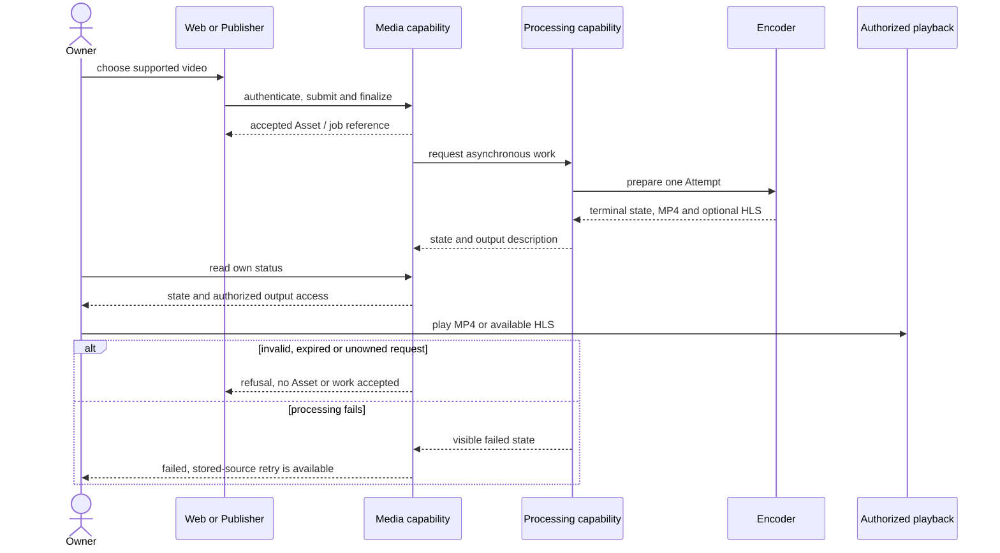
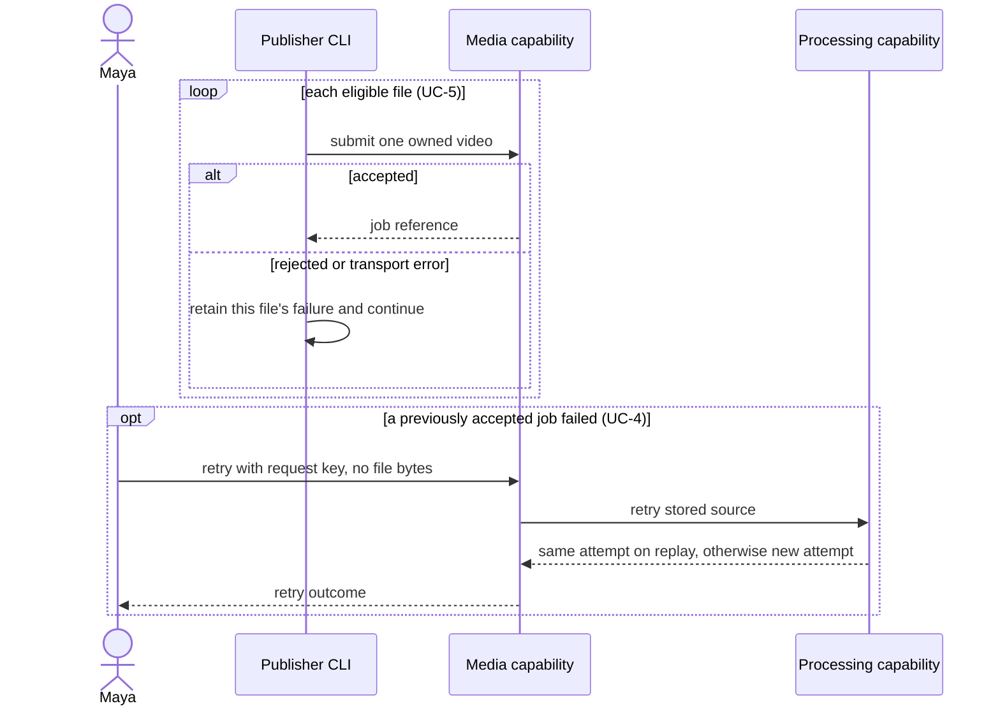
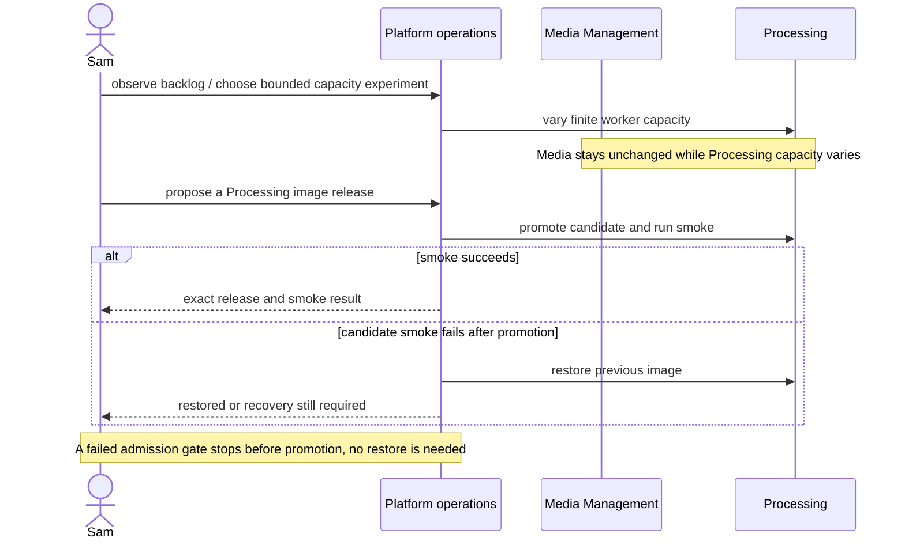
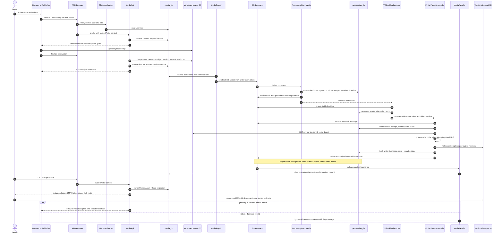
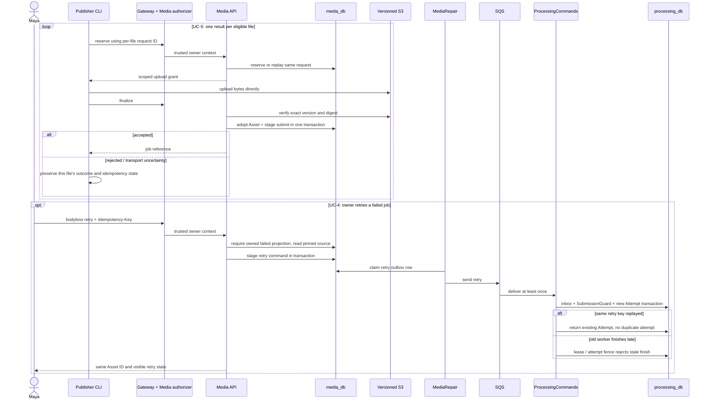
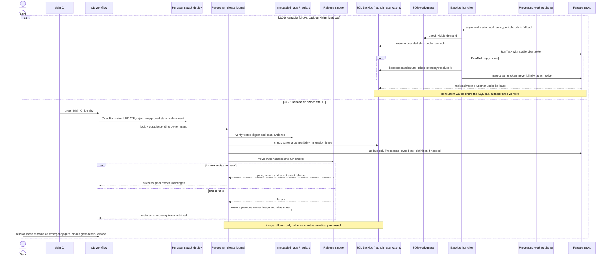

# Flickpond use-case and design catalogue

Reusable engineering reference for the seven in-scope use cases. This is not the final report or
presentation. It describes the service code frozen in `daee44b61a6e8eef3f62505df69f8bfd076d68b8`
and the persistent V2-live operating mode recorded in the release manifest. Main at
`f9ce3b949826a7f329839cd7dc2b3a48464e1661` contains documentation-only changes after that runtime
freeze. **Final engineering status: PENDING integration**; the parent replaces this status after
integrated verification. Tests cited below were read for their assertions; this task did not run them.

Maya, Arun, Jules and Sam are fictional planning personas, not interviewed users, application roles
or authorship evidence ([persona source](../../project-roadmap/business-scope.json)). Maya's course
context does not create shared accounts, student access or an LMS. Sam is an operator, not a product
administrator. The three sample proposals in the attached course bundle contribute no Flickpond
features or numerical targets.

## Use cases

### UC-1 — Register, log in and upload an owned video

**Actors/channels:** Maya or Arun as owner; Jules through Publisher; web or Publisher CLI.

- **Pre:** account exists or is created; caller owns a supported video ≤100 MiB.
- **Normal:** authenticate; Media reserves an owner-scoped S3 grant; client uploads directly to versioned S3; finalize verifies bytes and pins the VersionId, then atomically adopts the Asset and stages `submit`; return `202` and Asset/job ID.
- **Exceptions:** anonymous, unsupported type, declared oversize, wrong owner, changed request or expired reservation is refused. Missing, truncated, changed or unversioned bytes are not adopted and enqueue no work. S3 refusing an oversized body can surface as `503` at finalize on the frozen release (#271); the limit still holds. Reusing a request key with changed input conflicts.
- **Post:** one owned Asset, immutable verified source and one durable command; replay returns the same Asset without a second command.
- **Tests:** [`test_publisher_direct_post_encode_projection_and_ownership`](../../tests/v1/test_workflow_acceptance.py#L19), [`test_finalize_pins_the_exact_version_it_verified`](../../tests/v1/test_direct_intake_s3.py#L237), [`test_wrong_owner_cannot_finalize_or_observe_a_reservation`](../../tests/v1/test_direct_intake_s3.py#L253), [`test_missing_object_is_retryable_not_adopted`](../../tests/v1/test_direct_intake_s3.py#L299). The full workflow test requires a local runtime attachment; it marks browser rendering and AWS IAM NOT_RUN.

### UC-2 — Process video into playable outputs

**Actors/channel:** platform worker for Maya or Arun; asynchronous background processing.

- **Pre:** UC-1 committed a valid source and command; Processing has a queued Attempt and available worker capacity.
- **Normal:** consume command; create Job/Attempt; claim under DB-clock lease and task binding; verify pinned source; probe/encode primary MP4 and optional HLS; commit terminal state/result before work ACK; update Media projection.
- **Exceptions:** duplicates/reordering are fenced. Dependency, FFmpeg or deadline failure becomes visible `failed`; expired lease does not auto-requeue. HLS/probe failure can omit HLS while retaining MP4. Poison messages follow DLQ policy.
- **Post:** success has exactly one primary and optional HLS; failure is visible; output keys are scoped to job/attempt.
- **Tests:** [`test_success_output_namespace_validation_and_atomic_terminal_result`](../../tests/v1/test_messaging_sql.py#L322), [`test_a_failing_ladder_leaves_the_mp4_and_reports_no_ladder`](../../tests/test_worker_ffmpeg.py#L157), [`test_publisher_direct_post_encode_projection_and_ownership`](../../tests/v1/test_workflow_acceptance.py#L19).

### UC-3 — Track status and access playback

**Actors/channels:** Maya or Arun as owner-viewer; browser or Publisher CLI.

- **Pre:** caller is authenticated and owns the Asset; state may be queued, processing or terminal.
- **Normal:** Media reads the owner-filtered Asset and local Processing projection; returns status and, when done, a short-lived signed MP4 capability. Optional HLS playlist is served through Media and segments redirect to signed S3 URLs.
- **Exceptions:** foreign and unknown IDs are not found; stale/conflicting results cannot replace a newer projection. Expired signed URLs require a fresh authorized read; HLS may be absent.
- **Post:** owner-only status and expiring playback access; read has no domain mutation.
- **Tests:** [`test_local_status_hls_and_signed_range_capability`](../../tests/media/test_v1_projection.py#L151), [`test_wrong_owner_source_job_and_output_rejected`](../../tests/media/test_v1_projection.py#L130), [`test_publisher_direct_post_encode_projection_and_ownership`](../../tests/v1/test_workflow_acceptance.py#L19).

### UC-4 — Retry from the stored source

**Actors/channels:** Maya or Arun; web or Publisher CLI.

- **Pre:** caller owns a failed job and its accepted source remains available.
- **Normal:** send bodyless retry with idempotency key; Media checks owner, failed projection and pinned source; Processing serializes by SubmissionGuard and creates a new Attempt. Replay returns that attempt; no bytes are uploaded again.
- **Exceptions:** foreign/deleted job is not found; non-failed state or changed request conflicts; stale old-attempt worker/result cannot finish or overwrite the current attempt.
- **Post:** source identity is unchanged and one new Attempt is queued, or an explicit safe error remains visible.
- **Tests:** [`test_publisher_retry_reuses_the_stored_source_after_a_transient_encode_failure`](../../tests/v1/test_workflow_acceptance.py#L111), [`test_retry_idempotency_and_cancel_fence_old_and_current_attempts`](../../tests/v1/test_messaging_sql.py#L290), [`test_retry_and_cancel_are_commands`](../../tests/media/test_v1_projection.py#L220). The workflow test deletes the local source before retry.

### UC-5 — Bulk-publish a folder and report results

**Actors/channel:** Maya owns the content; Jules integrates Publisher; Publisher CLI.

- **Pre:** credentials and a folder of owner-held demonstration videos.
- **Normal:** authenticate; submit eligible files through the published API; continue through the batch and report one outcome/job reference per file. `status`, `output` and bodyless `retry` share the public contract.
- **Exceptions:** one invalid/refused file does not hide later successes; transport uncertainty preserves accepted IDs and request keys; sensitive server error text is withheld.
- **Post:** per-file outcomes survive the command; any failure makes the batch exit nonzero without losing successful references. Publisher has no service/database imports or DB credentials.
- **Tests:** [`test_cli_mixed_batch_keeps_every_file_outcome`](../../tests/publisher/test_publisher.py#L223), [`test_module_entry_and_import_boundary`](../../tests/publisher/test_publisher.py#L359), [`test_public_schema_conformance_and_explicit_ca`](../../tests/publisher/test_publisher.py#L380).

### UC-6 — Scale processing capacity independently

**Actor/channel:** Sam operates capacity and reviews results; no product operations dashboard.

- **Pre:** persistent environment enabled with durable Processing backlog; Media remains independently deployed.
- **Normal:** V2-live work sends wake the backlog launcher; a one-minute schedule is fallback. It checks SQL and visible SQS demand, reserves slots and starts finite Fargate tasks up to three. V1 1/2/3 experiments and V2-live cap-3 evidence are separate.
- **Exceptions:** no visible queue work means no launch; ambiguous RunTask replies retain their reservation until resolved; uncertain inventory/database fails closed; excess work stays queued. This is bounded task launch, not a general autoscaling service.
- **Post:** Processing capacity varies without changing Media; concurrent triggers stay within three reserved/running slots.
- **Tests:** [`test_always_on_concurrent_wakes_never_exceed_the_cap_without_a_session_end`](../../tests/v1/test_launcher_sql.py#L270), [`test_a_backlog_of_ten_launches_at_most_three_and_later_ticks_add_none`](../../tests/v1/test_launcher_sql.py#L229), [`test_a_lost_runtask_response_is_resolved_by_token_without_a_second_launch`](../../tests/v1/test_launcher_sql.py#L317). See [results](../results/actual-vs-target.md#scaling) and [manifest](../release/demo-release-manifest.md#worker-cap-resources-limits).

### UC-7 — Release Processing and demonstrate rollback

**Actor/channel:** Sam through CD and operator tools.

- **Pre:** candidate has green required CI, immutable image, applicable scan/migration evidence and a retained previous image.
- **Normal:** after initial deploy, green Main CI may update the persistent stack; only changed owners release. Validate candidate, move that owner's aliases/task definition, run smoke and adopt release; Media is unchanged for a Processing-only release.
- **Exceptions:** failed gates stop promotion; failed smoke restores previous image; failed restore leaves a durable recovery intent. Migrations are not reversed automatically. Session close defers release. Recorded cloud bad-candidate restore is source `7928b7c`, not frozen `daee44b`.
- **Post:** success records owner image and smoke; failure records restore or unresolved recovery. Release and smoke timing are separate.
- **Tests:** [`test_owner_release_applies_a_real_migration_and_failed_candidate_restores_aliases`](../../tests/v1/test_release_acceptance.py#L31), [`test_pending_intent_before_mutation_and_real_bad_candidate_restore`](../../tests/aws/test_aws_release.py#L58), [`test_owners_are_released_only_when_their_images_build_inputs_changed`](../../tests/aws/v1/test_persistent_environment.py#L184), [`test_success_promotes_exact_image_and_persists_only_processing`](../../tests/dev/test_release.py#L205). Offline tests do not prove a live `daee44b` rollback.

## Shared analysis class model

Conceptual analysis objects only. This view explains the problem domain; it is not a recovered,
historical UML artifact and does not claim these names were used in the original analysis.

## Common implemented design class model

One shared design view for UC-1–UC-7. It names the current domain and contract types; adapters and
transaction rules are mapped below. Full persistence detail is reused from the existing
[Media schema diagram](img/views-er-media.svg) and
[Processing schema diagram](img/views-er-processing.svg), with descriptions in
[views.md §4](views.md#4-persistence-design). This diagram intentionally does not restate every table
or column.

`User`, `Asset`, reservations, pins, projections, Jobs and Attempts persist in their owning database;
`Actor`, `Envelope`, `Source` and `Output` are contract/value types. `ProcessingProjection` is Media's
copy, not a shared cross-database ORM object. `Actor` is the API identity context; it is not nested
inside the queue `Envelope`. The schema diagrams above remain the canonical table views.
`LauncherControl` and `LaunchReservation` are Processing-owned SQL types. `Planner`, `Journal`
and `CLITransport` are operator-tool classes; release transitions themselves are functions in
`scripts/aws/v1/release.py`, not another domain service or an invented coordinator class.

## Analysis-to-design mapping

| Analysis responsibility | Implemented design choice | Why / invariant | Source and schema |
|---|---|---|---|
| Owner submits an Asset and follows its Job | Media owns `User`, `Asset`, `UploadReservation`, `SourceVersion` and a local `ProcessingProjection`; Processing owns `Job` and `Attempt` | Two logical databases/role sets on one Aurora cluster; cross-context IDs are UUID values, never cross-database foreign keys. The cluster remains one failure/capacity boundary. | [`ddd.md` §§2–4](ddd.md#2-ubiquitous-language); [Media](img/views-er-media.svg); [Processing](img/views-er-processing.svg) |
| Owner identity and authorization | Media authorizer checks the current user row and cookie; API Gateway passes a versioned trusted `Actor`; the Gateway adapter strips public owner/role headers. Processing filters by the trusted owner and role. | No shared JWT secret or caller-controlled owner header at Processing; no third identity service. | `media/authorizer.py`, `contracts/v1.py`, `contracts/gateway.py`, `processing/auth.py`; [authorization tests](../../tests/v1/test_contract_fixtures.py#L393) |
| Upload bytes and source identity | Browser/Publisher uses a scoped presigned S3 POST; finalize verifies bytes outside SQL row locks and pins the exact S3 VersionId. | Byte transfer does not pass through Lambda/API; finalized source cannot be replaced by replaying an unexpired grant. | `media/services/direct_intake.py`, `media/services/storage.py`, `contracts/v1.py`; [upload tests](../../tests/v1/test_direct_intake_s3.py#L201) |
| Cross-context asynchronous work | Each domain writes an outbox row in the same local transaction as its state change. Repair publishers claim/commit a short reservation, send through the SQS adapter outside SQL locks, then acknowledge only if the claim token still matches. | SQL and SQS are not one atomic resource. Delivery is at-least-once; retained sent rows and SQL work repair cover lost sends/queue retention gaps. | `delivery/sql.py`, `delivery/sqs.py`, `media/handlers.py`, `processing/handlers.py`; [AD-11](decisions.md#ad-11-sqs-with-sql-outbox-and-inbox-replaces-redisrq-and-synchronous-submitjob) |
| Consumer deduplication and state ordering | Inbox stores `message_id` plus canonical body hash in the consumer's DB transaction. Same ID/body is a no-op; same ID/different body conflicts. Lambda ACK follows commit; worker deletes SQS work only after durable claim/finish work. | Standard SQS may duplicate and reorder. Projection `state_version`, attempt ID/number, SubmissionGuard and live lease token reject stale transitions. This is not exactly-once delivery. | `delivery/sql.py`, `contracts/v1.py`, `media/projections.py`, `processing/messaging.py`, `processing/lifecycle.py`; [message tests](../../tests/v1/test_messaging_sql.py#L168) |
| Retry, worker failure and output | Retry is a command over the pinned source and creates a new Attempt only from failed state. A DB-clock lease and task binding fence a worker; lease expiry yields visible failure, not automatic retry. | Avoid duplicate terminal writes and unintended reuse of output from an older attempt. HLS remains optional. | `media/services/v1_lifecycle.py`, `processing/messaging.py`, `processing/lifecycle.py`; [retry tests](../../tests/v1/test_messaging_sql.py#L262) |
| Integrator and cloud edges | Publisher speaks the public HTTPS/OpenAPI contract; Gateway, S3, SQS, Aurora and ECS interactions stay behind existing modules/adapters. The worker has no queue-send authority; owner IAM roles are separated. | Jules needs no service/database import or credentials. Reuse does not introduce a framework or another business service. | `publisher/`, `contracts/`, `delivery/sqs.py`, `scripts/aws/v1/definitions.py`; [Publisher boundary test](../../tests/publisher/test_publisher.py#L365) |
| Operator capacity and release | SQL-backed launch reservations cap V2-live finite workers at three. CD and release scripts address one owner image family, immutable references, migration compatibility, smoke and image restore; infrastructure is one stack. | Worker capacity and owner code change independently, while both databases and infrastructure still share some failure domains. | `processing/launcher.py`, `scripts/aws/v1/deploy.py`, `scripts/aws/v1/release.py`, [AD-16](decisions.md#ad-16-per-owner-release-and-rollback), [AD-27](decisions.md#ad-27-one-persistent-always-on-environment-updated-in-place-scaling-to-zero-supersedes-ad-19) |

### Actual messaging, lease and release fences

- **Outbox:** `stage` stores the canonical envelope and hash in the domain transaction. `publish_due`
  reserves a row with a claim token, commits, performs network I/O without holding the SQL lock,
  then updates only if that token still owns the row. A lost SQS response may send the same
  `message_id` again. Successful rows remain available for bounded replay; `repair_work` rebuilds
  missing queued work from Processing SQL after the queue retention gap.
- **Inbox:** `accept` inserts the message ID and body hash inside the domain mutation transaction.
  A same-body duplicate is a no-op; conflicting reuse is rejected. The consumer commits inbox,
  domain state and any new outbox messages before Lambda's partial-batch ACK or worker SQS delete.
  Queues are Standard and delivery is at-least-once. Dedupe does not make SQS exactly-once.
- **Transport/adapters:** `contracts/` validates versioned values; `contracts/gateway.py` adapts API
  Gateway identity/events to the ASGI apps; `delivery/sqs.py` enforces producer/consumer lanes and
  bounded calls; Media/Processing storage modules wrap S3; `publisher/` is a separate public client.
  Producer authority is enforced by IAM and queue policy as well as by adapter validation.
- **Worker lease:** SQL database time determines `lease_expires_at` and `deadline_at`. A current
  attempt must be claimed and bound to one finite task; heartbeat/finish require the same live
  token. The worker renews SQL lease and SQS visibility together. Expired or stopped work becomes
  `abandoned`/`failed`; an owner retry creates a fresh attempt. This does not prove host/AZ recovery
  or zero duplicate output under every failure race.
- **Release fence:** a release journal/lock and durable pending intent precede mutation; candidate
  image and resolved task definitions are pinned and checked; owner and peer identities, migration
  compatibility, smoke result and absolute deadline are checked before completion. A failed smoke
  restores image/alias state; the schema is not rolled back. A failed restore keeps recovery intent
  for an explicit resume. Patch-specific CI admission and scan-parser changes are **pending parent
  verification** and are not claimed here.

## Grouped sequence views

The analysis views use only business concepts. They are explanatory, not historical artifacts. The
implementation views describe the frozen persistent V2-live behavior. Existing detailed V1 sequence
and state diagrams remain in [views.md §5](views.md#5-representative-use-case-upload-process-play) and
are not silently relabeled as V2.

### Analysis sequence: UC-1–UC-3 core workflow

### Analysis sequence: UC-4 and UC-5 retry / integration

### Analysis sequence: UC-6 and UC-7 operations

### Implemented sequence: UC-1–UC-3 upload, process and play

### Implemented sequence: UC-4 and UC-5 Publisher / stored-source retry

### Implemented sequence: UC-6 capacity and UC-7 release

## Three design-problem bundles

The suggested review/explanation owners below come only from the recorded team specialisms in the
[effort ledger](../../project-documentation/effort-ledger.md#specialisms). They are **suggestions,
not verified original authors**. Confirm each person's explanation and contribution with them.
These are real as-built design decisions, not claims that a named GoF pattern was selected. Before
views are explanatory where noted, not historical UML artifacts.

### 1. Bounded cloud capacity and safe per-owner release

**Suggested review/explanation owner:** Guruprasath Gopal — cloud and delivery specialism.

- **Problem:** Keep the environment usable while limiting idle cost and the blast radius of a code
  release. Processing can change without releasing Media, and an ambiguous cloud response must not
  create excess workers or falsely report a successful rollback.
- **Alternatives:** keep per-run stacks and operator-opened sessions; leave one long session open;
  release all owner code with a full stack update; use a mutable image tag; or add a separate staging
  environment. The first options retain slow deploy/teardown; full-stack code release couples the
  domains; mutable tags lose tested identity; staging was out of scope.
- **Before → after structure:** V1 operating mode was a booked/per-run stack with operator-started
  finite batches and teardown. Current V2-live keeps one stack; green Main CI updates it, then only
  owners with changed image inputs use an immutable, per-owner release and smoke. The SQL-backed
  launcher reserves finite worker slots up to three. This is the recorded AD-19/AD-27 change, not a
  claim about the 20 October live state after its manifest read.
- **Behavior:** failed preflight or smoke does not count as promotion. A journal/lock and
  `pending_release` intent precede mutation; the previous image is retained for restore. The SQL
  launch reservation plus stable RunTask token holds a slot through a lost reply. Infrastructure is
  still one shared stack and both logical databases share one Aurora cluster.
- **Implementation and evidence:** `scripts/aws/v1/deploy.py`, `scripts/aws/v1/release.py`,
  `scripts/aws/v1/session.py`, `processing/launcher_trigger.py`, `scripts/ci/cd.sh`; [persistent
  mode tests](../../tests/aws/v1/test_persistent_environment.py#L145), [launcher cap and replay
  tests](../../tests/v1/test_launcher_sql.py#L233), [release restore
  test](../../tests/aws/test_aws_release.py#L58). Retained cloud results are bounded: V2-live
  measured 9 clips at fixed cap 3 only; a frozen-source bad-candidate rollback was not run. The
  per-owner admission/scan patches being handled concurrently remain pending parent verification.

### 2. Durable asynchronous Processing handoff

**Suggested review/explanation owner:** Ibrahim Mammadov — backend services specialism.

- **Problem:** A Media upload must remain accepted if Processing or SQS is temporarily unavailable,
  without creating a Job that has no durable command or publishing work before its state commits.
- **Before → after structure:** The submitted proposal described synchronous Media-to-Processing
  `SubmitJob`, a service token and Redis/RQ. As built, Media DB transaction → Media outbox → SQS
  `processing-commands` → Processing inbox/domain transaction → Processing outbox → work/result
  queues. The alternate proposal design is historical; it is not this runtime's transport.
- **Alternatives:** keep peer HTTP/Redis-RQ; perform an unprotected SQL+SQS dual write from the API;
  or add another broker/workflow service. Chosen outboxes preserve local atomicity and reuse SQS;
  they require repair because SQL-to-SQS itself is not atomic.
- **Behavior:** the API role cannot send to SQS. A repair publisher claims rows and releases SQL locks
  before network I/O. Lost replies may cause duplicate sends. A consumer commits inbox, owned state
  and any follow-on outbox before ACK. Same message ID/body is idempotent; conflicting body is an
  error. Reordering is handled by state-version, attempt, guard and lease fences. `repair_work`
  reconstructs missing queue entries from SQL. A lease timeout marks work visibly failed; user retry
  creates a new attempt rather than hidden automatic requeue.
- **Implementation and evidence:** `delivery/sql.py`, `delivery/sqs.py`, `media/messaging.py`,
  `processing/messaging.py`, `processing/recovery_v1.py`; [lost-send replay
  test](../../tests/v1/test_messaging_sql.py#L168), [SQS emulator end-to-end
  test](../../tests/v1/test_messaging_sql.py#L325), [retry and stale-attempt
  fence](../../tests/v1/test_messaging_sql.py#L262), [AD-11](decisions.md#ad-11-sqs-with-sql-outbox-and-inbox-replaces-redisrq-and-synchronous-submitjob).
  Current delivery is at-least-once, not exactly-once. A 120-second lost-queue-entry AWS bound is
  encoded/tested locally but was not measured in the cited cloud run.

### 3. Trusted owner identity and reusable public contract

**Suggested review/explanation owner:** Nguyen Kim Long — domain, contracts and verification
specialism.

- **Problem:** Jules's independent client and Processing need the same owner decision without trusting
  a caller-supplied owner header or giving Processing Media's JWT secret/user table.
- **Before → after structure:** Proposal-era candidate: private Media-to-Processing HTTP plus service
  token and forwarded owner. As built: session cookie → Media authorizer reads current user/role →
  API Gateway trusted context → Gateway adapter → Processing's owner-filtered API and database role.
  Publisher uses HTTPS/OpenAPI and receives no service/database imports or credentials.
- **Alternatives:** trust `X-Owner-Id`/`X-Role`; distribute the JWT secret and user lookup to both
  services; or create a separate identity provider/service. The chosen boundary keeps account and
  ownership with Media and gives Processing only a validated `Actor` value; IAM and queue policies
  establish producer/consumer authority outside the envelope schema.
- **Behavior:** Gateway strips the public owner/role headers before constructing the ASGI event.
  Processing refuses direct/forged identity and filters by `owner_id`; missing foreign jobs remain
  404. Shared `Envelope`, `Source`, `Output` and OpenAPI values are versioned contracts. Version 1 is
  current; no second live contract version is claimed.
- **Implementation and evidence:** `media/authorizer.py`, `contracts/gateway.py`,
  `contracts/v1.py`, `processing/auth.py`, `processing/v1_api.py`, `publisher/`; [Gateway forged
  header test](../../tests/v1/test_local_gateway.py#L10), [Gateway anonymous denial
  test](../../tests/v1/test_local_gateway.py#L42), [trusted Media-to-Processing owner
  test](../../tests/v1/test_contract_fixtures.py#L484), [Publisher import boundary
  test](../../tests/publisher/test_publisher.py#L365). This explains the boundary design; it does
  not claim the suggested owner wrote the code or test.

## Data lifecycle, security and limits

| Data | Storage / access | Lifecycle and retention | Evidence limit |
|---|---|---|---|
| Accounts and auth | Media DB; bcrypt password hash; secure, HttpOnly, SameSite cookie; JWT secret in SSM SecureString; current role read by Media authorizer | No user-account purge/retention schedule is documented. | Do not infer account deletion or key-rotation policy beyond current code. |
| Uploads and sources | Versioned private S3 source bucket; short-lived presigned POST bound to owner/reservation key, declared type and size; verified size/hash/magic and pinned VersionId | Pending reservations expire after 15 minutes; late writes are rescanned and abandoned reservation rows retire only after a clean scan beyond the one-day horizon. Adopted source is deleted across versions after owner deletion/cancel acknowledgement. | No age-based retention for active accepted media is stated; exact future live object lifecycle configuration is not independently re-read here. |
| Jobs and attempts | Separate `media_db` and `processing_db`, own migration/runtime roles, TLS; both in one Aurora cluster | Asset/job deletion is tombstoned; cancellation and cleanup remove object versions asynchronously. Tombstone/audit-row hard purge policy is not specified. Aurora is configured with one-day backups; a restore drill is not evidenced. | Separate logical databases/roles do not isolate cluster outage or capacity. |
| Outputs | Versioned private S3 output bucket; worker writes attempt-scoped keys; Media issues expiring signed read capability | Attempt cleanup deletes output versions after retirement; no general expiry for successful outputs is documented. | Signed URL lifetime is bounded (default 900 seconds); it is a capability, not a permanent public link. |
| Messages and operations | Three Standard SQS queues and DLQs; SQL inbox/outbox; SecureString credentials; scoped IAM; sanitized logs | Queue retention 7 days, DLQ 14 days; outbox retains sent messages for replay. Function/task logs retain 7 days. | Logs/alarm history and one-day backups do not prove restore, alert response or long-term retention compliance. |

Data/schema links: [Media ER diagram](img/views-er-media.svg), [Processing ER diagram](img/views-er-processing.svg),
[storage keys and cleanup rules](views.md#43-object-storage-an-implicit-contract),
[message durability](views.md#44-message-durability), and [architecture limitations](decisions.md#6-architectural-limitations).

## Parent integration check

This catalogue uses stable frozen responsibilities only. Integration work on shared credentials,
owner-local list queries, #271 error classification/logging, CI admission and scan validation,
test/coverage selection, dependency/style cleanup and DAST is **pending parent verification**. Update
this note and the [course checklist](../../project-documentation/course-evidence-checklist.md) only
after the integrated source identity and affected evidence are known. Do not change the published
freeze or describe this documentation commit as deployed.
