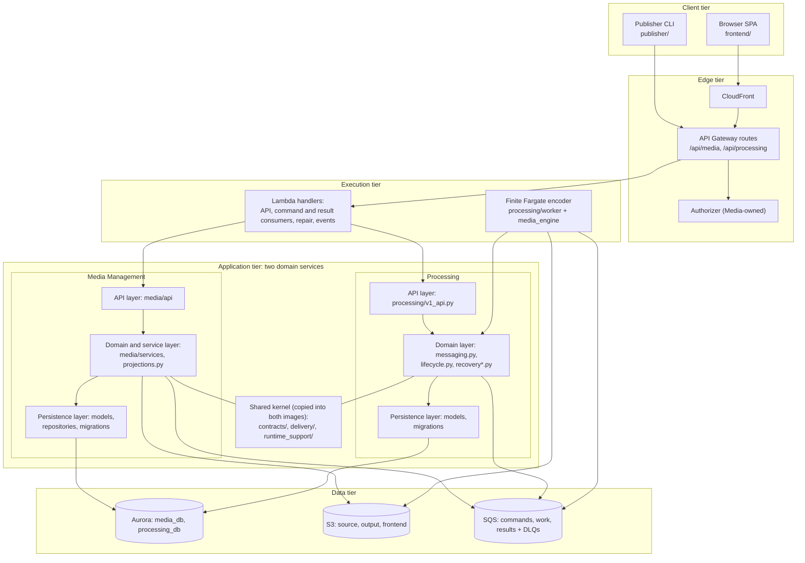
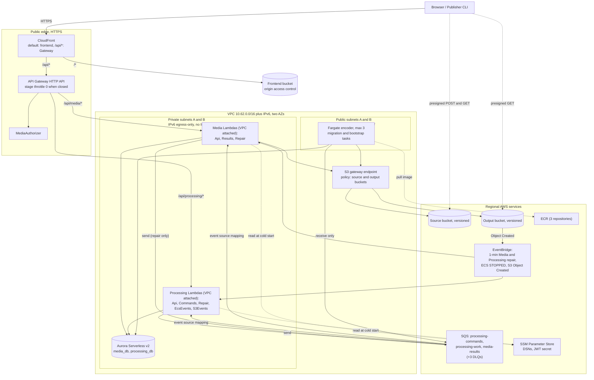
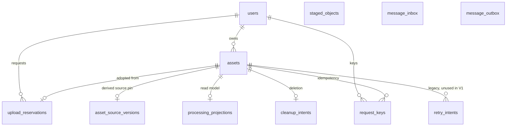
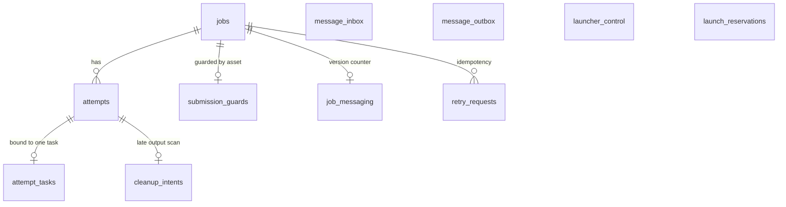
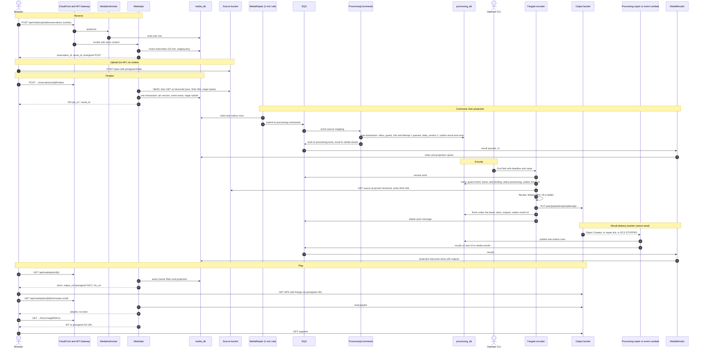
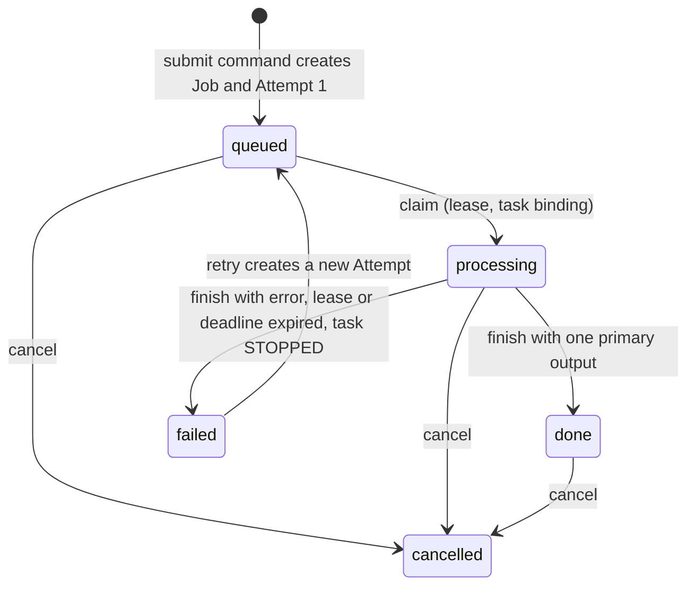

# Architecture views (V1 as built)

Backs report sections 3.1 to 3.3 and slides 3 and 4. Closes #188 together with
[decisions.md](decisions.md). Terms are defined in [ddd.md](ddd.md). The physical view is drawn
from `scripts/aws/v1/definitions.py`, whose output is identical to the checked-in
`deploy/aws/v1/template.json`. Counts below are computed from that rendered template at the default
flags (`DeployApplications=true`, `UnattendedLaunch=false`, `LambdaShortEncodes=false`).

Evidence labels: **[AWS]** recorded in
[`cloud-proof-r1017b.json`](../execution/aws/v1/evidence/cloud-proof-r1017b.json) (live run
2026-10-17) and [`cloud-proof-r1018b.json`](../execution/aws/v1/evidence/cloud-proof-r1018b.json) (live run
2026-10-18), both since torn down, with results against targets in [`evidence-index.md`](../evidence-index.md); **[Local]** real PostgreSQL and FFmpeg with Moto for S3/SQS, not AWS;
**[Code]** source or rendered template only.

Diagram sources are the Mermaid blocks in this file. Rendered copies are in [`img/`](img/); run
`python3 docs/architecture/render_diagrams.py` to regenerate them.

## 1. Tiers and layers (logical view)

Rendered: [`img/views-logical.svg`](img/views-logical.svg).

| Layer | Media Management | Processing | Shared |
|---|---|---|---|
| API (transport, auth context) | `media/api/auth.py`, `uploads.py`, `v1_jobs.py`, `v1_hls.py`, `deps.py`; `media/authorizer.py` | `processing/v1_api.py`, `processing/auth.py` | `contracts/gateway.py` (payload v2 to ASGI, trusted `Actor`) |
| Domain and service | `media/services/direct_intake.py`, `v1_lifecycle.py`, `intake.py`, `media/projections.py` | `processing/messaging.py`, `lifecycle.py`, `service.py` | `contracts/v1.py` (envelope, source) |
| Messaging | `media/messaging.py`, `media/handlers.py` | `processing/messaging.py`, `processing/handlers.py` | `delivery/` (`sql.py`, `sqs.py`, `envelope.py`, `dlq.py`) |
| Recovery and cleanup | `media/recovery_v1.py` | `processing/recovery.py`, `recovery_v1.py` | |
| Persistence | `media/models.py`, `upload_models.py`, `projection_models.py`, `messaging_models.py`, `repositories/`, `migrations/` | `processing/models.py`, `messaging_models.py`, `migrations/` | `runtime_support/` (Lambda DB engine, settings from SSM) |
| Storage access | `media/services/storage.py`, `storage_credentials.py` | `processing/worker/source.py`, `storage.py`, `storage_credentials.py` | |
| Media engine | | `media_engine/` (FFmpeg and ffprobe command builders, validation) | |
| Operations | | | `scripts/aws/v1/` (template, deploy, session, release, evidence), `.github/workflows/` (per-service CI lanes, CD) |

Dependency rules visible in the code: Processing's API module imports no Media package
(`processing/v1_api.py` docstring); each domain reaches the other only through `contracts/` and
the queues; the engine package is pure command construction. The retired peer-HTTP and Redis/RQ code lives in the top-level `legacy/` package, which no V1 image contains: `deploy/v1/check_runtime.py` fails the build if it, or the opposite domain package, is importable.

## 2. Nodes and subsystems

| Node | Count | Runs | State | Scales by | Subsystem |
|---|---|---|---|---|---|
| Browser SPA, Publisher CLI | n | Static app from CloudFront; CLI is a separate client of the public API | Cookie session | Client | Presentation |
| CloudFront distribution | 1 | Static frontend, `/api/*` pass-through | None | Managed | Edge |
| API Gateway HTTP API | 1 | 9 routes, one authorizer, 2 Lambda integrations | None; stage throttle is the intake gate | Managed | Edge |
| Lambda, Media image | 4 functions | `MediaApi` (2048 MB), `MediaAuthorizer`, `MediaResults`, `MediaRepair` (512 MB) | None (per-invocation DB sessions) | Concurrency; account limit 10; result consumer capped at 2 | Identity, intake, playback, projection |
| Lambda, Processing image | 5 functions | `ProcessingApi` (2048 MB), `ProcessingCommands`, `ProcessingRepair`, `ProcessingEcsEvents`, `ProcessingS3Events` | None | As above | Job orchestration, recovery |
| Fargate encoder task | 0 idle, at most 3 | `processing.v1_worker`: one attempt per task, 2 vCPU, 4 GiB | Scratch disk only | Operator batch | Encoding |
| Fargate one-off tasks | on demand | Media migration, Processing migration (256 CPU, 512 MB), bootstrap task, evidence load generator | None | Run once | Operations |
| Aurora PostgreSQL Serverless v2 | 1 cluster, 1 instance | `media_db`, `processing_db` | Durable | 0 to 2 ACU, auto-pause 300 s | Persistence |
| S3 | 3 buckets | Source, output, frontend (all versioned, SSE-S3, public access blocked) | Durable | Managed | Storage |
| SQS | 3 queues, 3 DLQs | Commands, work, results | Transient (7 days) | Managed | Messaging |
| EventBridge | 4 rules | Two one-minute ticks (Media repair, Processing repair), ECS task `STOPPED`, S3 `Object Created` on the output bucket | None | Managed | Recovery |
| SSM Parameter Store | 5 parameters (outside the template) | Four role DSNs and the JWT secret, as SecureStrings | Durable | | Configuration |
| ECR | 3 repositories | Media, Processing, worker images (immutable tags, scan on push) | Durable | | Delivery |
| CloudWatch | 12 alarms, 1 dashboard | Per-service views of errors, queue depth and age, dead-letter depth | Metrics | Managed | Operations |
| Operator station or CD runner | 1 | `session`, `release`, `evidence`, `deploy` CLIs; journal of launches and releases | Local journal, or private S3 state bucket for CD | | Operations |

| Subsystem | Responsibility | Where |
|---|---|---|
| Identity and intake | Accounts, JWT cookie, reservations, verified adoption of uploads | `media/api/auth.py`, `media/authorizer.py`, `media/services/direct_intake.py` |
| Playback | Owner-checked presigned MP4 URLs, HLS playlist and segment redirects | `media/projections.py:public_job`, `media/api/v1_hls.py` |
| Job orchestration | Job and attempt lifecycle, retry, cancel, leases, state versions | `processing/messaging.py`, `processing/lifecycle.py` |
| Encoding | Probe, MP4 or edited output, HLS ladder, output upload with SHA-256 | `processing/worker/`, `media_engine/` |
| Messaging | Envelope validation, outbox, inbox, SQS adapter, DLQ tooling | `delivery/`, `contracts/v1.py` |
| Recovery and cleanup | Re-send lost work, expire leases, react to stopped tasks, delete orphaned or late versions | `processing/recovery_v1.py`, `media/recovery_v1.py` |
| Operations | Template, deploy, session open and close, release and restore, evidence | `scripts/aws/v1/` |

## 3. Physical architecture (AWS, ap-southeast-1)

Rendered: [`img/views-physical.svg`](img/views-physical.svg).

### 3.1 Network

| Element | Definition (`definitions.py`) |
|---|---|
| VPC | `10.62.0.0/16` with an Amazon-provided IPv6 block; DNS support and hostnames on |
| Subnets | Private A `10.62.0.0/24`, B `10.62.1.0/24`; public A `10.62.2.0/24`, B `10.62.3.0/24`; each with a /64 IPv6 range; no auto-assigned public IPv4 |
| Private route tables | `::/0` to an egress-only internet gateway; **no IPv4 default route**, no NAT gateway |
| Public route tables | `0.0.0.0/0` and `::/0` to the internet gateway |
| Endpoints | One S3 **gateway** endpoint on all four route tables. Policy: `s3:*` on the source and output buckets only, plus `GetObject` on the regional ECR layer bucket. No interface endpoints. |
| Security groups | `Lambda`: egress 443 over IPv6 and IPv4 (IPv4 covers the S3 prefix route), 5432 to the database group. `Worker` and `Migration`: egress 443 and 5432 to the database group. `Database`: no egress; ingress 5432 from the three groups above. No other security group has an inbound rule. |
| Lambda placement | Both private subnets, dual-stack (`Ipv6AllowedForDualStack`), AWS SDK dual-stack endpoints enabled |
| Fargate placement | Public subnets with a public IPv4 only while a task runs (`assignPublicIp: ENABLED` in the operator's RunTask and migration calls) |

### 3.2 Services used and why

| Service | Used for | Why this and not the alternative (see decisions.md) |
|---|---|---|
| CloudFront | HTTPS entry, static frontend, `/api/*` forwarding | AD-15 |
| S3 (3 buckets) | Source uploads, encoder output, static site | AD-14; versioning protects the pinned-source rule |
| API Gateway HTTP API | Routing, authorizer hook, throttle gate | AD-09, AD-19 |
| Lambda (9 functions, container images, alias `live`) | APIs, queue consumers, repair and event handlers | AD-10 |
| SQS (3 queues, 3 DLQs) | Commands, work, results | AD-11 |
| EventBridge (4 rules) | Repair ticks and two event hints; all `DISABLED` until a session opens | AD-19 |
| Aurora PostgreSQL Serverless v2 | Two owned databases, pauses to zero | AD-12 |
| ECS on Fargate | Finite encoders, migrations, bootstrap | AD-13 |
| ECR | Immutable, scanned images, one repository per image | AD-10, AD-16 |
| SSM Parameter Store | DSNs and JWT secret as SecureStrings (created by the deploy pipeline, referenced by ARN) | Keeps secrets out of the template and images |
| Secrets Manager | Aurora master password (`ManageMasterUserPassword`), readable only by the bootstrap operator | AD-12 |
| CloudWatch | 7-day log groups per function and for tasks; 12 alarms (3 DLQ depth, 9 function errors) and the `ServicesDashboard` with a Media and a Processing section | AD-25 (13 of 13 `OK` in `r1018b`; none seen firing) |
| IAM, OIDC | Per-handler roles; GitHub deploy role (separate stack `deploy/aws/v1/github-oidc.yaml`) | AD-17, AD-20 |

Resource counts at defaults: 60 resources before applications are enabled, 159 after (ten
log groups, nine functions with versions and aliases, 17 roles, six queues with six policies, three
buckets with policies, one cluster and one instance, 12 alarms, one dashboard). Cluster, instance, buckets and ECR repositories
are retained when the stack is deleted.

### 3.3 IAM separation

Each Lambda, migration task and the worker has its own role. The permissions that make the boundary
real:

| Principal | Can | Cannot |
|---|---|---|
| `MediaApi` | Read and write source objects, read output objects, list and delete source versions; read Media DSN and the JWT secret | Send or receive any queue message; read the Processing DSN |
| `MediaAuthorizer` | Read Media DSN and JWT secret | Anything on S3 or SQS |
| `MediaResults` | Receive and delete on `media-results`; Media DSN | Send; S3 |
| `MediaRepair` | Send to `processing-commands`; list and delete source versions; Media DSN | Send to any other queue; read outputs |
| `ProcessingApi` | Read the Processing DSN | S3, SQS, the JWT secret |
| `ProcessingCommands` | Receive on `processing-commands`; send to `processing-work` and `media-results` | Media DSN, S3 |
| `ProcessingRepair`, `ProcessingEcsEvents`, `ProcessingS3Events` | Send to `processing-work` and `media-results`; list and delete output versions under `jobs/*` | Receive; source bucket |
| Worker task role | Get source objects and versions, put outputs, receive from `processing-work`; Processing DSN | Send any message; delete anything; Media DSN |
| Migration task roles | Read their own owner's migration DSN | Everything else |

Each function's environment lists only the queue URLs its code sends to. Queue resource policies repeat the rule from the queue side: only the listed producer roles may
`SendMessage`, only the listed consumer roles may receive or delete, and every non-TLS request is
denied. Account IAM users are exempt from the send rule so an operator can redrive a DLQ.
**[AWS]** `sqs-direct-send`: a send from outside the listed roles was refused (403) on all three
queues; `cross-database`: a runtime login could not connect to the other database or run DDL in its
own.

### 3.4 Network exposure

| Surface | Reachable from the internet | Control |
|---|---|---|
| CloudFront distribution | Yes, HTTPS only (HTTP redirects) | Origin access control to the frontend bucket |
| API Gateway `execute-api` endpoint | **Yes**, directly, as well as through CloudFront | Authorizer on every route except health and Media register, login, logout; stage throttle 0/0 when closed. No WAF. |
| S3 buckets | Only by presigned URL | Public access blocked, TLS-only policy; CORS on the source and output buckets limited to the frontend origin |
| Lambda | Not directly | Resource policy limited to the API; readiness probe only by IAM `lambda:InvokeFunction` |
| Aurora | No | Private subnets, `PubliclyAccessible: false`, security group admits three internal groups |
| SQS | Public AWS API endpoint, IAM-gated | Role-scoped queue policies, TLS-only |
| Fargate tasks | Outbound only | No inbound rules |

**[AWS]** `anonymous-denied`: all six probed job routes (frontend and Gateway, media, processing,
admin) returned 401 to an anonymous caller.

## 4. Persistence design

Two databases on one cluster. Each service owns its tables, migrations (Alembic, one history per database)
and roles. No table has a foreign key to the other database, and owner and
asset ids cross the boundary only as plain UUIDs.

### 4.1 Media (`media_db`, migrations `0001_media` to `media_0008`)

| Table | Purpose | Key constraints |
|---|---|---|
| `users` | Accounts | `email` unique; `role` CHECK in (`user`, `operator`); bcrypt hash (cost 10) |
| `assets` | Aggregate root; soft delete via `deleted_at` | `owner_id` FK and index; `source_key` unique; CHECK `source_revision >= 1 AND source_size_bytes > 0`; CHECK `submission_state` in (`pending`, `submitted`, `error`); `source_asset_id` set for edit-derived assets |
| `upload_reservations` | Grant and, once finalized, the adopted source pin | unique `(owner_id, request_id)`; `asset_id` unique; `key` unique; CHECK finalized implies a real `version_id`; partial index on pending cleanup |
| `asset_source_versions` | Version pin for derived (edit) sources | PK `asset_id` |
| `request_keys` | Idempotency for edit and retry | PK `(owner_id, operation, request_key)`; stores request hash |
| `processing_projections` | Owned read model of Processing | PK `asset_id`; `job_id` unique; CHECK `state_version >= 0 AND attempt_number >= 0`; CHECK status in the five values |
| `cleanup_intents` | Source deletion after cancel acknowledgement | PK `asset_id` |
| `staged_objects` | Ledger of copied sources not yet adopted | PK `key`; `write_uncertain` |
| `message_inbox`, `message_outbox` | Dedupe and send queue | PK `message_id`; outbox index on `next_try_at` |
| `retry_intents` | Earlier retry design | No V1 code path uses it |

### 4.2 Processing (`processing_db`, migrations `processing_0001` to `processing_0007`)

| Table | Purpose | Key constraints |
|---|---|---|
| `jobs` | Aggregate root | `asset_id` unique; `owner_id` indexed; `current_attempt_id` FK to `attempts`, deferrable and initially deferred; CHECK status in (`queued`, `processing`, `done`, `failed`); `source` and `outputs` JSONB; `source_url*` columns are legacy |
| `attempts` | One try, with its lease | unique `(job_id, attempt_number)`; CHECK `attempt_number >= 1`; CHECK state in six values; lease columns `lease_token`, `lease_expires_at`, `deadline_at`, `heartbeat_at`; index `(state, next_dispatch_at)` for recovery |
| `submission_guards` | Per-asset serialisation and cancel-before-submit | PK `asset_id`; carries `owner_id`, `job_id`, `deleted_at` |
| `retry_requests` | Retry idempotency | unique `(job_id, request_id)` |
| `cleanup_intents` | Rescan of an attempt's output prefix for late writes | PK `attempt_id`; `retired_at` ends the rescans |
| `job_messaging` | `state_version` counter | PK `job_id` |
| `attempt_tasks` | One finite task per attempt | PK `attempt_id`; `task_name` unique |
| `message_inbox`, `message_outbox` | As in Media | As in Media |
| `launcher_control`, `launch_reservations` | Opt-in unattended launcher (V2, #68) | Singleton row check; unused unless the flag is on |

Migration numbering: file numbers are not continuous. Media has `0001`, `0002`, `0004` to `0008` (no
`0003`); Processing has `0001` to `0003`, `0005` to `0007` (no `0004`). Alembic orders by revision id,
not file number: Processing `0005` names `0003` as its parent, and Media revision ids mix the styles
`0001_media`, `0002_uncertain_writes` and `media_0004` onward. Nothing is missing from the chain;
the gaps are only in the file names.

Role grants (`scripts/aws/v1/bootstrap.py`): `*_owner` owns the database and cannot log in;
`*_migrator` inherits the owner and runs Alembic; `*_runtime` has `SELECT, INSERT, UPDATE, DELETE`
and sequence use only. `PUBLIC` has no access to either database and neither domain's login roles
can connect to the other. Connections require verified TLS against the bundled RDS CA
(`rds.force_ssl=1` on the cluster).

### 4.3 Object storage: an implicit contract

Keys are not declared in a schema file. These rules are enforced by code on both sides, so any change
must be made in both services.

| Bucket | Key | Written by | Read by | Notes |
|---|---|---|---|---|
| Source (versioned) | `staging/{owner_id}/{reservation_id}/source` | Browser or Publisher via presigned POST | Media (verify), worker (pinned VersionId) | Despite the prefix, an adopted upload stays here. Policy fixes key, content type, length range; expires in 15 minutes. |
| Source | `sources/{owner_id}/{asset_id}/source` | Media API (copy of a validated output, for edit) | Worker | Version pinned in `asset_source_versions` |
| Output (versioned, EventBridge on) | `jobs/{job_id}/attempts/{attempt_id}/primary.{mp4,mkv,mp3}` | Worker | Media (presign, copy) | Exactly one `primary` is required; checked by Processing `finish` and Media `apply_result` |
| Output | `jobs/{job_id}/attempts/{attempt_id}/hls/master.m3u8`, `hls/v{n}/index.m3u8`, `hls/v{n}/seg%05d.ts` | Worker | Media (playlist body, segment redirect) | Only the master is listed as an output descriptor. Variants never exceed the source height, among 360, 480, 720. Media serves only names matching `[A-Za-z0-9_-]+.(m3u8|ts)` with an optional `v{n}/`. |
| Frontend | content-hashed assets, fixed `index.html` | Deploy pipeline | CloudFront | `scripts/aws/v1/frontend.py` |

Cleanup rules that depend on the layout: Media removes every version of a source key after deletion
or grant expiry, and re-scans for late writes (`direct_intake.py:cleanup_expired_uploads`,
`media/recovery_v1.py`); Processing removes every version under a retired attempt's prefix
(`processing/recovery_v1.py:NativeCleanupStore`). A bare `DeleteObject` on a versioned bucket only
adds a marker, so both use `DeleteObjectVersion`.

### 4.4 Message durability

Queued messages live 7 days (DLQs 14 days). SQL is the source of truth: a sent outbox row is kept
and re-armed for replay, and queued work is recreated from `jobs` and `attempts` by
`repair_work`. Losing a queue therefore delays work; it does not lose it.

## 5. Representative use case: upload, process, play

Actors: an owner in a browser, the Media and Processing contexts, an operator who starts an encoder
batch. Preconditions: a session is open (mappings and rules enabled, throttle raised) and the owner is
logged in.

Rendered: [`img/views-sequence.svg`](img/views-sequence.svg).

| Step | What the code does | Module |
|---|---|---|
| 2 to 4 | Authorizer verifies the JWT and reads the current user row; context `{owner_id, role}` is the only identity the API accepts | `media/authorizer.py:authorize`; `contracts/gateway.py:invoke_asgi` |
| 5 to 6 | Creates the `upload_reservations` row and a presigned POST bounded by key, content type and length; replaying the same `request_id` returns the same reservation | `media/services/direct_intake.py:reserve`; `storage.py:direct_upload_grant` |
| 7 | Client sends bytes straight to S3; the bucket allows CORS POST from the frontend origin only | `definitions.py` (`SourceBucket`) |
| 8 to 11 | Verification runs outside any SQL lock; the second transaction re-checks expiry and replay, then commits asset, pin and outbox together | `direct_intake.py:finalize`; `media/messaging.py:enqueue_submit` |
| 12 to 13 | The Media API cannot send to SQS; the repair Lambda claims due rows and sends | `delivery/sql.py:publish_due`; `media/handlers.py:repair_handler` |
| 14 to 16 | Inbox dedupe, guard, Job and Attempt creation and the outbox rows commit in one transaction, then are published | `processing/messaging.py:handle_command`, `emit_state` |
| 17 to 18 | A result is applied only if its `state_version` and attempt are newer | `media/projections.py:apply_result`, `validate_transition` |
| 19 to 21 | The operator starts a finite task. The task claims the attempt, which binds it to its task name and writes the lease | `scripts/aws/v1/session.py:batch`; `processing/messaging.py:claim`; `lifecycle.py:claim` |
| 22 to 26 | The source GET names the VersionId and the bytes are hashed; outputs are uploaded before `finish`, which re-checks the lease; the message is deleted only after `finish` commits | `processing/worker/sqs.py:execute_message`; `worker/tasks.py:pipeline`; `lifecycle.py:finish` |
| 27 to 31 | The encoder holds no send permission; results leave through a Lambda triggered by the output upload, a repair tick or the task stopping | `processing/handlers.py:invoke`; `recovery_v1.py:run_once`, `terminal_event` |
| 32 to 34 | The public job is built from the projection; the MP4 URL is a presigned GET whose lifetime is capped by `signed_url_ttl_seconds` (default 900) and by the signing credential's remaining life | `media/projections.py:public_job`; `storage.py:_sign` |
| 35 | The browser plays the MP4 from S3 with range requests | presigned URL |
| 36 to 41 | The playlist body comes through Media; each segment is a 307 to a presigned S3 URL | `media/api/v1_hls.py:part` |

Failure branches, all in code:

| Event | Result |
|---|---|
| Browser retries `finalize` after a lost response | Same asset returned; no second command (`finalize`, `finalized_at`) |
| Same `submit` delivered twice | Second is a no-op in the inbox; a different body with the same id is rejected (`delivery/sql.py:accept`) |
| Worker dies or its lease lapses | Repair or the ECS `STOPPED` event fails the attempt (`abandoned`, job `failed`); the owner retries and a new attempt is created (`recovery.py:interrupt`, `messaging.py:_retry_locked`) |
| Owner deletes during processing | Asset tombstoned, `cancel` sent, attempts cancelled, outputs cleared; late results are discarded in Media (`projections.py:apply_result`) |
| Result arrives out of order | Ignored if older; conflict if same version with different content |

Rendered: [`img/views-job-states.svg`](img/views-job-states.svg). `cancelled` is not a value of
`jobs.status` (its CHECK has four values); it is expressed by `deleted_at` and appears as the
status in result snapshots and in Media's projection.

**Evidence for this flow.** [AWS] `direct-upload-e2e` (#63): reserve 299 ms, S3 upload 272 ms
(828,699-byte clip), finalize 526 ms; the Media job read `accepted` at 0.3 s, `processing` at 70.1 s
and `done` at 75.6 s; MP4 range request answered 206, playlist not cached, segment answered 307 to S3;
one encoder started and none left running. The receipt does not split the 70 s before `processing`
between the repair tick and the encoder start. [Local] `tests/v1/test_workflow_acceptance.py`,
`tests/v1/test_integrated_boundaries.py` run the same flow with Moto.
