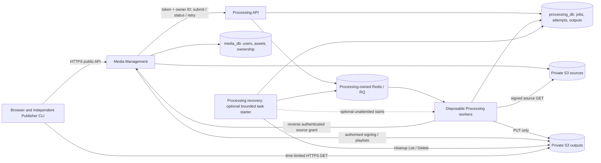
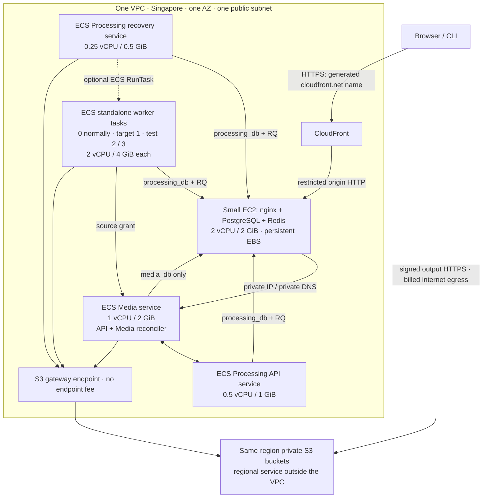

> **Historical (15 October AWS2 Fargate plan), superseded by [`architecture-plan.md`](architecture-plan.md) and the [V1 handoff](v1/README.md).** Kept unchanged below for provenance.

# Lean AWS microservices plan

15 October 2026 · proposal for review · no provisioning or spending approval.
This replaces the [14 October shared-host plan](architecture-plan-20261014.md).
Implementation baseline before planning: `485edac`; inspected planning revision
for the [readiness backlog](readiness/README.md): `af0b21e`. No application code, running
demo, original proposal, roadmap design, or historical measurement was changed.

## Decision

Use **ECS on Fargate for the service compute and disposable encoding workers**.
Keep **one `t3a.small` (2 vCPU / 2 GiB) for PostgreSQL, Redis, and nginx**.
That machine never runs Media, Processing, or FFmpeg. Give Media and Processing
separate ECS services, image digests, releases, credentials, and migrations.
Run encoding tasks only when work exists; stop the whole environment between
booked sessions. Public access uses an AWS-provided `*.cloudfront.net` HTTPS URL.

Use one VPC, one AZ, one public subnet, an Internet Gateway, and a **free S3
gateway endpoint**. No private/public subnet pair, NAT Gateway, load balancer,
paid interface endpoints, purchased domain, Kubernetes, service mesh, RDS,
ElastiCache, or replacement queue. Keep the existing Redis/RQ integration.

The remaining college window is **at most 14 days**. Expected usage is **$6.03 USD**,
or **$13.03 with visible reserves**. A larger bounded scenario is **$28.27 including
reserves**. Use **$15 expected / $30 contingency envelope**, rather than treating
the previous $200 ceiling as a spending target. Neither is an automatic bill cap.
The forecast assumes **20 online hours and 2 cumulative worker-task-hours**. All
application compute is off during downtime; only about **$1.73 of retained
storage/internal-DNS costs across the full 14 days** remains, before external hits.
[Reproducible calculation](calculate-costs.py), [inputs](cost-worksheet.json),
[regional price evidence](pricing-20261015.json).

## What counts as the microservices contribution

The original [Team 17 proposal](../../../project-documentation/Team17-Proposal.docx),
§§1.3–1.4, 2.2–2.5 and 3.3–3.5, commits to independently deployed Media Management
and Processing, separate data ownership, authenticated contracts, independent
worker capacity, and web/CLI reuse. AD-01 deliberately combines Identity, Media,
and Delivery; it rejects a four-service split as unnecessary. AD-02 explicitly
permits two databases on one PostgreSQL server. Preserve those useful boundaries.

The implementation already has `media/`, `processing/`, separate Dockerfiles,
separate PostgreSQL roles/migrations, HTTP integration, and `publisher/`.
See [interfaces](../interfaces.md) and [local Compose](../../../compose/local/docker-compose.yml).
Workers and reconciliation are execution roles inside the Processing service;
Redis, nginx and PostgreSQL are infrastructure, not extra business microservices.

This revision adds **separate compute and deployment boundaries**: restarting or
releasing Processing does not replace Media's ECS tasks; adding encoders does not
reserve more CPU on Media's host. Fargate isolates tasks; it does not promise a
dedicated physical server per microservice. The shared database host, gateway,
AZ, and region remain shared failure dependencies. This is a small single-AZ demo,
not a highly available system. [Fargate task isolation](https://docs.aws.amazon.com/AmazonECS/latest/developerguide/task-iam-roles.html).

## Logical architecture

Media's own reconciler runs alongside its API and uses only Media's database and
its peer API. It has the same storage permissions as Media. Workers cannot query
`media_db`; Media cannot query `processing_db`. Cross-service IDs stay references.

## Physical placement and sizes

[Editable AWS placement diagram](../../lean-aws-microservices.drawio).
The diagrams show deployment units and data flow, not a claim that S3 lives in a subnet.

| Unit | Image / command | Initial size | Lifetime / ownership |
|---|---|---|---|
| Media ECS service | `deploy/media.Dockerfile`; API and `media.recovery` containers | 1 vCPU / 2 GiB total | One task while site is open; own release and DB migration |
| Processing API ECS service | `deploy/processing.Dockerfile`; API | 0.5 vCPU / 1 GiB | One task while site is open; own release |
| Processing recovery ECS service | Same Processing digest; `processing.recovery`; starter optional | 0.25 vCPU / 0.5 GiB | One task while site is open; survives API/worker outages |
| Encoding standalone tasks | Same Processing digest; `python -m processing.worker --burst` | 2 vCPU / 4 GiB each | Exit after draining; maximum 3 across running and pending tasks |
| State/gateway EC2 | nginx, PostgreSQL 16, Redis | `t3a.small`, 2 vCPU / 2 GiB, **Standard CPU credits** | Start/stop with environment; no application/encoding images |
| Migration task | Owning service image and owning migration role | At most 1 vCPU / 2 GiB | One-off, separately invoked; never both services' migrations together |

These are **initial cloud configurations, not measured minima**. Media keeps a
1-vCPU allocation because the existing login evidence already has little margin;
cutting it to 0.25 vCPU cannot honestly promise the 20-login target. The state
host's approximate RAM envelope is PostgreSQL 512 MiB, Redis 128 MiB, nginx
128 MiB, and OS/agents/cache/headroom in the remaining 1,280 MiB. Measure actual
pressure and credit balance; Standard credits prevent surprise surplus charges
but can throttle. Do not run load generators or builds on this host.

Fargate's supported 2-vCPU task size starts at 4 GiB, whereas local workers had a
1.5-GiB container cap. Keep that container cap for the original scaling comparison
if compatible, record both the container limit and billed task allocation, and
report the cloud topology separately. Three workers temporarily reserve 6 vCPU /
12 GiB across three tasks; no 8-vCPU / 16-GiB machine is purchased. Aggregate
capacity at the largest test is higher than one worker and is charged accordingly.
[Task sizes](https://docs.aws.amazon.com/AmazonECS/latest/developerguide/task-cpu-memory-error.html).

Use Linux/x86_64 images and `linux/amd64` builds first. `t4g.small` would save only
$0.048 over 20 host-hours and introduces another architecture; leave ARM as a later
measured option. A 1-GiB state host has inadequate headroom for the stated envelope.

## Scheduling and shutdown

There are two independent controls:

1. **Environment hours:** an operator opens a booked session, starts the state
   host, waits for PostgreSQL TCP readiness, and starts the three ECS services.
   Outside booked sessions, set their desired counts to zero and stop EC2 after
   draining. The CloudFront URL remains allocated, but the application is unavailable.
   Use auto-assigned EC2 public IPv4, which is released on stop; update the
   CloudFront origin to the new AWS public DNS name on wake and wait for
   propagation. A longer warmup is acceptable. Do not keep an Elastic IP.
   This requires no always-running scheduler. An optional EventBridge start/stop
   schedule can be added later; it is not part of the default implementation.
2. **Worker residency:** reuse the existing `--burst` worker. Initially run it
   manually from a bounded release/operator command. Only if unattended starts are needed, add a small starter
   alongside **Processing recovery**, checking its own ledger about once per
   minute and starting missing worker slots only when queued work exists.
   Target one worker normally; an explicit operator setting selects 0/1/2/3.
   No backlog-based scale-up policy or extra broker is required.

The default demo uses explicit bounded batch starts. An unattended starter is
**optional new code**, not a prerequisite or an existing proven feature.
It must hold one Processing-owned coordination lease, record launch reservations
and stable `RunTask` client tokens, include PENDING and RUNNING tasks in its cap,
handle AWS eventual consistency and partial launch failures, and back off on
capacity/permission errors. Redis length alone is not authoritative. Do not launch
an unbounded worker on every upload or every timer tick. A job arriving just after
an idle worker exits is discovered on the next pass. Show a queued state in the
existing UI while capacity starts; measure cold start, do not promise seconds.

Standalone `RunTask` tasks are not automatically restarted by ECS. The starter
replaces lost capacity; existing recovery determines the interrupted attempt's
state. Current expired attempts become **failed/abandoned**, and the user retries
from the stored source. Do not describe this as automatic job retry or silently
change those semantics. Recovery stays at its existing 15-second interval while
online so queue repair can meet the original 120-second target.
[Standalone task lifecycle](https://docs.aws.amazon.com/AmazonECS/latest/developerguide/task-maintenance.html),
[RunTask consistency](https://docs.aws.amazon.com/AmazonECS/latest/APIReference/API_RunTask.html).

Use **on-demand Fargate first** for demos and measured runs. The 2 expected
worker-task-hours cost only $0.26 including IPv4. Spot is optional for expendable
rehearsals after interruption testing; it is not necessary to make this plan cheap.
Spot capacity can be unavailable, has a two-minute interruption warning, and
Fargate does not automatically fall back to on-demand. Planned releases must
pause new claims and drain before stopping tasks; `stopTimeout=120` cannot save
every long encode. Drain timeout must surface a failed release or explicit
interruption, not pretend success. [Spot behavior](https://docs.aws.amazon.com/AmazonECS/latest/developerguide/fargate-capacity-providers.html),
[stop timeout](https://docs.aws.amazon.com/AmazonECS/latest/APIReference/API_ContainerDefinition.html).

Issue 39's rejected fixed-host scheduling policy remains rejected. This is a new
billing/topology hypothesis: stopping Fargate tasks ends their compute bill.
Record task residency, cold waits and actual billing separately; do not relabel
old local experiments as proof of AWS savings. For the small AWS capacity check, prewarm ordinary non-burst workers at a fixed
1/2/3 count, then submit only 1/2/3 jobs respectively. Disable the starter during
that check and drain/stop the workers afterwards. That demonstrates placement and
parallel claims, not statistically valid scaling speedup. Preserve the completed
local experiments; do not repeat bulk cloud trials by default.

## Networking and public access

A public subnet is a route-table property; it does **not** require opening database
or API ports to everyone. Allocate public IPs for task egress/image pulls, use
private IPs for service communication, and restrict inbound traffic with security
groups. The three service-task IPs, temporary worker IPs, and EC2 public IP are
priced only while their compute runs. No IP is reserved during downtime.
Internet Gateway has no hourly charge.
[Public-subnet Fargate networking](https://docs.aws.amazon.com/AmazonECS/latest/developerguide/networking-outbound.html).

Use Cloud Map private DNS for `media` and `processing` only. Its internal namespace
is not a purchased domain. One private hosted zone is $0.50 per billed calendar
month; this 14-day window budgets one October charge. Add $0.50 if dates cross into November. DNS queries in the VPC
are free; registrations have a small charge. nginx and peer clients must resolve
changed task IPs and tolerate stale connections during releases. No Service
Connect/Envoy sidecars or load balancer are required for one replica per API.
[Private DNS pricing](https://aws.amazon.com/route53/pricing/).

The edge path is:

- Browser/Publisher → **HTTPS** `https://<distribution>.cloudfront.net` using AWS's
  default certificate. Domain registration and public hosted zone: **$0**.
- CloudFront → the running EC2 host's AWS public DNS hostname → nginx on port 80.
  Restrict that port to the CloudFront origin-facing managed prefix list **and**
  require a random origin header. Reject absent/wrong headers; block `/internal/`.
- nginx → Media through private DNS. PostgreSQL 5432 accepts only the owning task
  groups; Redis 6379 accepts only Processing groups. The public cannot reach either
  API task or data store. Admin access is scoped SSM, not a public SSH listener.

**TLS limitation:** this minimal origin path is HTTP from CloudFront to nginx;
viewer HTTPS is not end-to-end TLS. The origin is internet-addressed but ingress
is restricted to CloudFront, and a direct external scan should find it closed.
This is an explicit relaxation of a strict interpretation of the proposal's
“only HTTPS exposed” wording. Do not conceal it in the report or claim encrypted
origin traffic. If that interpretation must be retained, revise this origin leg
before deployment: a CloudFront VPC origin in a private subnet is a supported
alternative, but it changes the requested one-public-subnet topology. Do not
silently buy a domain/ALB or assume certificates can be issued for EC2's AWS DNS
name. Planning can proceed while this narrow tradeoff remains reviewable.
[Origin settings](https://docs.aws.amazon.com/AmazonCloudFront/latest/DeveloperGuide/DownloadDistValuesOrigin.html),
[origin headers](https://docs.aws.amazon.com/AmazonCloudFront/latest/DeveloperGuide/add-origin-custom-headers.html),
[VPC origin requirements](https://docs.aws.amazon.com/AmazonCloudFront/latest/DeveloperGuide/private-content-vpc-origins.html).

Use CloudFront pay-as-you-go with no paid WAF/Origin Shield bundle. Require viewer
HTTPS, allow all application methods, disable caching for `/api/*` including
redirects and errors, forward cookies/query strings and required headers, preserve
Set-Cookie and Range behavior, and set the configured public origin explicitly.
Cache static frontend assets only. nginx buffers uploads to bounded temporary
disk, supports the existing 100-MiB limit, and emits correct HTTPS external URLs.
Test slow uploads and proxy timeouts. Newer CloudFront Free plans may reduce costs,
but have configuration/eligibility restrictions; do not assume compatibility or
upgrade to a paid subscription. The estimate deducts no free allowances.
[Viewer HTTPS](https://docs.aws.amazon.com/AmazonCloudFront/latest/DeveloperGuide/using-https-viewers-to-cloudfront.html),
[flat-rate plan restrictions](https://docs.aws.amazon.com/AmazonCloudFront/latest/DeveloperGuide/flat-rate-pricing-plan.html).

### Where S3 traffic goes

Keep S3 in **the same region** and attach a **gateway** endpoint to the one subnet's
route table. The endpoint has no hourly or per-GB processing fee. Worker source
GETs, output PUTs and internal playlist reads use regional HTTPS S3 endpoints over
that route. S3 remains a regional service outside the VPC; there is no bucket
inside the subnet. Same-region service↔S3 transfer is not internet egress.
[Gateway endpoint](https://docs.aws.amazon.com/vpc/latest/privatelink/vpc-endpoints-s3.html),
[S3 transfer pricing](https://aws.amazon.com/s3/pricing/).

Preserve direct, short-lived S3 HTTPS URLs for external MP4/HLS segment playback.
Those **viewer bytes leave AWS and can cost money**. Expected budget: 2 GB = $0.24
before allowances. Do not impose a blanket endpoint-only bucket denial: it would
break signed browser URLs. S3 Block Public Access remains enabled; possession of
a valid signed URL grants only its limited object access. CORS permits the exact
CloudFront origin and required GET/Range headers; it does not grant ownership.
CloudFront distribution settings do not magically cache or discount these direct
S3 URLs. Moving playback behind signed CloudFront delivery is an optional later
optimization, not worth a new signing path for the expected $0.24.

## State, disks and recovery

| State | Owner / location | Sizing basis / lifetime | Failure handled |
|---|---|---|---|
| Users, assets, source references | Media; `media_db` on state-host data EBS | Shares 8-GiB metadata volume with Processing | Survives process restart and EC2 stop/start |
| Jobs, attempts, outputs; launch reservations only for optional automation | Processing; `processing_db`, distinct role/migrations | Metadata only; no video blobs | Durable retry/reconciliation; manual starts use a private operator journal |
| Redis/RQ | Processing; same host | 128-MiB memory cap; small AOF on data volume, no-eviction | Transport; reconstruct from Processing ledger if lost |
| Root, OS, nginx, DB/Redis images, bounded logs/upload buffering | State host; **16-GiB gp3 root** | Planning envelope: OS 4, images 3, packages/logs 2, upload scratch 1, free 6 GiB | Rebuildable, not authoritative |
| PostgreSQL data, WAL, Redis AOF, one temporary export | **8-GiB gp3 data**, encrypted, retained across host replacement | Initial envelope: metadata 0.5, WAL 2, Redis 0.25, maintenance/export 1.25, free 4 GiB | Persistent state; not a full media corpus |
| Worker input/intermediates/output | Each Fargate task's included **20-GiB ephemeral disk** | One active encode per task; compressed+unpacked images also consume it | Disposable; task replacement restarts from S3 source |
| Sources and completed encodes | Two private S3 Standard buckets | Fixture: 21,050,412 input + 60,959,567 output bytes per 60-second clip | Independent of compute lifetime |
| Image releases | Two ECR repositories, exact digests | 3 GB average total expected; keep current and rollback digests | Independent deployment/rollback |
| Small DB exports | Private S3 backup prefix, restore restricted to operator | At session close and before risky migrations; keep latest two sets, budget within S3 total | Optional recovery to last export after destructive loss |

24 GiB of provisioned EBS for 14 days costs **$1.0752**, whether the host runs or
stops. These disk sizes are reasoned initial envelopes, not measured needs. Measure
image unpacking, WAL, database size and maximum supported 100-MiB job scratch in
cloud smoke; refuse new jobs before scratch exhaustion and investigate WAL growth.
Do not copy the S3 media corpus onto the state host. Fargate includes
20 GiB by default; extra disk is not budgeted. [Fargate storage/billing](https://aws.amazon.com/fargate/pricing/).

The small cloud fixture set is six 60-second submissions at most (126,302,472
source bytes total), plus a handful of short workflow clips. A single local long
fixture can be reused as the upload input; failed-job retries use the already
stored source. Six successful long jobs produce about 492 MB of source/output
bytes combined. Budget **0.25 GB total upload, 1 GB average retained S3 data, and
2 GB playback**; backup/evidence/short clips fit within the storage allowance.
The 1-GB upload / 5-GB storage conservative scenario allows failures and corrections.
These are caps to work within, not a requirement to create that many files.

Reuse demo assets across ownership, polling, playback and release checks. Delete
unneeded test outputs after evidence capture; retain the few presentation assets.
Abort incomplete multipart uploads after a day. Do not delete sources referenced
by active/retryable jobs. Retain compact evidence and erase test data at teardown.

Snapshots are **not** in the default plan. Worker retry requires surviving DB state
and source objects, not snapshots. For the small demo, stop intake and drain jobs,
then export both DBs/roles at a common quiescent boundary so their references agree.
Keep exports private; export failure must be visible. This is not continuous backup
or point-in-time recovery. If both the live metadata and its exports are lost,
recreate demo accounts/assets; S3 files alone do not restore ownership. A state-host
failure still interrupts the entire workflow. Report that limitation honestly.

## Costs and alternatives

Pricing checked against official public AWS catalogs on 15 October 2026 in USD,
Singapore. The configured pricing connector denied discovery permission; public
catalog downloads supplied the rates. No other project's AWS resources were read
or changed. Exact rows and URLs are in [pricing evidence](pricing-20261015.json).

| Component | Expected: 20 online hours | Larger case: 40 online hours |
|---|---:|---:|
| Small state host + IPv4 only while running | $0.57 | $1.14 |
| Three Fargate service tasks, including their IPv4 | $2.46 | $4.91 |
| Workers: 2 / 8 cumulative task-hours, including IPv4 | $0.26 | $1.03 |
| Migration/release overlap | $0.13 | $0.27 |
| EBS, S3 storage/requests, registry | $1.48 | $2.70 |
| Direct S3 playback: 2 / 10 GB | $0.24 | $1.20 |
| CloudFront delivery, requests, upload-to-origin bytes | $0.11 | $0.42 |
| Discovery + logs + temporary independent generator | $0.78 | $1.59 |
| **AWS usage subtotal** | **$6.03** | **$13.27** |
| Tax/FX reserve (not a tax calculation) | $2.00 | $5.00 |
| Contingency | $5.00 | $10.00 |
| **Total planning allowance** | **$13.03** | **$28.27** |

Totals use unrounded inputs; displayed rows can differ by a cent. Source prices
are unchanged; the workload and lifetime have been corrected to the user's scope.
No free-tier or Spot savings are assumed. Recalculate offline with
`python docs/execution/aws/calculate-costs.py`.

Expected inputs: six long submissions and up to about a dozen short workflow jobs,
0.25 GB CloudFront uploads, 1 GB average S3 storage, 50k Tier1 / 20k Tier2 S3 requests,
0.25 GB logs, 3 GB image layers. Requests include recurring cleanup listings, not
only upload object count. Conservative inputs: 1 GB uploads, 5 GB S3, 250k / 100k
requests, 1 GB logs, 6 GB registry. Measure those numbers and stop rather than
quietly running another bulk suite. Logs retain 3 days and omit payloads/secrets.

Every encoder costs **$0.12824/hour including IPv4** from image download until exit;
Linux has a one-minute minimum. Desired-count-one API tasks still bill when idle.
Keeping the core online all **336 hours** plus the larger cleanup/log scenario
would be **$82.62 including reserves**; it is a sensitivity check, not the plan.
The default is zero running tasks and stopped EC2 during downtime.

### The chopping block: cost levers, ranked

| Lever | Saving / scale | Tradeoff and decision |
|---|---|---|
| **Close the whole environment outside booked sessions** | About **$48 compute/IP savings** versus keeping the core online for all 14 days; each extra 10 online hours is about **$1.51** | **Default.** Desired counts zero, standalone tasks drained/stopped, EC2 stopped. Public site unavailable until warmup |
| **No resident encoding worker** | One worker left on for 336h would cost $43.09; expected 2 task-hours cost $0.26 | **Default.** Bounded starts and drain/exit; slower first job. No worker ASG or permanently warm pool |
| **Release public IP between sessions** | **$1.58** versus retaining one IPv4 for 336h when EC2 only runs 20h | **Default.** Auto-assigned IP; update CloudFront's origin on wake. Stable CloudFront viewer URL; slower propagation |
| **Small cloud fixture set** | Avoids unnecessary worker hours, output retention and requests. Upload transfer alone is only $0.06/GB | **Default.** Six long submissions plus short smokes; reuse stored sources on retry. Full local scaling evidence stays local |
| **Delete the environment early** | All retained EBS costs **$0.0768/day**; other retained bytes also stop billing on deletion | **Use after the final demo/export.** Stopping alone does not remove storage charges; deleting DB volumes sacrifices warm restart |
| **Collapse Processing API + recovery into one ECS task** | About **$0.41** over 20h if both fit in the existing 0.5-vCPU / 1-GiB task | Optional, low value. Shared task failure/permissions; lose the independent recovery placement. Measure before adopting. Both already cost zero while off |
| **Skip the unattended worker starter** | Saves implementation/validation work, not a material AWS charge | **Default first demo:** operator starts bounded burst batches; automate only if unattended operation is actually needed |
| **Smaller root/data disks or fewer image versions** | Every 8 GiB of EBS removed saves **$0.36** over 14 days; each ECR GB saves **$0.047** | Measure first. Keep enough WAL/scratch/rollback space; do not risk the demo for cents |
| **Remove Cloud Map/private DNS** | At most about **$0.51** in the expected case | Not recommended: requires custom discovery/routing. A purchased domain is already absent. Recreating the hosted zone each session can add charges |
| **Spot instead of on-demand workers** | At an illustrative 50% compute discount, only **$0.12** saved on the expected 2 worker-hours | Not the first lever. Interruption/unavailable-capacity handling costs more effort; no automatic on-demand fallback |
| **NAT, ALB, managed Redis/RDS, interface endpoints, paid domains** | **Already excluded: $0 in this plan** | Do not add these merely to look production-like. More AWS product names do not improve the service boundary |

### What remains during downtime

| Resource | Downtime behavior | Cost basis |
|---|---|---|
| Media, Processing API, recovery | ECS desired count **0** | No Fargate CPU/RAM/IP charge |
| Encoder tasks | **0 running/pending** after drain | No worker compute/IP charge |
| EC2 + PostgreSQL + Redis + nginx | EC2 **stopped**, all processes off | No EC2 compute; auto public IPv4 released |
| ECS cluster, IAM, SGs, Internet Gateway, S3 gateway endpoint | Definitions/routes remain | No baseline hourly charge for these components |
| CloudFront | Distribution and generated hostname remain | No distribution-hour fee; requests still cost if people hit the closed site |
| EBS | 24 GiB retained for restart | **$1.08** over the entire 14-day window |
| Private DNS zone | Keep it; do not recreate each session | **$0.50** for one billed calendar month |
| S3 + ECR + retained logs | Keep only required assets, backups and rollback images | About **$0.15** retained-storage cost over 14 days in the expected case |
| **Retained baseline** | **Zero running application services** | **About $1.73 for all 14 days**, excluding viewer requests and tax |

An **Auto Scaling Group has no extra service fee**, but its EC2 instances still
bill unless desired/minimum capacity actually reaches zero. It is an alternative
for a future EC2 worker pool, not a cost-saving prerequisite here. Fargate needs no
worker ASG: stopped tasks already have zero compute charges. Keep the state host
outside a terminating ASG so PostgreSQL can simply stop/start with its EBS; an ASG
would need replacement/bootstrap/volume-reattach handling for no compute saving
beyond stopping it. No dedicated scheduler VM, autoscaling controller service,
minimum-one worker, or warm pool is included. An optional starter shares the
already-needed recovery task and is also off during downtime.
[EC2 Auto Scaling pricing](https://aws.amazon.com/ec2/autoscaling/pricing/).

| Option | Assessment |
|---|---|
| **Selected: Fargate services/workers + tiny state/proxy host** | Separate task resources/releases; zero idle worker compute; preserves existing DB/queue code; minimal host administration |
| Separate small EC2 placements | Technically valid; Media and Processing can have distinct hosts. Encoding still needs separate c6a.large workers for stable 2-vCPU capacity. At $0.0882/h + IPv4 + EBS, an active EC2 worker is cheaper per hour than Fargate, but needs AMI/agent/lifecycle capacity management. Sensible if utilization becomes sustained |
| ECS on EC2 or ECS Managed Instances | ECS schedules containers; EC2 capacity still exists and bills while running. This is not scale-to-zero billing per task. Managed instances also have management charges. No fleet is needed for this short demo |
| RDS + managed Redis + Fargate | Better managed persistence, but adds separate always-billed components; no need to buy those operational properties for two weeks. Reconsider only if state-host recovery/maintenance becomes a measured problem |
| AWS Batch + SQS / Lambda redesign | Batch adds a second job scheduler over the current RQ/SQL ledger. Lambda/API Gateway would require upload/lifecycle adaptations. No workload evidence justifies that rewrite now |
| Tailscale Serve / Funnel | Serve needs tailnet clients; public browser access is required. Funnel can be public without client installation, but introduces an additional relay/bandwidth dependency for performance measurements. CloudFront is the chosen public edge |
| Previous single 8-vCPU / 16-GiB host | Rejected for this revision: shared encoding contention, idle capacity, disputed disk/snapshot/domain assumptions |

Alternative references: [ECS compute-mode pricing](https://aws.amazon.com/ecs/pricing/),
[Tailscale Funnel public access and limits](https://tailscale.com/docs/features/tailscale-funnel).

The savings versus the previous $169.47 envelope are not a like-for-like benchmark:
this revision changes both architecture and usage/storage assumptions. Compare
captured task-hours and actual AWS line items after implementation.

## Minimum implementation work, in order

1. **Cloud packaging and credentials.** Build current accepted source as amd64,
   retain exact per-service digests, preserve tests/scan gates. Add AWS task-role
   credential providers (including temporary session-token refresh) to the existing
   S3-compatible SDK paths; current settings require static keys. Keep local MinIO
   support. Separate Media, Processing API, worker and cleanup task roles; the API
   needs no bucket permissions. Media/reconciler share a task role; cleanup/starter
   has output List/Delete; add scoped RunTask/PassRole only if optional unattended
   starts are separately implemented. Default manual starts use the operator role. No source credentials
   on workers, no OIDC/broker, and no secrets in task definitions, images or Git.
   Inject DSNs/tokens from scoped standard SSM parameters; execution roles fetch
   them, application roles access owned resources. Keep migrations one-off.
2. **One public-subnet deployment definition.** Dedicated AWS IaC, EC2 state/edge
   bootstrap, 16+8-GiB EBS, S3 gateway route, buckets, ECR, Cloud Map, the three ECS
   services, standalone worker definition, CloudFront and narrow security groups.
   No imported root Compose application. Private DB/queue endpoints, `MEDIA_PUBLIC_URL`
   set to the CloudFront URL, private peer URLs, regional TLS S3 endpoints, correct
   cookie/proxy/CORS configuration. Resolve the disclosed origin-TLS interpretation
   before applying. Validate frontend and Publisher with normal system trust.
3. **Manual cloud workflow first.** Startup/readiness, both owner migrations,
   one `--burst` task, actual multipart S3 upload, complete MP4/HLS playback, stored
   source retry, and environment stop/start. Verify task credential refresh and
   negative bucket/database permissions. Measure memory, disk, cold start and billed
   startup time. No application rewrite to create more service names.
4. **Per-service ECS release adapter.** Replace Compose/container inspection with
   ECS task-definition/service/digest checks; wait for private DNS/health, gate image
   promotion with cloud smoke, drain workers, preserve rollback digest, and record
   Media task IDs/image/database revision unchanged for a Processing release.
   Candidate API health failure must restore the prior version. Recovery updates
   use their own task and restart safely. Run backward-compatible owning migrations;
   image rollback does not automatically reverse a destructive schema migration.
5. **Optional bounded worker starter.** Skip this for an operator-run demo. If
   unattended queue-to-worker starts are required, add reservations/idempotency and the operator
   target described above. Verify zero-backlog zero-launch, cold enqueue, restart,
   ambiguous RunTask response, overlapping ticks, unavailable capacity and 3-task cap.
   This focused check is required before scheduling can be claimed reliable.
6. **Focused AWS evidence and handback.** Run the focused cloud checks below, capture
   source/digests/environment/limits, document failures, export compact evidence and
   DB backup, then stop compute. Rehearse restart and teardown with the owner.

These are sequenced work items, not implemented commands or an approved deadline.
The remaining work is cloud adapters, deployment and one cloud evidence cycle;
it is not another extraction project. Preserve the earlier three-day/five-day
implementation agreement as history; do not invent a fresh schedule before the
account and demonstration windows are known. Existing automated build/test/scan
workflow stays; all GitHub operations use authenticated `gh` exclusively.

## Acceptance and cost controls

| Demonstration | Evidence / unchanged target |
|---|---|
| Real service isolation | Separate ECS service/task definitions and digests; terminate a worker/Processing API task while Media task IDs and image stay unchanged; shared dependencies disclosed |
| Independent Processing release/rollback | Successful release + smoke ≤600 s; Media tasks and media_db migration revision unchanged; failed candidate restores prior digest |
| Worker capacity | Small 1/2/3-worker demonstration using just 1/2/3 long jobs (six total), 2-vCPU cap each; capture task identities, independent placement and concurrent claims. **Do not claim the full scaling speedup target from this sample** |
| Status and login | 50 status users /180 s: p90 ≤700 ms, errors <1%; separately 20 logins: p90 <2 s. Record actual password-hash cost, no silent weakening |
| Worker loss | Failure/requeue visible ≤300 s; stored-source retry succeeds, no duplicate published outputs; stopping a task does not prove host recovery |
| Queue loss / Processing outage | Repair ≤120 s while environment is online; Media accepts/reconciles interrupted submissions; different test from waking a cold worker |
| Web + Publisher | Same public HTTPS API; real multipart check using the existing ~21-MB source, MP4 range/seek, decoded HLS, ownership/expiry negatives, no SDK/service imports in Publisher |
| Scheduling | Default: explicit batch starts, zero idle workers, no >3 workers. If unattended starter is implemented: verify cold enqueue, overlap/idempotency and visible launch errors. No automatic retry claim |
| Persistence and budget | Stop/start keeps metadata and S3 sources; restore a quiescent export once if backup is claimed; record vCPU/GB/task seconds, image-pull time, IPv4 hours, S3 requests/bytes, log bytes and retained disks |

The original full scaling target remains 30 identical 60-second 720p clips per
1/2/3-worker batch, speedups ≥1.6× / ≥2.1×, falling queue wait and zero failed jobs.
Existing accepted evidence for that target is **local**. Repeating all 90 cloud
uploads is **not** in the default test set; do it only if cloud-specific throughput
proof becomes a separate requirement. Do not weaken or relabel the original result.

Use an independent short-lived generator for timed API tests; its 1/4-hour allowance
is priced. Those status/login tests reuse one asset and need no bulk video uploads. Do not rerun historical local suites merely to fill time or overwrite
failed evidence. Publish AWS results with their own provenance and limitations.

Set cost alerts around $5, $10 and $20 and inspect actual spend at session close;
alerts are delayed, not enforcement. Give each session a latest drain time. Stop
starting new jobs when the approved hours/worker/transfer envelope is exhausted.
Restrict public registration or test access using existing simple app controls
if needed for a public demo; do not add an identity platform. Before applying, verify Fargate regional on-demand vCPU quota supports at least
7.75 vCPU for the three-worker trial and additional release/migration overlap;
request 10 vCPU if needed and serialize migrations. Keep the CloudFront prefix
list rule in a separate edge security group if its rule weight exhausts the
default quota. These are account checks, not reasons to enlarge the compute host.
No paid spend until
actual project account, currency and resource plan are authorized.

Teardown removes ECS services/tasks, state host, retained EBS after export, Elastic
IP if any was deliberately retained, CloudFront distribution, Cloud Map/zone, ECR layers, S3 objects/buckets and
log groups/parameters/roles after required evidence retention. Stop is not delete.
Confirm exports and data-deletion ownership before destroying durable state. No
operations on inherited Alibaba or any other project's AWS account.

## Remaining nonsecret inputs

Use a private copy of [job inputs](job-inputs.template.json): actual project account
and scoped login/profile, billing owner, region/currency, start/demo/teardown windows,
export/deletion owner, selected source SHA, and authorization for the priced plan.
Public browser access is confirmed. A purchased domain and Tailscale installation
on viewers are not prerequisites. The CloudFront origin HTTP tradeoff is recorded
for review; paid provisioning is not authorized by this planning document.
