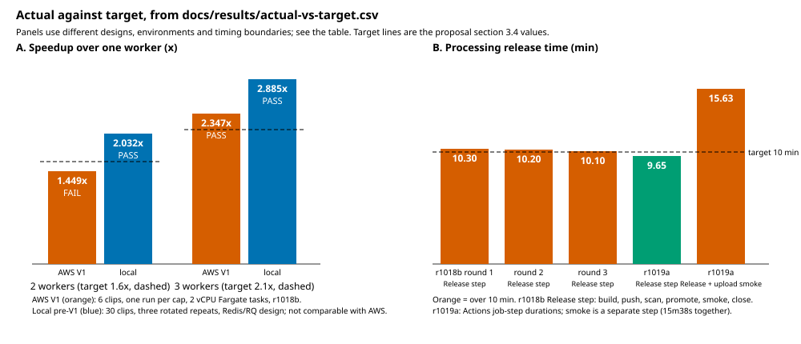

# Actual versus target results

Compact source material for the later deck and report. It restates numbers that already exist in
retained receipts; nothing was rerun and no target was changed. Last updated 20 October 2026. The full
scenario-by-scenario record, including every historical FAIL and NOT_RUN, is
[`docs/evidence-index.md`](../evidence-index.md); this page does not replace it.

- Data: [`actual-vs-target.csv`](actual-vs-target.csv). The table below and the figure are generated from
  it: `python scripts/dev/results_summary.py` (add `--check` to test that they are current).
- Targets are the Team17 proposal, section 3.4 ("Quality scenarios and initial targets"), as written.
- Figure: 

## Read this first

- **Environments are separate.** Local pre-V1 (Redis/RQ design, a different architecture), local V1
  emulated (Moto, no IAM/Lambda/Fargate/Aurora), AWS V1 (`r1017b`, `r1018b`, `r1019a`) and the V2-live
  persistent environment are never mixed in one row. A local result does not stand in for an AWS one.
- **The proposal commits to 30 clips.** AWS ran a **6-clip** backlog, one run per cap. Three rotated
  repeats were the team's local pre-V1 protocol, not an original-proposal promise.
- **Misses stay misses.** AWS two-worker speedup 1.449x against 1.6x is a FAIL. Processing release of
  10.1 to 10.3 min against 10 min in `r1018b` is a FAIL (marginal). The later `r1019a` result is added
  as separate rows and does not relabel the earlier ones.
- **Timing boundaries differ.** The 322.5 s operator-CLI promote step (`r1017b`), the CD `Release` step
  (10.1 to 10.3 min in `r1018b`; 9m39s in `r1019a`) and the `r1019a` Release plus the separate
  5m59s upload-to-playback smoke (15m38s as two consecutive steps) measure different things. None of
  them shows that an upload-smoked Processing release completed within ten minutes.
- **Latency was not measured from users.** Status p90 (58.2 ms) came from a Fargate generator in the
  same region. Login p90 (178 ms) is from 20 samples, one per user.
- **Inference, not finding.** Fargate task-time variability against a fast one-worker baseline is the
  most probable reason for the two-worker miss, as argued in the evidence index. No per-task CPU
  profile was captured, so the cause is unproven.
- **Later evidence has its own rows.** The 19 October V2-live security negatives, rollback,
  scale-to-zero backlog and stale-message repair are below, with their source limits. They do not
  change the earlier V1 results. The frozen runtime is recorded in the
  [release manifest](../release/demo-release-manifest.md); this table is not a current live probe.
- **Not demonstrated:** AWS lost-message timing (NOT_RUN; the command-consumer outage of #196 is a
  different scenario), duplicate-output check and stop-to-done time after a worker kill, the
  Publisher's 2 person-day effort, and actual spend (Cost Explorer showed zero with credits and
  lag; no invoice reviewed). A point-in-time Aurora pause does not establish monthly cost.
- Verdict text in parentheses is a scope limit, for example `PASS (reaction time only)`.

## Definitions

- **Throughput** (AWS): jobs done divided by time from first upload started to last job seen terminal
  (polled every 5 s). **Speedup**: throughput at a cap divided by throughput at cap 1.
- **Local pre-V1** speedup: median throughput of three batches per worker count.
- **Queue wait**: Processing API attempt stamps, so no client clock skew.
- **Unattributed source**: where a receipt does not record a source SHA, the row says so rather than
  guessing.

## Results

<!-- table:start -->

### Scaling

| ID | Scenario | Environment and source | Workload | Timing boundary | Target | Observed | Verdict | Receipt | Note |
|---|---|---|---|---|---|---|---|---|---|
| SC-AWS-1 | Throughput at 1 worker (baseline) | AWS V1 r1018b; run r1018b; source SHA not recorded in the receipt (unverified) | 6-clip backlog, one run per cap, one 36,035,343-byte fixture; each encoder a 2 vCPU / 4 GiB Fargate task; load generated in-region | jobs done / (first upload started to last job seen terminal, polled every 5 s) | none | 0.483 jobs/min | INFO | [cloud-proof-r1018b.json](../execution/aws/v1/evidence/cloud-proof-r1018b.json) `#185 backlog-compare jobs_per_minute.1` | Baseline for the ratios below. Proposal commits to 30 clips; 6 were run. |
| SC-AWS-2 | Throughput at 2 workers | AWS V1 r1018b; same as SC-AWS-1 | same as SC-AWS-1 | same as SC-AWS-1 | none | 0.700 jobs/min | INFO | [cloud-proof-r1018b.json](../execution/aws/v1/evidence/cloud-proof-r1018b.json) `#185 backlog-compare jobs_per_minute.2` | - |
| SC-AWS-3 | Throughput at 3 workers | AWS V1 r1018b; same as SC-AWS-1 | same as SC-AWS-1 | same as SC-AWS-1 | none | 1.134 jobs/min | INFO | [cloud-proof-r1018b.json](../execution/aws/v1/evidence/cloud-proof-r1018b.json) `#185 backlog-compare jobs_per_minute.3` | Cap 3 is the ceiling: account Fargate on-demand quota was 6 vCPU at the time. |
| SC-AWS-4 | Speedup at 2 workers | AWS V1 r1018b; same as SC-AWS-1 | same as SC-AWS-1 | jobs/min at cap 2 divided by jobs/min at cap 1 | >= 1.6 x | 1.449 x | **FAIL** | [cloud-proof-r1018b.json](../execution/aws/v1/evidence/cloud-proof-r1018b.json) `#185 backlog-compare speedup.2` | Miss stands. Drain basis (from first encoder launch) is 1.475x and also below 1.6x. Any cause (Fargate task-time variability against a fast baseline) is an inference; no per-task CPU profile was captured. |
| SC-AWS-5 | Speedup at 3 workers | AWS V1 r1018b; same as SC-AWS-1 | same as SC-AWS-1 | jobs/min at cap 3 divided by jobs/min at cap 1 | >= 2.1 x | 2.347 x | PASS | [cloud-proof-r1018b.json](../execution/aws/v1/evidence/cloud-proof-r1018b.json) `#185 backlog-compare speedup.3` | Six clips and one run per cap: a small sample. |
| SC-AWS-6 | Median queue wait falls at each step and 0 failed jobs | AWS V1 r1018b; same as SC-AWS-1 | same as SC-AWS-1 | Processing API attempt stamps (queued_at to started_at) | falls each step; 0 failed | 274.3 / 135.7 / 9.6 at 1/2/3 workers; 0 failed, 0 encoders left running | PASS | [cloud-proof-r1018b.json](../execution/aws/v1/evidence/cloud-proof-r1018b.json) `#185 backlog-compare median_queue_wait_seconds` | - |
| SC-LOC-1 | Speedup at 2 workers | Local pre-V1 (Redis/RQ design; not the shipped architecture); source f46599f (13 Oct) | 30 clips of one 60 s 1280x720 H264/AAC fixture; three rotated repeats per worker count (nine batches); workers capped at 2 CPU / 1536 MiB; load generator shared the Mac with the VM; 270 of 270 jobs succeeded | median throughput of three batches per worker count | >= 1.6 x | 2.032 x | PASS | [index.json](../execution/evidence/scaling-f46599f/index.json) | Different design and environment. It cannot establish SQS/Fargate performance. Three repeats were the team's local protocol; the original proposal specifies 30 clips only. |
| SC-LOC-2 | Speedup at 3 workers | Local pre-V1 (Redis/RQ design); source f46599f (13 Oct) | same as SC-LOC-1 | same as SC-LOC-1 | >= 2.1 x | 2.885 x | PASS | [index.json](../execution/evidence/scaling-f46599f/index.json) | Same caveat as SC-LOC-1. |
| SC-V1L-1 | Scaling on the shipped V1 design with 30 clips | Local V1 emulated; none | none run | not applicable | - | - | **NOT_RUN** | [evidence-index.md](../evidence-index.md) `Q1g` | The V1 capacity logic is only simulated in tests; no result exists. A 30-clip three-repeat run on AWS was not run either. |

### Deployability

| ID | Scenario | Environment and source | Workload | Timing boundary | Target | Observed | Verdict | Receipt | Note |
|---|---|---|---|---|---|---|---|---|---|
| DP-1 | Processing alone: Release step in CD | AWS V1 r1018b (CD); three CD rounds; source SHAs per round not recorded in this table (unverified) | Processing release with Media unchanged | CD Release step: build, push, scan, plan, promote, release smoke, close; excludes the upload-to-playback smoke | <= 10 min | 10.3, 10.2, 10.1 min | **FAIL** | [r1018b-results.md](../execution/aws/v1/evidence/r1018b-results.md) `Independent releases` | Marginal miss (0.1 to 0.3 min). Not rewritten after the later r1019a result. |
| DP-2 | Processing alone: promote step via operator CLI | AWS V1 r1017b (operator CLI); run r1017b | Processing promote-good with peer unchanged | promote step only; the image build ran before it and is excluded | <= 600 s | 322.5 s | PASS (promote step only) | [cloud-proof-r1017b.json](../execution/aws/v1/evidence/cloud-proof-r1017b.json) `#65 promote-good` | Not comparable with DP-1 or DP-3: different boundary. |
| DP-3 | Processing alone: Release step in CD (later run) | AWS V1 r1019a (CD); run 39087966647; source 358d169d6b0d0fc0f1e5ce809ffc8f1ad02fc592 | Processing release promoted; release health checks PASS | Release job step only (01:52:16 to 02:01:55 UTC from the Actions job API) | <= 10 min | 9m39s (9.65 min) | PASS (step only) | [release.json](../execution/aws/v1/evidence/archive-20261018/r1019a-release-39087966647/release.json) | Does not overwrite DP-1. Step timings are from the run's job record (not in the JSON). |
| DP-4 | Processing alone: release plus separate upload-to-playback smoke (r1019a) | AWS V1 r1019a (CD); run 39087966647; source 358d169d6b0d0fc0f1e5ce809ffc8f1ad02fc592 | Same run as DP-3 | consecutive job steps Release then Smoke test (01:52:16 to 02:07:54 UTC); smoke step alone 5m59s | <= 10 min | 15m38s (15.63 min) for both steps in sequence | **NOT ESTABLISHED within 10 min** | [cloud-proof-smoke-39087966647-1.json](../execution/aws/v1/evidence/archive-20261018/r1019a-release-39087966647/cloud-proof-smoke-39087966647-1.json) `#63 direct-upload-e2e (PASS)` | Whether the target's 'smoke-tested' includes the upload smoke is an interpretation the proposal text does not settle. Neither DP-2 nor DP-3 shows the upload-smoked release completed within ten minutes. |
| DP-5 | Media alone: Release step in CD | AWS V1 r1018b (CD); three CD rounds | Media release (not in the proposal target; the target names Processing) | CD Release step | none in proposal | 8.0, 8.0, 8.2 min | INFO | [r1018b-results.md](../execution/aws/v1/evidence/r1018b-results.md) `Independent releases` | - |
| DP-6 | Post-release upload-to-playback smoke in CD | AWS V1 r1018b (CD); five runs that reached it | after each Processing/Media release | smoke step | passes | 0 of 5 passed (three different causes) | **FAIL** | [r1018b-results.md](../execution/aws/v1/evidence/r1018b-results.md) `Q7d in evidence index` | Later fixed and passed in r1019a (DP-4); the r1018b FAIL stays. |

### Performance

| ID | Scenario | Environment and source | Workload | Timing boundary | Target | Observed | Verdict | Receipt | Note |
|---|---|---|---|---|---|---|---|---|---|
| PF-1 | Status polling p90 | AWS V1 r1017b; run r1017b | 50 users polling status for 3 min; 9000 requests; 0 errors; generator is a Fargate task in the same region | client-side request latency from an in-region generator, not from end users | <= 700 ms | 58.2 ms | PASS | [cloud-proof-r1017b.json](../execution/aws/v1/evidence/cloud-proof-r1017b.json) `#66 generator.status_cycle` | Not general end-user latency. |
| PF-2 | Status polling p90 | Local pre-V1; source f46599f | 50 users, 3 min, three repeats; 8999/8999/9000 requests; 0 errors | client-side from the local generator | <= 700 ms | 605.0, 580.2, 544.0 ms | PASS | [index.json](../execution/evidence/performance-f46599f/index.json) | - |
| PF-3 | Login p90 | AWS V1 r1017b; run r1017b | 20 concurrent logins as 20 samples (one per user); 0 errors | in-region generator | < 2000 ms | 178.0 ms | PASS | [cloud-proof-r1017b.json](../execution/aws/v1/evidence/cloud-proof-r1017b.json) `#66 generator.login_cycle` | Only 20 samples. Hash cost is configured in source and not read back from the deployed service. |
| PF-4 | Login p90 | Local pre-V1; source f46599f | 20 concurrent logins; three repeats | local generator | < 2000 ms | 1873.0, 1888.1, 1898.5 ms | PASS | [index.json](../execution/evidence/performance-f46599f/index.json) | Margin is only 101 to 127 ms. |

### Availability

| ID | Scenario | Environment and source | Workload | Timing boundary | Target | Observed | Verdict | Receipt | Note |
|---|---|---|---|---|---|---|---|---|---|
| AV-1 | Worker killed mid-encode: reaction | AWS V1 r1017b; run r1017b | one encoder task stopped mid-encode | stop to platform reaction; stop_to_done_seconds not recorded (null) | <= 300 (re-queued or failed) | 5.8 s | PASS (reaction time only) | [cloud-proof-r1017b.json](../execution/aws/v1/evidence/cloud-proof-r1017b.json) `#64 recovery` | Full criterion (retry succeeds, no duplicate outputs, stop-to-done) is not evidenced: the receipt has no duplicate-output check. |
| AV-2 | Worker killed mid-encode | Local pre-V1; source 422609b | kill during encode | visibility of the kill 69.2 s; whole recovery run 190.6 s | <= 300 s | 190.6 s | PASS | [recovery.json](../execution/evidence/local-workflow-422609b/recovery.json) | Different design. |
| AV-3 | Lost queue entry re-enqueued within 2 min | AWS V1; none | none run | not applicable | <= 120 s | not measured | **NOT_RUN** | [evidence-index.md](../evidence-index.md) `Q5c` | The 120 s figure on AWS is a design bound. Disabling only the command consumer (#196) is a different scenario. |
| AV-4 | Lost queue entry re-enqueued | Local pre-V1 and local V1 emulated; pre-V1 recovery.json; V1 tests/v1/test_delivery_recovery_sql.py | repair after a lost work message (V1: simulated clock) | pre-V1 real timing 23.5 s; V1 simulated clock asserts <= 120 s | <= 120 s | 23.5 (pre-V1); <= 120 asserted (V1 simulated) | PASS (local/simulated) | [recovery.json](../execution/evidence/local-workflow-422609b/recovery.json) | Not AWS evidence. |
| AV-5 | Processing temporarily unavailable (failure case 3) | AWS V1 r1018b; run r1018b | Processing command consumer disabled 48 s; Media kept accepting (202) | consumer off to job done 58.9 s after re-enable | Media accepts and job completes | 202 accepted; done 58.9 s after re-enable | PASS (consumer only) | [cloud-proof-r1018b.json](../execution/aws/v1/evidence/cloud-proof-r1018b.json) `#196 processing-down` | First attempt FAILED (harness bug fixed in #218); rerun PASS. The Processing API stayed up so this is not a full outage. |

### Security

| ID | Scenario | Environment and source | Workload | Timing boundary | Target | Observed | Verdict | Receipt | Note |
|---|---|---|---|---|---|---|---|---|---|
| SE-1 | Negative tests rejected (AWS checks run) | AWS V1 r1017b and r1018b; runs r1017b and r1018b | anonymous, forged identity, direct SQS send, cross-database, CORS | per check | 100% rejected | all checks run rejected | PASS (checks run) | [cloud-proof-r1018b.json](../execution/aws/v1/evidence/cloud-proof-r1018b.json) `#63` | Not run on AWS: two-user ownership (S2), expired/tampered presigned URLs (S5c), 100 MiB limit on real S3 bytes (S6), external port scan (S7). These four were later run and passed on dc2-live (#229, closed 19 Oct): see LV-6. |
| SE-2 | Fixable HIGH/CRITICAL image findings at release | CI and AWS r1018b releases; Trivy with ignore-unfixed; ECR scan gate | three images | at release | 0 count | 0 count | PASS | [scan-accepted-unfixed-20261017.json](../execution/aws/v1/scan-accepted-unfixed-20261017.json) | 14 unfixed findings are accepted (one CRITICAL) and still ship; the target counts fixable ones only. |

### Reuse

| ID | Scenario | Environment and source | Workload | Timing boundary | Target | Observed | Verdict | Receipt | Note |
|---|---|---|---|---|---|---|---|---|---|
| RU-1 | Publisher imports from service code and database credentials | Code; Publisher package at Main | static check and AST test | not applicable | 0 and 0 | 0 and 0 | PASS | [test_publisher.py](../../tests/publisher/test_publisher.py) `test_module_entry_and_import_boundary` | The 2 person-day build-effort target is NOT MEASURED: no effort log records person-days. |
| RU-2 | Publisher build effort | not measured; none | none | none | <= 2 person-days | not measured | **NOT_MEASURED** | [evidence-index.md](../evidence-index.md) `Reuse (Q9)` | - |

### Cost

| ID | Scenario | Environment and source | Workload | Timing boundary | Target | Observed | Verdict | Receipt | Note |
|---|---|---|---|---|---|---|---|---|---|
| CO-1 | Actual spend | AWS; Cost Explorer | r1017b and r1018b sessions | estimate with about one day lag | none in proposal (planning ceiling 15 USD; model estimate 1.5 to 3 USD) | 0.00 reported | **PENDING** | [evidence-index.md](../evidence-index.md) `Observability and cost` | Zero with credits applied and lagged data is not evidence of zero actual spend. No invoice reviewed. |

### Newer live evidence (r1019a and V2-live)

| ID | Scenario | Environment and source | Workload | Timing boundary | Target | Observed | Verdict | Receipt | Note |
|---|---|---|---|---|---|---|---|---|---|
| LV-1 | r1019a CD deploy plus upload-to-playback smoke | AWS V1 r1019a (CD); run 39085599276; source 0b491e1712a9e4423e7f53bc2c813191d25669e8 | one smoke upload | request accepted to job done | none | 108.5 s | INFO (smoke PASS) | [cloud-proof-smoke-39085599276-1.json](../execution/aws/v1/evidence/archive-20261018/r1019a-deploy-39085599276/cloud-proof-smoke-39085599276-1.json) `#63 direct-upload-e2e seconds_to_terminal` | Single sample. Receipt roll-up for #63 is INCOMPLETE. |
| LV-2 | r1019a Processing release plus upload-to-playback smoke | AWS V1 r1019a (CD); run 39087966647; source 358d169d6b0d0fc0f1e5ce809ffc8f1ad02fc592 | one smoke upload | request accepted to job done | none | 150.0 s | INFO (smoke PASS) | [cloud-proof-smoke-39087966647-1.json](../execution/aws/v1/evidence/archive-20261018/r1019a-release-39087966647/cloud-proof-smoke-39087966647-1.json) `#63 direct-upload-e2e seconds_to_terminal` | Single sample. |
| LV-3 | r1019a CD teardown | AWS V1 r1019a (CD); run 39089615147; source 0b491e1712a9e4423e7f53bc2c813191d25669e8 | teardown of the per-run stack | receipt status | CLEAN | CLEAN | PASS | [teardown.json](../execution/aws/v1/evidence/archive-20261018/r1019a-teardown-39089615147/teardown.json) | A CD teardown now completes CLEAN once; the two r1018b CD teardown failures stand in the evidence index. |
| LV-4 | CD bad-candidate rollback test | AWS V1 r1019a (CD); cancelled run 39089045496 (bad_candidate=true; source 784318636b690aac6ca64f0f8817ae7a15b6cae7) | deliberate faulty candidate | cancelled during the Release step | restored automatically | run cancelled before a result | **NOT_RUN (cancelled)** | [Actions run](https://github.com/Collaboration95/dc2/actions/runs/39089045496) | Not a PASS or FAIL of the rollback path. Bad-candidate restore evidence remains the operator receipts (Q7f/Q7g). |
| LV-5 | Persistent environment deploy plus upload-to-playback smoke | AWS V2-live (stack dc2-live); run 39105817431; source d2070db68c6b3545881eb948046b8e57f47e078e | one smoke upload | request accepted to job done | none | 123.8 s | INFO (smoke PASS) | [cloud-proof-smoke-39105817431-1.json](../execution/aws/v1/evidence/archive-20261018/live-deploy-39105817431/cloud-proof-smoke-39105817431-1.json) `#63 direct-upload-e2e seconds_to_terminal` | Basic live evidence. Not completion of every #238 acceptance row; #229 security negatives are NOT_RUN. |
| LV-6 | Security negatives on persistent environment | AWS V2-live (dc2-live); 19 October; earlier than daee44b; exact candidate SHA not recorded in merged receipt | two owners, signed upload/playback controls, oversized bytes, public endpoint probes | per negative and positive control | all selected controls pass | selected controls passed | PASS (checks run) | [cloud-proof-s229live.json](../execution/aws/v1/evidence/cloud-proof-s229live.json) `#229` | Three attempts merged; early harness failures and corrections are documented in s229-live-results.md. IPv6 was not scanned. Not repeated on daee44b. |
| LV-7 | Automatic worker scale 0 to 3 to 0 | AWS V2-live (dc2-live); 19 October before daee44b; exact source not recorded in scaling receipt | three concurrent 20 s 640x360 clips | ECS task counts and task timestamps | 0 -> 3 -> 0 | 0 -> 3 -> 0 | PASS | [scaling-and-backlog.json](../execution/aws/v1/evidence/v2live-verify-20261019/scaling-and-backlog.json) `three_clips_concurrent` | One run, one cookie jar per Publisher process; queue-wait miss is LV-8. |
| LV-8 | Warm-job observed queue wait | AWS V2-live (dc2-live); same run as LV-7 | same as LV-7 | observed status transitions and ECS stamps; not Processing database timestamps | <= 20 s | about 37 | **FAIL** | [scaling-and-backlog.json](../execution/aws/v1/evidence/v2live-verify-20261019/scaling-and-backlog.json) `three_clips_concurrent; encoder_task_timing_n12` | ECS created-to-started median 25.6 s across 12 tasks; this includes Fargate startup, not a measured Python-only boot time. |
| LV-9 | Backlog at a fixed worker cap of 3 | AWS V2-live (dc2-live); 19 October before daee44b; exact source not recorded in scaling receipt | nine 20 s 640x360 clips, one run, cap 3 | first submission to last job observed done | none | 239 (2.26 jobs/min) | INFO | [scaling-and-backlog.json](../execution/aws/v1/evidence/v2live-verify-20261019/scaling-and-backlog.json) `backlog_nine_clips` | No measured cap-1/cap-2 comparison. The calculated serial baseline is not an experiment. This run left stale messages; LV-11 records the repair re-test. |
| LV-10 | Bad-candidate Processing release restores itself | AWS V2-live (dc2-live); run 39271754470; source 7928b7c | deliberately failing candidate | candidate smoke failure to recorded restore outcome | restored automatically | restored | PASS (earlier source) | [release-processing.json](../execution/aws/v1/evidence/v2live-verify-20261019/cd-39271754470-bad-candidate-rollback/release-processing.json) `outcome; smoke.failures` | processing-jobs:503 triggered restore. Not re-proven on frozen daee44b or the quality candidate. Earlier cancelled LV-4 remains NOT_RUN. |
| LV-11 | Stale duplicate work drains without manual purge | AWS V2-live (dc2-live); source daee44b61a6e8eef3f62505df69f8bfd076d68b8; CD 39286933644 | nine copies of a 303113-byte synthetic clip; nine Publisher processes | queue sampled every 30 s; first both-zero at 17:11:01Z | both queue counts zero within about 2 min of completion | 9/9 done; 0 visible and 0 in flight; no purge | PASS | [burst-270-recheck.json](../execution/aws/v1/evidence/v2live-verify-20261019/burst-270-recheck.json) `verdict; queue_samples_every_30s; purge_used` | One run; SQS counts are approximate. 18 sends for nine jobs means duplicate sends still occur. No claim that duplication was eliminated. |
| LV-12 | Aurora reaches zero capacity after idle | AWS V2-live (dc2-live); source daee44b; recorded observation 19 October 18:07 UTC | after the nine-clip re-test | CloudWatch ServerlessDatabaseCapacity 1-minute maximum | 0 ACU | 0.0 ACU | PASS (point in time) | [demo-release-manifest.md](../release/demo-release-manifest.md) `Acceptance rows: Aurora auto-pause` | About 56 min after last upload. Later periodic sweeps may wake SQL; sustained idle cost and monthly spend are not measured. |

<!-- table:end -->
