# R2 — Runtime, request and deployment truth

Research baseline: Main `76282d3` (`76282d3b5a141f6548056f2506f9d5aff0742692`), inspected locally on 26 October 2026. This is a source/IaC reconstruction of **the configured `dc2-live` environment**, not a fresh AWS inventory or evidence that this commit is deployed. No cloud resources were read or changed. `AGENTS.md` is absent from this worktree; the task's supplied GitHub instruction was followed. Only this report was written.

All implementation citations below are GitHub permalinks to that commit. The deployment builder is executable IaC: `scripts/aws/v1/definitions.py`, not just the checked-in default `deploy/aws/v1/template.json`. Deployment actually calls `render_template(self.s.database)`; topology is selected when rendering. [scripts/aws/v1/deploy.py:1489](https://github.com/Collaboration95/dc2/blob/76282d3/scripts/aws/v1/deploy.py#L1489) [scripts/aws/v1/definitions.py:208](https://github.com/Collaboration95/dc2/blob/76282d3/scripts/aws/v1/definitions.py#L208)

## 0. Which deployment this describes

| Input / boundary | Source-established configuration |
|---|---|
| Persistent environment and region | CD defaults to `live`; `env_name(..., persistent=True)` produces `dc2-live`. CD fixes `ap-southeast-1`. [.github/workflows/cd.yml:104](https://github.com/Collaboration95/dc2/blob/76282d3/.github/workflows/cd.yml#L104) [scripts/aws/v1/deploy.py:669](https://github.com/Collaboration95/dc2/blob/76282d3/scripts/aws/v1/deploy.py#L669) [scripts/ci/cd.sh:20](https://github.com/Collaboration95/dc2/blob/76282d3/scripts/ci/cd.sh#L20) |
| Database topology | CD supplies `--database-topology separate`; the live environment may split a previously shared database in place. Media retains `DatabaseCluster`; Processing adds `ProcessingDatabaseCluster`. A split-created Processing cluster retains its copy-on-write clone properties. This flag/transition is not proof that the split completed in AWS. [scripts/ci/cd.sh:52](https://github.com/Collaboration95/dc2/blob/76282d3/scripts/ci/cd.sh#L52) [.github/workflows/cd.yml:105](https://github.com/Collaboration95/dc2/blob/76282d3/.github/workflows/cd.yml#L105) [scripts/aws/v1/definitions.py:215](https://github.com/Collaboration95/dc2/blob/76282d3/scripts/aws/v1/definitions.py#L215) [scripts/aws/v1/deploy.py:2680](https://github.com/Collaboration95/dc2/blob/76282d3/scripts/aws/v1/deploy.py#L2680) |
| Unattended launch and short encoder | Persistent settings force unattended launch; `PERSISTENT_LAMBDA_SHORT_ENCODES = True` enables the short lane. These override the per-run V1 defaults. [scripts/aws/v1/deploy.py:108](https://github.com/Collaboration95/dc2/blob/76282d3/scripts/aws/v1/deploy.py#L108) [scripts/aws/v1/deploy.py:640](https://github.com/Collaboration95/dc2/blob/76282d3/scripts/aws/v1/deploy.py#L640) |
| Open/closed gates | Always-on/open is conditional: `Applications`, `Unattended`, `ShortEncodes`, `AlwaysOnEnv`, `AlwaysOpen`. An operator kill switch can leave routes throttled to zero, mappings disabled and schedules disabled across an update. Thus configured resources do not prove the gates are currently open. [scripts/aws/v1/definitions.py:247](https://github.com/Collaboration95/dc2/blob/76282d3/scripts/aws/v1/definitions.py#L247) [scripts/aws/v1/definitions.py:2051](https://github.com/Collaboration95/dc2/blob/76282d3/scripts/aws/v1/definitions.py#L2051) [scripts/aws/v1/definitions.py:1516](https://github.com/Collaboration95/dc2/blob/76282d3/scripts/aws/v1/definitions.py#L1516) |
| Default V1 JSON is different | `DatabaseOptions()` defaults to shared, 300-second pause and 2 ACU maximum; template flags default unattended/short encodes/always-on to false. Do not count a live deployment from these defaults. [scripts/aws/v1/definitions.py:51](https://github.com/Collaboration95/dc2/blob/76282d3/scripts/aws/v1/definitions.py#L51) [scripts/aws/v1/definitions.py:72](https://github.com/Collaboration95/dc2/blob/76282d3/scripts/aws/v1/definitions.py#L72) [scripts/aws/v1/definitions.py:237](https://github.com/Collaboration95/dc2/blob/76282d3/scripts/aws/v1/definitions.py#L237) |

With applications, unattended launch and short encodes enabled, and separate databases, the builder contains **11 Lambda functions, 3 event-source mappings, 4 application queues + 4 DLQs, 5 EventBridge rules, 2 Aurora clusters with 1 instance each, 3 application S3 buckets, 3 ECR repositories, 1 ECS cluster, 4 task definitions, 19 IAM roles and 15 CloudWatch alarms**. These counts were independently computed from an in-memory render; their definitions are itemized in section 5. The optional budget email subscription depends separately on a nonempty email. [scripts/aws/v1/definitions.py:283](https://github.com/Collaboration95/dc2/blob/76282d3/scripts/aws/v1/definitions.py#L283) [scripts/aws/v1/definitions.py:596](https://github.com/Collaboration95/dc2/blob/76282d3/scripts/aws/v1/definitions.py#L596) [scripts/aws/v1/definitions.py:632](https://github.com/Collaboration95/dc2/blob/76282d3/scripts/aws/v1/definitions.py#L632) [scripts/aws/v1/definitions.py:501](https://github.com/Collaboration95/dc2/blob/76282d3/scripts/aws/v1/definitions.py#L501) [scripts/aws/v1/definitions.py:1267](https://github.com/Collaboration95/dc2/blob/76282d3/scripts/aws/v1/definitions.py#L1267) [scripts/aws/v1/definitions.py:1306](https://github.com/Collaboration95/dc2/blob/76282d3/scripts/aws/v1/definitions.py#L1306) [scripts/aws/v1/definitions.py:1739](https://github.com/Collaboration95/dc2/blob/76282d3/scripts/aws/v1/definitions.py#L1739) [scripts/aws/v1/definitions.py:1797](https://github.com/Collaboration95/dc2/blob/76282d3/scripts/aws/v1/definitions.py#L1797) [scripts/aws/v1/definitions.py:1976](https://github.com/Collaboration95/dc2/blob/76282d3/scripts/aws/v1/definitions.py#L1976) [scripts/aws/v1/definitions.py:992](https://github.com/Collaboration95/dc2/blob/76282d3/scripts/aws/v1/definitions.py#L992)

## 1. Public request paths and authorization

### 1.1 Edge, Gateway and authorizer

The normal API path is:

`Browser / Publisher → CloudFront Distribution, /api/* behavior → HttpApi ($default stage, HTTP API) → GatewayAuthorizer where CUSTOM → MediaApiAlias or ProcessingApiAlias → GatewayAdapter → FastAPI route`.

This is **API Gateway v2 HTTP API**, not REST API. There are two `AWS_PROXY` Lambda integrations, payload format `2.0`, integration timeout 29,000 ms. The stage's configured open limits are 20 requests/s and burst 50. CloudFront's static default origin is `FrontendBucket` through SigV4 OAC; `/api/*` uses the Gateway HTTPS origin and the configured disabled-cache policy. Authenticated responses also set `private, no-store`. [scripts/aws/v1/definitions.py:1500](https://github.com/Collaboration95/dc2/blob/76282d3/scripts/aws/v1/definitions.py#L1500) [scripts/aws/v1/definitions.py:253](https://github.com/Collaboration95/dc2/blob/76282d3/scripts/aws/v1/definitions.py#L253) [scripts/aws/v1/definitions.py:1560](https://github.com/Collaboration95/dc2/blob/76282d3/scripts/aws/v1/definitions.py#L1560) [scripts/aws/v1/definitions.py:1622](https://github.com/Collaboration95/dc2/blob/76282d3/scripts/aws/v1/definitions.py#L1622) [scripts/aws/v1/definitions.py:1642](https://github.com/Collaboration95/dc2/blob/76282d3/scripts/aws/v1/definitions.py#L1642) [scripts/aws/v1/definitions.py:1683](https://github.com/Collaboration95/dc2/blob/76282d3/scripts/aws/v1/definitions.py#L1683) [contracts/gateway.py:149](https://github.com/Collaboration95/dc2/blob/76282d3/contracts/gateway.py#L149)

CloudFront is **not an enforced exclusive entry point**: the execute-api endpoint remains public in this IaC. The API definition does not disable it or add an origin restriction, and the stack exports `HttpApiUrl`. The same Gateway authorization still applies when it is called directly. No WAF or CloudFront-only API policy is defined by this builder. [scripts/aws/v1/definitions.py:1500](https://github.com/Collaboration95/dc2/blob/76282d3/scripts/aws/v1/definitions.py#L1500) [scripts/aws/v1/definitions.py:1602](https://github.com/Collaboration95/dc2/blob/76282d3/scripts/aws/v1/definitions.py#L1602) [scripts/aws/v1/definitions.py:2142](https://github.com/Collaboration95/dc2/blob/76282d3/scripts/aws/v1/definitions.py#L2142)

`GatewayAuthorizer` is a **Lambda REQUEST authorizer**, name `MediaIdentity`, payload v2, simple boolean response, cache TTL **0**, identity source **`$request.header.Cookie`**. It invokes `MediaAuthorizerAlias`; it is not the managed API Gateway JWT authorizer, although the Lambda verifies a JWT. Its configured entry point is `media.lambda_handler.authorizer`, a re-export of `media.authorizer.handler`. [scripts/aws/v1/definitions.py:1529](https://github.com/Collaboration95/dc2/blob/76282d3/scripts/aws/v1/definitions.py#L1529) [scripts/aws/v1/definitions.py:283](https://github.com/Collaboration95/dc2/blob/76282d3/scripts/aws/v1/definitions.py#L283) [media/lambda_handler.py:3](https://github.com/Collaboration95/dc2/blob/76282d3/media/lambda_handler.py#L3)

What it validates and passes:

1. Payload must be version `2.0` with a request context. Cookies must contain exactly one `access_token`; missing/ambiguous/invalid cookies fail closed. [media/authorizer.py:23](https://github.com/Collaboration95/dc2/blob/76282d3/media/authorizer.py#L23) [media/authorizer.py:40](https://github.com/Collaboration95/dc2/blob/76282d3/media/authorizer.py#L40)
2. `read_token()` verifies the HS256 JWT using Media's secret, requires `sub`, `exp`, `iat`, and parses `sub` as a UUID. There is no issuer/JWKS/OIDC-provider check in this implementation. [media/services/security.py:48](https://github.com/Collaboration95/dc2/blob/76282d3/media/services/security.py#L48)
3. It reads the **current `users` row in Media's DB**, denies a missing user or unsupported current role, and maps both `user` and `operator` to contract role `publisher`. It never emits `viewer` or a Gateway `operator` role. Exceptions deny authorization. [media/authorizer.py:13](https://github.com/Collaboration95/dc2/blob/76282d3/media/authorizer.py#L13) [media/authorizer.py:40](https://github.com/Collaboration95/dc2/blob/76282d3/media/authorizer.py#L40)
4. Success is `{isAuthorized: true, context: {schema_version: 1, integration: "dc2-gateway-v1", owner_id, role: "publisher"}}`. The adapter reads `requestContext.authorizer.lambda`, validates `Actor`, strips client `x-owner-id` / `x-role`, preserves the Gateway cookies, and injects `request.state.actor` and `gateway_v1=True`. [contracts/v1.py:20](https://github.com/Collaboration95/dc2/blob/76282d3/contracts/v1.py#L20) [contracts/v1.py:69](https://github.com/Collaboration95/dc2/blob/76282d3/contracts/v1.py#L69) [contracts/gateway.py:33](https://github.com/Collaboration95/dc2/blob/76282d3/contracts/gateway.py#L33) [contracts/gateway.py:58](https://github.com/Collaboration95/dc2/blob/76282d3/contracts/gateway.py#L58) [contracts/gateway.py:78](https://github.com/Collaboration95/dc2/blob/76282d3/contracts/gateway.py#L78)
5. **Media still receives and revalidates the cookie** and rereads the current user, then compares it with the trusted Actor. Admin routes separately require current DB role `operator`. Processing requires only adapter-injected `Actor`; retry/delete require `publisher`. Processing does not receive Media's JWT secret or access its user table from its handler. Protected Processing requests nevertheless depend synchronously on the Media authorizer's user lookup. [media/api/deps.py:16](https://github.com/Collaboration95/dc2/blob/76282d3/media/api/deps.py#L16) [media/api/deps.py:45](https://github.com/Collaboration95/dc2/blob/76282d3/media/api/deps.py#L45) [processing/auth.py:6](https://github.com/Collaboration95/dc2/blob/76282d3/processing/auth.py#L6) [processing/v1_api.py:34](https://github.com/Collaboration95/dc2/blob/76282d3/processing/v1_api.py#L34) [scripts/aws/v1/definitions.py:809](https://github.com/Collaboration95/dc2/blob/76282d3/scripts/aws/v1/definitions.py#L809)

### 1.2 The nine Gateway routes

`CUSTOM` below means the exact Lambda REQUEST authorizer above. All route targets are aliases named `live`, not naked `$LATEST` functions. Prefix removal and routing to ASGI occur inside the corresponding `GatewayAdapter`. [scripts/aws/v1/definitions.py:1257](https://github.com/Collaboration95/dc2/blob/76282d3/scripts/aws/v1/definitions.py#L1257) [contracts/gateway.py:48](https://github.com/Collaboration95/dc2/blob/76282d3/contracts/gateway.py#L48)

| Gateway route key | Authorization | Integration / Lambda entry point |
|---|---|---|
| `ANY /api/media/{proxy+}` | CUSTOM | `MediaIntegration → MediaApiAlias → media.lambda_handler.handler`. [scripts/aws/v1/definitions.py:1602](https://github.com/Collaboration95/dc2/blob/76282d3/scripts/aws/v1/definitions.py#L1602) [media/lambda_handler.py:14](https://github.com/Collaboration95/dc2/blob/76282d3/media/lambda_handler.py#L14) |
| `ANY /api/media` | CUSTOM | Same Media integration; exact root is rejected with 404 by the adapter because it requires prefix plus `/`. [scripts/aws/v1/definitions.py:1603](https://github.com/Collaboration95/dc2/blob/76282d3/scripts/aws/v1/definitions.py#L1603) [contracts/gateway.py:54](https://github.com/Collaboration95/dc2/blob/76282d3/contracts/gateway.py#L54) |
| `GET /api/media/health` | NONE | Same Media integration. [scripts/aws/v1/definitions.py:1605](https://github.com/Collaboration95/dc2/blob/76282d3/scripts/aws/v1/definitions.py#L1605) [media/main.py:43](https://github.com/Collaboration95/dc2/blob/76282d3/media/main.py#L43) |
| `POST /api/media/auth/register` | NONE | Same Media integration. [scripts/aws/v1/definitions.py:1607](https://github.com/Collaboration95/dc2/blob/76282d3/scripts/aws/v1/definitions.py#L1607) [media/api/auth.py:33](https://github.com/Collaboration95/dc2/blob/76282d3/media/api/auth.py#L33) |
| `POST /api/media/auth/login` | NONE | Same Media integration. [scripts/aws/v1/definitions.py:1607](https://github.com/Collaboration95/dc2/blob/76282d3/scripts/aws/v1/definitions.py#L1607) [media/api/auth.py:47](https://github.com/Collaboration95/dc2/blob/76282d3/media/api/auth.py#L47) |
| `POST /api/media/auth/logout` | NONE | Same Media integration. [scripts/aws/v1/definitions.py:1607](https://github.com/Collaboration95/dc2/blob/76282d3/scripts/aws/v1/definitions.py#L1607) [media/api/auth.py:62](https://github.com/Collaboration95/dc2/blob/76282d3/media/api/auth.py#L62) |
| `ANY /api/processing/{proxy+}` | CUSTOM | `ProcessingIntegration → ProcessingApiAlias → processing.lambda_handler.handler`. [scripts/aws/v1/definitions.py:1560](https://github.com/Collaboration95/dc2/blob/76282d3/scripts/aws/v1/definitions.py#L1560) [scripts/aws/v1/definitions.py:1602](https://github.com/Collaboration95/dc2/blob/76282d3/scripts/aws/v1/definitions.py#L1602) [processing/lambda_handler.py:13](https://github.com/Collaboration95/dc2/blob/76282d3/processing/lambda_handler.py#L13) |
| `ANY /api/processing` | CUSTOM | Same Processing integration; adapter returns 404 at exact root. [scripts/aws/v1/definitions.py:1604](https://github.com/Collaboration95/dc2/blob/76282d3/scripts/aws/v1/definitions.py#L1604) [contracts/gateway.py:54](https://github.com/Collaboration95/dc2/blob/76282d3/contracts/gateway.py#L54) |
| `GET /api/processing/health` | NONE | Same Processing integration. [scripts/aws/v1/definitions.py:1605](https://github.com/Collaboration95/dc2/blob/76282d3/scripts/aws/v1/definitions.py#L1605) [processing/v1_api.py:138](https://github.com/Collaboration95/dc2/blob/76282d3/processing/v1_api.py#L138) |

### 1.3 Every mounted application API route

Every row uses the CloudFront/Gateway/integration path above. `A` = CUSTOM authorizer + current owner; `O` = same authorizer + Media's current operator check; `P` = same authorizer + Processing publisher check; `—` = Gateway NONE. Media `{job_id}` is the public **Asset ID**; Processing `{job_id}` is the Processing **Job ID**. These IDs are not interchangeable. [media/api/v1_jobs.py:43](https://github.com/Collaboration95/dc2/blob/76282d3/media/api/v1_jobs.py#L43) [media/api/uploads.py:43](https://github.com/Collaboration95/dc2/blob/76282d3/media/api/uploads.py#L43) [processing/v1_api.py:162](https://github.com/Collaboration95/dc2/blob/76282d3/processing/v1_api.py#L162)

| Method and full public path | Auth | Lambda → route function / behavior | Code |
|---|---|---|---|
| `GET /api/media/health` | — | MediaApi → `build_app.health`; version/status, no DB readiness probe | [media/main.py:43](https://github.com/Collaboration95/dc2/blob/76282d3/media/main.py#L43) |
| `POST /api/media/auth/register` | — | MediaApi → `auth.register`; creates user and session cookie | [media/api/auth.py:33](https://github.com/Collaboration95/dc2/blob/76282d3/media/api/auth.py#L33) |
| `POST /api/media/auth/login` | — | MediaApi → `auth.login`; bcrypt verification and session cookie | [media/api/auth.py:47](https://github.com/Collaboration95/dc2/blob/76282d3/media/api/auth.py#L47) |
| `POST /api/media/auth/logout` | — | MediaApi → `auth.logout`; clears cookie | [media/api/auth.py:62](https://github.com/Collaboration95/dc2/blob/76282d3/media/api/auth.py#L62) |
| `GET /api/media/auth/me` | A | MediaApi → `auth.me` | [media/api/auth.py:69](https://github.com/Collaboration95/dc2/blob/76282d3/media/api/auth.py#L69) |
| `POST /api/media/uploads/reservations` | A | MediaApi → `uploads.reserve_upload`; returns S3 POST grant | [media/api/uploads.py:18](https://github.com/Collaboration95/dc2/blob/76282d3/media/api/uploads.py#L18) |
| `POST /api/media/uploads/reservations/{reservation_id}/finalize` | A | MediaApi → `uploads.finalize_upload`; durable acceptance, 202 | [media/api/uploads.py:25](https://github.com/Collaboration95/dc2/blob/76282d3/media/api/uploads.py#L25) |
| `GET /api/media/jobs` | A | MediaApi → `v1_jobs.listing`; local projections, limit 1–200, offset | [media/api/v1_jobs.py:19](https://github.com/Collaboration95/dc2/blob/76282d3/media/api/v1_jobs.py#L19) |
| `GET /api/media/jobs/{job_id}` | A | MediaApi → `v1_jobs.read`; local projection and output grants | [media/api/v1_jobs.py:43](https://github.com/Collaboration95/dc2/blob/76282d3/media/api/v1_jobs.py#L43) |
| `POST /api/media/jobs/{job_id}/retry` | A | MediaApi → `v1_jobs.retry`; retry command in Media outbox, 202 | [media/api/v1_jobs.py:49](https://github.com/Collaboration95/dc2/blob/76282d3/media/api/v1_jobs.py#L49) |
| `POST /api/media/jobs/{job_id}/edit` | A | MediaApi → `v1_jobs.edit`; new derived Asset and submit command, 202 | [media/api/v1_jobs.py:55](https://github.com/Collaboration95/dc2/blob/76282d3/media/api/v1_jobs.py#L55) |
| `DELETE /api/media/jobs/{job_id}` | A | MediaApi → `v1_jobs.remove`; tombstone + cancel command, 204 | [media/api/v1_jobs.py:68](https://github.com/Collaboration95/dc2/blob/76282d3/media/api/v1_jobs.py#L68) |
| `GET /api/media/admin/jobs` | O | MediaApi → `v1_jobs.admin_listing`; cross-owner list | [media/api/v1_jobs.py:74](https://github.com/Collaboration95/dc2/blob/76282d3/media/api/v1_jobs.py#L74) |
| `DELETE /api/media/admin/jobs/{job_id}` | O | MediaApi → `v1_jobs.admin_remove`; same tombstone/cancel path | [media/api/v1_jobs.py:86](https://github.com/Collaboration95/dc2/blob/76282d3/media/api/v1_jobs.py#L86) |
| `GET /api/media/jobs/{job_id}/hls/{path:path}` | A | MediaApi → `v1_hls.part`; `.m3u8` body or `.ts` 307 to S3 | [media/api/v1_hls.py:25](https://github.com/Collaboration95/dc2/blob/76282d3/media/api/v1_hls.py#L25) |
| `GET /api/processing/health` | — | ProcessingApi → `create_app.health`; no DB connection | [processing/v1_api.py:138](https://github.com/Collaboration95/dc2/blob/76282d3/processing/v1_api.py#L138) |
| `GET /api/processing/jobs?asset_ids=...` | A | ProcessingApi → `batch`; owner-filtered, 1–200 Asset UUIDs | [processing/v1_api.py:95](https://github.com/Collaboration95/dc2/blob/76282d3/processing/v1_api.py#L95) [processing/v1_api.py:149](https://github.com/Collaboration95/dc2/blob/76282d3/processing/v1_api.py#L149) |
| `GET /api/processing/jobs/{job_id}` | A | ProcessingApi → `read`; owned Job/Attempt | [processing/v1_api.py:162](https://github.com/Collaboration95/dc2/blob/76282d3/processing/v1_api.py#L162) |
| `POST /api/processing/jobs/{job_id}/retry` | P | ProcessingApi → `retry` / `retry_owned`; direct Processing SQL transaction, 202 | [processing/v1_api.py:166](https://github.com/Collaboration95/dc2/blob/76282d3/processing/v1_api.py#L166) [processing/v1_api.py:77](https://github.com/Collaboration95/dc2/blob/76282d3/processing/v1_api.py#L77) |
| `DELETE /api/processing/jobs/{job_id}` | P | ProcessingApi → `cancel` / `cancel_owned`; Processing cancellation, 204 | [processing/v1_api.py:170](https://github.com/Collaboration95/dc2/blob/76282d3/processing/v1_api.py#L170) [processing/v1_api.py:85](https://github.com/Collaboration95/dc2/blob/76282d3/processing/v1_api.py#L85) |

Media additionally constructs FastAPI with its default generated `/openapi.json`, `/docs`, `/docs/oauth2-redirect` and `/redoc` routes enabled; under its prefix those requests are protected by the CUSTOM proxy route and adapter. These are framework utility routes, not additional explicitly declared Gateway routes. Processing explicitly disables all three docs/OpenAPI settings. No `PUT`/`PATCH` update endpoint or public Processing create/submit endpoint is mounted; edits use the POST route above. Unknown proxy paths/methods have no business handler. This follows the mounted router set and app constructors, not an older OpenAPI document. [media/main.py:29](https://github.com/Collaboration95/dc2/blob/76282d3/media/main.py#L29) [media/main.py:58](https://github.com/Collaboration95/dc2/blob/76282d3/media/main.py#L58) [processing/v1_api.py:105](https://github.com/Collaboration95/dc2/blob/76282d3/processing/v1_api.py#L105) [contracts/gateway.py:40](https://github.com/Collaboration95/dc2/blob/76282d3/contracts/gateway.py#L40)

The **byte path bypasses Gateway/Lambda**: client POSTs to the grant's S3 endpoint after reserving; MP4 playback GETs a signed S3 URL; HLS playlists go through Media and segment requests first hit Media for the 307, then S3 serves bytes. The `ready` operation is an IAM-gated direct Lambda operator invocation, not a public HTTP route. [media/services/storage.py:42](https://github.com/Collaboration95/dc2/blob/76282d3/media/services/storage.py#L42) [media/services/storage.py:145](https://github.com/Collaboration95/dc2/blob/76282d3/media/services/storage.py#L145) [media/api/v1_hls.py:25](https://github.com/Collaboration95/dc2/blob/76282d3/media/api/v1_hls.py#L25) [contracts/gateway.py:170](https://github.com/Collaboration95/dc2/blob/76282d3/contracts/gateway.py#L170)

## 2. Exact upload/edit/retry/cancel/delete chains

### 2.1 Common asynchronous handoff

**The public Media API never sends directly to SQS.** Its role has S3 access but no SendMessage grant, and the queue producer policy lists **only `MediaRepairRole`** for `ProcessingCommandsQueue` (with narrowly defined operator/redrive exceptions). `MediaRepair` is the command relay. Its EventBridge rule is `rate(1 minute)`; it runs `publish_commands()` before cleanup. This is scheduled SQL polling, not a database stream/CDC trigger, S3-upload trigger, or inline API send. [scripts/aws/v1/definitions.py:742](https://github.com/Collaboration95/dc2/blob/76282d3/scripts/aws/v1/definitions.py#L742) [scripts/aws/v1/definitions.py:863](https://github.com/Collaboration95/dc2/blob/76282d3/scripts/aws/v1/definitions.py#L863) [scripts/aws/v1/definitions.py:1058](https://github.com/Collaboration95/dc2/blob/76282d3/scripts/aws/v1/definitions.py#L1058) [scripts/aws/v1/definitions.py:1765](https://github.com/Collaboration95/dc2/blob/76282d3/scripts/aws/v1/definitions.py#L1765) [media/handlers.py:58](https://github.com/Collaboration95/dc2/blob/76282d3/media/handlers.py#L58)

The exact downstream chain, reused by upload/edit/Media retry/delete, is:

`Media transaction commits state + MediaOutbox → EventBridge MediaRepairRule → MediaRepair / repair_handler → publish_commands → delivery.sql.publish_due → SQS.SendMessage(ProcessingCommandsQueue) → Lambda ProcessingCommandsMapping → ProcessingCommands / command_handler → handle_command: inbox + guard + Job/Attempt mutation + ProcessingOutbox in one transaction → best-effort inline publish_outbox → ProcessingWorkQueue OR ProcessingShortWorkQueue + MediaResultsQueue`.

Processing's consumer **can publish its own outbox inline after the SQL transaction**, but its command ACK depends on committed inbox/domain/outbox, not a successful send. Failed/deferred sends are picked up by `ProcessingRepair`; ECS STOPPED and output-object hints also run that repair/publish pass. [media/messaging.py:9](https://github.com/Collaboration95/dc2/blob/76282d3/media/messaging.py#L9) [delivery/sql.py:58](https://github.com/Collaboration95/dc2/blob/76282d3/delivery/sql.py#L58) [scripts/aws/v1/definitions.py:1267](https://github.com/Collaboration95/dc2/blob/76282d3/scripts/aws/v1/definitions.py#L1267) [processing/handlers.py:52](https://github.com/Collaboration95/dc2/blob/76282d3/processing/handlers.py#L52) [processing/messaging.py:232](https://github.com/Collaboration95/dc2/blob/76282d3/processing/messaging.py#L232) [processing/messaging.py:102](https://github.com/Collaboration95/dc2/blob/76282d3/processing/messaging.py#L102) [processing/recovery_v1.py:166](https://github.com/Collaboration95/dc2/blob/76282d3/processing/recovery_v1.py#L166)

After an encoder's claim/finish, its **result is another Processing SQL outbox row**. Neither Fargate `WorkerRole` nor `ProcessingShortEncoderRole` can send to results SQS. A Processing relay (`ProcessingRepair`, or the ECS/S3 hint handler; also the next command-handler outbox pass) publishes it. `MediaResultsMapping` invokes `MediaResults`, which commits result inbox + projection atomically. There is no direct encoder-to-Media call. [processing/messaging.py:356](https://github.com/Collaboration95/dc2/blob/76282d3/processing/messaging.py#L356) [processing/messaging.py:405](https://github.com/Collaboration95/dc2/blob/76282d3/processing/messaging.py#L405) [scripts/aws/v1/definitions.py:800](https://github.com/Collaboration95/dc2/blob/76282d3/scripts/aws/v1/definitions.py#L800) [scripts/aws/v1/definitions.py:871](https://github.com/Collaboration95/dc2/blob/76282d3/scripts/aws/v1/definitions.py#L871) [media/handlers.py:19](https://github.com/Collaboration95/dc2/blob/76282d3/media/handlers.py#L19) [media/messaging.py:16](https://github.com/Collaboration95/dc2/blob/76282d3/media/messaging.py#L16)

### 2.2 Command-by-command chains

| User command | Exact local acceptance and handoff | Consequence / edge cases |
|---|---|---|
| **Reserve/upload/finalize** | `reserve_upload → direct_intake.reserve → upload_reservations commit → presigned S3 POST grant → client uploads directly to SourceBucket → finalize_upload → verify_direct_upload (HEAD then pinned-version streaming GET; size, SHA-256, content type/sniff) → transaction: finalized reservation containing VersionId + new Asset + submit MediaOutbox → common handoff above`. | Grant lasts 15 min; accepted source ≤100 MiB. No encode/command on reserve alone or an S3 source-object event. Finalize replay returns the prior Asset and does not restage submit. The upload pin lives in **upload_reservations**, not a separate `asset_source_versions` row. [media/services/direct_intake.py:99](https://github.com/Collaboration95/dc2/blob/76282d3/media/services/direct_intake.py#L99) [media/services/direct_intake.py:149](https://github.com/Collaboration95/dc2/blob/76282d3/media/services/direct_intake.py#L149) [media/services/storage.py:62](https://github.com/Collaboration95/dc2/blob/76282d3/media/services/storage.py#L62) [media/services/direct_intake.py:63](https://github.com/Collaboration95/dc2/blob/76282d3/media/services/direct_intake.py#L63) [contracts/v1.py:26](https://github.com/Collaboration95/dc2/blob/76282d3/contracts/v1.py#L26) |
| **Edit/update a completed video** | `POST .../edit → v1_lifecycle.edit → read completed parent primary output → stage source key → Media streams verified OutputBucket bytes through a temporary file and PUTs SourceBucket sources/{owner}/{new_asset}/source → transaction: NEW Asset(source_asset_id=parent), operations, new asset_source_versions pin, optional RequestKey, submit MediaOutbox; remove staged ledger → common handoff`. | This is a **new derived Asset and new Processing Job**, not an in-place update to the old Job, and not an `edit` message kind. Parent must be done with primary output. Copy occurs before final adoption and has durable orphan cleanup; pin verification for copied content runs inside the adoption transaction. [media/services/v1_lifecycle.py:105](https://github.com/Collaboration95/dc2/blob/76282d3/media/services/v1_lifecycle.py#L105) [media/services/storage.py:209](https://github.com/Collaboration95/dc2/blob/76282d3/media/services/storage.py#L209) [media/services/direct_intake.py:75](https://github.com/Collaboration95/dc2/blob/76282d3/media/services/direct_intake.py#L75) [media/services/v1_lifecycle.py:145](https://github.com/Collaboration95/dc2/blob/76282d3/media/services/v1_lifecycle.py#L145) |
| **Retry via Media API** | `POST /api/media/jobs/{asset_id}/retry → v1_lifecycle.retry → lock Asset, require local failed projection, resolve RequestKey replay → transaction: retry MediaOutbox with stored immutable source and stable message identity → common handoff → _retry_locked → cleanup previous Attempt, NEW queued Attempt, same Job/source/operations + result/work ProcessingOutbox`. | `Idempotency-Key` is optional; without one identity is derived from Asset + failed projection state_version. This can depend on projection convergence. Retry is permitted only from failed. [media/services/v1_lifecycle.py:50](https://github.com/Collaboration95/dc2/blob/76282d3/media/services/v1_lifecycle.py#L50) [processing/messaging.py:155](https://github.com/Collaboration95/dc2/blob/76282d3/processing/messaging.py#L155) |
| **Retry via Processing API** | `POST /api/processing/jobs/{processing_job_id}/retry → retry_owned → messaging.retry_job → transaction: RetryRequest + new Attempt + Job update + result/work ProcessingOutbox → next ProcessingRepair (or other Processing relay) → work/results SQS`. | **No Media outbox and no command queue in this path.** The API has no SQS send; `retry_request_id` deduplicates. It still uses the shared Media authorizer before entry. [processing/v1_api.py:77](https://github.com/Collaboration95/dc2/blob/76282d3/processing/v1_api.py#L77) [processing/messaging.py:308](https://github.com/Collaboration95/dc2/blob/76282d3/processing/messaging.py#L308) [processing/messaging.py:155](https://github.com/Collaboration95/dc2/blob/76282d3/processing/messaging.py#L155) [scripts/aws/v1/definitions.py:745](https://github.com/Collaboration95/dc2/blob/76282d3/scripts/aws/v1/definitions.py#L745) |
| **Cancel via Processing API** | `DELETE /api/processing/jobs/{processing_job_id} → cancel_owned → messaging.cancel_asset → transaction: SubmissionGuard.deleted_at, Job.deleted_at, clear outputs, mark queued/processing Attempts cancelled + expire lease, per-Attempt cleanup intents + result ProcessingOutbox → Processing relay → MediaResultsQueue → Media projection`. | This cancels Processing, **does not tombstone Media's Asset or authorize Media source deletion**. No Media cancel-command queue leg. Cancellation invalidates worker authority; it does not call ECS StopTask. [processing/v1_api.py:85](https://github.com/Collaboration95/dc2/blob/76282d3/processing/v1_api.py#L85) [processing/messaging.py:319](https://github.com/Collaboration95/dc2/blob/76282d3/processing/messaging.py#L319) [processing/messaging.py:186](https://github.com/Collaboration95/dc2/blob/76282d3/processing/messaging.py#L186) [media/projections.py:83](https://github.com/Collaboration95/dc2/blob/76282d3/media/projections.py#L83) [media/projections.py:139](https://github.com/Collaboration95/dc2/blob/76282d3/media/projections.py#L139) |
| **Delete via Media API (owner or operator)** | `DELETE /api/media[/admin]/jobs/{asset_id} → v1_lifecycle.tombstone → transaction: Asset.deleted_at + CleanupIntent + cancel MediaOutbox → common command handoff → _cancel_locked → Processing guard/job tombstone, Attempt cancellation, output cleanup intents + result ProcessingOutbox → Processing relay → MediaResults → confirm_cancellation → Media CleanupIntent.processing_deleted_at → later MediaRepair deletes source versions`. | Media's tombstone hides the Asset immediately; physical deletion is eventual and separately owned. Processing repair deletes output versions. Media waits for a durable cancellation result before deleting accepted source versions. Repeated delete is a no-op; cancel-before-submit tombstones the guard so a late submit cannot resurrect processing. [media/services/v1_lifecycle.py:87](https://github.com/Collaboration95/dc2/blob/76282d3/media/services/v1_lifecycle.py#L87) [processing/messaging.py:186](https://github.com/Collaboration95/dc2/blob/76282d3/processing/messaging.py#L186) [processing/messaging.py:248](https://github.com/Collaboration95/dc2/blob/76282d3/processing/messaging.py#L248) [media/projections.py:139](https://github.com/Collaboration95/dc2/blob/76282d3/media/projections.py#L139) [media/recovery_v1.py:39](https://github.com/Collaboration95/dc2/blob/76282d3/media/recovery_v1.py#L39) [processing/recovery_v1.py:195](https://github.com/Collaboration95/dc2/blob/76282d3/processing/recovery_v1.py#L195) |

No separate Media `/cancel` endpoint and no business `PUT`/`PATCH` handler exists in the mounted routers; the Processing DELETE is cancellation and the Media DELETE is Asset deletion. The command-envelope kinds are `submit`, `retry`, `cancel`; an edit emits `submit`. [media/main.py:58](https://github.com/Collaboration95/dc2/blob/76282d3/media/main.py#L58) [media/api/v1_jobs.py:49](https://github.com/Collaboration95/dc2/blob/76282d3/media/api/v1_jobs.py#L49) [processing/v1_api.py:166](https://github.com/Collaboration95/dc2/blob/76282d3/processing/v1_api.py#L166) [media/messaging.py:9](https://github.com/Collaboration95/dc2/blob/76282d3/media/messaging.py#L9) [media/services/v1_lifecycle.py:39](https://github.com/Collaboration95/dc2/blob/76282d3/media/services/v1_lifecycle.py#L39)

A one-minute relay is **not** an end-to-end latency guarantee. Always-on repair/launcher ticks can skip SQL using SSM activity markers. Touches are best effort; quiet values are ignored after 1,800 seconds, forcing a later full sweep. Keep the implemented 120-second lost-work recovery target separate from measured guarantees and from delayed wake/touch behavior. [runtime_support/activity.py:13](https://github.com/Collaboration95/dc2/blob/76282d3/runtime_support/activity.py#L13) [runtime_support/activity.py:37](https://github.com/Collaboration95/dc2/blob/76282d3/runtime_support/activity.py#L37) [media/handlers.py:38](https://github.com/Collaboration95/dc2/blob/76282d3/media/handlers.py#L38) [processing/handlers.py:28](https://github.com/Collaboration95/dc2/blob/76282d3/processing/handlers.py#L28) [processing/messaging.py:26](https://github.com/Collaboration95/dc2/blob/76282d3/processing/messaging.py#L26)

## 3. Lambda versus Fargate: decision, fallback and scaling

### 3.1 The exact decision points

| Stage | File / function | Inputs and exact rule |
|---|---|---|
| Initial dispatch | `processing.messaging.emit_state` calls `processing.short_lane.work_lane(session, job)` when Job and current Attempt are queued | Standard lane unless `PROCESSING_SHORT_LANE=true`, accepted `source.size_bytes` is an actual integer in `(0, 64*1024*1024]`, and **no Attempt of this Job was previously bound to an executor name starting `lambda-`**. Otherwise short lane. The initial dispatcher knows source size, not duration or dimensions. [processing/messaging.py:115](https://github.com/Collaboration95/dc2/blob/76282d3/processing/messaging.py#L115) [processing/short_lane.py:81](https://github.com/Collaboration95/dc2/blob/76282d3/processing/short_lane.py#L81) [processing/short_lane.py:103](https://github.com/Collaboration95/dc2/blob/76282d3/processing/short_lane.py#L103) [processing/short_lane.py:124](https://github.com/Collaboration95/dc2/blob/76282d3/processing/short_lane.py#L124) |
| Lost-work repair | `processing.recovery_v1.repair_work` | If a work outbox row is missing, it calls the same `work_lane`; if an existing sent row is rearmed it preserves that row's lane. [processing/recovery_v1.py:126](https://github.com/Collaboration95/dc2/blob/76282d3/processing/recovery_v1.py#L126) |
| Execution-time admission | `short_encoder.encode_record → worker.sqs.execute_message → worker.tasks.pipeline → short_lane.check_probe` | SQL claim/binding commits first, then pinned-source download, then FFprobe. Accept only finite **duration >0 and ≤60.0 s**, and **source height ≤1080**. The 64 MiB bound was the dispatch filter. It is height, not width, megapixels or maximum dimension. It probes the input source before applying edits; a requested short clip of a long source does not bypass this check. [processing/short_encoder.py:82](https://github.com/Collaboration95/dc2/blob/76282d3/processing/short_encoder.py#L82) [processing/worker/sqs.py:145](https://github.com/Collaboration95/dc2/blob/76282d3/processing/worker/sqs.py#L145) [processing/worker/tasks.py:16](https://github.com/Collaboration95/dc2/blob/76282d3/processing/worker/tasks.py#L16) [processing/short_lane.py:94](https://github.com/Collaboration95/dc2/blob/76282d3/processing/short_lane.py#L94) |
| Over-bound probe | `NotAdmitted → execute_message → messaging.redirect_to_long_lane` | Live lease required. Old Attempt becomes abandoned, lease expires, cleanup intent is staged; a new Attempt is queued on the same Job and `emit_state` stages work/results. Persisted Lambda binding forces this and future retry attempts onto standard Fargate lane; no ping-pong. [processing/worker/sqs.py:201](https://github.com/Collaboration95/dc2/blob/76282d3/processing/worker/sqs.py#L201) [processing/messaging.py:412](https://github.com/Collaboration95/dc2/blob/76282d3/processing/messaging.py#L412) [processing/short_lane.py:103](https://github.com/Collaboration95/dc2/blob/76282d3/processing/short_lane.py#L103) |
| Ordinary encode error / timeout / crash | `execute_message` failure branch; `recover_expired` / `interrupt` | An ordinary error records failed, while expired lease/deadline or ECS STOPPED produces abandoned Attempt + failed Job. **Not every Lambda error automatically redirects.** Owner-requested retry creates the new Attempt, and its earlier Lambda binding makes that retry Fargate. [processing/worker/sqs.py:205](https://github.com/Collaboration95/dc2/blob/76282d3/processing/worker/sqs.py#L205) [processing/recovery.py:24](https://github.com/Collaboration95/dc2/blob/76282d3/processing/recovery.py#L24) [processing/recovery_v1.py:252](https://github.com/Collaboration95/dc2/blob/76282d3/processing/recovery_v1.py#L252) [processing/messaging.py:155](https://github.com/Collaboration95/dc2/blob/76282d3/processing/messaging.py#L155) |
| Short-lane feature disabled | `delivery.sqs.SQS.send` | A retained `processing-work-short` outbox row falls back to `processing-work` if the short queue URL is empty; this is transport fallback, distinct from the fenced new-Attempt redirect. [delivery/sqs.py:30](https://github.com/Collaboration95/dc2/blob/76282d3/delivery/sqs.py#L30) [delivery/sqs.py:61](https://github.com/Collaboration95/dc2/blob/76282d3/delivery/sqs.py#L61) |

The short Lambda is 3008 MB, `/tmp` 2048 MB, timeout 900 s, pipeline maximum 720 s with 180 s headroom, mapping batch size 1 and maximum concurrency 2. It uses the **same Worker ECR image and encode pipeline** as Fargate, with the Lambda runtime entry point overridden. Fargate task size is 2 vCPU / 4096 MiB. Configured encoder ceilings are **3 Fargate + 2 Lambda = 5**, subject to shared account concurrency and capacity; 3 is not a global encoder cap. [processing/short_lane.py:47](https://github.com/Collaboration95/dc2/blob/76282d3/processing/short_lane.py#L47) [processing/short_encoder.py:65](https://github.com/Collaboration95/dc2/blob/76282d3/processing/short_encoder.py#L65) [scripts/aws/v1/definitions.py:1181](https://github.com/Collaboration95/dc2/blob/76282d3/scripts/aws/v1/definitions.py#L1181) [scripts/aws/v1/definitions.py:1198](https://github.com/Collaboration95/dc2/blob/76282d3/scripts/aws/v1/definitions.py#L1198) [scripts/aws/v1/definitions.py:1286](https://github.com/Collaboration95/dc2/blob/76282d3/scripts/aws/v1/definitions.py#L1286) [scripts/aws/v1/definitions.py:1871](https://github.com/Collaboration95/dc2/blob/76282d3/scripts/aws/v1/definitions.py#L1871)

### 3.2 Who starts Fargate, and the actual 0 → N → 0 mechanism

The component is **`ProcessingLauncher` Lambda**, handler `processing.handlers.launcher_handler`, implemented by `processing.launcher_aws.run` and `processing.launcher.tick`. It calls **ECS `RunTask`**, `launchType=FARGATE`, `count=1` per reservation, on `WorkerTaskDefinition`. **There is no ECS Service, desiredCount, Application Auto Scaling policy, or queue-depth CloudWatch scaling target.** This is a custom bounded launcher. [processing/handlers.py:98](https://github.com/Collaboration95/dc2/blob/76282d3/processing/handlers.py#L98) [processing/launcher.py:90](https://github.com/Collaboration95/dc2/blob/76282d3/processing/launcher.py#L90) [processing/launcher_aws.py:81](https://github.com/Collaboration95/dc2/blob/76282d3/processing/launcher_aws.py#L81) [scripts/aws/v1/definitions.py:688](https://github.com/Collaboration95/dc2/blob/76282d3/scripts/aws/v1/definitions.py#L688) [scripts/aws/v1/definitions.py:1867](https://github.com/Collaboration95/dc2/blob/76282d3/scripts/aws/v1/definitions.py#L1867)

1. A Processing work publisher sends **standard** work, then `WakeOnWork.send()` asynchronously invokes the launcher alias (`InvocationType="Event"`), once per publishing invocation. ProcessingCommands/Repair/EcsEvents/S3Events are the only runtime wake principals. Short-queue publication does not wake Fargate. A minute EventBridge schedule is the recovery net. [processing/launcher_trigger.py:14](https://github.com/Collaboration95/dc2/blob/76282d3/processing/launcher_trigger.py#L14) [processing/launcher_trigger.py:19](https://github.com/Collaboration95/dc2/blob/76282d3/processing/launcher_trigger.py#L19) [processing/launcher_trigger.py:39](https://github.com/Collaboration95/dc2/blob/76282d3/processing/launcher_trigger.py#L39) [scripts/aws/v1/definitions.py:31](https://github.com/Collaboration95/dc2/blob/76282d3/scripts/aws/v1/definitions.py#L31) [scripts/aws/v1/definitions.py:885](https://github.com/Collaboration95/dc2/blob/76282d3/scripts/aws/v1/definitions.py#L885) [scripts/aws/v1/definitions.py:1756](https://github.com/Collaboration95/dc2/blob/76282d3/scripts/aws/v1/definitions.py#L1756)
2. The launcher reads SQL queued current Attempts and **approximate visible depth of standard ProcessingWorkQueue**; it observes ECS workers of the worker task family (including tasks started by others). SQL backlog is not filtered by short lane; standard-queue visibility bounds the demand. Disabled control, missing/failed queue observation, idle breaker or occupied capacity prevents starts. [processing/launcher.py:135](https://github.com/Collaboration95/dc2/blob/76282d3/processing/launcher.py#L135) [processing/launcher.py:161](https://github.com/Collaboration95/dc2/blob/76282d3/processing/launcher.py#L161) [processing/launcher.py:226](https://github.com/Collaboration95/dc2/blob/76282d3/processing/launcher.py#L226) [processing/launcher_aws.py:96](https://github.com/Collaboration95/dc2/blob/76282d3/processing/launcher_aws.py#L96) [processing/launcher.py:379](https://github.com/Collaboration95/dc2/blob/76282d3/processing/launcher.py#L379)
3. `_reserve()` serializes on singleton `launcher_control` FOR UPDATE, reconciles reservations, and computes `demand=min(SQL backlog, visible)`, `occupied=live tasks + unexplained reservations`, `idle=occupied-bound workers`, `count=max(0,min(demand-idle, slots-occupied))`, with `slots≤3`. It commits durable `launch_reservations` **before** RunTask. `_send()` holds the control row FOR SHARE over the call, preventing disable from racing starts. Lost RunTask replies keep their slot and replay the same ECS `clientToken`/`startedBy`; refused calls release it. [processing/launcher.py:238](https://github.com/Collaboration95/dc2/blob/76282d3/processing/launcher.py#L238) [processing/launcher.py:288](https://github.com/Collaboration95/dc2/blob/76282d3/processing/launcher.py#L288) [processing/launcher.py:337](https://github.com/Collaboration95/dc2/blob/76282d3/processing/launcher.py#L337)
4. A finite worker long-polls SQS, claims **at most one Attempt**, downloads/FFprobes/encodes/PUTs outputs, commits fenced completion, ACKs, optionally drains stale duplicates and exits. No daemon/service remains to keep capacity at N. The default task lifetime is 1800 s; worker can also exit after two empty polls. New backlog causes fresh RunTask calls. Thus **0 → N≤3 → 0** comes from finite task creation and natural exit, not service scale-in or a load balancer. [scripts/aws/v1/definitions.py:230](https://github.com/Collaboration95/dc2/blob/76282d3/scripts/aws/v1/definitions.py#L230) [processing/launcher.py:46](https://github.com/Collaboration95/dc2/blob/76282d3/processing/launcher.py#L46) [processing/worker/sqs.py:305](https://github.com/Collaboration95/dc2/blob/76282d3/processing/worker/sqs.py#L305) [processing/worker/sqs.py:361](https://github.com/Collaboration95/dc2/blob/76282d3/processing/worker/sqs.py#L361)
5. At short-lane idle there are no encoding invocations; SQS event-source mapping starts invocations as messages arrive, up to configured maximum concurrency 2. No reserved/provisioned concurrency is set in these Lambda definitions. [scripts/aws/v1/definitions.py:1204](https://github.com/Collaboration95/dc2/blob/76282d3/scripts/aws/v1/definitions.py#L1204) [scripts/aws/v1/definitions.py:1286](https://github.com/Collaboration95/dc2/blob/76282d3/scripts/aws/v1/definitions.py#L1286)

## 4. Load distribution: what exists and what does not

**There is no ALB or NLB in the generated application stack, no target group, listener, EC2 web fleet, ECS web service, or VPC Link.** Gateway invokes Lambda aliases directly; Fargate workers have no inbound rules, HTTP port mappings or load-balancer registration. No NAT gateway or RDS Proxy is defined either. These are source-inventory statements, not an assertion about unrelated AWS resources in the account. [scripts/aws/v1/definitions.py:208](https://github.com/Collaboration95/dc2/blob/76282d3/scripts/aws/v1/definitions.py#L208) [scripts/aws/v1/definitions.py:435](https://github.com/Collaboration95/dc2/blob/76282d3/scripts/aws/v1/definitions.py#L435) [scripts/aws/v1/definitions.py:1560](https://github.com/Collaboration95/dc2/blob/76282d3/scripts/aws/v1/definitions.py#L1560) [scripts/aws/v1/definitions.py:1867](https://github.com/Collaboration95/dc2/blob/76282d3/scripts/aws/v1/definitions.py#L1867)

| Work/load | Actual distribution mechanism | Relevant limit / implication |
|---|---|---|
| Static browser assets | CloudFront → S3 OAC origin | One distribution, managed edge/cache; no app server pool. [scripts/aws/v1/definitions.py:1622](https://github.com/Collaboration95/dc2/blob/76282d3/scripts/aws/v1/definitions.py#L1622) [scripts/aws/v1/definitions.py:1642](https://github.com/Collaboration95/dc2/blob/76282d3/scripts/aws/v1/definitions.py#L1642) |
| Public API requests | CloudFront behavior → HTTP API route/integration → Lambda invocations | Gateway stage throttle 20/s, burst 50 when open; Lambda execution concurrency rather than balancing requests across listening containers. Integration timeout 29 s even though API function timeout is 60 s. [scripts/aws/v1/definitions.py:1516](https://github.com/Collaboration95/dc2/blob/76282d3/scripts/aws/v1/definitions.py#L1516) [scripts/aws/v1/definitions.py:1560](https://github.com/Collaboration95/dc2/blob/76282d3/scripts/aws/v1/definitions.py#L1560) [scripts/aws/v1/definitions.py:1214](https://github.com/Collaboration95/dc2/blob/76282d3/scripts/aws/v1/definitions.py#L1214) |
| Commands/results | SQS event-source mappings distribute batches to ProcessingCommands / MediaResults | Each mapping maximum concurrency 2, batch 10/window 1 s, partial failures. [scripts/aws/v1/definitions.py:1267](https://github.com/Collaboration95/dc2/blob/76282d3/scripts/aws/v1/definitions.py#L1267) |
| Short encode work | Separate short SQS mapping → ProcessingShortEncoder | Batch 1, maximum concurrency 2. [scripts/aws/v1/definitions.py:1286](https://github.com/Collaboration95/dc2/blob/76282d3/scripts/aws/v1/definitions.py#L1286) |
| Long encode work | Launcher creates finite Fargate tasks; each competes for SQS receives and fenced SQL claim | Launcher cap 3, visibility + lease prevent concurrent authorized execution of the same current Attempt; no round-robin/ALB job routing. [processing/launcher.py:238](https://github.com/Collaboration95/dc2/blob/76282d3/processing/launcher.py#L238) [processing/worker/sqs.py:305](https://github.com/Collaboration95/dc2/blob/76282d3/processing/worker/sqs.py#L305) [processing/lifecycle.py:136](https://github.com/Collaboration95/dc2/blob/76282d3/processing/lifecycle.py#L136) |
| SQL capacity | Aurora Serverless v2 ACUs | 0–2 ACU per cluster, one DB instance per cluster; two subnet/AZ choices do not create a second DB instance or automatic instance failover target. [scripts/aws/v1/definitions.py:501](https://github.com/Collaboration95/dc2/blob/76282d3/scripts/aws/v1/definitions.py#L501) |

Why no dedicated load balancer is needed **in this implementation**: the public consumers are Lambda integrations, not inbound HTTP Fargate servers; encoders pull queue work. That explanation follows directly from the invocation and worker code. It does not mean the system has no load distribution. Do not claim an ALB that the code never creates, or claim that a diagram of private/public subnets alone explains scaling. [scripts/aws/v1/definitions.py:1560](https://github.com/Collaboration95/dc2/blob/76282d3/scripts/aws/v1/definitions.py#L1560) [processing/launcher.py:90](https://github.com/Collaboration95/dc2/blob/76282d3/processing/launcher.py#L90) [processing/worker/sqs.py:305](https://github.com/Collaboration95/dc2/blob/76282d3/processing/worker/sqs.py#L305)

A deployment view should show global CloudFront; regional Gateway/EventBridge/SQS/S3/ECR/SSM/CloudWatch outside the VPC; VPC execution environments/ENIs for Lambdas in both private subnets; separate Aurora clusters with one instance each; outbound-only finite Fargate tasks in public subnet placement choices; the S3 gateway endpoint; private IPv6 egress-only gateway versus public IPv4 IGW egress; direct S3 upload/playback; all three scheduled ticks; queue consumer mappings; launcher RunTask and IAM identities. Label optional features and the source-configured gates. Do not draw managed API Gateway as an in-subnet instance or show a round-robin box between SQS and encoders. The diagram in section 8 follows these definitions. [scripts/aws/v1/definitions.py:316](https://github.com/Collaboration95/dc2/blob/76282d3/scripts/aws/v1/definitions.py#L316) [scripts/aws/v1/definitions.py:392](https://github.com/Collaboration95/dc2/blob/76282d3/scripts/aws/v1/definitions.py#L392) [scripts/aws/v1/definitions.py:501](https://github.com/Collaboration95/dc2/blob/76282d3/scripts/aws/v1/definitions.py#L501) [scripts/aws/v1/definitions.py:1233](https://github.com/Collaboration95/dc2/blob/76282d3/scripts/aws/v1/definitions.py#L1233) [scripts/aws/v1/definitions.py:1500](https://github.com/Collaboration95/dc2/blob/76282d3/scripts/aws/v1/definitions.py#L1500) [scripts/aws/v1/definitions.py:1739](https://github.com/Collaboration95/dc2/blob/76282d3/scripts/aws/v1/definitions.py#L1739) [processing/launcher.py:90](https://github.com/Collaboration95/dc2/blob/76282d3/processing/launcher.py#L90)

## 5. Deployment inventory: configured dc2-live

Use logical IDs below in diagrams. **Most physical resource names/IDs, bucket names, queue URLs, cluster names, Lambda names and selected account AZ names are CloudFormation-generated and cannot be recovered exactly from this source alone.** The builder deliberately omits their explicit names and exports their actual values. The explicit task families, alias names, alarm names and SSM names are given below. Subnet AZs use `Fn::GetAZs` indices 0/1; do not invent AZ letters. [scripts/aws/v1/definitions.py:334](https://github.com/Collaboration95/dc2/blob/76282d3/scripts/aws/v1/definitions.py#L334) [scripts/aws/v1/definitions.py:595](https://github.com/Collaboration95/dc2/blob/76282d3/scripts/aws/v1/definitions.py#L595) [scripts/aws/v1/definitions.py:1204](https://github.com/Collaboration95/dc2/blob/76282d3/scripts/aws/v1/definitions.py#L1204) [scripts/aws/v1/definitions.py:1871](https://github.com/Collaboration95/dc2/blob/76282d3/scripts/aws/v1/definitions.py#L1871) [scripts/aws/v1/definitions.py:2021](https://github.com/Collaboration95/dc2/blob/76282d3/scripts/aws/v1/definitions.py#L2021)

### 5.1 Network and persistence resources

All application resources in this table are defined in `scripts/aws/v1/definitions.py`; the links identify the generating code.

| Resource(s) | Count / exact definition | Evidence |
|---|---|---|
| `Vpc`, `VpcIpv6` | 1 VPC, IPv4 `10.62.0.0/16`, Amazon IPv6 block, DNS support/hostnames on | [scripts/aws/v1/definitions.py:316](https://github.com/Collaboration95/dc2/blob/76282d3/scripts/aws/v1/definitions.py#L316) |
| `PrivateASubnet`, `PrivateBSubnet` | Two dual-stack /24 subnets: `10.62.0.0/24`, `10.62.1.0/24`; AZ indices 0, 1; private IPv6 /64 ranges | [scripts/aws/v1/definitions.py:334](https://github.com/Collaboration95/dc2/blob/76282d3/scripts/aws/v1/definitions.py#L334) |
| `PublicASubnet`, `PublicBSubnet` | `10.62.2.0/24`, `10.62.3.0/24`; same AZ indices; IPv6 /64; auto-public IPv4 off for all subnets | [scripts/aws/v1/definitions.py:334](https://github.com/Collaboration95/dc2/blob/76282d3/scripts/aws/v1/definitions.py#L334) |
| Four route tables + associations; IGW + attachment; egress-only IGW | Private `::/0 → EgressOnlyGateway`, **no private IPv4 default**; public `::/0` and `0.0.0.0/0 → InternetGateway` | [scripts/aws/v1/definitions.py:326](https://github.com/Collaboration95/dc2/blob/76282d3/scripts/aws/v1/definitions.py#L326) [scripts/aws/v1/definitions.py:363](https://github.com/Collaboration95/dc2/blob/76282d3/scripts/aws/v1/definitions.py#L363) |
| `S3Gateway` | One **Gateway** VPC endpoint on all four route tables. Allows source/output buckets and regional ECR starport image-layer GetObject. No interface endpoints | [scripts/aws/v1/definitions.py:392](https://github.com/Collaboration95/dc2/blob/76282d3/scripts/aws/v1/definitions.py#L392) |
| `LambdaSecurityGroup` | No ingress; egress TCP 443 IPv6, IPv4 443 (S3 gateway route), 5432 to both DB groups | [scripts/aws/v1/definitions.py:435](https://github.com/Collaboration95/dc2/blob/76282d3/scripts/aws/v1/definitions.py#L435) |
| `WorkerSecurityGroup` | No ingress; egress IPv4 TCP 443 and 5432 **only to Processing DB group** | [scripts/aws/v1/definitions.py:55](https://github.com/Collaboration95/dc2/blob/76282d3/scripts/aws/v1/definitions.py#L55) [scripts/aws/v1/definitions.py:435](https://github.com/Collaboration95/dc2/blob/76282d3/scripts/aws/v1/definitions.py#L435) |
| `MigrationSecurityGroup` | No ingress; egress IPv4 TCP 443, 5432 to both DB groups | [scripts/aws/v1/definitions.py:55](https://github.com/Collaboration95/dc2/blob/76282d3/scripts/aws/v1/definitions.py#L55) [scripts/aws/v1/definitions.py:435](https://github.com/Collaboration95/dc2/blob/76282d3/scripts/aws/v1/definitions.py#L435) |
| `DatabaseSecurityGroup`, `ProcessingDatabaseSecurityGroup` | Two DB groups: Media ingress 5432 from Lambda + Migration; Processing from Lambda + Worker + Migration (five total ingress resources). Their explicit egress is a dummy TCP port 1 to `127.0.0.1/32`, suppressing default allow-all, rather than unrestricted outbound | [scripts/aws/v1/definitions.py:55](https://github.com/Collaboration95/dc2/blob/76282d3/scripts/aws/v1/definitions.py#L55) [scripts/aws/v1/definitions.py:441](https://github.com/Collaboration95/dc2/blob/76282d3/scripts/aws/v1/definitions.py#L441) [scripts/aws/v1/definitions.py:470](https://github.com/Collaboration95/dc2/blob/76282d3/scripts/aws/v1/definitions.py#L470) |
| Lambda placements | All 11 functions configured with Private A+B, shared Lambda SG, IPv6 enabled; SDK dual-stack endpoints enabled | [scripts/aws/v1/definitions.py:1100](https://github.com/Collaboration95/dc2/blob/76282d3/scripts/aws/v1/definitions.py#L1100) [scripts/aws/v1/definitions.py:1233](https://github.com/Collaboration95/dc2/blob/76282d3/scripts/aws/v1/definitions.py#L1233) |
| Fargate placements and actual egress | Worker launcher and one-off deploy tasks use Public A+B placement choices and `assignPublicIp=ENABLED`. Worker/Migration SGs permit IPv4 HTTPS, **not general IPv6 HTTPS**. Their effective external API egress is public IPv4/IGW plus S3 gateway routes | [scripts/aws/v1/definitions.py:1145](https://github.com/Collaboration95/dc2/blob/76282d3/scripts/aws/v1/definitions.py#L1145) [processing/launcher.py:90](https://github.com/Collaboration95/dc2/blob/76282d3/processing/launcher.py#L90) [scripts/aws/v1/deploy.py:2007](https://github.com/Collaboration95/dc2/blob/76282d3/scripts/aws/v1/deploy.py#L2007) [scripts/aws/v1/definitions.py:435](https://github.com/Collaboration95/dc2/blob/76282d3/scripts/aws/v1/definitions.py#L435) |
| `DbSubnets`, `DbParameters` | Shared DB subnet group with Private A+B; Aurora PostgreSQL 16 parameter family; force SSL | [scripts/aws/v1/definitions.py:483](https://github.com/Collaboration95/dc2/blob/76282d3/scripts/aws/v1/definitions.py#L483) |
| `DatabaseCluster`, `DatabaseInstance` | Media cluster, private `db.serverless` instance; Aurora PostgreSQL default 16.8, `EngineMode=provisioned` **with Serverless v2**, dual-stack, encrypted, one-day backups, deletion protection, retained resources | [scripts/aws/v1/definitions.py:229](https://github.com/Collaboration95/dc2/blob/76282d3/scripts/aws/v1/definitions.py#L229) [scripts/aws/v1/definitions.py:501](https://github.com/Collaboration95/dc2/blob/76282d3/scripts/aws/v1/definitions.py#L501) |
| `ProcessingDatabaseCluster`, `ProcessingDatabaseInstance` | Second, separate Processing cluster/instance; same v2/retention/placement/scaling properties. Existing split layout uses clone of Media's cluster; fresh separate layout need not be a clone | [scripts/aws/v1/definitions.py:215](https://github.com/Collaboration95/dc2/blob/76282d3/scripts/aws/v1/definitions.py#L215) [scripts/aws/v1/definitions.py:501](https://github.com/Collaboration95/dc2/blob/76282d3/scripts/aws/v1/definitions.py#L501) [scripts/aws/v1/definitions.py:522](https://github.com/Collaboration95/dc2/blob/76282d3/scripts/aws/v1/definitions.py#L522) |
| Capacity and pausing | **Each** cluster min 0, default max 2 ACU, auto-pause 300 s; render options can change max/pause. One instance each, not one writer plus reader. Runtime connects using verified TLS | [scripts/aws/v1/definitions.py:51](https://github.com/Collaboration95/dc2/blob/76282d3/scripts/aws/v1/definitions.py#L51) [scripts/aws/v1/definitions.py:515](https://github.com/Collaboration95/dc2/blob/76282d3/scripts/aws/v1/definitions.py#L515) [scripts/aws/v1/definitions.py:535](https://github.com/Collaboration95/dc2/blob/76282d3/scripts/aws/v1/definitions.py#L535) [scripts/aws/v1/definitions.py:143](https://github.com/Collaboration95/dc2/blob/76282d3/scripts/aws/v1/definitions.py#L143) |

These shared network SGs do not express per-function database isolation: the Lambda SG can reach both clusters. Per-service credentials/IAM, DB roles and separately packaged code provide the finer ownership boundary. Scheduled repair/launcher code consults the four activity parameters to avoid opening SQL unnecessarily so auto-pause remains possible; that is best effort, not a guarantee of continuous pause. [scripts/aws/v1/definitions.py:55](https://github.com/Collaboration95/dc2/blob/76282d3/scripts/aws/v1/definitions.py#L55) [scripts/aws/v1/definitions.py:809](https://github.com/Collaboration95/dc2/blob/76282d3/scripts/aws/v1/definitions.py#L809) [runtime_support/activity.py:1](https://github.com/Collaboration95/dc2/blob/76282d3/runtime_support/activity.py#L1) [processing/launcher_aws.py:144](https://github.com/Collaboration95/dc2/blob/76282d3/processing/launcher_aws.py#L144)

### 5.2 Storage, queues, edge and images

| Logical resource(s) | Configuration / ownership | IaC evidence |
|---|---|---|
| `SourceBucket` | Private, versioned, SSE-S3 AES256, retained, TLS-only; browser POST CORS restricted to configured frontend origin; `staging/{owner}/{reservation}/source` or copied `sources/{owner}/{asset}/source` | [scripts/aws/v1/definitions.py:548](https://github.com/Collaboration95/dc2/blob/76282d3/scripts/aws/v1/definitions.py#L548) [scripts/aws/v1/definitions.py:1708](https://github.com/Collaboration95/dc2/blob/76282d3/scripts/aws/v1/definitions.py#L1708) [media/services/direct_intake.py:119](https://github.com/Collaboration95/dc2/blob/76282d3/media/services/direct_intake.py#L119) [media/services/v1_lifecycle.py:120](https://github.com/Collaboration95/dc2/blob/76282d3/media/services/v1_lifecycle.py#L120) |
| `OutputBucket` | Same protection/versioning/retention; GET/HEAD CORS; EventBridge Object Created enabled; keys `jobs/{job_uuid}/attempts/{attempt_uuid}/...` | [scripts/aws/v1/definitions.py:576](https://github.com/Collaboration95/dc2/blob/76282d3/scripts/aws/v1/definitions.py#L576) [processing/lifecycle.py:20](https://github.com/Collaboration95/dc2/blob/76282d3/processing/lifecycle.py#L20) |
| `FrontendBucket` | Same protection/versioning/retention; OAC allows distribution GetObject; default static origin | [scripts/aws/v1/definitions.py:548](https://github.com/Collaboration95/dc2/blob/76282d3/scripts/aws/v1/definitions.py#L548) [scripts/aws/v1/definitions.py:1718](https://github.com/Collaboration95/dc2/blob/76282d3/scripts/aws/v1/definitions.py#L1718) |
| `ProcessingCommandsQueue` + `ProcessingCommandsDlq` | Command lane, standard SQS (no FIFO/dedup settings); 7-day source retention, 14-day DLQ retention, long poll 20 s, visibility 420 s, SSE-SQS, max receives 5 | [scripts/aws/v1/definitions.py:596](https://github.com/Collaboration95/dc2/blob/76282d3/scripts/aws/v1/definitions.py#L596) |
| `ProcessingWorkQueue` + `ProcessingWorkDlq` | Standard Fargate work lane; same queue settings | [scripts/aws/v1/definitions.py:596](https://github.com/Collaboration95/dc2/blob/76282d3/scripts/aws/v1/definitions.py#L596) |
| `MediaResultsQueue` + `MediaResultsDlq` | Result lane; same queue settings | [scripts/aws/v1/definitions.py:596](https://github.com/Collaboration95/dc2/blob/76282d3/scripts/aws/v1/definitions.py#L596) |
| `ProcessingShortWorkQueue` + `ProcessingShortWorkDlq` | Fourth physical queue/lane when short encodes enabled; same retention/redrive/encryption, but visibility **960 s**; one short-work DLQ | [scripts/aws/v1/definitions.py:632](https://github.com/Collaboration95/dc2/blob/76282d3/scripts/aws/v1/definitions.py#L632) [processing/short_lane.py:63](https://github.com/Collaboration95/dc2/blob/76282d3/processing/short_lane.py#L63) |
| Queue policies | TLS-only, explicit deny for unlisted producers/consumers; operators/SQS redrive have bounded send exception; DLQs have TLS-only policies | [scripts/aws/v1/definitions.py:614](https://github.com/Collaboration95/dc2/blob/76282d3/scripts/aws/v1/definitions.py#L614) [scripts/aws/v1/definitions.py:1030](https://github.com/Collaboration95/dc2/blob/76282d3/scripts/aws/v1/definitions.py#L1030) |
| `MediaRepository`, `ProcessingRepository`, `WorkerRepository` | Three ECR repositories, immutable tags, scan-on-push, AES256, retained; image URIs must be digest-pinned | [scripts/aws/v1/definitions.py:263](https://github.com/Collaboration95/dc2/blob/76282d3/scripts/aws/v1/definitions.py#L263) [scripts/aws/v1/definitions.py:676](https://github.com/Collaboration95/dc2/blob/76282d3/scripts/aws/v1/definitions.py#L676) |
| `Distribution`, `FrontendOac` | One CloudFront distribution and S3 OAC; HTTP/2+3, IPv6, PriceClass_200; frontend default, `/api/*` Gateway HTTPS behavior; S3 outputs are not CloudFront origins | [scripts/aws/v1/definitions.py:1622](https://github.com/Collaboration95/dc2/blob/76282d3/scripts/aws/v1/definitions.py#L1622) [scripts/aws/v1/definitions.py:1642](https://github.com/Collaboration95/dc2/blob/76282d3/scripts/aws/v1/definitions.py#L1642) |
| `HttpApi`, `HttpStage`, `GatewayAuthorizer`, two integrations | One HTTP API / `$default` stage, nine Gateway route resources, one REQUEST Lambda authorizer, two AWS_PROXY payload-v2 integrations | [scripts/aws/v1/definitions.py:1500](https://github.com/Collaboration95/dc2/blob/76282d3/scripts/aws/v1/definitions.py#L1500) [scripts/aws/v1/definitions.py:1560](https://github.com/Collaboration95/dc2/blob/76282d3/scripts/aws/v1/definitions.py#L1560) [scripts/aws/v1/definitions.py:1602](https://github.com/Collaboration95/dc2/blob/76282d3/scripts/aws/v1/definitions.py#L1602) |

### 5.3 Every Lambda: logical name, trigger, memory and code

All are image-packaged x86_64 Lambdas in the two private subnets; every function has its own same-stem `Role`, `LogGroup`, published `Version` and `Alias` (`live`). **Names below are logical IDs, not fabricated physical FunctionNames.** Image/handler definitions and common sizing/placement: [scripts/aws/v1/definitions.py:283](https://github.com/Collaboration95/dc2/blob/76282d3/scripts/aws/v1/definitions.py#L283) [scripts/aws/v1/definitions.py:1198](https://github.com/Collaboration95/dc2/blob/76282d3/scripts/aws/v1/definitions.py#L1198) [scripts/aws/v1/definitions.py:1204](https://github.com/Collaboration95/dc2/blob/76282d3/scripts/aws/v1/definitions.py#L1204) [scripts/aws/v1/definitions.py:1250](https://github.com/Collaboration95/dc2/blob/76282d3/scripts/aws/v1/definitions.py#L1250)

| Lambda | Trigger | Memory / timeout | Handler / image |
|---|---|---|---|
| `MediaApi` | Gateway Media integration | 2048 MB / 60 s | `media.lambda_handler.handler`; Media image. [media/lambda_handler.py:14](https://github.com/Collaboration95/dc2/blob/76282d3/media/lambda_handler.py#L14) [scripts/aws/v1/definitions.py:1560](https://github.com/Collaboration95/dc2/blob/76282d3/scripts/aws/v1/definitions.py#L1560) |
| `MediaAuthorizer` | HTTP API authorizer invocation | 512 MB / 10 s | `media.lambda_handler.authorizer` → `media.authorizer.handler`; Media image. [media/lambda_handler.py:4](https://github.com/Collaboration95/dc2/blob/76282d3/media/lambda_handler.py#L4) [scripts/aws/v1/definitions.py:1529](https://github.com/Collaboration95/dc2/blob/76282d3/scripts/aws/v1/definitions.py#L1529) |
| `MediaResults` | `MediaResultsMapping` on results SQS; batch 10/window 1 s/concurrency max 2 | 512 MB / 60 s | `media.handlers.result_handler`; Media image. [media/handlers.py:84](https://github.com/Collaboration95/dc2/blob/76282d3/media/handlers.py#L84) [scripts/aws/v1/definitions.py:1267](https://github.com/Collaboration95/dc2/blob/76282d3/scripts/aws/v1/definitions.py#L1267) |
| `MediaRepair` | EventBridge one-minute schedule | 512 MB / 60 s | `media.handlers.repair_handler`; Media image. [media/handlers.py:89](https://github.com/Collaboration95/dc2/blob/76282d3/media/handlers.py#L89) [scripts/aws/v1/definitions.py:1765](https://github.com/Collaboration95/dc2/blob/76282d3/scripts/aws/v1/definitions.py#L1765) |
| `ProcessingApi` | Gateway Processing integration | 2048 MB / 60 s | `processing.lambda_handler.handler`; Processing image. [processing/lambda_handler.py:13](https://github.com/Collaboration95/dc2/blob/76282d3/processing/lambda_handler.py#L13) [scripts/aws/v1/definitions.py:1560](https://github.com/Collaboration95/dc2/blob/76282d3/scripts/aws/v1/definitions.py#L1560) |
| `ProcessingCommands` | `ProcessingCommandsMapping` on command SQS; batch 10/window 1 s/concurrency max 2 | 512 MB / 60 s | `processing.handlers.command_handler`; Processing image. [processing/handlers.py:78](https://github.com/Collaboration95/dc2/blob/76282d3/processing/handlers.py#L78) [scripts/aws/v1/definitions.py:1267](https://github.com/Collaboration95/dc2/blob/76282d3/scripts/aws/v1/definitions.py#L1267) |
| `ProcessingRepair` | EventBridge one-minute schedule | 512 MB / 60 s | `processing.handlers.repair_handler`; Processing image. [processing/handlers.py:83](https://github.com/Collaboration95/dc2/blob/76282d3/processing/handlers.py#L83) [scripts/aws/v1/definitions.py:1765](https://github.com/Collaboration95/dc2/blob/76282d3/scripts/aws/v1/definitions.py#L1765) |
| `ProcessingEcsEvents` | EventBridge ECS Task State Change, matching cluster and `lastStatus=STOPPED` | 512 MB / 60 s | `processing.handlers.ecs_handler`; Processing image. [processing/handlers.py:88](https://github.com/Collaboration95/dc2/blob/76282d3/processing/handlers.py#L88) [scripts/aws/v1/definitions.py:1767](https://github.com/Collaboration95/dc2/blob/76282d3/scripts/aws/v1/definitions.py#L1767) |
| `ProcessingS3Events` | EventBridge S3 Object Created on OutputBucket | 512 MB / 60 s | `processing.handlers.s3_handler`; Processing image. [processing/handlers.py:93](https://github.com/Collaboration95/dc2/blob/76282d3/processing/handlers.py#L93) [scripts/aws/v1/definitions.py:1773](https://github.com/Collaboration95/dc2/blob/76282d3/scripts/aws/v1/definitions.py#L1773) |
| `ProcessingLauncher` | Async work-send wake + EventBridge one-minute tick; IAM operator controls | 512 MB / 30 s | `processing.handlers.launcher_handler`; Processing image; Unattended condition. [processing/handlers.py:98](https://github.com/Collaboration95/dc2/blob/76282d3/processing/handlers.py#L98) [processing/launcher_trigger.py:19](https://github.com/Collaboration95/dc2/blob/76282d3/processing/launcher_trigger.py#L19) [processing/launcher_aws.py:173](https://github.com/Collaboration95/dc2/blob/76282d3/processing/launcher_aws.py#L173) |
| `ProcessingShortEncoder` | `ProcessingShortEncoderMapping` on short SQS; batch 1/concurrency max 2 | 3008 MB / 900 s; ephemeral storage 2048 MB | `processing.handlers.short_encoder_handler`; **Worker** image, entry point `python -m awslambdaric`; ShortEncodes condition. [processing/handlers.py:107](https://github.com/Collaboration95/dc2/blob/76282d3/processing/handlers.py#L107) [scripts/aws/v1/definitions.py:1181](https://github.com/Collaboration95/dc2/blob/76282d3/scripts/aws/v1/definitions.py#L1181) [scripts/aws/v1/definitions.py:1198](https://github.com/Collaboration95/dc2/blob/76282d3/scripts/aws/v1/definitions.py#L1198) [scripts/aws/v1/definitions.py:1286](https://github.com/Collaboration95/dc2/blob/76282d3/scripts/aws/v1/definitions.py#L1286) |

Memory/timeouts in every row are generated centrally, not inferred from handler names. No function has configured reserved/provisioned concurrency here; consumer mapping caps are separate from the source's stated account limit 10. [scripts/aws/v1/definitions.py:1214](https://github.com/Collaboration95/dc2/blob/76282d3/scripts/aws/v1/definitions.py#L1214) [processing/short_lane.py:48](https://github.com/Collaboration95/dc2/blob/76282d3/processing/short_lane.py#L48)

### 5.4 ECS task definitions and operational launches

| Resource | Definition / placement / invocation | IaC/code |
|---|---|---|
| `Cluster` | One ECS cluster, Container Insights disabled; no ECS Services | [scripts/aws/v1/definitions.py:688](https://github.com/Collaboration95/dc2/blob/76282d3/scripts/aws/v1/definitions.py#L688) |
| `WorkerTaskDefinition` | Family `dc2-live-worker`; Fargate `awsvpc`, Linux X86_64, CPU 2048 (2 vCPU), memory 4096 MiB, container `worker`, Worker image; command `python -m processing.v1_worker --max-empty-polls 2`; launcher overrides absolute deadline/name | [scripts/aws/v1/definitions.py:1848](https://github.com/Collaboration95/dc2/blob/76282d3/scripts/aws/v1/definitions.py#L1848) [scripts/aws/v1/definitions.py:1867](https://github.com/Collaboration95/dc2/blob/76282d3/scripts/aws/v1/definitions.py#L1867) [processing/launcher.py:90](https://github.com/Collaboration95/dc2/blob/76282d3/processing/launcher.py#L90) |
| `MediaMigrationTaskDefinition` | Family `dc2-live-mediamigration`; CPU 256, memory 512; Media image; `python -m alembic -c media/alembic.ini upgrade head`; per-domain migration DSN | [scripts/aws/v1/definitions.py:1797](https://github.com/Collaboration95/dc2/blob/76282d3/scripts/aws/v1/definitions.py#L1797) [scripts/aws/v1/definitions.py:1854](https://github.com/Collaboration95/dc2/blob/76282d3/scripts/aws/v1/definitions.py#L1854) |
| `ProcessingMigrationTaskDefinition` | Family `dc2-live-processingmigration`; CPU 256, memory 512; Processing image; corresponding Alembic command and DSN | [scripts/aws/v1/definitions.py:1797](https://github.com/Collaboration95/dc2/blob/76282d3/scripts/aws/v1/definitions.py#L1797) [scripts/aws/v1/definitions.py:1854](https://github.com/Collaboration95/dc2/blob/76282d3/scripts/aws/v1/definitions.py#L1854) |
| `BootstrapTaskDefinition` | Family `dc2-live-bootstrap`; CPU 256, memory 512; Worker image; `python /opt/db-bootstrap.py`; temporary SSM bootstrap input; distinct privileged operation | [scripts/aws/v1/definitions.py:1914](https://github.com/Collaboration95/dc2/blob/76282d3/scripts/aws/v1/definitions.py#L1914) [scripts/aws/v1/definitions.py:1976](https://github.com/Collaboration95/dc2/blob/76282d3/scripts/aws/v1/definitions.py#L1976) |
| One-off placement | Bootstrap uses deploy `finite_task()`; migrations use `migration.migrate()` and owner-specific task networks. Both use public subnets, Migration SG and public IP. Not always-running servers; operator/evidence generators are tooling, not a fifth permanent app task definition | [scripts/aws/v1/deploy.py:1988](https://github.com/Collaboration95/dc2/blob/76282d3/scripts/aws/v1/deploy.py#L1988) [scripts/aws/v1/deploy.py:2007](https://github.com/Collaboration95/dc2/blob/76282d3/scripts/aws/v1/deploy.py#L2007) [scripts/aws/v1/definitions.py:2106](https://github.com/Collaboration95/dc2/blob/76282d3/scripts/aws/v1/definitions.py#L2106) [scripts/aws/v1/migration.py:25](https://github.com/Collaboration95/dc2/blob/76282d3/scripts/aws/v1/migration.py#L25) [scripts/aws/v1/operations.py:101](https://github.com/Collaboration95/dc2/blob/76282d3/scripts/aws/v1/operations.py#L101) |

### 5.5 Secrets, configuration, database identities and IAM

| Item | Exact scope and grants | Defining code |
|---|---|---|
| Five runtime/migration SecureStrings | `/dc2/dc2-live/media_runtime_dsn`, `media_migration_dsn`, `processing_runtime_dsn`, `processing_migration_dsn`, `jwt_secret`. Created by deployment tooling, **not five Secrets Manager resources in the application template**. JWT secret reused on reruns | [scripts/aws/v1/deploy.py:2056](https://github.com/Collaboration95/dc2/blob/76282d3/scripts/aws/v1/deploy.py#L2056) [scripts/aws/v1/deploy.py:2170](https://github.com/Collaboration95/dc2/blob/76282d3/scripts/aws/v1/deploy.py#L2170) [scripts/aws/v1/deploy.py:2191](https://github.com/Collaboration95/dc2/blob/76282d3/scripts/aws/v1/deploy.py#L2191) |
| RDS-managed master secrets | `ManageMasterUserPassword=True` per cluster; master secret ARNs exported per domain; deploy reads them for bootstrap. Runtime service roles are not granted these master secrets | [scripts/aws/v1/definitions.py:501](https://github.com/Collaboration95/dc2/blob/76282d3/scripts/aws/v1/definitions.py#L501) [scripts/aws/v1/definitions.py:2012](https://github.com/Collaboration95/dc2/blob/76282d3/scripts/aws/v1/definitions.py#L2012) [scripts/aws/v1/deploy.py:2171](https://github.com/Collaboration95/dc2/blob/76282d3/scripts/aws/v1/deploy.py#L2171) |
| Temporary bootstrap secret | `/dc2/dc2-live/bootstrap-input` SecureString, injected into bootstrap task; operational lifecycle, not a permanent app secret | [scripts/aws/v1/definitions.py:1914](https://github.com/Collaboration95/dc2/blob/76282d3/scripts/aws/v1/definitions.py#L1914) [scripts/aws/v1/deploy.py:2136](https://github.com/Collaboration95/dc2/blob/76282d3/scripts/aws/v1/deploy.py#L2136) |
| Four activity markers | `/dc2/dc2-live/activity/{media,processing}/{touched,quiet}`, plain SSM `String`; writer/repair/launcher permissions separated | [scripts/aws/v1/definitions.py:896](https://github.com/Collaboration95/dc2/blob/76282d3/scripts/aws/v1/definitions.py#L896) |
| PostgreSQL identities | Per domain owner (NOLOGIN), migrator and runtime; `media_db` / `processing_db`; credentials for each domain point to its cluster; DB identities are distinct from AWS IAM roles | [scripts/aws/v1/bootstrap.py:19](https://github.com/Collaboration95/dc2/blob/76282d3/scripts/aws/v1/bootstrap.py#L19) [scripts/aws/v1/bootstrap.py:115](https://github.com/Collaboration95/dc2/blob/76282d3/scripts/aws/v1/bootstrap.py#L115) [scripts/aws/v1/deploy.py:2191](https://github.com/Collaboration95/dc2/blob/76282d3/scripts/aws/v1/deploy.py#L2191) |
| `MediaApiRole` | Media runtime DSN + JWT parameter; source Get/Put/version cleanup/list, output Get/read/sign; **no SQS send**; activity touched writer | [scripts/aws/v1/definitions.py:720](https://github.com/Collaboration95/dc2/blob/76282d3/scripts/aws/v1/definitions.py#L720) [scripts/aws/v1/definitions.py:742](https://github.com/Collaboration95/dc2/blob/76282d3/scripts/aws/v1/definitions.py#L742) [scripts/aws/v1/definitions.py:809](https://github.com/Collaboration95/dc2/blob/76282d3/scripts/aws/v1/definitions.py#L809) [scripts/aws/v1/definitions.py:24](https://github.com/Collaboration95/dc2/blob/76282d3/scripts/aws/v1/definitions.py#L24) |
| `MediaAuthorizerRole` | Media runtime DSN + JWT; logs/network ENI; no S3/SQS grants | [scripts/aws/v1/definitions.py:744](https://github.com/Collaboration95/dc2/blob/76282d3/scripts/aws/v1/definitions.py#L744) [scripts/aws/v1/definitions.py:809](https://github.com/Collaboration95/dc2/blob/76282d3/scripts/aws/v1/definitions.py#L809) |
| `MediaResultsRole` | Media runtime DSN + results receive/delete/visibility; touched writer | [scripts/aws/v1/definitions.py:750](https://github.com/Collaboration95/dc2/blob/76282d3/scripts/aws/v1/definitions.py#L750) [scripts/aws/v1/definitions.py:24](https://github.com/Collaboration95/dc2/blob/76282d3/scripts/aws/v1/definitions.py#L24) |
| `MediaRepairRole` | Media runtime DSN; source ListBucketVersions/DeleteObjectVersion; command SendMessage; activity read/quiet write | [scripts/aws/v1/definitions.py:751](https://github.com/Collaboration95/dc2/blob/76282d3/scripts/aws/v1/definitions.py#L751) [scripts/aws/v1/definitions.py:928](https://github.com/Collaboration95/dc2/blob/76282d3/scripts/aws/v1/definitions.py#L928) |
| `ProcessingApiRole` | Processing runtime DSN; no S3 or SQS; activity touched writer | [scripts/aws/v1/definitions.py:745](https://github.com/Collaboration95/dc2/blob/76282d3/scripts/aws/v1/definitions.py#L745) [scripts/aws/v1/definitions.py:24](https://github.com/Collaboration95/dc2/blob/76282d3/scripts/aws/v1/definitions.py#L24) |
| `ProcessingCommandsRole` | Processing runtime DSN; commands receive/delete/visibility; work/results SendMessage, short-send policy, launcher invoke; activity touched writer | [scripts/aws/v1/definitions.py:746](https://github.com/Collaboration95/dc2/blob/76282d3/scripts/aws/v1/definitions.py#L746) [scripts/aws/v1/definitions.py:885](https://github.com/Collaboration95/dc2/blob/76282d3/scripts/aws/v1/definitions.py#L885) [scripts/aws/v1/definitions.py:1088](https://github.com/Collaboration95/dc2/blob/76282d3/scripts/aws/v1/definitions.py#L1088) |
| `ProcessingRepairRole` | Processing runtime DSN; work/results/short SendMessage, output ListBucketVersions/DeleteObjectVersion, launcher invoke, activity read/quiet write | [scripts/aws/v1/definitions.py:754](https://github.com/Collaboration95/dc2/blob/76282d3/scripts/aws/v1/definitions.py#L754) [scripts/aws/v1/definitions.py:885](https://github.com/Collaboration95/dc2/blob/76282d3/scripts/aws/v1/definitions.py#L885) [scripts/aws/v1/definitions.py:928](https://github.com/Collaboration95/dc2/blob/76282d3/scripts/aws/v1/definitions.py#L928) |
| `ProcessingEcsEventsRole`, `ProcessingS3EventsRole` | Two roles; Processing runtime DSN, work/results/short send, output version cleanup, launcher invoke | [scripts/aws/v1/definitions.py:758](https://github.com/Collaboration95/dc2/blob/76282d3/scripts/aws/v1/definitions.py#L758) [scripts/aws/v1/definitions.py:885](https://github.com/Collaboration95/dc2/blob/76282d3/scripts/aws/v1/definitions.py#L885) [scripts/aws/v1/definitions.py:1088](https://github.com/Collaboration95/dc2/blob/76282d3/scripts/aws/v1/definitions.py#L1088) |
| `ProcessingLauncherRole` | Processing runtime DSN; RunTask limited to worker family + cluster, PassRole only WorkerRole/WorkerExecutionRole to ECS, List/Describe cluster tasks, standard queue GetQueueAttributes, activity read; no S3 or queue send/receive | [scripts/aws/v1/definitions.py:767](https://github.com/Collaboration95/dc2/blob/76282d3/scripts/aws/v1/definitions.py#L767) [scripts/aws/v1/definitions.py:943](https://github.com/Collaboration95/dc2/blob/76282d3/scripts/aws/v1/definitions.py#L943) |
| `ProcessingShortEncoderRole` | Processing runtime DSN; source Get/GetVersion, output Put/AbortMultipartUpload, short-queue receive/delete/visibility; no results SendMessage | [scripts/aws/v1/definitions.py:712](https://github.com/Collaboration95/dc2/blob/76282d3/scripts/aws/v1/definitions.py#L712) [scripts/aws/v1/definitions.py:801](https://github.com/Collaboration95/dc2/blob/76282d3/scripts/aws/v1/definitions.py#L801) |
| `WorkerRole` | Processing runtime DSN; source Get/GetVersion, output Put/AbortMultipartUpload, standard-work receive/delete/visibility; no results send | [scripts/aws/v1/definitions.py:800](https://github.com/Collaboration95/dc2/blob/76282d3/scripts/aws/v1/definitions.py#L800) [scripts/aws/v1/definitions.py:809](https://github.com/Collaboration95/dc2/blob/76282d3/scripts/aws/v1/definitions.py#L809) |
| `MediaMigrationRole`, `ProcessingMigrationRole` | Two task runtime roles; only corresponding migration DSN plus trust; no runtime storage/queue privileges | [scripts/aws/v1/definitions.py:805](https://github.com/Collaboration95/dc2/blob/76282d3/scripts/aws/v1/definitions.py#L805) [scripts/aws/v1/definitions.py:809](https://github.com/Collaboration95/dc2/blob/76282d3/scripts/aws/v1/definitions.py#L809) |
| `WorkerExecutionRole`, `MediaMigrationExecutionRole`, `ProcessingMigrationExecutionRole` | Three ECS execution roles: corresponding ECR pull, task logs and own runtime/migration SSM injection; separate from task runtime roles | [scripts/aws/v1/definitions.py:1797](https://github.com/Collaboration95/dc2/blob/76282d3/scripts/aws/v1/definitions.py#L1797) |
| `BootstrapRole`, `BootstrapExecutionRole` | Bootstrap task role has ECS trust and no app policy; execution role pulls Worker image, writes task logs and reads temporary bootstrap input | [scripts/aws/v1/definitions.py:1920](https://github.com/Collaboration95/dc2/blob/76282d3/scripts/aws/v1/definitions.py#L1920) [scripts/aws/v1/definitions.py:1937](https://github.com/Collaboration95/dc2/blob/76282d3/scripts/aws/v1/definitions.py#L1937) |

The application stack's **19 IAM roles** are the 11 function roles + WorkerRole + 2 migration task roles + 3 execution roles + 2 bootstrap roles. Each Lambda role also has scoped log writes and required EC2 ENI permissions; handlers/tasks read only their own DSN parameter. This inventory does not conflate PostgreSQL roles with IAM roles. [scripts/aws/v1/definitions.py:742](https://github.com/Collaboration95/dc2/blob/76282d3/scripts/aws/v1/definitions.py#L742) [scripts/aws/v1/definitions.py:809](https://github.com/Collaboration95/dc2/blob/76282d3/scripts/aws/v1/definitions.py#L809) [scripts/aws/v1/definitions.py:818](https://github.com/Collaboration95/dc2/blob/76282d3/scripts/aws/v1/definitions.py#L818) [scripts/aws/v1/definitions.py:1797](https://github.com/Collaboration95/dc2/blob/76282d3/scripts/aws/v1/definitions.py#L1797) [scripts/aws/v1/definitions.py:1920](https://github.com/Collaboration95/dc2/blob/76282d3/scripts/aws/v1/definitions.py#L1920)

### 5.6 Event rules, CloudWatch, budget and deployment support

| Resource(s) | Configuration / count | IaC/code |
|---|---|---|
| `MediaRepairRule`, `ProcessingRepairRule`, `ProcessingLauncherRule` | Three `rate(1 minute)` rules; alias targets, open-gate conditions | [scripts/aws/v1/definitions.py:1739](https://github.com/Collaboration95/dc2/blob/76282d3/scripts/aws/v1/definitions.py#L1739) [scripts/aws/v1/definitions.py:1765](https://github.com/Collaboration95/dc2/blob/76282d3/scripts/aws/v1/definitions.py#L1765) |
| `ProcessingEcsEventsRule`, `ProcessingS3EventsRule` | ECS STOPPED and output Object Created hints; total EventBridge rules **5** | [scripts/aws/v1/definitions.py:1767](https://github.com/Collaboration95/dc2/blob/76282d3/scripts/aws/v1/definitions.py#L1767) |
| Four DLQ alarms | Logical IDs `ProcessingCommandsDlqAlarm`, `ProcessingWorkDlqAlarm`, `MediaResultsDlqAlarm`, `ProcessingShortWorkDlqAlarm`; alarm names `dc2-live-<queue stem>-dlq-not-empty`; AWS/SQS visible >0, Maximum, 300 s, 1 period, missing notBreaching | [scripts/aws/v1/definitions.py:1306](https://github.com/Collaboration95/dc2/blob/76282d3/scripts/aws/v1/definitions.py#L1306) |
| Eleven function error alarms | `<each Lambda logical ID>ErrorsAlarm`; `dc2-live-<Lambda logical ID>-errors`; AWS/Lambda Errors Sum >0, 300 s, 1 period, missing notBreaching; condition follows function | [scripts/aws/v1/definitions.py:1339](https://github.com/Collaboration95/dc2/blob/76282d3/scripts/aws/v1/definitions.py#L1339) |
| Alarm total | **15 = 4 DLQ + 11 function errors**. Default V1 is 12 = 3+9; unattended-only is 13 = 3+10. No AlarmActions/pager wiring in these service alarms | [scripts/aws/v1/definitions.py:1302](https://github.com/Collaboration95/dc2/blob/76282d3/scripts/aws/v1/definitions.py#L1302) [scripts/aws/v1/definitions.py:1312](https://github.com/Collaboration95/dc2/blob/76282d3/scripts/aws/v1/definitions.py#L1312) [scripts/aws/v1/definitions.py:1339](https://github.com/Collaboration95/dc2/blob/76282d3/scripts/aws/v1/definitions.py#L1339) |
| `ServicesDashboard`, log groups | One service dashboard; 11 function groups `/dc2/dc2-live/<Lambda logical ID>` + task group `/dc2/dc2-live/tasks`, 7-day retention. Dashboard deliberately omits optional launcher/short encoder panels although their alarms exist | [scripts/aws/v1/definitions.py:818](https://github.com/Collaboration95/dc2/blob/76282d3/scripts/aws/v1/definitions.py#L818) [scripts/aws/v1/definitions.py:1366](https://github.com/Collaboration95/dc2/blob/76282d3/scripts/aws/v1/definitions.py#L1366) [scripts/aws/v1/definitions.py:1792](https://github.com/Collaboration95/dc2/blob/76282d3/scripts/aws/v1/definitions.py#L1792) |
| `MonthlyBudget`, `BudgetAlertTopic`, policy, optional email subscription | Account-wide cost budget named `dc2-live-monthly`, default USD20/month, ACTUAL threshold notifications at 50/80/100%; SNS budget notification separate from service CloudWatch alarms. No automatic spend-stop action in this resource | [scripts/aws/v1/definitions.py:255](https://github.com/Collaboration95/dc2/blob/76282d3/scripts/aws/v1/definitions.py#L255) [scripts/aws/v1/definitions.py:969](https://github.com/Collaboration95/dc2/blob/76282d3/scripts/aws/v1/definitions.py#L969) |
| Application stack creation/update | Two-phase foundation/app deployment via generated CloudFormation change sets; digest image validation; alias versions; existing environments retain/promote per-owner images | [scripts/aws/v1/deploy.py:1489](https://github.com/Collaboration95/dc2/blob/76282d3/scripts/aws/v1/deploy.py#L1489) [scripts/aws/v1/deploy.py:1718](https://github.com/Collaboration95/dc2/blob/76282d3/scripts/aws/v1/deploy.py#L1718) [scripts/aws/v1/definitions.py:263](https://github.com/Collaboration95/dc2/blob/76282d3/scripts/aws/v1/definitions.py#L263) [scripts/aws/v1/definitions.py:1243](https://github.com/Collaboration95/dc2/blob/76282d3/scripts/aws/v1/definitions.py#L1243) |
| Separate template-staging stack/bucket | Usually `dc2-live-bootstrap`, bucket `dc2-live-artifacts-<account>`; may adopt a pre-existing healthy staging stack instead. Private/versioned/encrypted/TLS-only. Additional to the three app buckets, not part of request processing | [scripts/aws/v1/deploy.py:660](https://github.com/Collaboration95/dc2/blob/76282d3/scripts/aws/v1/deploy.py#L660) [scripts/aws/v1/deploy.py:1423](https://github.com/Collaboration95/dc2/blob/76282d3/scripts/aws/v1/deploy.py#L1423) [deploy/aws/v1-operator-bootstrap.json:8](https://github.com/Collaboration95/dc2/blob/76282d3/deploy/aws/v1-operator-bootstrap.json#L8) |
| Shared CD support stack | `deploy/aws/v1/github-oidc.yaml`: optional GitHub OIDC provider, `dc2-github-deploy` IAM role with repo/environment subject, AdministratorAccess plus optional region-lock policy, retained versioned private state S3 bucket `dc2-cd-state-${AccountId}-${Region}`. Additional deployment support, not per-request runtime IAM | [deploy/aws/v1/github-oidc.yaml:54](https://github.com/Collaboration95/dc2/blob/76282d3/deploy/aws/v1/github-oidc.yaml#L54) [deploy/aws/v1/github-oidc.yaml:64](https://github.com/Collaboration95/dc2/blob/76282d3/deploy/aws/v1/github-oidc.yaml#L64) [deploy/aws/v1/github-oidc.yaml:96](https://github.com/Collaboration95/dc2/blob/76282d3/deploy/aws/v1/github-oidc.yaml#L96) |
| CD state persistence and live execution | Private state bucket selected by `AWS_STATE_BUCKET` repository variable; CD syncs `envs/live/`; successful Main CI can trigger deployment at its tested SHA using GitHub OIDC | [.github/workflows/cd.yml:21](https://github.com/Collaboration95/dc2/blob/76282d3/.github/workflows/cd.yml#L21) [.github/workflows/cd.yml:104](https://github.com/Collaboration95/dc2/blob/76282d3/.github/workflows/cd.yml#L104) [.github/workflows/cd.yml:124](https://github.com/Collaboration95/dc2/blob/76282d3/.github/workflows/cd.yml#L124) [scripts/ci/cd.sh:127](https://github.com/Collaboration95/dc2/blob/76282d3/scripts/ci/cd.sh#L127) |

## 6. Inter-service messaging, outbox/inbox and leases

### 6.1 Three logical message flows, four physical queues, five kinds

The question's “three queues” accurately names the base command/work/result topology. **Configured dc2-live adds a fourth physical source queue plus its DLQ for short work**, while retaining the same five envelope kinds. Neither short-work nor edit is a sixth kind. [delivery/sqs.py:12](https://github.com/Collaboration95/dc2/blob/76282d3/delivery/sqs.py#L12) [contracts/v1.py:28](https://github.com/Collaboration95/dc2/blob/76282d3/contracts/v1.py#L28) [scripts/aws/v1/definitions.py:632](https://github.com/Collaboration95/dc2/blob/76282d3/scripts/aws/v1/definitions.py#L632)

| Kind | Logical producer → consumer | Queue and runtime sender / receiver | Payload / identity |
|---|---|---|---|
| `submit` | Media → Processing | `processing-commands` / ProcessingCommandsQueue; MediaRepair sends, ProcessingCommands consumes | Immutable source descriptor + operations; create Job/Attempt under SubmissionGuard. Edit uses UUIDv5 `media/submit/<new asset>`; finalize uses random UUID because adoption is once. [media/messaging.py:31](https://github.com/Collaboration95/dc2/blob/76282d3/media/messaging.py#L31) [media/services/v1_lifecycle.py:39](https://github.com/Collaboration95/dc2/blob/76282d3/media/services/v1_lifecycle.py#L39) [processing/messaging.py:232](https://github.com/Collaboration95/dc2/blob/76282d3/processing/messaging.py#L232) |
| `retry` | Media → Processing | Same command queue/sender/consumer | Stored source and failed-state identity; same Job, new Attempt. Direct Processing API retry does not emit this command envelope. [media/services/v1_lifecycle.py:50](https://github.com/Collaboration95/dc2/blob/76282d3/media/services/v1_lifecycle.py#L50) [processing/messaging.py:255](https://github.com/Collaboration95/dc2/blob/76282d3/processing/messaging.py#L255) [processing/v1_api.py:77](https://github.com/Collaboration95/dc2/blob/76282d3/processing/v1_api.py#L77) |
| `cancel` | Media → Processing | Same command queue/sender/consumer | Asset/owner/job identity; stable UUIDv5 `media/cancel/<asset>`; guard tombstone prevents reordered submit. [media/services/v1_lifecycle.py:87](https://github.com/Collaboration95/dc2/blob/76282d3/media/services/v1_lifecycle.py#L87) [processing/messaging.py:186](https://github.com/Collaboration95/dc2/blob/76282d3/processing/messaging.py#L186) |
| `work` | **Processing → Processing** | `processing-work` or `processing-work-short`; four Processing relay roles send; finite Worker or ProcessingShortEncoder consumes | Job + Attempt + immutable source + operations; UUIDv5 of `(attempt_id,state_version)`. It never crosses the Media→Processing context boundary. [processing/messaging.py:42](https://github.com/Collaboration95/dc2/blob/76282d3/processing/messaging.py#L42) [processing/messaging.py:78](https://github.com/Collaboration95/dc2/blob/76282d3/processing/messaging.py#L78) [scripts/aws/v1/definitions.py:863](https://github.com/Collaboration95/dc2/blob/76282d3/scripts/aws/v1/definitions.py#L863) [scripts/aws/v1/definitions.py:1030](https://github.com/Collaboration95/dc2/blob/76282d3/scripts/aws/v1/definitions.py#L1030) |
| `result` | Processing → Media | `media-results`; same four Processing relay roles send; MediaResults consumes | Full versioned snapshot: status, outputs/error, attempt number, source/owner/asset/job IDs, plus no-job cancellation acknowledgement variant. [processing/messaging.py:78](https://github.com/Collaboration95/dc2/blob/76282d3/processing/messaging.py#L78) [processing/messaging.py:186](https://github.com/Collaboration95/dc2/blob/76282d3/processing/messaging.py#L186) [media/messaging.py:16](https://github.com/Collaboration95/dc2/blob/76282d3/media/messaging.py#L16) |

Envelopes carry schema version, message UUID, kind, owner/Asset/Job/Attempt IDs, state version, immutable source and kind-specific payload. Source descriptor is `{bucket,key,version_id,sha256,size_bytes,content_type}`. Producer/consumer kind validation is in contract + transport; authority comes from IAM/queue policies, not a self-asserted field. No media bytes, tokens, credentials or signed URLs belong in an envelope. [contracts/v1.py:99](https://github.com/Collaboration95/dc2/blob/76282d3/contracts/v1.py#L99) [contracts/v1.py:132](https://github.com/Collaboration95/dc2/blob/76282d3/contracts/v1.py#L132) [contracts/v1.py:157](https://github.com/Collaboration95/dc2/blob/76282d3/contracts/v1.py#L157) [delivery/sqs.py:12](https://github.com/Collaboration95/dc2/blob/76282d3/delivery/sqs.py#L12) [scripts/aws/v1/definitions.py:1036](https://github.com/Collaboration95/dc2/blob/76282d3/scripts/aws/v1/definitions.py#L1036)

### 6.2 SQL delivery records and idempotency

| Mechanism | What actually happens | Evidence |
|---|---|---|
| Media inbox/outbox | Media-owned `message_inbox`, `message_outbox` tables: message UUID PK/hash; outbox stores queue, JSON body, next_try_at, tries, claim_token, sent_at, last_error. Result inbox and projection commit together | [media/messaging_models.py:13](https://github.com/Collaboration95/dc2/blob/76282d3/media/messaging_models.py#L13) [media/messaging.py:16](https://github.com/Collaboration95/dc2/blob/76282d3/media/messaging.py#L16) |
| Processing inbox/outbox | Processing has its **own** tables of the same names, separate Base/DB; `job_messaging` stores Job state_version; `attempt_tasks` uniquely binds Attempt and task_name | [processing/messaging_models.py:13](https://github.com/Collaboration95/dc2/blob/76282d3/processing/messaging_models.py#L13) [processing/messaging_models.py:36](https://github.com/Collaboration95/dc2/blob/76282d3/processing/messaging_models.py#L36) |
| Atomic intent | `stage()` uses caller transaction, no implicit commit; same outbox UUID with different canonical hash or queue conflicts. Domain acceptance and intent either both commit or roll back | [delivery/sql.py:36](https://github.com/Collaboration95/dc2/blob/76282d3/delivery/sql.py#L36) |
| Outbox relay lease | `publish_due`: select due row FOR UPDATE SKIP LOCKED, reserve with random claim_token and next_try +30 s, commit, send **outside SQL locks**, then lock/fence acknowledgement by token. Uncertain response may send twice. Failed sends back off to ≤60 s; sent rows retained and replayed after 518400 s (6 days), before 7-day queue retention | [delivery/sql.py:58](https://github.com/Collaboration95/dc2/blob/76282d3/delivery/sql.py#L58) |
| Inbox dedupe | Insert UUID + canonical body hash ON CONFLICT DO NOTHING within domain transaction. Same ID/hash returns False (safe duplicate); same ID/different body raises MessageConflict. Dedupe is not SQS FIFO/content-based deduplication | [delivery/sql.py:18](https://github.com/Collaboration95/dc2/blob/76282d3/delivery/sql.py#L18) [scripts/aws/v1/definitions.py:596](https://github.com/Collaboration95/dc2/blob/76282d3/scripts/aws/v1/definitions.py#L596) |
| Public request replay | Reservation unique `(owner_id,request_id)` + input hash; finalize adoption locked and replayed. Media RequestKey scopes owner/operation/id and hash; retry identity stable per key or failed projection version. Processing RetryRequest unique `(job_id,request_id)` | [media/upload_models.py:25](https://github.com/Collaboration95/dc2/blob/76282d3/media/upload_models.py#L25) [media/services/direct_intake.py:149](https://github.com/Collaboration95/dc2/blob/76282d3/media/services/direct_intake.py#L149) [media/models.py:63](https://github.com/Collaboration95/dc2/blob/76282d3/media/models.py#L63) [media/services/v1_lifecycle.py:50](https://github.com/Collaboration95/dc2/blob/76282d3/media/services/v1_lifecycle.py#L50) [processing/models.py:77](https://github.com/Collaboration95/dc2/blob/76282d3/processing/models.py#L77) |
| Submission ordering | SubmissionGuard row locked per Asset/owner, binds one Job; cancellation can win before submit; a late submit then becomes an accepted no-op. Repeated submit with conflicting source/operations is rejected | [processing/messaging.py:131](https://github.com/Collaboration95/dc2/blob/76282d3/processing/messaging.py#L131) [processing/messaging.py:232](https://github.com/Collaboration95/dc2/blob/76282d3/processing/messaging.py#L232) |
| Work dedupe | Workers do **not** use ProcessingInbox for work. SQL current Job/Attempt/guard, live claim and unique `attempt_tasks` binding are the authority. Work must match saved owner/Asset/source/operations before native S3 GET. Stale duplicates are ACKed only when SQL proves them stale | [processing/messaging.py:325](https://github.com/Collaboration95/dc2/blob/76282d3/processing/messaging.py#L325) [processing/messaging.py:380](https://github.com/Collaboration95/dc2/blob/76282d3/processing/messaging.py#L380) [processing/worker/sqs.py:145](https://github.com/Collaboration95/dc2/blob/76282d3/processing/worker/sqs.py#L145) |
| Result ordering | Media validates owner/source/attempt output namespace, then state_version/attempt progression. Older snapshots ignored; **same-version identical semantic snapshot ignored**, same-version conflicting content rejected; same message ID/hash already deduped by inbox. Tombstone dominates late non-cancel state | [media/projections.py:36](https://github.com/Collaboration95/dc2/blob/76282d3/media/projections.py#L36) [media/projections.py:69](https://github.com/Collaboration95/dc2/blob/76282d3/media/projections.py#L69) |
| ACK | Commands/results use partial-batch failure responses: successful records deleted by Lambda mapping after handler committed. Fargate deletes its receipt after durable finish or SQL-proved stale; short Lambda returns partial failures and mapping owns deletion | [delivery/sqs.py:112](https://github.com/Collaboration95/dc2/blob/76282d3/delivery/sqs.py#L112) [processing/worker/sqs.py:338](https://github.com/Collaboration95/dc2/blob/76282d3/processing/worker/sqs.py#L338) [processing/short_encoder.py:95](https://github.com/Collaboration95/dc2/blob/76282d3/processing/short_encoder.py#L95) [processing/short_encoder.py:115](https://github.com/Collaboration95/dc2/blob/76282d3/processing/short_encoder.py#L115) |
| Lost queued work | SQL repair checks queued current Attempts, re-creates or rearms stable work outbox row, normally every 45 s eligible interval plus 60 s schedule. It never grows a new work row on every repair and never automatically reclaims a dead processing Attempt | [processing/messaging.py:26](https://github.com/Collaboration95/dc2/blob/76282d3/processing/messaging.py#L26) [processing/recovery_v1.py:84](https://github.com/Collaboration95/dc2/blob/76282d3/processing/recovery_v1.py#L84) [processing/recovery.py:24](https://github.com/Collaboration95/dc2/blob/76282d3/processing/recovery.py#L24) |

### 6.3 Worker authority lease versus queue visibility versus launch reservation

These are different mechanisms:

- **Execution lease:** claim locks current Job/Attempt, checks queued/nondeleted, generates UUID lease token, stores deadline and `lease_expires_at=min(deadline,DB clock+lease_seconds)`. Default lease 60 s, heartbeat 10 s, Attempt deadline 900 s (short lane 720 s or less). Heartbeat and finish require same current Attempt, states processing, matching token, unexpired lease and deadline according to `clock_timestamp()`. Outputs are validated under `jobs/{job_uuid}/attempts/{attempt_uuid}/`. [processing/lifecycle.py:20](https://github.com/Collaboration95/dc2/blob/76282d3/processing/lifecycle.py#L20) [processing/lifecycle.py:24](https://github.com/Collaboration95/dc2/blob/76282d3/processing/lifecycle.py#L24) [processing/lifecycle.py:38](https://github.com/Collaboration95/dc2/blob/76282d3/processing/lifecycle.py#L38) [processing/lifecycle.py:136](https://github.com/Collaboration95/dc2/blob/76282d3/processing/lifecycle.py#L136) [processing/lifecycle.py:170](https://github.com/Collaboration95/dc2/blob/76282d3/processing/lifecycle.py#L170) [processing/lifecycle.py:184](https://github.com/Collaboration95/dc2/blob/76282d3/processing/lifecycle.py#L184) [processing/config.py:25](https://github.com/Collaboration95/dc2/blob/76282d3/processing/config.py#L25) [processing/short_encoder.py:65](https://github.com/Collaboration95/dc2/blob/76282d3/processing/short_encoder.py#L65)
- **SQS visibility:** base queue setting is 420 s, but Fargate receive explicitly requests `visibility=max(2,min(240,lease_seconds))`, normally 60 s, and its supervisor renews visibility alongside DB authority. Short mapping uses queue visibility 960 s and no custom visibility renewal. Queue visibility does not by itself authorize completion. [scripts/aws/v1/definitions.py:606](https://github.com/Collaboration95/dc2/blob/76282d3/scripts/aws/v1/definitions.py#L606) [processing/worker/sqs.py:255](https://github.com/Collaboration95/dc2/blob/76282d3/processing/worker/sqs.py#L255) [processing/worker/sqs.py:309](https://github.com/Collaboration95/dc2/blob/76282d3/processing/worker/sqs.py#L309) [processing/worker/supervisor.py:51](https://github.com/Collaboration95/dc2/blob/76282d3/processing/worker/supervisor.py#L51) [processing/short_encoder.py:82](https://github.com/Collaboration95/dc2/blob/76282d3/processing/short_encoder.py#L82) [processing/short_lane.py:63](https://github.com/Collaboration95/dc2/blob/76282d3/processing/short_lane.py#L63)
- **Outbox publication reservation:** claim_token/30-second next_try prevents relay interference; ACK is fenced after external SQS send; it is not the encoder lease. [delivery/sql.py:58](https://github.com/Collaboration95/dc2/blob/76282d3/delivery/sql.py#L58)
- **Launch reservation:** launcher_control + launch_reservations bound ECS starts, idempotent clientToken and ambiguous reply recovery. They do not claim the Job for the worker; actual Attempt claim happens after SQS receive. [processing/launcher.py:238](https://github.com/Collaboration95/dc2/blob/76282d3/processing/launcher.py#L238) [processing/launcher.py:337](https://github.com/Collaboration95/dc2/blob/76282d3/processing/launcher.py#L337) [processing/worker/sqs.py:338](https://github.com/Collaboration95/dc2/blob/76282d3/processing/worker/sqs.py#L338)

If a running encoder dies, `recover_expired()` or a matched ECS STOPPED event transitions the current Attempt to **abandoned** and Job to **failed**, stages result/cleanup, and waits for owner retry. It does not requeue that Attempt. A short probe admission redirect is the explicit exception that creates a successor automatically; a queued-work repair merely restores transport delivery of work never claimed. [processing/recovery.py:24](https://github.com/Collaboration95/dc2/blob/76282d3/processing/recovery.py#L24) [processing/recovery.py:40](https://github.com/Collaboration95/dc2/blob/76282d3/processing/recovery.py#L40) [processing/recovery_v1.py:252](https://github.com/Collaboration95/dc2/blob/76282d3/processing/recovery_v1.py#L252) [processing/messaging.py:412](https://github.com/Collaboration95/dc2/blob/76282d3/processing/messaging.py#L412) [processing/recovery_v1.py:84](https://github.com/Collaboration95/dc2/blob/76282d3/processing/recovery_v1.py#L84)

## 7. Documentation disagreements and scope traps

Documentation was read to find disagreements, never to establish the implementation.

| Documentation / deck statement | Source truth / disposition |
|---|---|
| `docs/architecture/views.md` nodes/physical diagram: nine Lambdas, three queues/DLQs, four event rules, one cluster, operator-started workers; 12 alarms | Explicitly labelled **V1 defaults**, so not intrinsically false historical documentation. It must not be reused as a dc2-live deployment view: persistent settings add launcher and short lane; CD selects separate DBs; live configuration has 11/4+4/5/2 and 15 alarms. Its opening live note lists only short lane and split DB, omitting the unattended-launch difference. Document claim: [docs/architecture/views.md:5](https://github.com/Collaboration95/dc2/blob/76282d3/docs/architecture/views.md#L5) [docs/architecture/views.md:9](https://github.com/Collaboration95/dc2/blob/76282d3/docs/architecture/views.md#L9) [docs/architecture/views.md:99](https://github.com/Collaboration95/dc2/blob/76282d3/docs/architecture/views.md#L99); truth: [scripts/aws/v1/deploy.py:640](https://github.com/Collaboration95/dc2/blob/76282d3/scripts/aws/v1/deploy.py#L640) [scripts/ci/cd.sh:52](https://github.com/Collaboration95/dc2/blob/76282d3/scripts/ci/cd.sh#L52) [scripts/aws/v1/definitions.py:1306](https://github.com/Collaboration95/dc2/blob/76282d3/scripts/aws/v1/definitions.py#L1306) |
| `views.md`: “5 parameters (outside the template)” | Five **SecureString DSN/JWT** parameters is correct; total persistent configuration also has four template-owned plain String activity markers. Do not label five as the total SSM inventory. [docs/architecture/views.md:112](https://github.com/Collaboration95/dc2/blob/76282d3/docs/architecture/views.md#L112) [scripts/aws/v1/definitions.py:896](https://github.com/Collaboration95/dc2/blob/76282d3/scripts/aws/v1/definitions.py#L896) [scripts/aws/v1/deploy.py:2191](https://github.com/Collaboration95/dc2/blob/76282d3/scripts/aws/v1/deploy.py#L2191) |
| `views.md` / AD-13 / proposal-delta: operator batches, no autoscaling | Valid V1 history, incomplete for live: custom unattended launcher reacts to work-send wakes and minute schedule. Do not replace it with a fictitious ECS Service autoscaler. [docs/architecture/views.md:106](https://github.com/Collaboration95/dc2/blob/76282d3/docs/architecture/views.md#L106) [docs/architecture/decisions.md:158](https://github.com/Collaboration95/dc2/blob/76282d3/docs/architecture/decisions.md#L158) [docs/architecture/decisions.md:522](https://github.com/Collaboration95/dc2/blob/76282d3/docs/architecture/decisions.md#L522) [processing/launcher_trigger.py:39](https://github.com/Collaboration95/dc2/blob/76282d3/processing/launcher_trigger.py#L39) [processing/launcher.py:238](https://github.com/Collaboration95/dc2/blob/76282d3/processing/launcher.py#L238) |
| `ddd.md` message table maps work only to Fargate standard queue | Base topology omits enabled live short-work lane; work remains Processing-internal in both lanes. [docs/architecture/ddd.md:156](https://github.com/Collaboration95/dc2/blob/76282d3/docs/architecture/ddd.md#L156) [processing/short_lane.py:124](https://github.com/Collaboration95/dc2/blob/76282d3/processing/short_lane.py#L124) [delivery/sqs.py:12](https://github.com/Collaboration95/dc2/blob/76282d3/delivery/sqs.py#L12) |
| Deck slide 22: 13 alarms alongside 11 functions and 4+4 queues | Inconsistent with builder loops: enabled configuration is 15 alarms. Thirteen fits launcher-only configuration without short lane. [project-documentation/presentation/site/deck.html:171](https://github.com/Collaboration95/dc2/blob/76282d3/project-documentation/presentation/site/deck.html#L171) [scripts/aws/v1/definitions.py:1306](https://github.com/Collaboration95/dc2/blob/76282d3/scripts/aws/v1/definitions.py#L1306) [scripts/aws/v1/definitions.py:1339](https://github.com/Collaboration95/dc2/blob/76282d3/scripts/aws/v1/definitions.py#L1339) |
| Deck backup 63: public-subnet encoder uses IPv6 egress | Worker SG only allows external IPv4 443; launcher assigns public IP; public routes use IGW. Private Lambda API calls use IPv6/egress-only gateway. S3 gateway routes apply to both. [project-documentation/presentation/site/deck.html:255](https://github.com/Collaboration95/dc2/blob/76282d3/project-documentation/presentation/site/deck.html#L255) [scripts/aws/v1/definitions.py:369](https://github.com/Collaboration95/dc2/blob/76282d3/scripts/aws/v1/definitions.py#L369) [scripts/aws/v1/definitions.py:435](https://github.com/Collaboration95/dc2/blob/76282d3/scripts/aws/v1/definitions.py#L435) [processing/launcher.py:99](https://github.com/Collaboration95/dc2/blob/76282d3/processing/launcher.py#L99) |
| Deck slide 29 notes: verification outside row locks | Correct for **upload finalize**, not universally true for **edit**: edit holds parent/staged locks during copy and verifies the copied pin inside adoption transaction. Keep use cases separate. [project-documentation/presentation/site/deck.html:184](https://github.com/Collaboration95/dc2/blob/76282d3/project-documentation/presentation/site/deck.html#L184) [media/services/direct_intake.py:167](https://github.com/Collaboration95/dc2/blob/76282d3/media/services/direct_intake.py#L167) [media/services/v1_lifecycle.py:124](https://github.com/Collaboration95/dc2/blob/76282d3/media/services/v1_lifecycle.py#L124) [media/services/v1_lifecycle.py:145](https://github.com/Collaboration95/dc2/blob/76282d3/media/services/v1_lifecycle.py#L145) |

| Final report `32-physical.md`: Processing image deploys all seven Processing functions; short encoder uses Processing image | Wrong artifact mapping: five base Processing functions plus launcher use Processing image; short encoder uses **WorkerImageUri** and Lambda runtime entry point override. [project-documentation/final-report/src/32-physical.md:25](https://github.com/Collaboration95/dc2/blob/76282d3/project-documentation/final-report/src/32-physical.md#L25) [scripts/aws/v1/definitions.py:1198](https://github.com/Collaboration95/dc2/blob/76282d3/scripts/aws/v1/definitions.py#L1198) |
| Final report `32-physical.md`: three queues/DLQs, scheduling list omits launcher, 13 alarms | Correct live totals: four source queues + four DLQs; five event rules including launcher tick; 15 alarms. [project-documentation/final-report/src/32-physical.md:30](https://github.com/Collaboration95/dc2/blob/76282d3/project-documentation/final-report/src/32-physical.md#L30) [scripts/aws/v1/definitions.py:632](https://github.com/Collaboration95/dc2/blob/76282d3/scripts/aws/v1/definitions.py#L632) [scripts/aws/v1/definitions.py:1739](https://github.com/Collaboration95/dc2/blob/76282d3/scripts/aws/v1/definitions.py#L1739) [scripts/aws/v1/definitions.py:1306](https://github.com/Collaboration95/dc2/blob/76282d3/scripts/aws/v1/definitions.py#L1306) |
| Final report `32-physical.md`: S3 endpoint restricted to source/output; all DB groups admit worker; at most three concurrent encodes | Endpoint also allows regional ECR layer-bucket GetObject; Media DB SG does not admit Worker SG; total configured encoder ceiling is five with short lane. [project-documentation/final-report/src/32-physical.md:42](https://github.com/Collaboration95/dc2/blob/76282d3/project-documentation/final-report/src/32-physical.md#L42) [project-documentation/final-report/src/32-physical.md:58](https://github.com/Collaboration95/dc2/blob/76282d3/project-documentation/final-report/src/32-physical.md#L58) [scripts/aws/v1/definitions.py:418](https://github.com/Collaboration95/dc2/blob/76282d3/scripts/aws/v1/definitions.py#L418) [scripts/aws/v1/definitions.py:55](https://github.com/Collaboration95/dc2/blob/76282d3/scripts/aws/v1/definitions.py#L55) [processing/short_lane.py:67](https://github.com/Collaboration95/dc2/blob/76282d3/processing/short_lane.py#L67) |
| Final report `34-persistence-detailed.md`: queue visibility 420 s without short-lane distinction; “Launch” step implies launcher selects clips by duration/size/resolution | Base queue visibility is 420 s, short queue is 960 s, Fargate receive normally overrides to 60 s. Dispatch decision is `emit_state → work_lane` based on size/history; encoder probe decides duration/height. Launcher does not probe or choose the lane. [project-documentation/final-report/src/34-persistence-detailed.md:61](https://github.com/Collaboration95/dc2/blob/76282d3/project-documentation/final-report/src/34-persistence-detailed.md#L61) [project-documentation/final-report/src/34-persistence-detailed.md:202](https://github.com/Collaboration95/dc2/blob/76282d3/project-documentation/final-report/src/34-persistence-detailed.md#L202) [processing/short_lane.py:63](https://github.com/Collaboration95/dc2/blob/76282d3/processing/short_lane.py#L63) [processing/worker/sqs.py:255](https://github.com/Collaboration95/dc2/blob/76282d3/processing/worker/sqs.py#L255) [processing/messaging.py:115](https://github.com/Collaboration95/dc2/blob/76282d3/processing/messaging.py#L115) [processing/short_lane.py:124](https://github.com/Collaboration95/dc2/blob/76282d3/processing/short_lane.py#L124) |

No code/IaC-only research can establish current open gates, actual physical IDs/AZ letters, successful deployment, observed alarm states, current account quotas, performance measurements or bills. Values in source comments or old receipts are not fresh measurements. This report provides the architecture the pinned source defines; deck performance/security outcome claims in backups 50/51/57/58/62/66 require their own evidence audit.

## 8. Ready-to-render PlantUML: UML deployment of configured dc2-live

This is a UML deployment view with `node`, `artifact`, `database` and `queue` elements, not a subnet-only sketch. Grouped private/public boxes are **placement sets across two AZs**, not duplicated function/DB instances. Managed services are outside the VPC. Synchronous, queued and operational links are labelled separately. Evidence for every element is in section 5; source anchors are also embedded as comments so the source remains traceable when extracted. Physical generated IDs are deliberately not invented. No external PlantUML includes are required.

```plantuml
@startuml dc2_live_deployment
' Baseline: Collaboration95/dc2 76282d3; configured state, not a live AWS receipt.
' Network: https://github.com/Collaboration95/dc2/blob/76282d3/scripts/aws/v1/definitions.py#L316
' SG/egress: https://github.com/Collaboration95/dc2/blob/76282d3/scripts/aws/v1/definitions.py#L435
' DBs: https://github.com/Collaboration95/dc2/blob/76282d3/scripts/aws/v1/definitions.py#L501
' Functions/images: https://github.com/Collaboration95/dc2/blob/76282d3/scripts/aws/v1/definitions.py#L1198
' Handler names: https://github.com/Collaboration95/dc2/blob/76282d3/scripts/aws/v1/definitions.py#L283
' Queues/mappings: https://github.com/Collaboration95/dc2/blob/76282d3/scripts/aws/v1/definitions.py#L596
' Short mapping: https://github.com/Collaboration95/dc2/blob/76282d3/scripts/aws/v1/definitions.py#L1286
' Edge: https://github.com/Collaboration95/dc2/blob/76282d3/scripts/aws/v1/definitions.py#L1500
' Events: https://github.com/Collaboration95/dc2/blob/76282d3/scripts/aws/v1/definitions.py#L1739
' ECS: https://github.com/Collaboration95/dc2/blob/76282d3/scripts/aws/v1/definitions.py#L1797
' Bootstrap: https://github.com/Collaboration95/dc2/blob/76282d3/scripts/aws/v1/definitions.py#L1976
' RunTask: https://github.com/Collaboration95/dc2/blob/76282d3/processing/launcher.py#L90
' Wake: https://github.com/Collaboration95/dc2/blob/76282d3/processing/launcher_trigger.py#L39
' Observability: https://github.com/Collaboration95/dc2/blob/76282d3/scripts/aws/v1/definitions.py#L1306
' Activity/SSM: https://github.com/Collaboration95/dc2/blob/76282d3/scripts/aws/v1/definitions.py#L896
' Deployment support: https://github.com/Collaboration95/dc2/blob/76282d3/deploy/aws/v1/github-oidc.yaml#L54
' Deployment support: https://github.com/Collaboration95/dc2/blob/76282d3/deploy/aws/v1-operator-bootstrap.json#L8
left to right direction
skinparam shadowing false
skinparam componentStyle uml2
skinparam linetype ortho
skinparam defaultFontSize 12
skinparam nodesep 35
skinparam ranksep 45

title dc2-live deployment — source configuration at 76282d3

node "Owner client" as client <<device>> {
  artifact "Browser SPA / Publisher CLI" as clientapp
}
cloud "Global AWS edge" as edge {
  node "CloudFront Distribution\nHTTP/2+3, IPv6\nfrontend default + /api/*" as cf
}

cloud "AWS ap-southeast-1\nconfigured environment: dc2-live" as region {
  node "API Gateway: HttpApi\nHTTP API / $default\n20 requests/s, burst 50 when open\n2 AWS_PROXY integrations, payload v2" as gw
  node "EventBridge\nMediaRepairRule: 1 minute\nProcessingRepairRule: 1 minute\nProcessingLauncherRule: 1 minute\nECS STOPPED / output Object Created" as eb
  node "SQS (managed, outside VPC)" as sqs {
    queue "ProcessingCommandsQueue\nsubmit | retry | cancel" as commands
    queue "ProcessingWorkQueue\nwork: standard lane" as longq
    queue "ProcessingShortWorkQueue\nwork: short lane" as shortq
    queue "MediaResultsQueue\nresult snapshots" as results
    queue "4 matching DLQs\n5 receives; retention 14 days" as dlqs
  }
  node "S3 (managed, outside VPC)" as s3 {
    artifact "FrontendBucket\nprivate/versioned; OAC" as frontend
    artifact "SourceBucket\nstaging/... or sources/... + VersionId" as sources
    artifact "OutputBucket\njobs/{job}/attempts/{attempt UUID}/..." as outputs
  }
  node "ECR" as ecr {
    artifact "MediaRepository image" as mediaimage
    artifact "ProcessingRepository image" as procimage
    artifact "WorkerRepository image" as workerimage
  }
  node "SSM Parameter Store\n5 SecureString DSN/JWT parameters\n4 String activity markers\ntemporary bootstrap input" as ssm
  node "RDS-managed master secrets\none per cluster" as mastersecrets
  node "CloudWatch\n15 alarms = 11 function + 4 DLQ\n12 log groups, retention 7 days\nServicesDashboard" as cw
  node "AWS Budget dc2-live-monthly\nUSD20; 50/80/100% -> SNS\noptional email subscription" as budget
  node "ECS Cluster\nstandalone Fargate RunTask\nno ECS Service" as ecs

  node "Vpc: 10.62.0.0/16 + Amazon IPv6\n4 subnets; AZ indices 0 and 1" as vpc {
    node "Private placement set (A + B)\n10.62.0.0/24, 10.62.1.0/24 + IPv6 /64 each\nno IPv4 default route" as private {
      node "Media Lambda execution environments\nMedia image; LambdaSecurityGroup" as mediaruntime {
        artifact "MediaApi\n2048 MB / 60 s" as ma
        artifact "MediaAuthorizer\n512 MB / 10 s" as auth
        artifact "MediaRepair\n512 MB / 60 s" as mr
        artifact "MediaResults\n512 MB / 60 s" as mres
      }
      node "Processing Lambda execution environments\nProcessing image; LambdaSecurityGroup" as procruntime {
        artifact "ProcessingApi\n2048 MB / 60 s" as pa
        artifact "ProcessingCommands\n512 MB / 60 s" as pc
        artifact "ProcessingRepair\n512 MB / 60 s" as pr
        artifact "ProcessingEcsEvents\n512 MB / 60 s" as pe
        artifact "ProcessingS3Events\n512 MB / 60 s" as ps
        artifact "ProcessingLauncher\n512 MB / 30 s" as launch
      }
      node "Short Lambda execution environments\nWorker image; LambdaSecurityGroup\nSQS mapping max concurrency 2" as shortruntime {
        artifact "ProcessingShortEncoder\n3008 MB / 900 s; /tmp 2048 MB" as shortenc
      }
      database "DatabaseCluster / DatabaseInstance\nMedia: media_db\nAurora PostgreSQL Serverless v2\n1 instance; 0-2 ACU; pause 300 s" as mdb
      database "ProcessingDatabaseCluster / Instance\nProcessing: processing_db\nAurora PostgreSQL Serverless v2\n1 instance; 0-2 ACU; pause 300 s" as pdb
    }
    node "Public task placement set (A + B)\n10.62.2.0/24, 10.62.3.0/24 + IPv6 /64 each\nassignPublicIp ENABLED; no inbound SG rules" as public {
      node "Finite Fargate Worker tasks: 0..3\n2 vCPU / 4096 MiB; WorkerSecurityGroup" as workers {
        artifact "dc2-live-worker\nWorkerTaskDefinition / Worker image\npython -m processing.v1_worker\nat most one Attempt per task" as worker
      }
      node "One-off Fargate operations\n256 CPU / 512 MiB; MigrationSecurityGroup" as ops {
        artifact "dc2-live-mediamigration\nMedia image / Alembic" as mmig
        artifact "dc2-live-processingmigration\nProcessing image / Alembic" as pmig
        artifact "dc2-live-bootstrap\nWorker image / db-bootstrap.py" as bootstrap
      }
    }
    node "S3Gateway\nGateway VPC endpoint\nall 4 route tables" as s3gw
    node "EgressOnlyGateway\nprivate ::/0" as eigw
    node "InternetGateway\npublic 0.0.0.0/0 and ::/0" as igw
  }

  node "IAM deployment identities\n11 Lambda roles + WorkerRole\n2 migration task roles\n3 ECS execution roles\nBootstrapRole + BootstrapExecutionRole\n= 19 app-stack roles" as iam
}

node "CD / operator control plane\nCloudFormation generated from definitions.py" as cd {
  artifact "GitHub Actions CD\nOIDC -> dc2-github-deploy" as cdjob
  artifact "Private CD state bucket (shared)\ndc2-cd-state-{account}-{region}" as statebucket
  artifact "Template staging (separate stack)\ndc2-live-bootstrap / artifacts bucket\nor adopted staging stack" as templatebucket
}

clientapp --> cf : HTTPS assets / API
cf --> frontend : signed OAC GetObject
cf --> gw : /api/* HTTPS; cache disabled
clientapp ..> gw : direct execute-api also reachable
clientapp --> sources : presigned direct POST
clientapp --> outputs : presigned GET / Range bytes

gw --> auth : CUSTOM REQUEST authorizer\nprotected routes only
auth --> mdb : JWT subject -> current user lookup
gw --> ma : MediaApiAlias:live
gw --> pa : ProcessingApiAlias:live
ma --> mdb : owned state / command outbox
mr --> mdb : reserve due outbox / cleanup
mres --> mdb : result inbox + projection
pa --> pdb : Job reads / retry / cancel outbox
pc --> pdb : inbox + Job/Attempt + outbox
pr --> pdb : expire / repair / publish / cleanup
pe --> pdb : STOPPED binding / repair
ps --> pdb : cleanup hint / repair
launch --> pdb : launcher_control / reservations
shortenc --> pdb : claim / lease / finish + result outbox
worker --> pdb : claim / lease / finish + result outbox

eb --> mr : scheduled tick
eb --> pr : scheduled tick
eb --> launch : scheduled tick
eb --> pe : task STOPPED
eb --> ps : output Object Created
outputs --> eb : event notification
workers ..> eb : ECS task state event
mr --> commands : SendMessage AFTER SQL commit
commands --> pc : event-source mapping\nbatch 10, max concurrency 2
pc --> longq : publish work outbox
pc --> shortq : publish short-work outbox
pc --> results : publish result outbox
pr --> longq : repair / outbox send
pr --> shortq : repair / outbox send
pr --> results : outbox send
pe ..> sqs : same Processing publish pass
ps ..> sqs : same Processing publish pass
pc ..> launch : async wake AFTER standard work send
pr ..> launch : async wake AFTER standard work send
pe ..> launch : async wake AFTER standard work send
ps ..> launch : async wake AFTER standard work send
launch --> longq : GetQueueAttributes (visible depth)
launch --> ecs : ECS RunTask; worker family only
ecs ..> workers : creates standalone finite tasks
worker --> longq : Receive / visibility / Delete
shortq --> shortenc : event-source mapping\nbatch 1, max concurrency 2
results --> mres : event-source mapping\nbatch 10, max concurrency 2
commands ..> dlqs : exhausted receives
longq ..> dlqs : exhausted receives
shortq ..> dlqs : exhausted receives
results ..> dlqs : exhausted receives

ma --> s3gw : source writes / output reads
mr --> s3gw : source version cleanup
shortenc --> s3gw : pinned source GET / output PUT
worker --> s3gw : pinned source GET / output PUT
pr --> s3gw : output version cleanup
s3gw --> sources : bucket-scoped route
s3gw --> outputs : bucket-scoped route
s3gw ..> ecr : regional starport layer bucket GET
private ..> eigw : permitted AWS API HTTPS over IPv6
eigw ..> region : dual-stack public AWS endpoints
public ..> igw : permitted AWS API HTTPS over IPv4
mediaruntime ..> ssm : own DSN; JWT only API/authorizer
procruntime ..> ssm : own DSN / scoped activity markers
shortruntime ..> ssm : Processing runtime DSN
worker ..> ssm : Processing runtime DSN via execution role
mmig --> mdb : Media migration DSN
pmig --> pdb : Processing migration DSN
bootstrap --> mdb : privileged one-off bootstrap
bootstrap --> pdb : privileged one-off bootstrap
mediaimage ..> mediaruntime : image deployment
procimage ..> procruntime : image deployment
workerimage ..> shortruntime : image deployment
workerimage ..> workers : image deployment
vpc ..> cw : function / task logs and metrics
sqs ..> cw : queue / DLQ metrics
cdjob ..> statebucket : private envs/live journal
cdjob ..> templatebucket : generated CFN template
cdjob ..> ecr : publish digest images
cdjob ..> ecs : migration / bootstrap RunTask
cdjob ..> mastersecrets : bootstrap only

note bottom of iam
  Role names above are logical identities.
  SGs provide network reachability; IAM + DB roles provide ownership.
  Lambda SG can reach both DBs; Worker SG only Processing DB.
end note
note bottom of launch
  Not an ECS Service autoscaler.
  min(SQL queued, visible standard queue) bounds demand.
  Live ECS tasks + unresolved launch reservations count toward cap 3.
  Finite exits produce 0 -> N -> 0; short lane adds at most 2 invocations.
end note
legend bottom
  Solid arrows: runtime requests, messages or data access.
  Dashed arrows: events, control, deployment or configuration associations.
  API Gateway/SQS/S3/EventBridge/ECR/SSM are managed services outside VPC subnets.
  No ALB/NLB, NAT gateway, ECS Service or RDS Proxy is defined.
  Public/private boxes show placement choices, not duplicated DB instances.
  Applications, Unattended, ShortEncodes, AlwaysOn and gate flags determine activation.
endlegend
@enduml
```

## 9. Ready-to-render PlantUML: edit/command → outbox → SQS → Processing

The sequence makes both transaction boundaries and the two different relays explicit. `:v1_lifecycle`, `:messaging` and `:publish_due` lifelines are real Python module/function roles inside their deployment unit, not invented network services. The primary trace is the Media edit command; upload finalize and Media retry/delete join at the same durable command handoff. The direct Processing retry/cancel paths are described separately in section 2. Evidence is embedded in comments and the cited trace in sections 2, 3 and 6.

```plantuml
@startuml dc2_edit_outbox_processing
' Baseline: Collaboration95/dc2 76282d3.
' Gateway: https://github.com/Collaboration95/dc2/blob/76282d3/contracts/gateway.py#L48
' Auth: https://github.com/Collaboration95/dc2/blob/76282d3/media/authorizer.py#L40
' Edit: https://github.com/Collaboration95/dc2/blob/76282d3/media/services/v1_lifecycle.py#L105
' Copy: https://github.com/Collaboration95/dc2/blob/76282d3/media/services/storage.py#L209
' Pin: https://github.com/Collaboration95/dc2/blob/76282d3/media/services/direct_intake.py#L75
' Media relay: https://github.com/Collaboration95/dc2/blob/76282d3/media/handlers.py#L35
' Publication: https://github.com/Collaboration95/dc2/blob/76282d3/delivery/sql.py#L58
' Consume/inline relay: https://github.com/Collaboration95/dc2/blob/76282d3/processing/handlers.py#L52
' Processing tx: https://github.com/Collaboration95/dc2/blob/76282d3/processing/messaging.py#L232
' Lane: https://github.com/Collaboration95/dc2/blob/76282d3/processing/short_lane.py#L124
' Work/lease: https://github.com/Collaboration95/dc2/blob/76282d3/processing/worker/sqs.py#L109
' Encode/probe: https://github.com/Collaboration95/dc2/blob/76282d3/processing/worker/tasks.py#L16
' Redirect: https://github.com/Collaboration95/dc2/blob/76282d3/processing/messaging.py#L412
' Launch: https://github.com/Collaboration95/dc2/blob/76282d3/processing/launcher.py#L238
' Result relay: https://github.com/Collaboration95/dc2/blob/76282d3/processing/recovery_v1.py#L166
' Projection: https://github.com/Collaboration95/dc2/blob/76282d3/media/messaging.py#L16
hide footbox
skinparam shadowing false
skinparam sequenceMessageAlign center
autonumber
title Edit creates a new Asset — scheduled Media relay and transactional Processing inbox

actor "Owner client" as client
boundary "CloudFront" as cf
boundary "HttpApi\nHTTP API / $default" as gw
control "MediaAuthorizer\nmedia.authorizer.authorize" as az
box "MediaApi Lambda" #E8F1FC
  boundary "v1_jobs.edit\nGatewayAdapter + CurrentUser" as ma
  control ":v1_lifecycle.edit\n:stage_submit / :command" as edit
end box
database "Media Aurora / media_db\nAsset, SourceVersion, RequestKey\nMediaOutbox / MediaInbox / projection" as mdb
collections "S3 SourceBucket + OutputBucket" as s3
control "EventBridge\nminute ticks / event hints" as eb
box "MediaRepair Lambda" #E8F1FC
  control "repair_handler\npublish_commands / publish_due" as mr
end box
queue "ProcessingCommandsQueue" as cq
box "ProcessingCommands Lambda" #EAF6E9
  boundary "command_handler\nconsume_commands" as pc
  control ":messaging.handle_command\n:emit_state -> :work_lane" as domain
end box
database "Processing Aurora / processing_db\nProcessingInbox, SubmissionGuard\nJob, Attempt, JobMessaging\nProcessingOutbox, AttemptTask" as pdb
queue "ProcessingShortWorkQueue" as sq
queue "ProcessingWorkQueue" as lq
control "ProcessingLauncher Lambda\nlauncher.tick / ECS RunTask" as launch
participant "ECS Fargate Worker\nprocessing.v1_worker" as fw
participant "ProcessingShortEncoder Lambda\nshort_encoder.encode_record" as sl
control "ProcessingRepair / EcsEvents / S3Events\npublish_outbox / publish_due" as pr
queue "MediaResultsQueue" as rq
control "MediaResults Lambda\nconsume_result / apply_result" as results

client -> cf : POST /api/media/jobs/{parent_asset_id}/edit\nCookie + operations + optional Idempotency-Key
cf -> gw : forward /api/* (cache disabled)
gw -> az : Lambda REQUEST authorizer\nCookie identity source; TTL 0
az -> mdb : validate HS256 subject -> current User/role
mdb --> az : existing supported user
az --> gw : isAuthorized + Actor context

gw -> ma : AWS_PROXY payload v2 + cookies\nrequestContext.authorizer.lambda
ma -> mdb : revalidate cookie and current user\ncompare trusted Actor; owner check
ma -> edit : edit(session, storage, owner_id, parent_id, request, key)
edit -> mdb : replay lookup; parent completed primary lookup
mdb --> edit : parent and verified output metadata
edit -> mdb : stage new source key (durable orphan ledger)
edit -> s3 : lock parent/staged row; GET primary output\nstream/hash via tempfile; PUT sources/{owner}/{new_asset}/source
s3 --> edit : size / SHA-256

group Media adoption transaction
  edit -> mdb : INSERT NEW Asset(source_asset_id=parent)\noperations, immutable source metadata
  edit -> s3 : verify copied source; get VersionId\ncheck_content=False (copy already validated)
  s3 --> edit : pinned immutable descriptor
  edit -> mdb : INSERT asset_source_versions + optional RequestKey
  edit -> mdb : INSERT MediaOutbox kind=submit\nqueue=processing-commands; stable new-Asset UUIDv5\nDELETE staged_objects row
  edit -> mdb : COMMIT
end
edit --> ma : NEW Asset
ma --> gw : 202 Accepted {job_id: new_asset_id}
gw --> cf : response
cf --> client : accepted; processing is asynchronous
note over ma,cq
  MediaApi has no SendMessage permission.
  No SQS send happens in this HTTP edit handler.
  Upload finalize / Media retry / Media delete join this relay with submit / retry / cancel.
end note

... next due MediaRepair tick (not a DB stream) ...
eb -> mr : rate(1 minute), if gates open\nSSM quiet marker may skip SQL
mr -> mdb : publish_due: lock due outbox row SKIP LOCKED\nclaim_token + 30 s reservation; COMMIT
mr -> cq : SendMessage(command envelope), outside SQL lock
cq --> mr : send accepted (lost reply may cause duplicate)
mr -> mdb : fence by claim_token; sent_at / next_try_at; COMMIT
cq -> pc : Lambda event-source mapping\nbatch up to 10; max concurrency 2
pc -> domain : handle_command(factory, envelope)

group Processing acceptance transaction
  domain -> pdb : INSERT ProcessingInbox UUID + body hash\nlock/create SubmissionGuard (owner, Asset)
  alt new valid submit and guard not deleted
    domain -> pdb : INSERT Job + Attempt #1 queued\nbind guard.job_id
    domain -> domain : emit_state -> short_lane.work_lane\nsize <=64 MiB? feature on? no earlier lambda binding?
    domain -> pdb : increment JobMessaging.state_version\nINSERT result + work ProcessingOutbox\nwork queue short or standard
  else exact duplicate
    domain -> pdb : inbox/domain no-op
  else cancel command
    domain -> pdb : guard/job tombstone; cancel attempts\ncleanup intents + result outbox
  else retry command
    domain -> pdb : require failed; new Attempt\nRetryRequest + result/work outbox
  end
  domain -> pdb : COMMIT inbox + owned state + outbox
end
domain --> pc : committed / safe duplicate
loop each due ProcessingOutbox row (best effort, bounded pass)
  pc -> pdb : publish_due reserve row with claim_token; COMMIT
  alt work row routed short
    pc -> sq : SendMessage(work), outside SQL locks
  else work row routed standard
    pc -> lq : SendMessage(work), outside SQL locks
    pc ->> launch : async Lambda wake AFTER standard send
  else result row
    pc -> rq : SendMessage(result snapshot), outside SQL locks
  end
  pc -> pdb : fence publication acknowledgement; COMMIT
end
pc --> cq : partial-batch result\nmapping deletes successful command records
note over pc,cq
  If the inline publish fails, inbox/domain/outbox remain committed.
  ACK does not require network publication success.
  ProcessingRepair later sends the durable pending rows.
end note

alt short lane
  sq -> sl : mapping batch 1; max concurrency 2
  sl -> pdb : messaging.claim: current Job/Attempt/guard\nlease + lambda-<request id> AttemptTask + result outbox; COMMIT
  sl -> s3 : GET exact source VersionId; verify digest
  sl -> sl : FFprobe source before applying edits
  alt duration <=60 s and height <=1080
    sl -> sl : encode with shared pipeline\nheartbeat / deadline checks
    sl -> s3 : PUT verified attempt-scoped outputs
    sl -> pdb : fenced finish + result ProcessingOutbox; COMMIT
  else probe exceeds bound
    sl -> pdb : redirect_to_long_lane under live lease\nold Attempt abandoned, NEW Attempt queued\nresult/work outbox; prior lambda binding forces standard lane; COMMIT
    note over sl,pr
      Redirect stages SQL intent; short encoder does not publish SQS.
      Repair/event relay publishes standard work and wakes launcher.
    end note
  end
  sl --> sq : success / partial failures; mapping owns ACK
else standard lane
  launch -> pdb : serialize launcher_control\nreserve from min(SQL queued, SQS visible)\ncount live tasks + unresolved slots; cap 3; COMMIT
  launch -> fw : ECS RunTask via launcher_aws.EcsPort\nclientToken / startedBy; public subnets; public IPv4
  fw -> lq : ReceiveMessage (long-poll)
  fw -> pdb : messaging.claim: guard + Job + Attempt\nunique task binding + lease + result outbox; COMMIT
  fw -> s3 : GET pinned source; probe; FFmpeg; PUT outputs
  fw -> pdb : heartbeat; fenced finish + result outbox; COMMIT
  fw -> lq : DeleteMessage; bounded stale drain; exit
end

... minute repair tick, or ECS STOPPED / S3 Object Created hint ...
eb -> pr : repair invocation (same outbox pass)
pr -> pdb : repair_work / expire leases; transactional changes
loop each due ProcessingOutbox row
  pr -> pdb : reserve row with claim_token; COMMIT
  alt unsent redirected standard work
    pr -> lq : SendMessage(work for new Attempt), outside SQL lock
    pr ->> launch : async wake AFTER standard work send
  else result row
    pr -> rq : SendMessage(result), outside SQL lock
  else other queued work
    pr -> sq : or short / standard work lane from row
  end
  pr -> pdb : fence publication acknowledgement; COMMIT
end
rq -> results : Lambda mapping; max concurrency 2
results -> mdb : transaction: MediaInbox dedupe\nowner/source/version/attempt checks\napply projection (or confirm tombstone cleanup); COMMIT
results --> rq : partial-batch result; mapping ACKs successes
note over fw,results
  Encoders write result OUTBOX rows; they do not send to results SQS.
  Identical replay is ignored; conflicting same-version state is rejected.
  Crash/lease expiry fails the Job; owner retry is needed, unlike explicit probe redirect.
end note
@enduml
```

## 10. Verification performed and evidence limits

- Verified local HEAD is the requested commit and reconstructed the live render with `python3 -B` (no generated template file and no application imports requiring a runtime). Counted generated resource types and enumerated all function handlers/memory, alarms, event rules, task definitions and roles. These are structural source checks, not deployment tests. The builder is pure data. [scripts/aws/v1/definitions.py:1](https://github.com/Collaboration95/dc2/blob/76282d3/scripts/aws/v1/definitions.py#L1) [scripts/aws/v1/definitions.py:208](https://github.com/Collaboration95/dc2/blob/76282d3/scripts/aws/v1/definitions.py#L208)
- Cross-checked explicit Gateway routes against the mounted FastAPI routers and checked all report permalink targets against tracked files at the pinned commit. No GitHub/network/cloud access was needed.
- PlantUML source is self-contained and supplied for downstream rendering. A PlantUML renderer is not installed in this worktree/session, so **no rendered-diagram success is claimed**. No dependencies were installed or additional output files created.

## Corrections to the deck

Slide numbers are the HTML section IDs `s12`…`s68`; backup labels B01…B20 are included where useful. “Omission” means a needed clarification, not a claim that an intentionally simplified slide is factually false.

1. **Slide 12 — Gateway/Processing request path (omission).** It draws Gateway/authorizer feeding Media and a single SQS box between domain internals. Add the second Gateway integration to ProcessingApi, distinct command consumer (`ProcessingCommands`) and result consumer (`MediaResults`), plus actual queue lanes. A Processing API is not the SQS command handler. Slide: [project-documentation/presentation/site/deck.html:151](https://github.com/Collaboration95/dc2/blob/76282d3/project-documentation/presentation/site/deck.html#L151); truth: [scripts/aws/v1/definitions.py:283](https://github.com/Collaboration95/dc2/blob/76282d3/scripts/aws/v1/definitions.py#L283) [scripts/aws/v1/definitions.py:1560](https://github.com/Collaboration95/dc2/blob/76282d3/scripts/aws/v1/definitions.py#L1560) [scripts/aws/v1/definitions.py:1267](https://github.com/Collaboration95/dc2/blob/76282d3/scripts/aws/v1/definitions.py#L1267).
2. **Slides 13–14 — outbox → SQS arrows omit the sender and trigger.** Insert `EventBridge rate(1 minute) → MediaRepair.publish_commands → publish_due → ProcessingCommandsQueue`. Show ProcessingCommands' post-commit inline relay and ProcessingRepair fallback on the Processing side. The public Media edit handler commits intent, not SQS. Slides: [project-documentation/presentation/site/deck.html:152](https://github.com/Collaboration95/dc2/blob/76282d3/project-documentation/presentation/site/deck.html#L152) [project-documentation/presentation/site/deck.html:154](https://github.com/Collaboration95/dc2/blob/76282d3/project-documentation/presentation/site/deck.html#L154); truth: [media/handlers.py:58](https://github.com/Collaboration95/dc2/blob/76282d3/media/handlers.py#L58) [scripts/aws/v1/definitions.py:1765](https://github.com/Collaboration95/dc2/blob/76282d3/scripts/aws/v1/definitions.py#L1765) [processing/handlers.py:52](https://github.com/Collaboration95/dc2/blob/76282d3/processing/handlers.py#L52).
3. **Slide 15 — “Services receive a trusted owner, not a token.”** Name **Lambda REQUEST authorizer**, Cookie identity, HS256 verification, current Media User lookup, boolean+Actor response and TTL 0. Processing relies on Actor; Media also receives/revalidates the JWT cookie. Avoid implying JWT tokens disappear before every handler or calling this the managed JWT authorizer. Slide: [project-documentation/presentation/site/deck.html:155](https://github.com/Collaboration95/dc2/blob/76282d3/project-documentation/presentation/site/deck.html#L155); truth: [scripts/aws/v1/definitions.py:1529](https://github.com/Collaboration95/dc2/blob/76282d3/scripts/aws/v1/definitions.py#L1529) [media/authorizer.py:40](https://github.com/Collaboration95/dc2/blob/76282d3/media/authorizer.py#L40) [contracts/gateway.py:63](https://github.com/Collaboration95/dc2/blob/76282d3/contracts/gateway.py#L63) [media/api/deps.py:16](https://github.com/Collaboration95/dc2/blob/76282d3/media/api/deps.py#L16).
4. **Slide 16 — Media→Processing arrow includes `work`.** Move `work` inside Processing (outbox→standard/short queue→encoder). Only `submit`, `retry`, `cancel` cross from Media to Processing; `result` returns. Backup 60's direction table already gets this right. Slide: [project-documentation/presentation/site/deck.html:159](https://github.com/Collaboration95/dc2/blob/76282d3/project-documentation/presentation/site/deck.html#L159); truth: [contracts/v1.py:28](https://github.com/Collaboration95/dc2/blob/76282d3/contracts/v1.py#L28) [media/messaging.py:9](https://github.com/Collaboration95/dc2/blob/76282d3/media/messaging.py#L9) [processing/messaging.py:115](https://github.com/Collaboration95/dc2/blob/76282d3/processing/messaging.py#L115); backup: [project-documentation/presentation/site/deck.html:252](https://github.com/Collaboration95/dc2/blob/76282d3/project-documentation/presentation/site/deck.html#L252).
5. **Slide 19 — “v3 again → rejected: conflicts.”** Qualify as **different content at v3**. Same message+body is inbox-deduped; distinct message ID with identical semantic v3 is ignored; only conflicting same-version state is rejected. Slide: [project-documentation/presentation/site/deck.html:165](https://github.com/Collaboration95/dc2/blob/76282d3/project-documentation/presentation/site/deck.html#L165); truth: [delivery/sql.py:18](https://github.com/Collaboration95/dc2/blob/76282d3/delivery/sql.py#L18) [media/projections.py:36](https://github.com/Collaboration95/dc2/blob/76282d3/media/projections.py#L36).
6. **Slide 20 — “same three calls” is only the producer upload flow (omission).** Keep reserve/direct S3 POST/finalize, then add actual `/api/media` and `/api/processing` route ownership, auth exceptions, statuses/playback, edits, two retry/cancel surfaces and their different IDs. Do not present S3 POST as an API Gateway route. Slide: [project-documentation/presentation/site/deck.html:166](https://github.com/Collaboration95/dc2/blob/76282d3/project-documentation/presentation/site/deck.html#L166); truth: [media/api/uploads.py:18](https://github.com/Collaboration95/dc2/blob/76282d3/media/api/uploads.py#L18) [media/services/storage.py:42](https://github.com/Collaboration95/dc2/blob/76282d3/media/services/storage.py#L42) [media/api/v1_jobs.py:43](https://github.com/Collaboration95/dc2/blob/76282d3/media/api/v1_jobs.py#L43) [processing/v1_api.py:149](https://github.com/Collaboration95/dc2/blob/76282d3/processing/v1_api.py#L149).
7. **Slide 22 — “13 alarms.”** Replace with **15 = 11 Lambda Errors alarms + 4 DLQ alarms** for the shown short-lane configuration. Show five event rules, launcher and mappings in deployment detail. Its 11 functions, 4+4 queues, 2 clusters and 2+3 encoder ceilings otherwise match configured live IaC. Slide: [project-documentation/presentation/site/deck.html:171](https://github.com/Collaboration95/dc2/blob/76282d3/project-documentation/presentation/site/deck.html#L171); truth: [scripts/aws/v1/definitions.py:1306](https://github.com/Collaboration95/dc2/blob/76282d3/scripts/aws/v1/definitions.py#L1306) [scripts/aws/v1/definitions.py:1339](https://github.com/Collaboration95/dc2/blob/76282d3/scripts/aws/v1/definitions.py#L1339) [scripts/aws/v1/definitions.py:1739](https://github.com/Collaboration95/dc2/blob/76282d3/scripts/aws/v1/definitions.py#L1739).
8. **Slides 22–24 — distribution/scaling explanation (omission).** Show Gateway invoking Lambda; standard SQS consumers; `ProcessingLauncher` async wake + minute net → SQL reservation → ECS RunTask → finite exit. State **no ALB/NLB or ECS Service autoscaling**. Do not treat public/private placement as the balancing mechanism. Slides: [project-documentation/presentation/site/deck.html:171](https://github.com/Collaboration95/dc2/blob/76282d3/project-documentation/presentation/site/deck.html#L171) [project-documentation/presentation/site/deck.html:173](https://github.com/Collaboration95/dc2/blob/76282d3/project-documentation/presentation/site/deck.html#L173); truth: [scripts/aws/v1/definitions.py:1560](https://github.com/Collaboration95/dc2/blob/76282d3/scripts/aws/v1/definitions.py#L1560) [processing/launcher_trigger.py:39](https://github.com/Collaboration95/dc2/blob/76282d3/processing/launcher_trigger.py#L39) [processing/launcher.py:238](https://github.com/Collaboration95/dc2/blob/76282d3/processing/launcher.py#L238) [processing/launcher.py:337](https://github.com/Collaboration95/dc2/blob/76282d3/processing/launcher.py#L337) [processing/worker/sqs.py:361](https://github.com/Collaboration95/dc2/blob/76282d3/processing/worker/sqs.py#L361).
9. **Slide 24 — “Size filter”, “≤1080 px”, “fits” versus “Fenced redirect.”** Name the actual functions: `emit_state → short_lane.work_lane` uses descriptor **size/history only**; `worker.tasks.pipeline → check_probe` uses **source duration and height** after claim/download. Probe over bounds creates a new Attempt in standard lane; generic failure/crash requires owner retry and that retry stays Fargate. The dispatcher is not the launcher. Slide: [project-documentation/presentation/site/deck.html:173](https://github.com/Collaboration95/dc2/blob/76282d3/project-documentation/presentation/site/deck.html#L173); truth: [processing/messaging.py:115](https://github.com/Collaboration95/dc2/blob/76282d3/processing/messaging.py#L115) [processing/short_lane.py:124](https://github.com/Collaboration95/dc2/blob/76282d3/processing/short_lane.py#L124) [processing/short_lane.py:94](https://github.com/Collaboration95/dc2/blob/76282d3/processing/short_lane.py#L94) [processing/messaging.py:412](https://github.com/Collaboration95/dc2/blob/76282d3/processing/messaging.py#L412) [processing/recovery.py:24](https://github.com/Collaboration95/dc2/blob/76282d3/processing/recovery.py#L24).
10. **Slide 27 — `jobs/{job}/attempts/{n}/primary.*`.** Replace `{n}` with **`{attempt_uuid}`**; Attempt number is a separate integer and is not the S3 key component. Slide: [project-documentation/presentation/site/deck.html:180](https://github.com/Collaboration95/dc2/blob/76282d3/project-documentation/presentation/site/deck.html#L180); truth: [processing/lifecycle.py:20](https://github.com/Collaboration95/dc2/blob/76282d3/processing/lifecycle.py#L20) [processing/models.py:59](https://github.com/Collaboration95/dc2/blob/76282d3/processing/models.py#L59).
11. **Slides 28–29 — upload-only acceptance diagram leaves edit/update unclear (omission).** Add the edit sequence: completed parent primary → verified streaming copy into new source → NEW Asset + SourceVersion + submit outbox transaction → scheduled MediaRepair. Upload finalize's source pin is stored on finalized UploadReservation; derived edits use `asset_source_versions`. “Verify outside row locks” applies to finalize, not the edit copy/pin path. Slides: [project-documentation/presentation/site/deck.html:183](https://github.com/Collaboration95/dc2/blob/76282d3/project-documentation/presentation/site/deck.html#L183) [project-documentation/presentation/site/deck.html:184](https://github.com/Collaboration95/dc2/blob/76282d3/project-documentation/presentation/site/deck.html#L184); truth: [media/services/v1_lifecycle.py:105](https://github.com/Collaboration95/dc2/blob/76282d3/media/services/v1_lifecycle.py#L105) [media/services/storage.py:209](https://github.com/Collaboration95/dc2/blob/76282d3/media/services/storage.py#L209) [media/services/direct_intake.py:63](https://github.com/Collaboration95/dc2/blob/76282d3/media/services/direct_intake.py#L63) [media/services/direct_intake.py:167](https://github.com/Collaboration95/dc2/blob/76282d3/media/services/direct_intake.py#L167).
12. **Slide 30 — command/inbox/work/ACK (omission).** Separate command queue ACK after Processing inbox/domain/outbox commit from work ACK after fenced completion. Show Processing's work/result outbox relay and the actual executor; encoders never send results directly to SQS. Slide: [project-documentation/presentation/site/deck.html:185](https://github.com/Collaboration95/dc2/blob/76282d3/project-documentation/presentation/site/deck.html#L185); truth: [processing/handlers.py:52](https://github.com/Collaboration95/dc2/blob/76282d3/processing/handlers.py#L52) [processing/messaging.py:102](https://github.com/Collaboration95/dc2/blob/76282d3/processing/messaging.py#L102) [processing/worker/sqs.py:338](https://github.com/Collaboration95/dc2/blob/76282d3/processing/worker/sqs.py#L338) [scripts/aws/v1/definitions.py:800](https://github.com/Collaboration95/dc2/blob/76282d3/scripts/aws/v1/definitions.py#L800).
13. **Slide 31 — Processing→Media result and segment-arrow placement.** Insert Processing outbox→relay→MediaResultsQueue→MediaResults→projection. Show `.ts` request **client→Media**, then Media's **307 response**, then client→S3 GET/206; the 307 is not generated by the client→S3 leg. HLS playlist bytes come from Media; signed MP4 bytes come directly from S3. Slide: [project-documentation/presentation/site/deck.html:186](https://github.com/Collaboration95/dc2/blob/76282d3/project-documentation/presentation/site/deck.html#L186); truth: [processing/recovery_v1.py:192](https://github.com/Collaboration95/dc2/blob/76282d3/processing/recovery_v1.py#L192) [media/messaging.py:16](https://github.com/Collaboration95/dc2/blob/76282d3/media/messaging.py#L16) [media/api/v1_hls.py:25](https://github.com/Collaboration95/dc2/blob/76282d3/media/api/v1_hls.py#L25) [media/services/storage.py:145](https://github.com/Collaboration95/dc2/blob/76282d3/media/services/storage.py#L145).
14. **Backup 55/B07 — “2 services / 11 functions.”** Count is correct for configured live. Add the deployment artifact detail if discussing containers: **4 Media-image functions, 6 Processing-image functions, 1 Worker-image short Lambda**, plus Worker-image Fargate tasks. Short encoder belongs to Processing but does not use ProcessingImageUri. Slide: [project-documentation/presentation/site/deck.html:247](https://github.com/Collaboration95/dc2/blob/76282d3/project-documentation/presentation/site/deck.html#L247); truth: [scripts/aws/v1/definitions.py:283](https://github.com/Collaboration95/dc2/blob/76282d3/scripts/aws/v1/definitions.py#L283) [scripts/aws/v1/definitions.py:1198](https://github.com/Collaboration95/dc2/blob/76282d3/scripts/aws/v1/definitions.py#L1198).
15. **Backup 61/B13 — retry/cancel explanation (omission).** Keep new Attempt on stored source, but distinguish Media retry command versus direct Processing retry. Keep “cancelled is not jobs.status”: cancellation uses `deleted_at` and Attempt cancelled state; API projection/snapshot presents cancelled. Slide: [project-documentation/presentation/site/deck.html:253](https://github.com/Collaboration95/dc2/blob/76282d3/project-documentation/presentation/site/deck.html#L253); truth: [media/services/v1_lifecycle.py:50](https://github.com/Collaboration95/dc2/blob/76282d3/media/services/v1_lifecycle.py#L50) [processing/v1_api.py:77](https://github.com/Collaboration95/dc2/blob/76282d3/processing/v1_api.py#L77) [processing/messaging.py:186](https://github.com/Collaboration95/dc2/blob/76282d3/processing/messaging.py#L186) [processing/messaging.py:60](https://github.com/Collaboration95/dc2/blob/76282d3/processing/messaging.py#L60) [processing/models.py:15](https://github.com/Collaboration95/dc2/blob/76282d3/processing/models.py#L15).
16. **Backup 63/B15 — “public-subnet encoder … egress by IPv6.”** Replace with **public IPv4 HTTPS through IGW + S3 gateway endpoint; no inbound SG rules**. IPv6 through egress-only gateway is the private Lambda path. Slide: [project-documentation/presentation/site/deck.html:255](https://github.com/Collaboration95/dc2/blob/76282d3/project-documentation/presentation/site/deck.html#L255); truth: [scripts/aws/v1/definitions.py:369](https://github.com/Collaboration95/dc2/blob/76282d3/scripts/aws/v1/definitions.py#L369) [scripts/aws/v1/definitions.py:435](https://github.com/Collaboration95/dc2/blob/76282d3/scripts/aws/v1/definitions.py#L435) [processing/launcher.py:99](https://github.com/Collaboration95/dc2/blob/76282d3/processing/launcher.py#L99).
17. **Backup 67/B19 — worker dies / lost queue message conflated (clarification).** Keep the existing second-line qualification, but draw separate branches: **unclaimed queued work lost → SQL rearms outbox → SQS**, versus **claimed worker dies → abandoned Attempt + failed Job → owner retry**. Neither is “SQS automatically retries the same encode until done.” Slide: [project-documentation/presentation/site/deck.html:259](https://github.com/Collaboration95/dc2/blob/76282d3/project-documentation/presentation/site/deck.html#L259); truth: [processing/recovery_v1.py:84](https://github.com/Collaboration95/dc2/blob/76282d3/processing/recovery_v1.py#L84) [processing/recovery.py:24](https://github.com/Collaboration95/dc2/blob/76282d3/processing/recovery.py#L24).
