# R3 — DDD, detailed design and data models

Research baseline: **Main `76282d3b5a141f6548056f2506f9d5aff0742692`**. This is an as-built code assessment, with proposed diagram interpretations explicitly labelled. It does not establish deployed schema state, cloud configuration, execution success or measured performance. The requested correction scope comes from the [feedback](../FEEDBACK.md); architecture/use-case references describe intent, while the implementation and migration links below establish behaviour. There is no `AGENTS.md` in this worktree; the supplied instruction requires authenticated `gh` for any GitHub access. This pass used local files and constructed commit-pinned permalinks; no GitHub connector or browser was used.

## 1. Bounded contexts and context map

**Two implemented business contexts are defensible: Media Management and Processing.** Media owns users, asset ownership, upload adoption, source pins, deletion acceptance and the playback-facing projection. Processing owns jobs, attempts, worker authority, output descriptors and capacity reservations. These are separate SQLAlchemy bases and migration histories; Processing stores owner/asset UUIDs without Media foreign keys. The production entrypoints select the V1 routes and exclude the retired peer-HTTP/Redis adapters. Identity and playback are responsibilities inside Media, and the encoder/launcher are Processing execution components, not additional independently persisted business contexts. [M-model] [M-upload] [M-projection] [P-model] [P-launch-model] [M-main] [P-api] [runtime-boundary]

| Relationship | As-built evidence and qualification |
|---|---|
| Customer/supplier | Media requests processing through `submit`, `retry`, `cancel`; Processing supplies `result` snapshots. This is a useful **design interpretation** of the code; organisational negotiation cannot be inferred from source. `work` stays inside Processing. [M-message] [P-command] [P-emit] |
| Media anti-corruption layer (ACL) | `enqueue_submit`/`v1_lifecycle.command` translate Asset + accepted source into envelopes. `apply_result` checks owner/job/source/attempt namespaces and maps snapshots into `ProcessingProjection`; `public_job_schema` introduces the Media-specific `accepted` state. No Asset ORM instance crosses the queue. [M-message] [M-command] [M-apply] [M-public] |
| Processing translation/ACL | `handle_command` validates source ownership, converts operations, serialises via `_guard`, and constructs its own `Job`/`Attempt`. It does not import Media entities. [P-command] [P-source] |
| Published language | Frozen `contracts.v1.Actor`, `Source`, `Envelope`: wire schema 1; `accepted_versions()` currently accepts only 1, not a second deployed version. `Envelope` contains IDs/source/payload, **not Actor**. The contracts validate shape, not sender authority; transport lane restrictions are separate. [C-version] [C-actor] [C-source] [C-envelope] [D-sqs] |
| Shared kernel? | The common **contract code** is literally copied into both owner images: a small shared contract kernel is a fair label. `delivery/` and `runtime_support/` are shared technical libraries, not shared business entities or a shared database. This code sharing alone does not prove a formal DDD team-governance Shared Kernel agreement. [M-image] [P-image] |
| Consistency boundary | Asset adoption + submit outbox are one Media transaction; Processing inbox + Job/Attempt + follow-on outboxes are another; Media inbox + projection are another. There is no distributed SQL/SQS transaction. [M-finalize] [P-command] [M-message] [D-sql] |

**PlantUML C1 — context map.** Code mappings: Media translation [M-message] [M-apply]; Processing command/work/result [P-command] [P-emit]; optional lanes [P-lane]; shared contracts/images [C-envelope] [M-image] [P-image]. Arrows show message/data direction; the supplier label describes Processing's responsibility, not arrow direction.

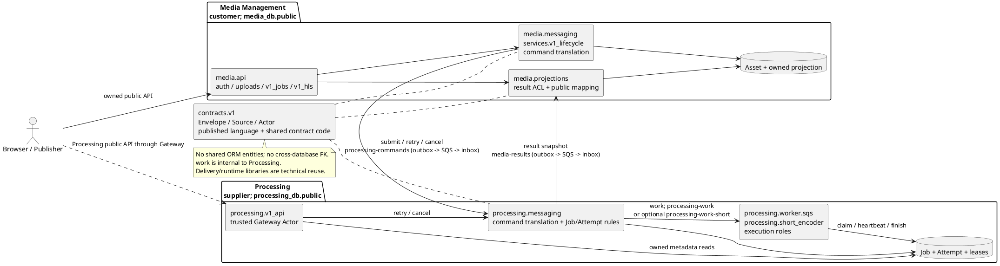

## 2. Aggregates, rules and DDD honesty

The source has **anaemic SQLAlchemy record classes**, not rich aggregate objects: `Asset` and `Job` declare fields/constraints but no business methods or encapsulated child collections. Domain rules live in module functions that use SQLAlchemy directly. Thus “Asset aggregate” and “ProcessingJob aggregate” are useful **transaction-boundary interpretations**, not framework-enforced aggregate-root types. The existing “exactly two aggregates” is too absolute: a reservation exists before its Asset, a cancellation guard can exist without a Job, users have an independent lifecycle, and launcher state is independently locked. The tables below distinguish the two principal business aggregates from those supporting boundaries. [M-model] [M-upload] [P-model] [P-command] [P-launch]

### Media: User (supporting identity aggregate interpretation)

| Aspect | Actual model / rule / implementing code |
|---|---|
| Root, entities, values | `User`; no child entities. `id: UUID`, email, password hash and role are primitive attributes, not Email/Password value-object classes. [M-model] |
| Invariants | Unique email and role in `user/operator` are DB constraints. Registration catches duplicate-email `IntegrityError`; login verifies password. Current user lookup rechecks stored identity/role, rather than trusting a role in a token. [M-mig1] [M-auth] [M-deps] |
| Services, repository | Application functions `register`, `login`, `me`; security helpers `hash_password`, `verify_password`, `issue_token`, `read_token`; direct `AsyncSession` queries, no UserRepository class. `authorizer.authorize` emits `Actor` with gateway role `publisher` for both stored roles. [M-auth] [M-security] [M-authorizer] |
| Messages / honesty | No persisted `UserRegistered` event. Actor is a trusted API context value, not a queue domain event. Identity is not a third deployed service in this code. [M-auth] [C-actor] [M-authorizer] |

### Media: UploadReservation (independent pre-adoption boundary)

| Aspect | Actual model / rule / implementing code |
|---|---|
| Root, entities, values | `UploadReservation` is independently created and locked before any `Asset` exists. Its adopted source is a six-field immutable descriptor; `contracts.v1.Source` is the frozen value type, while intake manipulates dictionaries. No SourceRevision entity class exists. [M-upload] [M-reserve] [M-finalize] [C-source] |
| Invariants | `(owner_id,request_id)` unique; key/asset ID unique. `reserve` fingerprints the complete request; changed input is 409; unfinalized expiry is 410. `ReserveRequest` demands strict positive size <=100 MiB and lowercase SHA-256; service admits only supported content types. Key is server chosen and grant lasts 15 minutes. [M-reserve-type] [M-reserve] [M-mig4] |
| Adoption | `Storage.verify_direct_upload` checks exact VersionId, declared size/type, streamed SHA-256 and signature bytes outside SQL row locks. Finalize then relocks the reservation, rechecks expiry/replay, stores the pin, creates Asset and stages submit in one transaction. DB check requires a nonempty, non-`null` version whenever finalized. [M-verify] [M-finalize] [M-mig7] |
| Cleanup | Expired grants remain available for rescanning: cleanup preserves an adopted version, backs off scans and retires only after a successful scan beyond the horizon. This is lifecycle bookkeeping, not an Asset child that disappears when adopted. [M-upload-cleanup] |
| Services / repository / messages | `direct_intake.reserve/finalize/source_for_asset/cleanup_expired_uploads`, `Storage`; direct session queries. No reservation repository class or UploadCompleted event; successful adoption stages `submit`. [M-reserve] [M-finalize] [M-message] |
| Honesty | `upload_reservations.asset_id` is unique **without an FK to assets** because the Asset does not yet exist. The reservation is associated with the eventual Asset by value. [M-mig4] |

### Media: Asset (principal business aggregate interpretation)

| Aspect | Actual model / rule / implementing code |
|---|---|
| Root and related entities | Root `Asset`; derived-source `SourceVersion`; idempotency `RequestKey`; deletion `media.models.CleanupIntent`. `ProcessingProjection` is an owned read model. `StagedObject` is a key-indexed orphan ledger and has no Asset FK. UploadReservation supplies the original pin but has a prior independent lifecycle. `User` is referenced, not composed. [M-model] [M-upload] [M-projection] |
| Values | `contracts.v1.Source`, Media `schemas.outputs.Output`, edit DTOs; UUIDs/checksums/operations are mostly primitives or JSON. Output DTOs are not persisted Output entity rows. [C-source] [M-output] [M-edit-schema] |
| Ownership / source invariants | `get_asset` filters owner + nondeleted state (404 otherwise); source lookup verifies pin key matches `Asset.source_key`. SQL checks positive revision and size; it does **not** make those fields immutable against arbitrary DML. Immutability is an application rule backed by the finalized-pin check. [M-repo] [M-source] [M-mig1] [M-mig7] |
| Retry / edit | Retry requires failed projection; owner/request-key replay is resolved first, then a stable retry command uses the accepted source. Edit requires a done parent and primary output, stages a copied source, verifies/pins it, then adopts a **new Asset** with submit outbox. Edit does not send directly to SQS. Unlike finalize, its copy step intentionally holds the parent/staged-object locks during S3 I/O. [M-retry] [M-edit] |
| Delete / projection | Tombstone + CleanupIntent + cancel command commit together. Only a validated cancellation result authorises source cleanup. Projection application locks Asset, checks source/job/output namespace, rejects equivocation and ignores older versions/attempts. [M-delete] [M-cancel-ack] [M-cleanup] [M-apply] [M-transition] |
| Repository / services | Real repository **module** `repositories.assets`: `get_asset`, `replay`, `list_asset_pages`. Application services: `direct_intake`, `v1_lifecycle`, `projections`, `recovery_v1`. Domain policies and orchestration are intermingled; no AssetService/AssetRepository interface class exists. [M-repo] [M-retry] [M-apply] [M-cleanup] |
| Messages / leftovers | Commands `submit/retry/cancel`; incoming `result` snapshots. No named AssetUploaded/AssetDeleted domain-event classes. `RetryIntent` remains in schema but active retry writes RequestKey + outbox instead. [M-message] [M-command] [M-retry] [M-mig1] |

### Processing: Job / ProcessingJob (principal business aggregate interpretation)

| Aspect | Actual model / rule / implementing code |
|---|---|
| Root and entities | Actual ORM root is **`processing.models.Job`**, not `ProcessingJob` (the latter is a response DTO). Related entities: Attempt, RetryRequest, CleanupIntent, JobMessaging, AttemptTask. SubmissionGuard is a per-asset gate that can precede the Job. [P-model] [P-msg-model] [P-schema] |
| Values | `Claim` frozen dataclass conveys worker authority; `contracts.v1.Source/Envelope`; `processing.schemas.Output` and discriminated edit operation models. A lease is a set of Attempt columns, not a Lease class. `media_engine.SourceProbe` is an immutable execution value. [P-life] [C-envelope] [P-schema] [E-probe] |
| Identity / submit | `jobs.asset_id` unique; guarded duplicate submit checks canonical source+operations hash. Commands must match durable owner/asset/job/source. Guard insertion/lock serialises command acceptance; source keys must be owner scoped. [P-mig1] [P-source] [P-command] |
| State / lease | Claim requires current, nondeleted queued Job+Attempt; new token, deadline and expiry use DB `clock_timestamp()`. `lock_pair` issues **FOR UPDATE on Job, then plain session.get(Attempt)**; do not draw a second explicit Attempt row lock. `live` requires processing states, exact lease token and both times unexpired. Heartbeat and finish recheck it. SQL constrains state membership; transition ordering is application code. [P-life] [P-mig1] |
| Finite executor | `AttemptTask` PK is attempt_id; task_name unique. `messaging.claim` validates the work source/operations and binds task atomically with state/result staging. One binding cannot be reused for a different attempt. [P-claim] [P-mig5] |
| Retry / failure | `_retry_locked`: only failed jobs, new Attempt number+1, reset outputs/error and increment state version in same transaction. Replay creates no new attempt, but **returns the current attempt**, not necessarily `RetryRequest.attempt_id` if later retries occurred. Expiry recovery sets Job failed/Attempt abandoned; it does not automatically retry. [P-retry] [P-recovery] |
| Completion | Exactly one primary, unique output kinds, attempt-scoped keys, nonzero size and digest are required by finish; stale Claim returns false. Optional HLS errors preserve primary. State + result outbox commit before worker work-message deletion. [P-finish] [P-worker] [P-pipeline] |
| Lane transfer | Optional short lane prefilters <=64 MiB; executor checks duration <=60s and height <=1080 after download/probe. A rejected short execution abandons its attempt and creates a successor for Fargate under the same lease fence; prior Lambda task binding prevents ping-pong. This is distinct from owner retry after a visible failure. [P-lane] [P-redirect] [P-short] |
| Repositories / services / messages | No JobRepository interface: queries are in `messaging`, `lifecycle`, `service`, `recovery`. Application adapters: handlers/v1_api/worker.sqs/short_encoder; domain policies: lifecycle/short_lane plus messaging/recovery functions. Messages: internal `work`, outgoing `result` full snapshots. `JobMessaging.state_version` is incremented on changed states; this is state transfer, not event sourcing. [P-command] [P-life] [P-service] [P-emit] |

### Processing: SubmissionGuard (supporting cancellation boundary)

| Aspect | Actual model / rule / implementing code |
|---|---|
| Root / entities | `SubmissionGuard` keyed by asset_id, with owner_id, optional job_id, deleted_at; no children. It is not a child that requires an already-created Job. [P-model] [P-mig1] |
| Invariant | `_guard` inserts-if-missing then locks; owner mismatch is 404. Cancel-before-submit persists deleted_at and emits an acknowledgement without fictitious Job/Attempt IDs; subsequent submit is an accepted no-op. With a Job, cancel tombstones it, clears outputs, cancels live attempts and schedules cleanup. [P-guard] [P-cancel] [P-command] |
| Services / messaging / honesty | `_guard`, `_cancel_locked`, `cancel_asset`; direct ORM queries. API `messaging.retry_job` locks Job directly, so **not every retry path takes Guard first**; queued-command retry and worker claim do. This is a consistency gate inside Processing, not an independently deployed context. [P-retry-api] [P-claim] [P-command] |

### Processing: LauncherControl + LaunchReservation (technical consistency boundary)

| Aspect | Actual model / rule / implementing code |
|---|---|
| Root / records / values | Singleton LauncherControl (id=1); LaunchReservation records keyed by ECS client token; config/observation dataclasses. No FK from reservation to control or AttemptTask. Calling these an aggregate is a **technical transaction model**, not another business aggregate/context. [P-launch-model] [P-launch-mig] [P-launch] |
| Invariants | `_reserve` locks control and open reservations, reconciles ECS observations and reserves only available capacity using SQL backlog and visible queue work. `_send` holds control FOR SHARE and reservation FOR UPDATE while awaiting RunTask, fencing disable; ambiguous replies keep the slot. Thus “no SQL lock during any network I/O” is false globally: the outbox has that property, launcher deliberately does not. [P-launch] [P-launch-send] [D-sql] |
| Services / messages | `launcher.tick/_reserve/_send/settle/set_enabled`; `launcher_aws` ECS/SQS adapter; `launcher_trigger` wakes after standard work publication. Stores RunTask request payloads, not a new domain event stream. [P-launch] [P-launch-send] [P-launch-trigger] |

**PlantUML A1 — Media aggregate/entity interpretation.** All relationships below come from [M-model] [M-upload] [M-projection] [M-finalize] [M-retry]. Composition denotes an interpreted consistency grouping, not ORM relationships or cascade deletion. Dotted relationships are ID/application associations.

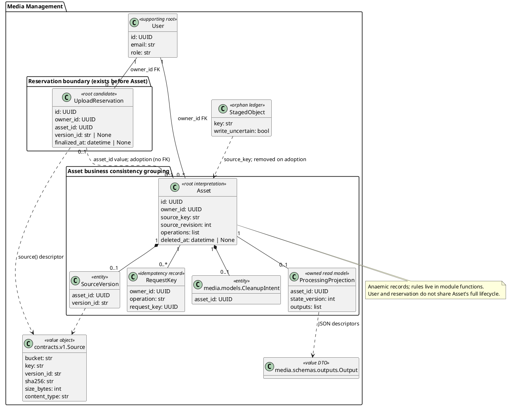

**PlantUML A2 — Processing aggregate/entity interpretation.** [P-model] [P-msg-model] [P-life] [P-command] [P-launch-model].

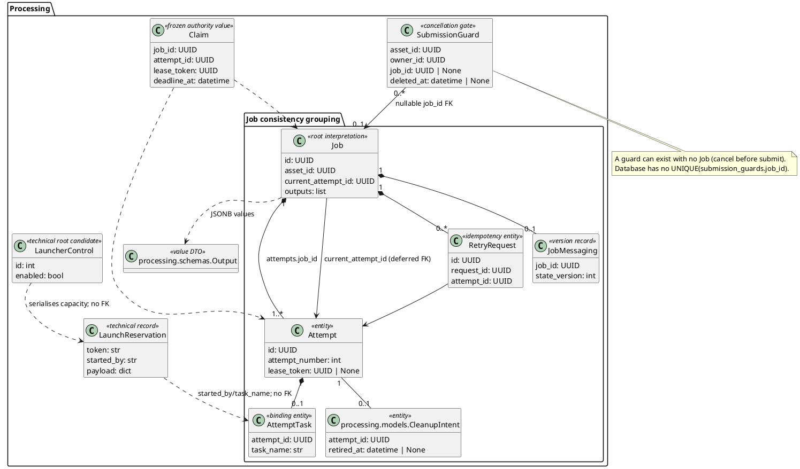

## 3. Component-level design

The layers below are a **responsibility view**, not a clean-architecture claim. Application modules import ORM models, SQLAlchemy and infrastructure directly; mapped records combine domain data and persistence. `media_engine` is the comparatively clean pure calculation layer. Shared `delivery` owns transport/dedupe mechanics but is parameterised by each owner's inbox/outbox classes. [M-finalize] [P-command] [P-life] [P-pipeline] [D-sql]

| Service / responsibility | Real modules and dependencies |
|---|---|
| Media handlers | `lambda_handler` adapts Gateway ASGI to `main.app`; `api.auth/uploads/v1_jobs/v1_hls` call services/repository; dependencies resolve current User/session/storage. `authorizer` independently reads User and emits Actor. `handlers.result_handler/repair_handler` call `consume_results/invoke`. [M-lambda] [M-main] [M-upload-api] [M-job-api] [M-hls] [M-authorizer] [M-handlers] |
| Media application/domain policies | `services.direct_intake` -> request validation, upload model, repository fingerprint and Storage; `services.v1_lifecycle` -> repository, projection, intake staging, Storage, messaging; `projections` -> local Asset/pin/output validation and public mapping; `messaging` -> contracts + delivery.sql + Media message models; `recovery_v1` -> cleanup models + Storage + direct-intake cleanup. [M-finalize] [M-edit] [M-apply] [M-message] [M-cleanup] |
| Media infrastructure | `database` creates owned SQL sessions; models/upload_models/projection_models/messaging_models map owned tables; migrations own DDL. `services.storage` wraps Minio SDK for native S3 operations, `storage_credentials` obtains credentials. `handlers` constructs delivery.sqs.SQS for the **repair** publisher. No API-to-SQS direct send. [M-db] [M-storage] [M-handlers] [M-message] |
| Processing handlers | `lambda_handler` -> `v1_api`; API uses `auth.gateway_actor`, owned queries and messaging retry/cancel. `handlers` selects command/repair/ECS/S3/launcher/short-encoder entrypoints; command consumer commits before best-effort outbox publish. [P-lambda] [P-api] [P-auth] [P-handlers] |
| Processing application/domain policies | `messaging` -> lifecycle, short_lane, schemas, ORM, delivery.sql; `lifecycle` -> ORM, DB clock, Output validation; `recovery_v1` -> recovery + messaging + native cleanup; `launcher` -> owned models + injected ECS/queue; `launcher_aws` supplies adapters; `launcher_trigger` wraps work publisher. [P-command] [P-life] [P-recovery-v1] [P-launch] [P-launch-trigger] |
| Processing execution | `worker.sqs` -> messaging claim/finish + Supervisor + tasks.pipeline + SourceStore/OutputStore; Supervisor -> lifecycle.heartbeat + subprocess supervision; tasks -> media_engine probe/validation/operations/HLS; SourceStore/OutputStore -> Minio. `short_encoder` reuses execute_message with admission/redirect hooks and Lambda deadline. [P-worker] [P-supervisor] [P-pipeline] [P-source-store] [P-output-store] [P-short] |
| Processing infrastructure | `database`, models/messaging_models/launcher_models, migrations; native S3/SQS/ECS adapters, storage_credentials. Output cleanup uses version enumeration/deletion, not worker OutputStore read permissions. [P-db] [P-model] [P-msg-model] [P-launch-model] [P-recovery-v1] |

**PlantUML K1 — Media components.** Evidence is the preceding Media component rows; components name real packages/modules, not invented service classes.

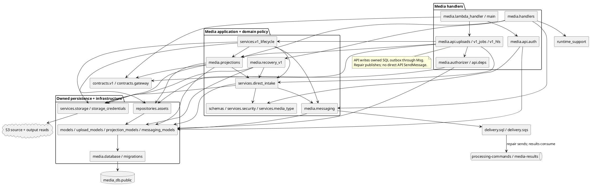

**PlantUML K2 — Processing components.** Evidence is the preceding Processing component rows. Both workers execute the same Job/Attempt model; the engine is a package, not a third service.

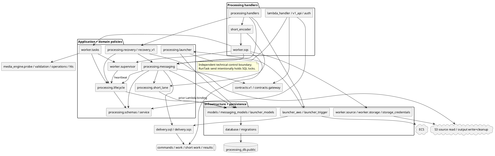

## 4. Two critical use cases at class/object level

**Pick 1: UC-1–UC-3 upload → encode → play**, the catalogue's core workflow: verified intake, asynchronous handoff, execution authority and authorised read model all cross boundaries. **Pick 2: UC-4 retry with lease expiry and stale-result fencing**, the catalogue's explicit stored-source retry and stale-completion exception; this exposes the consistency design that happy-path arrows hide. This is two detailed scenarios, not a claim that UC-1–UC-3 is one catalogue ID. UC-5 repeats upload per file; UC-6/UC-7 are operational scenarios already documented separately. [UC-core] [UC-retry] [UC-ops]

**Notation:** class boxes use actual Python class names. `<<module>>` boxes contain real free functions; they are not invented controller/service classes. Attribute types reproduce annotations, with `Mapped[T]` shown as `T`; unannotated method/function parameters and returns are deliberately left untyped instead of inventing signatures. Selected relevant members are shown, with complete persisted columns in §5. Frozen DTOs supply actual typed value objects. [M-model] [M-upload] [P-model] [P-life] [P-supervisor]

### UC-1–UC-3 class diagram

Source map: request/intake [M-reserve-type] [M-finalize]; persisted entities [M-model] [M-upload] [P-model]; contract [C-source] [C-envelope]; execution classes [P-life] [P-supervisor] [P-source-store] [P-output-store] [E-probe]; projection [M-projection] [M-public].

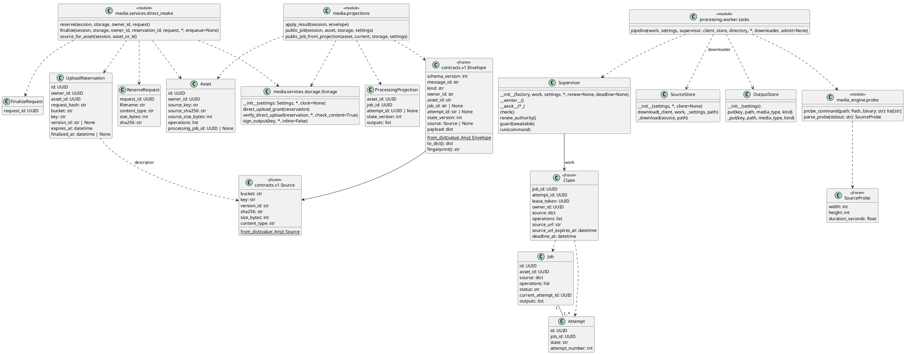

### UC-1–UC-3 object-level sequence

This selects the standard Fargate path and gives the optional lane decision explicitly. Participants are real module execution contexts and real adapter/session instances; message queues/S3 are external lifelines. The `session` lifeline represents owner-specific short-lived AsyncSession instances, not a single session shared across databases. Relevant calls: [M-upload-api] [M-reserve] [M-finalize] [M-verify] [M-message] [D-sql] [P-handlers] [P-command] [P-emit] [P-worker] [P-claim] [P-pipeline] [M-handlers] [M-apply] [M-job-api] [M-public]. Gateway authentication is the precondition supplied by `authorizer.authorize`/`api.deps.current_user`, not an invented inline method on the business service. [M-authorizer] [M-deps]

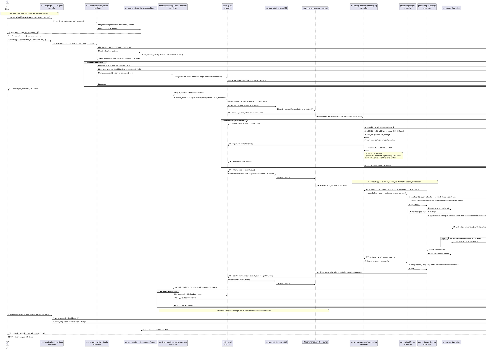

### UC-4 class diagram

Source map: persistence [P-model] [P-msg-model] [M-projection]; lifecycle authority [P-life] [P-claim]; recovery [P-recovery]; retry/command [M-retry] [P-retry] [P-command]; result fence [M-transition]. `live`, `lock_pair` and retry are functions, not Job methods.

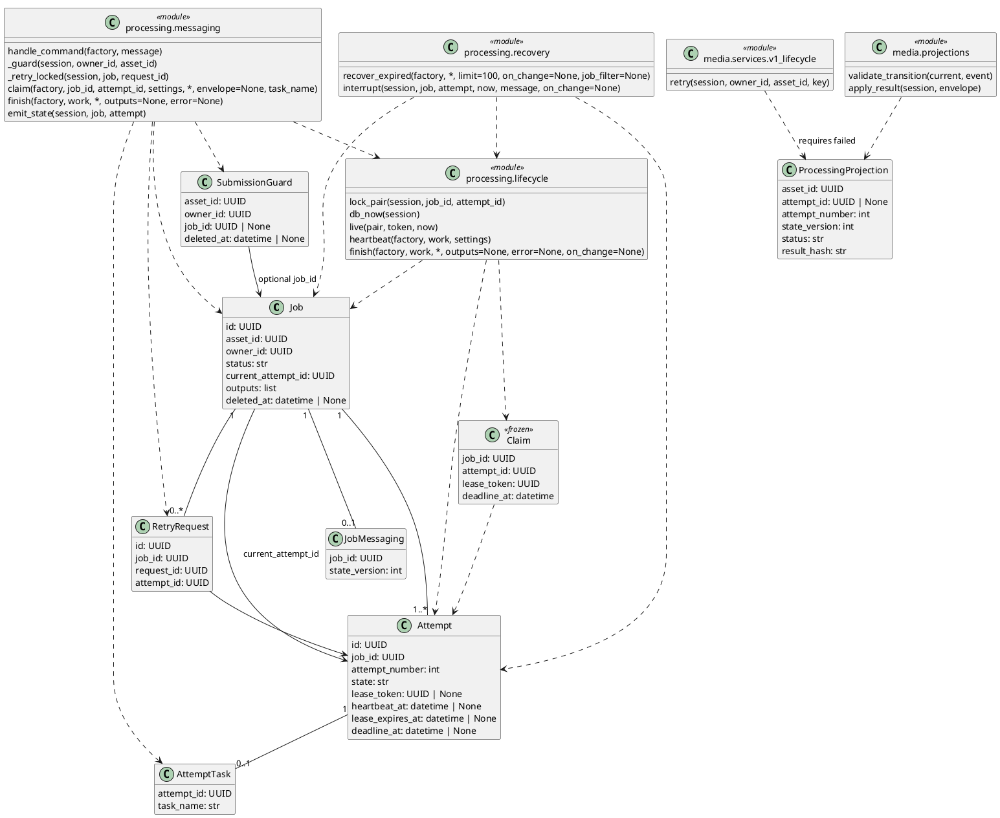

### UC-4 object-level sequence: expiry → owner retry → stale rejection

This uses the **queued Media retry** path. The direct Processing API path uses `messaging.retry_job` and a Job lock; it does not pretend to consume a Media command. Old `finish` is issued by the **old worker**, not ProcessingCommands (a mistake in the old retry sequence). [P-retry-api] [P-worker] [P-recovery] [M-retry] [P-command] [P-retry] [P-finish] [M-transition]

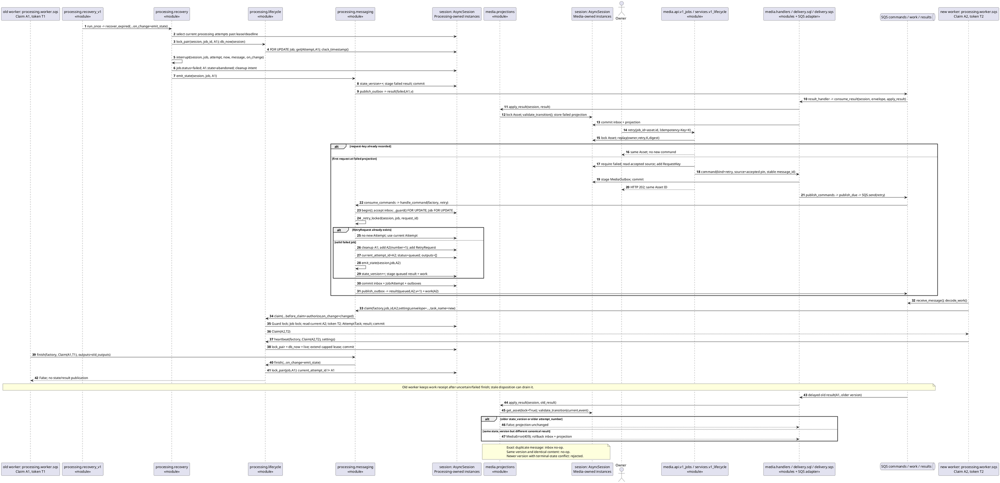


## 5. Data stores and schemas at migration head

### 5.1 SQL ownership and reading conventions

The bootstrap creates `media_db` and `processing_db` and grants each owner/migrator/runtime access to its own `public` schema; no separate application-named SQL schema is created. Aurora topology is configurable (shared or separate clusters), so these logical schemas do not prove which layout is deployed. The report should state its deployment baseline separately. [DB-bootstrap] [DB-topology]

The following **22 application tables** are reconstructed from every `upgrade()` in each migration chain, including retained columns and optional-feature tables. This is static migration reconstruction, not a migration executed against Aurora. `NN` means NOT NULL; `?` means nullable. Types are SQL migration types; no-length `VARCHAR` means unbounded varchar, not TEXT. Defaults shown are **server defaults only**; Python ORM defaults are not SQL defaults. Primary/unique constraints also supply their normal backing indexes; the index lists enumerate explicitly created nonconstraint indexes. No ON UPDATE action is declared. [M-mig1] [M-mig4] [M-mig5] [M-mig6] [M-mig7] [M-mig8] [P-mig1] [P-mig2] [P-mig3] [P-mig5] [P-mig6] [P-launch-mig]

### 5.2 media_db.public — head `media_0008`

Revision chain: `0001_media` → `0002_uncertain_writes` → `media_0004` → `media_0005` → `media_0006` → `media_0007` → `media_0008`. File-number gaps are not missing migrations.

#### `staged_objects`

Migration evidence: [0001_media.py](https://github.com/Collaboration95/dc2/blob/76282d3/media/migrations/versions/0001_media.py#L11), [0002_uncertain_writes.py](https://github.com/Collaboration95/dc2/blob/76282d3/media/migrations/versions/0002_uncertain_writes.py#L16).

| Column | SQL type | Nullability | Server default |
|---|---|---|---|
| `key` | `TEXT` | NN | — |
| `created_at` | `TIMESTAMP WITH TIME ZONE` | NN | — |
| `write_uncertain` | `BOOLEAN` | NN | `true` |

Constraints: PK (key).

Explicit indexes: none.

#### `users`

Migration evidence: [0001_media.py](https://github.com/Collaboration95/dc2/blob/76282d3/media/migrations/versions/0001_media.py#L16).

| Column | SQL type | Nullability | Server default |
|---|---|---|---|
| `id` | `UUID` | NN | — |
| `email` | `VARCHAR(320)` | NN | — |
| `password_hash` | `TEXT` | NN | — |
| `role` | `VARCHAR(20)` | NN | — |
| `created_at` | `TIMESTAMP WITH TIME ZONE` | NN | — |

Constraints: PK (id); UNIQUE (email); CHECK `role IN ('user', 'operator')`.

Explicit indexes: none.

#### `assets`

Migration evidence: [0001_media.py](https://github.com/Collaboration95/dc2/blob/76282d3/media/migrations/versions/0001_media.py#L26).

| Column | SQL type | Nullability | Server default |
|---|---|---|---|
| `id` | `UUID` | NN | — |
| `owner_id` | `UUID` | NN | — |
| `filename` | `VARCHAR(100)` | NN | — |
| `source_key` | `TEXT` | NN | — |
| `source_revision` | `INTEGER` | NN | — |
| `source_sha256` | `VARCHAR(64)` | NN | — |
| `source_size_bytes` | `INTEGER` | NN | — |
| `source_media_type` | `VARCHAR(100)` | NN | — |
| `source_asset_id` | `UUID` | ? | — |
| `operations` | `JSONB` | NN | — |
| `submission_state` | `VARCHAR(20)` | NN | — |
| `processing_job_id` | `UUID` | ? | — |
| `submitted_at` | `TIMESTAMP WITH TIME ZONE` | ? | — |
| `last_submit_error` | `TEXT` | ? | — |
| `submit_attempts` | `INTEGER` | NN | — |
| `next_submit_at` | `TIMESTAMP WITH TIME ZONE` | NN | — |
| `created_at` | `TIMESTAMP WITH TIME ZONE` | NN | — |
| `deleted_at` | `TIMESTAMP WITH TIME ZONE` | ? | — |

Constraints: PK (id); UNIQUE (source_key); FK (owner_id) → `users.id` (default NO ACTION); CHECK `source_revision >= 1 AND source_size_bytes > 0`; CHECK `submission_state IN ('pending', 'submitted', 'error')`.

Explicit indexes: `ix_assets_owner_id` (owner_id); `assets_pending_due` (submission_state, next_submit_at).

#### `cleanup_intents`

Migration evidence: [0001_media.py](https://github.com/Collaboration95/dc2/blob/76282d3/media/migrations/versions/0001_media.py#L53).

| Column | SQL type | Nullability | Server default |
|---|---|---|---|
| `asset_id` | `UUID` | NN | — |
| `processing_deleted_at` | `TIMESTAMP WITH TIME ZONE` | ? | — |
| `source_deleted_at` | `TIMESTAMP WITH TIME ZONE` | ? | — |
| `next_try_at` | `TIMESTAMP WITH TIME ZONE` | NN | — |
| `attempts` | `INTEGER` | NN | — |
| `last_error` | `TEXT` | ? | — |

Constraints: PK (asset_id); FK (asset_id) → `assets.id` (default NO ACTION).

Explicit indexes: none.

#### `request_keys`

Migration evidence: [0001_media.py](https://github.com/Collaboration95/dc2/blob/76282d3/media/migrations/versions/0001_media.py#L63).

| Column | SQL type | Nullability | Server default |
|---|---|---|---|
| `owner_id` | `UUID` | NN | — |
| `operation` | `VARCHAR(20)` | NN | — |
| `request_key` | `UUID` | NN | — |
| `request_hash` | `VARCHAR(64)` | NN | — |
| `asset_id` | `UUID` | NN | — |
| `created_at` | `TIMESTAMP WITH TIME ZONE` | NN | — |

Constraints: PK (owner_id, operation, request_key); FK (owner_id) → `users.id` (default NO ACTION); FK (asset_id) → `assets.id` (default NO ACTION).

Explicit indexes: none.

#### `retry_intents`

Migration evidence: [0001_media.py](https://github.com/Collaboration95/dc2/blob/76282d3/media/migrations/versions/0001_media.py#L74).

| Column | SQL type | Nullability | Server default |
|---|---|---|---|
| `id` | `UUID` | NN | — |
| `asset_id` | `UUID` | NN | — |
| `confirmed_at` | `TIMESTAMP WITH TIME ZONE` | ? | — |
| `rejected_at` | `TIMESTAMP WITH TIME ZONE` | ? | — |
| `created_at` | `TIMESTAMP WITH TIME ZONE` | NN | — |
| `next_try_at` | `TIMESTAMP WITH TIME ZONE` | NN | — |
| `attempts` | `INTEGER` | NN | — |
| `last_error` | `TEXT` | ? | — |

Constraints: PK (id); FK (asset_id) → `assets.id` (default NO ACTION).

Explicit indexes: `ix_retry_intents_asset_id` (asset_id).

#### `asset_source_versions`

Migration evidence: [0004_direct_uploads.py](https://github.com/Collaboration95/dc2/blob/76282d3/media/migrations/versions/0004_direct_uploads.py#L13).

| Column | SQL type | Nullability | Server default |
|---|---|---|---|
| `asset_id` | `UUID` | NN | — |
| `bucket` | `TEXT` | NN | — |
| `key` | `TEXT` | NN | — |
| `version_id` | `TEXT` | NN | — |
| `sha256` | `VARCHAR(64)` | NN | — |
| `size_bytes` | `INTEGER` | NN | — |
| `content_type` | `VARCHAR(100)` | NN | — |

Constraints: PK (asset_id); FK (asset_id) → `assets.id` (default NO ACTION).

Explicit indexes: none.

#### `upload_reservations`

Migration evidence: [0004_direct_uploads.py](https://github.com/Collaboration95/dc2/blob/76282d3/media/migrations/versions/0004_direct_uploads.py#L23), [0007_finalized_requires_pin.py](https://github.com/Collaboration95/dc2/blob/76282d3/media/migrations/versions/0007_finalized_requires_pin.py#L19), [0008_upload_cleanup_schedule.py](https://github.com/Collaboration95/dc2/blob/76282d3/media/migrations/versions/0008_upload_cleanup_schedule.py#L21).

| Column | SQL type | Nullability | Server default |
|---|---|---|---|
| `id` | `UUID` | NN | — |
| `owner_id` | `UUID` | NN | — |
| `request_id` | `UUID` | NN | — |
| `request_hash` | `VARCHAR(64)` | NN | — |
| `asset_id` | `UUID` | NN | — |
| `filename` | `VARCHAR(100)` | NN | — |
| `bucket` | `TEXT` | NN | — |
| `key` | `TEXT` | NN | — |
| `content_type` | `VARCHAR(100)` | NN | — |
| `size_bytes` | `INTEGER` | NN | — |
| `sha256` | `VARCHAR(64)` | NN | — |
| `version_id` | `TEXT` | ? | — |
| `expires_at` | `TIMESTAMP WITH TIME ZONE` | NN | — |
| `finalized_at` | `TIMESTAMP WITH TIME ZONE` | ? | — |
| `created_at` | `TIMESTAMP WITH TIME ZONE` | NN | — |
| `cleanup_checked_at` | `TIMESTAMP WITH TIME ZONE` | NN | — |
| `cleanup_next_at` | `TIMESTAMP WITH TIME ZONE` | NN | `now()` |
| `cleanup_attempts` | `INTEGER` | NN | `0` |
| `cleanup_retired_at` | `TIMESTAMP WITH TIME ZONE` | ? | — |

Constraints: PK (id); UNIQUE (asset_id); UNIQUE (key); UNIQUE (owner_id, request_id); FK (owner_id) → `users.id` (default NO ACTION); CHECK `ck_upload_reservations_finalized_has_pin`: `finalized_at IS NULL OR (version_id IS NOT NULL AND version_id NOT IN ('', 'null'))`.

Explicit indexes: `ix_upload_reservations_owner_id` (owner_id); `ix_upload_reservations_expires_at` (expires_at); `ix_upload_reservations_cleanup_due` (cleanup_next_at) WHERE `cleanup_retired_at IS NULL`.

#### `processing_projections`

Migration evidence: [0005_projection.py](https://github.com/Collaboration95/dc2/blob/76282d3/media/migrations/versions/0005_projection.py#L14).

| Column | SQL type | Nullability | Server default |
|---|---|---|---|
| `asset_id` | `UUID` | NN | — |
| `job_id` | `UUID` | NN | — |
| `attempt_id` | `UUID` | ? | — |
| `attempt_number` | `INTEGER` | NN | — |
| `state_version` | `INTEGER` | NN | — |
| `status` | `VARCHAR(20)` | NN | — |
| `source` | `JSONB` | NN | — |
| `outputs` | `JSONB` | NN | — |
| `error` | `TEXT` | ? | — |
| `result_hash` | `VARCHAR(64)` | NN | — |

Constraints: PK (asset_id); UNIQUE (job_id); FK (asset_id) → `assets.id` (default NO ACTION); CHECK `state_version >= 0 AND attempt_number >= 0`; CHECK `status IN ('queued', 'processing', 'done', 'failed', 'cancelled')`.

Explicit indexes: none.

#### `message_inbox`

Migration evidence: [0006_messaging.py](https://github.com/Collaboration95/dc2/blob/76282d3/media/migrations/versions/0006_messaging.py#L14).

| Column | SQL type | Nullability | Server default |
|---|---|---|---|
| `message_id` | `UUID` | NN | — |
| `body_hash` | `VARCHAR(64)` | NN | — |
| `received_at` | `TIMESTAMP WITH TIME ZONE` | NN | `now()` |

Constraints: PK (message_id).

Explicit indexes: none.

#### `message_outbox`

Migration evidence: [0006_messaging.py](https://github.com/Collaboration95/dc2/blob/76282d3/media/migrations/versions/0006_messaging.py#L22).

| Column | SQL type | Nullability | Server default |
|---|---|---|---|
| `message_id` | `UUID` | NN | — |
| `body_hash` | `VARCHAR(64)` | NN | — |
| `queue` | `VARCHAR(40)` | NN | — |
| `body` | `JSONB` | NN | — |
| `next_try_at` | `TIMESTAMP WITH TIME ZONE` | NN | — |
| `tries` | `INTEGER` | NN | `0` |
| `claim_token` | `UUID` | ? | — |
| `sent_at` | `TIMESTAMP WITH TIME ZONE` | ? | — |
| `last_error` | `VARCHAR` | ? | — |

Constraints: PK (message_id).

Explicit indexes: `ix_message_outbox_due` (next_try_at).

**PlantUML ER-M — all 11 application tables, columns and declared foreign keys.** The per-table migration evidence above applies to this diagram. No association is drawn merely because two UUIDs have matching names.

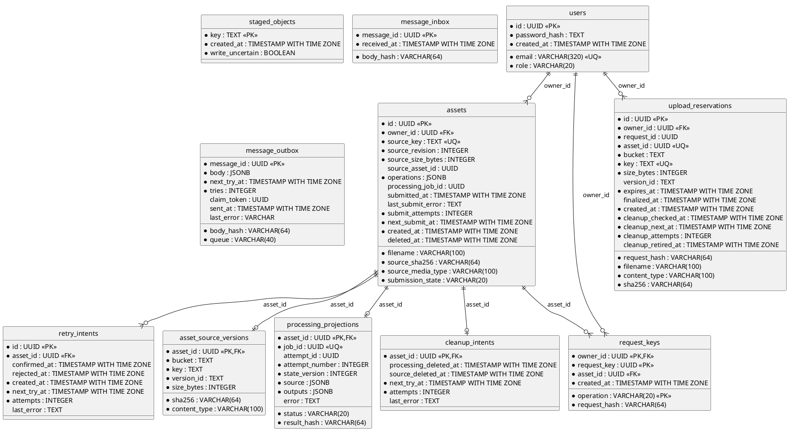

### 5.3 processing_db.public — head `processing_0007`

Revision chain: `processing_0001` → `processing_0002` → `processing_0003` → `processing_0005` → `processing_0006` → `processing_0007`. File-number gaps are not missing migrations.

#### `jobs`

Migration evidence: [0001_intake.py](https://github.com/Collaboration95/dc2/blob/76282d3/processing/migrations/versions/0001_intake.py#L14), [0002_lifecycle.py](https://github.com/Collaboration95/dc2/blob/76282d3/processing/migrations/versions/0002_lifecycle.py#L16).

| Column | SQL type | Nullability | Server default |
|---|---|---|---|
| `id` | `UUID` | NN | — |
| `asset_id` | `UUID` | NN | — |
| `owner_id` | `UUID` | NN | — |
| `source` | `JSONB` | NN | — |
| `operations` | `JSONB` | NN | — |
| `request_hash` | `VARCHAR(64)` | NN | — |
| `source_url` | `VARCHAR` | NN | — |
| `source_url_expires_at` | `TIMESTAMP WITH TIME ZONE` | NN | — |
| `status` | `VARCHAR(16)` | NN | — |
| `current_attempt_id` | `UUID` | NN | — |
| `error` | `VARCHAR` | ? | — |
| `created_at` | `TIMESTAMP WITH TIME ZONE` | NN | — |
| `updated_at` | `TIMESTAMP WITH TIME ZONE` | NN | — |
| `deleted_at` | `TIMESTAMP WITH TIME ZONE` | ? | — |
| `outputs` | `JSONB` | NN | `'[]'::jsonb` |

Constraints: PK (id); UNIQUE (asset_id); FK (current_attempt_id) → `attempts.id` `fk_jobs_current_attempt` (default NO ACTION) DEFERRABLE INITIALLY DEFERRED; CHECK `ck_jobs_status`: `status IN ('queued', 'processing', 'done', 'failed')`.

Explicit indexes: `ix_jobs_owner_id` (owner_id).

#### `attempts`

Migration evidence: [0001_intake.py](https://github.com/Collaboration95/dc2/blob/76282d3/processing/migrations/versions/0001_intake.py#L35), [0002_lifecycle.py](https://github.com/Collaboration95/dc2/blob/76282d3/processing/migrations/versions/0002_lifecycle.py#L28).

| Column | SQL type | Nullability | Server default |
|---|---|---|---|
| `id` | `UUID` | NN | — |
| `job_id` | `UUID` | NN | — |
| `attempt_number` | `INTEGER` | NN | — |
| `state` | `VARCHAR(16)` | NN | — |
| `queued_at` | `TIMESTAMP WITH TIME ZONE` | NN | — |
| `started_at` | `TIMESTAMP WITH TIME ZONE` | ? | — |
| `finished_at` | `TIMESTAMP WITH TIME ZONE` | ? | — |
| `error` | `VARCHAR` | ? | — |
| `lease_token` | `UUID` | ? | — |
| `heartbeat_at` | `TIMESTAMP WITH TIME ZONE` | ? | — |
| `lease_expires_at` | `TIMESTAMP WITH TIME ZONE` | ? | — |
| `deadline_at` | `TIMESTAMP WITH TIME ZONE` | ? | — |
| `next_dispatch_at` | `TIMESTAMP WITH TIME ZONE` | ? | — |
| `dispatch_error` | `VARCHAR` | ? | — |
| `dispatch_count` | `INTEGER` | NN | `0` |

Constraints: PK (id); UNIQUE (job_id, attempt_number) `uq_attempts_job_number`; FK (job_id) → `jobs.id` (default NO ACTION); CHECK `ck_attempts_number`: `attempt_number >= 1`; CHECK `ck_attempts_state`: `state IN ('queued', 'processing', 'succeeded', 'failed', 'abandoned', 'cancelled')`.

Explicit indexes: `ix_attempts_recovery` (state, next_dispatch_at).

#### `submission_guards`

Migration evidence: [0001_intake.py](https://github.com/Collaboration95/dc2/blob/76282d3/processing/migrations/versions/0001_intake.py#L61).

| Column | SQL type | Nullability | Server default |
|---|---|---|---|
| `asset_id` | `UUID` | NN | — |
| `owner_id` | `UUID` | NN | — |
| `job_id` | `UUID` | ? | — |
| `deleted_at` | `TIMESTAMP WITH TIME ZONE` | ? | — |

Constraints: PK (asset_id); FK (job_id) → `jobs.id` (default NO ACTION).

Explicit indexes: none.

#### `retry_requests`

Migration evidence: [0002_lifecycle.py](https://github.com/Collaboration95/dc2/blob/76282d3/processing/migrations/versions/0002_lifecycle.py#L33).

| Column | SQL type | Nullability | Server default |
|---|---|---|---|
| `id` | `UUID` | NN | — |
| `job_id` | `UUID` | NN | — |
| `request_id` | `UUID` | NN | — |
| `attempt_id` | `UUID` | NN | — |

Constraints: PK (id); UNIQUE (job_id, request_id); FK (job_id) → `jobs.id` ON DELETE CASCADE; FK (attempt_id) → `attempts.id` ON DELETE CASCADE.

Explicit indexes: none.

#### `cleanup_intents`

Migration evidence: [0002_lifecycle.py](https://github.com/Collaboration95/dc2/blob/76282d3/processing/migrations/versions/0002_lifecycle.py#L48), [0006_cleanup_retirement.py](https://github.com/Collaboration95/dc2/blob/76282d3/processing/migrations/versions/0006_cleanup_retirement.py#L18).

| Column | SQL type | Nullability | Server default |
|---|---|---|---|
| `attempt_id` | `UUID` | NN | — |
| `job_id` | `UUID` | NN | — |
| `next_try_at` | `TIMESTAMP WITH TIME ZONE` | NN | — |
| `tries` | `INTEGER` | NN | `0` |
| `last_error` | `VARCHAR` | ? | — |
| `created_at` | `TIMESTAMP WITH TIME ZONE` | NN | `now()` |
| `retired_at` | `TIMESTAMP WITH TIME ZONE` | ? | — |

Constraints: PK (attempt_id); FK (attempt_id) → `attempts.id` ON DELETE CASCADE; FK (job_id) → `jobs.id` ON DELETE CASCADE.

Explicit indexes: `ix_cleanup_intents_due` (next_try_at, attempt_id) WHERE `retired_at IS NULL`.

#### `message_inbox`

Migration evidence: [0003_messaging.py](https://github.com/Collaboration95/dc2/blob/76282d3/processing/migrations/versions/0003_messaging.py#L14).

| Column | SQL type | Nullability | Server default |
|---|---|---|---|
| `message_id` | `UUID` | NN | — |
| `body_hash` | `VARCHAR(64)` | NN | — |
| `received_at` | `TIMESTAMP WITH TIME ZONE` | NN | `now()` |

Constraints: PK (message_id).

Explicit indexes: none.

#### `message_outbox`

Migration evidence: [0003_messaging.py](https://github.com/Collaboration95/dc2/blob/76282d3/processing/migrations/versions/0003_messaging.py#L22).

| Column | SQL type | Nullability | Server default |
|---|---|---|---|
| `message_id` | `UUID` | NN | — |
| `body_hash` | `VARCHAR(64)` | NN | — |
| `queue` | `VARCHAR(40)` | NN | — |
| `body` | `JSONB` | NN | — |
| `next_try_at` | `TIMESTAMP WITH TIME ZONE` | NN | — |
| `tries` | `INTEGER` | NN | `0` |
| `claim_token` | `UUID` | ? | — |
| `sent_at` | `TIMESTAMP WITH TIME ZONE` | ? | — |
| `last_error` | `VARCHAR` | ? | — |

Constraints: PK (message_id).

Explicit indexes: `ix_message_outbox_due` (next_try_at).

#### `job_messaging`

Migration evidence: [0003_messaging.py](https://github.com/Collaboration95/dc2/blob/76282d3/processing/migrations/versions/0003_messaging.py#L35).

| Column | SQL type | Nullability | Server default |
|---|---|---|---|
| `job_id` | `UUID` | NN | — |
| `state_version` | `INTEGER` | NN | `0` |

Constraints: PK (job_id); FK (job_id) → `jobs.id` (default NO ACTION).

Explicit indexes: none.

#### `attempt_tasks`

Migration evidence: [0005_task_binding.py](https://github.com/Collaboration95/dc2/blob/76282d3/processing/migrations/versions/0005_task_binding.py#L13).

| Column | SQL type | Nullability | Server default |
|---|---|---|---|
| `attempt_id` | `UUID` | NN | — |
| `task_name` | `VARCHAR(256)` | NN | — |

Constraints: PK (attempt_id); UNIQUE (task_name); FK (attempt_id) → `attempts.id` (default NO ACTION).

Explicit indexes: none.

#### `launcher_control`

Migration evidence: [0007_launch_reservations.py](https://github.com/Collaboration95/dc2/blob/76282d3/processing/migrations/versions/0007_launch_reservations.py#L18).

| Column | SQL type | Nullability | Server default |
|---|---|---|---|
| `id` | `INTEGER` | NN | — |
| `enabled` | `BOOLEAN` | NN | `false` |
| `enabled_at` | `TIMESTAMP WITH TIME ZONE` | ? | — |
| `session_end_at` | `TIMESTAMP WITH TIME ZONE` | ? | — |
| `updated_at` | `TIMESTAMP WITH TIME ZONE` | NN | `now()` |

Constraints: PK (id); CHECK `ck_launcher_control_singleton`: `id = 1`.

Explicit indexes: none.

#### `launch_reservations`

Migration evidence: [0007_launch_reservations.py](https://github.com/Collaboration95/dc2/blob/76282d3/processing/migrations/versions/0007_launch_reservations.py#L29).

| Column | SQL type | Nullability | Server default |
|---|---|---|---|
| `token` | `VARCHAR(64)` | NN | — |
| `started_by` | `VARCHAR(36)` | NN | — |
| `status` | `VARCHAR(16)` | NN | `reserved` |
| `payload` | `JSONB` | NN | — |
| `deadline_at` | `TIMESTAMP WITH TIME ZONE` | NN | — |
| `reserved_at` | `TIMESTAMP WITH TIME ZONE` | NN | `now()` |
| `sent_at` | `TIMESTAMP WITH TIME ZONE` | ? | — |
| `launched_at` | `TIMESTAMP WITH TIME ZONE` | ? | — |
| `settled_at` | `TIMESTAMP WITH TIME ZONE` | ? | — |
| `task_arn` | `VARCHAR(512)` | ? | — |
| `claimed` | `BOOLEAN` | ? | — |
| `last_error` | `VARCHAR(120)` | ? | — |

Constraints: PK (token); UNIQUE (started_by); CHECK `ck_launch_reservations_status`: `status IN ('reserved', 'launched', 'stopped', 'released')`.

Explicit indexes: `ix_launch_reservations_open` (reserved_at) WHERE `status IN ('reserved', 'launched')`.

**PlantUML ER-P — all 11 application tables, columns and declared foreign keys.** The per-table migration evidence above applies to this diagram. No association is drawn merely because two UUIDs have matching names.

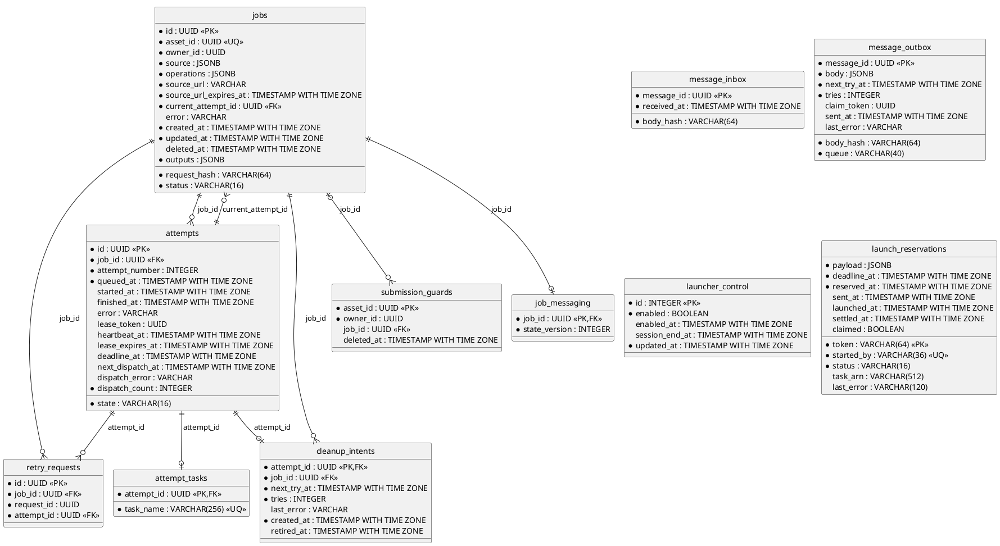

### 5.4 Constraints the ER diagram must not invent

`upload_reservations.asset_id` has UNIQUE but no FK to assets. `assets.source_asset_id` and `assets.processing_job_id` are UUID values without FKs. `submission_guards.job_id` is nullable and not unique, even though the application normally maintains one guard for a job through its asset. `launch_reservations` has no FK to launcher_control/attempt_tasks. `jobs.current_attempt_id` has a deferred FK, but SQL does not express that the referenced Attempt must also have `job_id = jobs.id`; `lock_pair` checks that in code. The diagram includes the otherwise easy-to-miss `retry_requests.attempt_id` and `cleanup_intents.job_id` FKs. [M-mig1] [M-mig4] [P-mig1] [P-mig2] [P-launch-mig] [P-life]

Each database also uses framework-managed Alembic version bookkeeping; `context.run_migrations()` is invoked in both migration environments. The application migration files do not define that framework table DDL, so it is excluded from the 22-table application count rather than claiming its columns were declared by these upgrades. No live database catalog was queried. [M-mig-env] [P-mig-env]

### 5.5 JSONB models and SQS schemas

`jobs.source` and projected source are the **native immutable source descriptor**, not the old `processing.schemas.Source` DTO (`asset_id/revision/media_type`). V1 `handle_command` stores the contract descriptor; the legacy `source_url` columns remain required but are populated with `""` and current DB time. Outputs are embedded JSON descriptors, not separate SQL tables. [C-source] [P-command] [P-schema] [M-apply]

| Embedded value | Fields / validation |
|---|---|
| Source | `bucket:string`, `key:string`, `version_id:string`, `sha256:64 lowercase hex`, `size_bytes:strict integer 1..104857600`, `content_type:string`. Nonempty strings, no URL syntax for bucket/key, real version (not `null`). Processing also checks owner key prefix; source downloads check VersionId/size/hash. [C-source] [P-source] [P-source-store] |
| Operations | JSON array of `{operation,params}`. `clip:{start,end}` finite ordered floats; `crop:{x,y,w,h}` strict integer dimensions; `downscale/upscale:{height}` positive strict integer; `convert:{format:"mkv" or "mp3"}`. At most five, no repeated operation, no simultaneous up/downscale. Source-aware bounds are checked after probing, not from browser metadata. [P-schema] [P-command] [M-edit-schema] [E-validation] |
| Output | `{kind:"primary" or "hls_manifest",object_key:string,media_type:string,size_bytes:integer or null,sha256:string or null}` at DTO level. **Processing finish strengthens this**: positive size/hash, unique kinds, exactly one primary and attempt-key prefix. Media independently checks exactly one primary for done and output-key namespace, but its DTO allows null size/hash; do not claim all checksum requirements are duplicated there. [P-schema] [P-finish] [M-output] [M-apply] |
| Launch payload | `launch_reservations.payload` stores the actual RunTask request built by `run_payload`, including stable client token/startedBy, task definition and finite worker overrides; this JSON is operational replay state, not a video document or an Envelope. [P-launch-payload] [P-launch] |
| Outbox body | Canonical validated Envelope JSON, hashed with stable ordering; inbox stores hash only. No implicit commit in `delivery.sql.stage/accept`. [D-envelope] [D-sql] |

All queue messages share this **logical schema**, directly corresponding to the frozen Envelope dataclass. All ten keys must be present; nullable means JSON null is allowed, not that the key may be omitted. Unknown top-level/source fields are dropped by validation; payload semantics are further checked by consumers. Only schema version 1 exists in this baseline. [C-version] [C-envelope]

```text
Envelope = {
  schema_version: integer = 1,
  message_id: UUID string,
  kind: "submit" | "retry" | "cancel" | "work" | "result",
  owner_id: UUID string,
  asset_id: UUID string,
  job_id: UUID string | null,
  attempt_id: UUID string | null,
  state_version: nonnegative strict integer,
  source: Source | null,
  payload: JSON object
}
```

| Kind / physical lane | Required semantics and produced payload |
|---|---|
| `submit` → `processing-commands` | Media produces immutable source + `payload.operations`; normal finalize can send null job_id (Processing assigns its own), attempt_id null, state_version 0. Asset's public job ID is not necessarily Processing's internal Job ID. [M-message] [P-command] |
| `retry` → `processing-commands` | Media supplies the stored source with an empty payload through `v1_lifecycle.command`; operations remain on the durable Job. Stable message ID provides request identity. Consumer uses `payload.request_id` when supplied, otherwise message_id. Envelope itself does not require retry.source, but consumer checks it when present. [M-command] [M-retry] [P-command] |
| `cancel` → `processing-commands` | Media emits `source:null`, optional/null job_id and attempt_id; durable guard supports cancel-before-submit. [M-command] [M-delete] [P-cancel] |
| `work` → `processing-work` or optional `processing-work-short` | Job, Attempt and Source required; payload `{operations:[...]}`. Stable work message_id derives from attempt + state_version. Worker compares envelope to durable Job before GET. Lane changes no message schema. [C-envelope] [P-emit] [P-claim] [P-lane] |
| Normal `result` → `media-results` | Producer emits required job/attempt/source, state_version and `{status,outputs,error,attempt_number}`. Status is queued/processing/done/failed/cancelled; cancellation is derived from deleted_at, not stored as jobs.status. Consumer enforces state/attempt/identity/output rules. [P-emit] [M-apply] [M-transition] |
| No-job cancellation result | job_id, attempt_id, source all null; payload **exactly** `{status:"cancelled",cancellation_confirmed:true,command_message_id:UUID}`. Producer sets state_version 0. Media matches acknowledgement to its cancel outbox row before releasing cleanup. [C-envelope] [P-cancel] [M-cancel-ack] |
| DLQs | Redriven original message body, not a separate domain message type. Template sets base queues to seven-day retention, DLQs fourteen days, redrive after five receives; optional short queue has its own queue/DLQ and longer visibility. [Q-template] [Q-short-template] |

Payloads reject keys suggestive of secrets/credentials/tokens/media bytes and HTTP(S) URL strings; the envelope validates data, while `delivery.sqs` enforces permitted producer/consumer lanes. Do not draw user-supplied owners or URLs as a trusted processing contract. [C-safe] [D-sqs]

### 5.6 S3 schemas / keys / lifecycle

All three provisioned bucket roles are versioned and private in the template. Actual generated physical names are deployment outputs; do not invent literal bucket names. [S3-template]

| Store / keys | Data model, writers/readers, lifecycle |
|---|---|
| Source: `staging/{owner_id}/{reservation_id}/source` | Direct upload object; metadata authority is UploadReservation, pin is exact VersionId. Browser/Publisher writes through bounded POST; Media verifies; Processing reads pinned version. **Adopted upload stays at this staging key**; finalize does not copy it to sources/. Expired grant rescans remove other versions while preserving the adopted pin. [M-reserve] [M-verify] [M-upload-cleanup] |
| Source: `sources/{owner_id}/{asset_id}/source` | Media copies a done parent's verified primary into a new edit Asset's source. `asset_source_versions` holds its pin. StagedObject survives uncertain copies and is removed atomically at adoption. [M-edit] [M-source-pin] |
| Output: `jobs/{job_id}/attempts/{attempt_id}/primary.{mp4,mkv,mp3}` | Attempt ID is a UUID, **not attempt_number**. OutputStore returns acknowledged size/hash descriptor; primary extension is selected by operations. Plain upload uses mp4. [P-life] [P-pipeline] [P-output-store] |
| Output: same prefix + `hls/master.m3u8`, `hls/v{n}/index.m3u8`, `hls/v{n}/seg%05d.ts` | Generated only when operations are empty; master uploaded last and only master is retained in outputs list. Source height determines rungs among 360/480/720, or one source-height rung below 360. Media returns playlists through its authorised HLS route and redirects segments with signed URLs. HLS failure can leave primary available. [P-pipeline] [E-hls] [M-hls] |
| Frontend: `index.html`, `<stem>.<10-character SHA-256 prefix>.<js/css>`, `vendor/...` | Deployment builder rewrites referenced JS/CSS to hashed paths (including vendor references); fixed vendor support assets remain under vendor/. It builds a manifest of key/content_type/cache_control/size/SHA-256/MD5; index uploads last. This is static hosting, not domain state. [FE-store] |

Processing cleanup enumerates/deletes versions under the retired **attempt prefix**; Media deletes all source-key versions only after the cancellation acknowledgement. A stale PUT can finish after cancellation, so retained intents rescan. Successful source/outputs have no general age-expiry rule in these application paths; cleanup horizons bound abandoned-object scans, not active-video retention. Versioned output descriptors do not carry an S3 output VersionId: isolation comes from attempt-specific keys and fenced SQL publication. [P-recovery-v1] [P-output-store] [M-cleanup] [M-upload-cleanup]

### 5.7 Other stores and explicit absences

| Store | Schema / use / evidence limit |
|---|---|
| SSM Parameter Store: activity markers | `/dc2/{EnvironmentId}/activity/{media|processing}/touched` is a String epoch seconds; `quiet` is String `"checked_epoch due_epoch"`. Initial `"0"` means not quiet. `Activity` reads both before skipping SQL; malformed/missing values cause a full pass. These are hints, **not job-authority records**. [SSM-template] [SSM-model] |
| SSM runtime/migration DSNs + Media JWT secret | Parameter ARN inputs select owner-specific secret configuration, not application tables. Runtime roles are scoped to the appropriate parameter(s). No secret value is included in this research. Aurora additionally requests managed master password storage; that is bootstrap infrastructure, not a user/account store. [SSM-secrets] [DB-cluster] |
| CloudWatch Logs | Template declares function/task log groups with seven-day retention. No application data schema beyond log events is declared here; logs are diagnostics, not recovery authority. [LOG-store] |
| Operator local JSON journals | Deployment uses `DeployJournal` (including `deploy-journal.json`) and session/release journal state, outside the product request path. This is operational persistence, not an additional microservice database. Do not fold operator Planner/Journal classes into the upload domain model. [OPS-journal] [OPS-session] |
| DynamoDB / Mongo / Redis | No DynamoDB or Mongo application store was found in the inspected V1 service/contracts/migration/provisioner graph. The V1 image boundary expressly excludes Redis/RQ and legacy peer adapters. Mongo/DynamoDB below are **alternatives considered**, not deployed stores. This is a scoped code finding, not a claim about all resources in an AWS account. [runtime-boundary] [M-image] [P-image] [P-worker-image] [DB-cluster] |

## 6. Proposed ADR: relational authority, document-friendly reads

**Status: proposed report text; no implementation or migration authorised here.** The assessor's Mongo comment is reasonable because much of the payload is an asset/job document: source metadata, edit operations, output descriptors and an owner-facing projection. The existing implementation already embeds those variable structures as PostgreSQL JSONB rather than normalising every output into another table. The stronger argument for retaining PostgreSQL is its current concurrency/transaction model, not an assertion that video metadata intrinsically requires relational storage. [P-model] [M-projection] [P-schema]

| Current access pattern | Document/key-value suitability | What must be preserved / redesigned |
|---|---|---|
| Get own Asset + projected Job by ID | Strong candidate for an owner/asset keyed document; read can retrieve one denormalised item. | Owner filtering, deleted/tombstoned visibility, source/result namespace checks and version-conditional projection updates. Current list also does a local Asset/projection join and ordered paging. [M-repo] [M-transition] |
| Immutable source + output descriptor lists | Natural nested document values; good fit in either current JSONB or a document item. | Keep bytes in S3; preserve VersionId for source, attempt namespace for output and checksums. No reason to move media blobs into Mongo or DynamoDB. [C-source] [P-pipeline] [P-output-store] |
| Inbox by message_id; retry/idempotency by owner/key | Natural conditional insert/key lookup. | Atomic dedupe with its domain mutation, conflicting-body detection and the retained replay lifecycle. Key-value lookups alone do not provide end-to-end dedupe. [D-sql] [M-retry] [P-retry] |
| State mutation + outbox append | Already relies on one local transaction, including a different table. | In DynamoDB, design an all-or-nothing item transaction or co-located aggregate/outbox representation; in Mongo, embed bounded pending events or use a multi-document transaction. Sending directly to SQS still creates a dual-write gap. [M-finalize] [P-emit] [D-sql] |
| Claim/heartbeat/finish + current-attempt fencing | Possible using conditional writes/CAS and transactionally checking/updating Job/Attempt/binding state. | Recreate token, deadline, state, current-attempt and one-task-per-attempt rules. Current implementation depends on **database time** plus a Job lock; choosing a client-clock policy in a replacement is a real design change, not a mechanical port. [P-life] [P-claim] |
| Email, asset/job, attempt-number and task-name uniqueness | PostgreSQL already enforces these independently of query code. | DynamoDB would need identity/sentinel items and atomic reservation rules for secondary uniqueness; Mongo can retain suitable [unique indexes](https://www.mongodb.com/docs/manual/core/index-unique/create-compound/) but cross-document transitions still need transaction design. The application's scoped tombstone/FK rules must also be preserved. [M-mig1] [P-mig1] [P-mig5] |
| Due outbox/cleanup scans and launcher capacity | Relational query + partial indexes + locked claims suit today's design. | A key-value design needs due-time indexes/partitions, conditional work claims and a hot singleton capacity gate or different scheduler. Launcher lock during RunTask/disable must be redesigned explicitly. [D-sql] [M-mig8] [P-mig6] [P-launch] [P-launch-send] |

It would be wrong to argue “NoSQL has no transactions”: DynamoDB supports conditional actions in ACID transactions across up to 100 distinct items, with a 4 MB transaction limit in one account/Region; MongoDB supports multi-document transactions and single-document writes are atomic. Neither store automatically makes a database update and external SQS send atomic. Those capabilities make both alternatives feasible, with different modelling and operational trade-offs. [AWS transaction documentation](https://docs.aws.amazon.com/amazondynamodb/latest/developerguide/transaction-apis.html), [DynamoDB TransactWriteItems](https://docs.aws.amazon.com/amazondynamodb/latest/APIReference/API_TransactWriteItems.html), [MongoDB transactions](https://www.mongodb.com/docs/manual/core/transactions/).

**Recommendation for the report:** retain each context's relational authority for this release, because atomic state/outbox/inbox transitions, uniqueness, explicit lock ordering and recovery scans are implemented there. A document or DynamoDB read projection is a credible later experiment if measured read volume, latency or idle-cost requirements justify an extra store; start with the owner/asset projection and rebuild it from current result messages. Keep its conditional state_version/attempt fences and define reconciliation/deletion before rollout. Compare this against simply continuing with JSONB in Aurora; do not claim a second projection store reduces complexity or cost without measurements. This is a recommendation inferred from [D-sql] [M-transition] [M-repo] [P-life], not evidence that an alternate implementation exists.

Suggested ADR wording:

> We considered MongoDB and DynamoDB because asset metadata, operation lists, output descriptors and job projections map naturally to documents or keyed items. We retain PostgreSQL as the authority in the current design because each context already commits its state, idempotency records and outbox in one transaction, and relies on database-enforced uniqueness and fenced recovery. A document store can preserve those guarantees, but would require explicit transaction, conditional-write and scheduling design. We will revisit a keyed read projection against measured requirements while leaving media bytes in S3.

Basis for the proposed paragraph: [M-finalize] [P-emit] [D-sql] [P-life] [M-repo] and the official database documentation linked above. It is an alternatives assessment, not a benchmark result.

## 7. Existing report figures and deck: retain, repair, supplement

The PNGs are render artifacts; line-level evidence comes from their Mermaid source or architecture-doc block where available. I visually inspected `domain-model.png`, both `views-er-*.png`, `report-context-map.png`, and implemented class/core/retry PNGs. Other catalogue figures were checked through their text sources; this does not claim pixel inspection of every figure. The deck assessment below is from `deck.html` source (including inline SVG and speaker notes), not a browser rendering. [F-context] [F-class] [F-core] [F-retry] [V-media-er] [V-proc-er] [S16] [S65]

| Existing figure group | What is already there | Wrong or insufficient / smallest repair |
|---|---|---|
| `domain-model.png` | Two contexts, Owner/Asset/ProcessingJob/Output and business-rule/state boxes. | Visually still labels **SubmitJob with source URL**, **JobStatus with output URL**, and a plain retry arc. These are historical peer-contract concepts: V1 messages carry pinned descriptors, results carry object keys, playback URLs are issued by Media. Replace or label historical; add Attempt/guard/token and explicit new-attempt retry. The editable source confirms these labels [F-domain]; current-code correction is anchored at [M-message] [P-command] [P-emit] [M-public] [P-retry]. |
| `ddd-context-map.png`, `ddd-01-context-map.png`, `report-context-map.png` | Contexts, ACL translation, projection, command/result/work queues, shared published language. Sources [F-ddd] [F-context]. | Useful strategic overview, but no entity attributes, aggregate boundaries or invariant enforcement. Reservation is simply nested in Asset despite pre-adoption lifecycle. Add A1/A2 and source-backed aggregate tables; update standard-only encoder view for optional short lane. The dotted client→Processing path is public API access, not permission to bypass Gateway. [M-reserve] [P-cancel] [P-lane] [P-auth] |
| `use-case-design-01-...analysis-class-model.png` | Explicit conceptual analysis names and relationships. [F-analysis] | Correctly labelled analysis in catalogue, but cannot satisfy detailed implemented class diagram: no actual method signatures/attributes; conceptual Owner/PlayableOutput are not ORM classes. Retain as analysis, add U1/U4 implementation diagrams. [M-model] [P-model] [UC-analysis] |
| `use-case-design-02-...implemented-design-class-model.png` | Real class names, principal cardinalities, launcher and operator-tool classes. [F-class] | Compartments are empty: no fields, types, methods, actual application functions or persistence dependencies. `Job 1→1 SubmissionGuard` omits the independent no-job guard, and LauncherControl→reservations is an application control relation, not an FK. Separate release-tool classes from critical product use cases; replace/supplement with U1/U4. [P-cancel] [P-launch-mig] [P-life] |
| `use-case-design-03/04/05-...analysis-sequence*.png` | Goal-oriented core/retry/operations interactions. [UC-analysis-seq] | Analysis granularity is useful; do not present service/actor lifelines as object design. Keep names/captions explicitly conceptual and link to implemented diagrams. |
| `use-case-design-06-...upload-process-and-play.png` | Fairly complete Gateway/authorizer, direct upload, outbox, SQL claim, worker, projection and playback story. [F-core] | Still system/service lifelines (“MediaApi”, “ProcessingCommands”, “Finite Fargate encoder”), not real class instances/method calls. Extremely wide when reduced to page/slide size. Add object-level U1, use phased/landscape layout, and explain optional short lane plus the precise control-vs-byte paths. [P-worker] [P-pipeline] [P-lane] |
| `use-case-design-07-...publisher-stored-source-retry.png` | Batch loop, idempotency, stored source and queued retry. [F-retry] | **Wrong lifeline:** the Commands consumer is drawn sending “old worker finishes late” to SQL; actual stale finish originates in worker.sqs through messaging/lifecycle. It also implies replay returns the original attempt, while `_retry_locked` returns the current one. Separate UC-5 batching from UC-4 failure/concurrency as U4 does. [P-worker] [P-retry] [P-finish] |
| `use-case-design-08-...capacity-and-release.png` | Operational capacity/release sequence. [F-ops] | Appropriate supplementary UC-6/UC-7 view, but does not substitute for per-service components, business class design or schema. Launcher records are technical state, not a third context. [P-launch] [P-launch-model] |
| `views-er-media.png` | All eleven application table names, including legacy retry_intents and message ledgers. [V-media-er] | **No columns/types/PK/unique/index details.** Solid asset↔upload_reservations looks like an FK although none is declared. Keep that relation dotted/labelled application-only; show full migration-based ER-M plus schema catalogue. [M-mig4] |
| `views-er-processing.png` | Job/Attempt/guard/retry/binding/cleanup and launcher/message table names. [V-proc-er] | **No columns/types/constraints; missing FK edges** from jobs.current_attempt_id→attempts, retry_requests.attempt_id→attempts, cleanup_intents.job_id→jobs. Existing jobs↔submission_guards multiplicity implies one job per guard even though job_id is nullable; SQL does not make guard.job_id unique. ER-P repairs the declared schema. [P-mig1] [P-mig2] |
| `report-logical.png`, `views-logical.png` | Logical tiers and broad API/domain/persistence packages. [F-logical] [V-logical] | Not full component design: publisher ownership, actual module dependencies, module functions, optional lane and direct ORM coupling need to be explicit. Shared delivery/runtime libraries should not imply shared domain entities. K1/K2 supply the component views. [M-handlers] [P-handlers] [M-image] [P-image] |
| `report-seq-intake/encode/play.png`, `views-sequence.png` | Clear staged system flow and several transaction details; encode source includes a short-lane note. [F-intake] [F-encode] [F-play] [V-sequence] | In `report-seq-encode`, “claim outbox row” is on the SQS arrow with no Media SQL lifeline. Its short-lane note lists all three limits at dispatch, though only size is known until probe. “delete work message, exit when idle” should say one claimed encode then bounded stale-drain/exit; the task never takes another claim. [D-sql] [P-lane] [P-worker] |
| Physical/deployment/pipeline/performance figures elsewhere in the folder | Other architectural perspectives are present. | Their existence does not fill the missing aggregate/entity, object-method or complete store-schema detail. This research makes no additional correctness finding about unrelated rendered deployment/pipeline figures. |

| Requested slide | Existing content / precise correction |
|---|---|
| **16** | Customer/supplier + published language/kernel, but **puts `work` on the Media→Processing arrow**. Remove work there and draw an internal Processing executor arrow; work is emitted by Processing. This is a concrete incorrect boundary, not merely a lack of detail. [S16] [P-emit] [D-sqs] |
| **17** | Two aggregate names + three rules each. Move the explicit “one Job per Asset” uniqueness mechanism to Processing `jobs.asset_id`; Media pins/adopts/submits, but does not own that DB constraint. Show entities, supporting reservation/guard boundaries and where rules live. “Exactly two” should be “two principal business aggregates.” [S17] [M-mig1] [P-mig1] [M-finalize] |
| **18** | Useful vocabulary, but Asset also includes edit-derived assets, and `assets.source_revision` is a positive integer whereas immutable identity is S3 VersionId. Clarify that distinction, preserve concise glossary and add entity diagram elsewhere. [S18] [M-edit] [M-model] [M-source] |
| **19** | v3/v2/v3 example is useful but **“v3 again → rejected: conflicts” is overbroad**. Exact duplicates are ignored; same-version different content conflicts. Add the changed-content qualifier and distinguish message-ID equivocation from state-version equivocation. [S19] [D-sql] [M-transition] |
| **26** | Correct logical separation/role intent; not a schema model. Actual SQL schema is `public` in each database, and cluster topology is an option whose live split requires a deployment receipt. Add table/column evidence and keep any live claim tied to its own dated evidence. [S26] [DB-bootstrap] [DB-topology] |
| **27** | Source key/pin is useful; **output path `attempts/{n}` implies attempt number**. Replace `{n}` with `{attempt_id}` (UUID). Retention bullets need separate policy evidence; cleanup retirement is not successful-video TTL. [S27] [P-life] [P-output-store] [M-upload-cleanup] |
| **28** | Six-step navigation into UC-1–UC-3 is useful, but not a detailed design artifact. Link phased object sequence/class views in report. [S28] [UC-core] |
| **29** | Source verification and adoption transaction are substantially correct. Clarify pin for direct upload lives on UploadReservation; no new SourceVersion row and no S3 copy in finalize. Add actual `finalize`/`Storage.verify_direct_upload` and session calls. [S29] [M-finalize] [M-verify] |
| **30** | Correct intent for DB-clock lease, owner retry and short-lane successor. Clarify class/module participants, **Job row lock then Attempt read**, task binding, renewal and what happens on false finish; add expiry and old-result paths. [S30] [P-life] [P-claim] [P-worker] [P-redirect] |
| **31** | Correct projection→authorised playback overview; snapshots with greater versions can still be invalid, not simply “newer wins”. Add identity/source/attempt checks, API methods and exact duplicate handling; HLS part reads authorised manifest or issues 307. [S31] [M-apply] [M-transition] [M-hls] |
| **60 / B12** | Heading promises full context map but rendered body is a five-message direction table; speaker note points to an unreadable portrait SVG. Keep table as message summary; replace body or add an actual landscape context/entity map. [S60] [F-context] |
| **65 / B17** | References both ER SVGs, but **both image containers are absolutely positioned at the same coordinates with opaque white backgrounds**. The navigation script advances whole slides and has no fragment step, despite the caption promising a next click. Source-level layout inference: the later Processing container covers Media. Split into two slides or implement a real toggle; also add columns/constraints and a schema appendix. Browser rendering was not checked. [S65] [S-navigation] [V-media-er] [V-proc-er] |

### Evidence and validation status

The eleven fenced PlantUML sources are C1, A1/A2, K1/K2, U1/U4 classes, U1/U4 sequences and ER-M/ER-P. Source claims are linked below at the fixed commit. Migration reconstruction resolves the complete linear chains to `media_0008` and `processing_0007`, yielding 11 tables / 94 columns and 11 tables / 78 columns respectively; it does not connect to a database. PlantUML rendering status and final structural/link checks are recorded after the source index.

### Commit-pinned source index

[M-model]: https://github.com/Collaboration95/dc2/blob/76282d3/media/models.py#L26
[M-upload]: https://github.com/Collaboration95/dc2/blob/76282d3/media/upload_models.py#L25
[M-projection]: https://github.com/Collaboration95/dc2/blob/76282d3/media/projection_models.py#L12
[M-main]: https://github.com/Collaboration95/dc2/blob/76282d3/media/main.py#L58
[M-reserve-type]: https://github.com/Collaboration95/dc2/blob/76282d3/media/services/direct_intake.py#L22
[M-reserve]: https://github.com/Collaboration95/dc2/blob/76282d3/media/services/direct_intake.py#L99
[M-finalize]: https://github.com/Collaboration95/dc2/blob/76282d3/media/services/direct_intake.py#L149
[M-source]: https://github.com/Collaboration95/dc2/blob/76282d3/media/services/direct_intake.py#L43
[M-source-pin]: https://github.com/Collaboration95/dc2/blob/76282d3/media/services/direct_intake.py#L75
[M-upload-cleanup]: https://github.com/Collaboration95/dc2/blob/76282d3/media/services/direct_intake.py#L206
[M-storage]: https://github.com/Collaboration95/dc2/blob/76282d3/media/services/storage.py#L23
[M-verify]: https://github.com/Collaboration95/dc2/blob/76282d3/media/services/storage.py#L62
[M-message]: https://github.com/Collaboration95/dc2/blob/76282d3/media/messaging.py#L9
[M-command]: https://github.com/Collaboration95/dc2/blob/76282d3/media/services/v1_lifecycle.py#L17
[M-retry]: https://github.com/Collaboration95/dc2/blob/76282d3/media/services/v1_lifecycle.py#L50
[M-delete]: https://github.com/Collaboration95/dc2/blob/76282d3/media/services/v1_lifecycle.py#L87
[M-edit]: https://github.com/Collaboration95/dc2/blob/76282d3/media/services/v1_lifecycle.py#L105
[M-apply]: https://github.com/Collaboration95/dc2/blob/76282d3/media/projections.py#L69
[M-transition]: https://github.com/Collaboration95/dc2/blob/76282d3/media/projections.py#L36
[M-cancel-ack]: https://github.com/Collaboration95/dc2/blob/76282d3/media/projections.py#L139
[M-public]: https://github.com/Collaboration95/dc2/blob/76282d3/media/projections.py#L227
[M-cleanup]: https://github.com/Collaboration95/dc2/blob/76282d3/media/recovery_v1.py#L39
[M-repo]: https://github.com/Collaboration95/dc2/blob/76282d3/media/repositories/assets.py#L31
[M-output]: https://github.com/Collaboration95/dc2/blob/76282d3/media/schemas/outputs.py#L11
[M-edit-schema]: https://github.com/Collaboration95/dc2/blob/76282d3/media/schemas/edit.py#L1
[M-auth]: https://github.com/Collaboration95/dc2/blob/76282d3/media/api/auth.py#L33
[M-deps]: https://github.com/Collaboration95/dc2/blob/76282d3/media/api/deps.py#L16
[M-security]: https://github.com/Collaboration95/dc2/blob/76282d3/media/services/security.py#L19
[M-authorizer]: https://github.com/Collaboration95/dc2/blob/76282d3/media/authorizer.py#L13
[M-handlers]: https://github.com/Collaboration95/dc2/blob/76282d3/media/handlers.py#L19
[M-upload-api]: https://github.com/Collaboration95/dc2/blob/76282d3/media/api/uploads.py#L18
[M-job-api]: https://github.com/Collaboration95/dc2/blob/76282d3/media/api/v1_jobs.py#L43
[M-hls]: https://github.com/Collaboration95/dc2/blob/76282d3/media/api/v1_hls.py#L25
[M-db]: https://github.com/Collaboration95/dc2/blob/76282d3/media/database.py#L1
[M-lambda]: https://github.com/Collaboration95/dc2/blob/76282d3/media/lambda_handler.py#L1
[M-image]: https://github.com/Collaboration95/dc2/blob/76282d3/deploy/v1/media.Dockerfile#L16
[M-mig1]: https://github.com/Collaboration95/dc2/blob/76282d3/media/migrations/versions/0001_media.py#L10
[M-mig4]: https://github.com/Collaboration95/dc2/blob/76282d3/media/migrations/versions/0004_direct_uploads.py#L12
[M-mig5]: https://github.com/Collaboration95/dc2/blob/76282d3/media/migrations/versions/0005_projection.py#L13
[M-mig6]: https://github.com/Collaboration95/dc2/blob/76282d3/media/migrations/versions/0006_messaging.py#L13
[M-mig7]: https://github.com/Collaboration95/dc2/blob/76282d3/media/migrations/versions/0007_finalized_requires_pin.py#L14
[M-mig8]: https://github.com/Collaboration95/dc2/blob/76282d3/media/migrations/versions/0008_upload_cleanup_schedule.py#L16
[M-mig-env]: https://github.com/Collaboration95/dc2/blob/76282d3/media/migrations/env.py#L25
[P-model]: https://github.com/Collaboration95/dc2/blob/76282d3/processing/models.py#L15
[P-msg-model]: https://github.com/Collaboration95/dc2/blob/76282d3/processing/messaging_models.py#L13
[P-launch-model]: https://github.com/Collaboration95/dc2/blob/76282d3/processing/launcher_models.py#L18
[P-command]: https://github.com/Collaboration95/dc2/blob/76282d3/processing/messaging.py#L232
[P-source]: https://github.com/Collaboration95/dc2/blob/76282d3/processing/messaging.py#L47
[P-guard]: https://github.com/Collaboration95/dc2/blob/76282d3/processing/messaging.py#L131
[P-retry]: https://github.com/Collaboration95/dc2/blob/76282d3/processing/messaging.py#L155
[P-retry-api]: https://github.com/Collaboration95/dc2/blob/76282d3/processing/messaging.py#L308
[P-cancel]: https://github.com/Collaboration95/dc2/blob/76282d3/processing/messaging.py#L186
[P-emit]: https://github.com/Collaboration95/dc2/blob/76282d3/processing/messaging.py#L78
[P-claim]: https://github.com/Collaboration95/dc2/blob/76282d3/processing/messaging.py#L325
[P-redirect]: https://github.com/Collaboration95/dc2/blob/76282d3/processing/messaging.py#L412
[P-life]: https://github.com/Collaboration95/dc2/blob/76282d3/processing/lifecycle.py#L20
[P-finish]: https://github.com/Collaboration95/dc2/blob/76282d3/processing/lifecycle.py#L184
[P-recovery]: https://github.com/Collaboration95/dc2/blob/76282d3/processing/recovery.py#L24
[P-recovery-v1]: https://github.com/Collaboration95/dc2/blob/76282d3/processing/recovery_v1.py#L25
[P-worker]: https://github.com/Collaboration95/dc2/blob/76282d3/processing/worker/sqs.py#L109
[P-pipeline]: https://github.com/Collaboration95/dc2/blob/76282d3/processing/worker/tasks.py#L16
[P-supervisor]: https://github.com/Collaboration95/dc2/blob/76282d3/processing/worker/supervisor.py#L24
[P-source-store]: https://github.com/Collaboration95/dc2/blob/76282d3/processing/worker/source.py#L12
[P-output-store]: https://github.com/Collaboration95/dc2/blob/76282d3/processing/worker/storage.py#L26
[P-lane]: https://github.com/Collaboration95/dc2/blob/76282d3/processing/short_lane.py#L23
[P-short]: https://github.com/Collaboration95/dc2/blob/76282d3/processing/short_encoder.py#L54
[P-api]: https://github.com/Collaboration95/dc2/blob/76282d3/processing/v1_api.py#L1
[P-auth]: https://github.com/Collaboration95/dc2/blob/76282d3/processing/auth.py#L1
[P-service]: https://github.com/Collaboration95/dc2/blob/76282d3/processing/service.py#L9
[P-schema]: https://github.com/Collaboration95/dc2/blob/76282d3/processing/schemas.py#L15
[P-handlers]: https://github.com/Collaboration95/dc2/blob/76282d3/processing/handlers.py#L25
[P-lambda]: https://github.com/Collaboration95/dc2/blob/76282d3/processing/lambda_handler.py#L1
[P-db]: https://github.com/Collaboration95/dc2/blob/76282d3/processing/database.py#L1
[P-image]: https://github.com/Collaboration95/dc2/blob/76282d3/deploy/v1/processing.Dockerfile#L16
[P-worker-image]: https://github.com/Collaboration95/dc2/blob/76282d3/deploy/v1/worker.Dockerfile#L16
[P-launch]: https://github.com/Collaboration95/dc2/blob/76282d3/processing/launcher.py#L238
[P-launch-send]: https://github.com/Collaboration95/dc2/blob/76282d3/processing/launcher.py#L337
[P-launch-payload]: https://github.com/Collaboration95/dc2/blob/76282d3/processing/launcher.py#L90
[P-launch-trigger]: https://github.com/Collaboration95/dc2/blob/76282d3/processing/launcher_trigger.py#L1
[P-launch-mig]: https://github.com/Collaboration95/dc2/blob/76282d3/processing/migrations/versions/0007_launch_reservations.py#L17
[P-mig1]: https://github.com/Collaboration95/dc2/blob/76282d3/processing/migrations/versions/0001_intake.py#L13
[P-mig2]: https://github.com/Collaboration95/dc2/blob/76282d3/processing/migrations/versions/0002_lifecycle.py#L13
[P-mig3]: https://github.com/Collaboration95/dc2/blob/76282d3/processing/migrations/versions/0003_messaging.py#L13
[P-mig5]: https://github.com/Collaboration95/dc2/blob/76282d3/processing/migrations/versions/0005_task_binding.py#L12
[P-mig6]: https://github.com/Collaboration95/dc2/blob/76282d3/processing/migrations/versions/0006_cleanup_retirement.py#L15
[P-mig-env]: https://github.com/Collaboration95/dc2/blob/76282d3/processing/migrations/env.py#L17
[C-version]: https://github.com/Collaboration95/dc2/blob/76282d3/contracts/v1.py#L19
[C-actor]: https://github.com/Collaboration95/dc2/blob/76282d3/contracts/v1.py#L69
[C-source]: https://github.com/Collaboration95/dc2/blob/76282d3/contracts/v1.py#L99
[C-envelope]: https://github.com/Collaboration95/dc2/blob/76282d3/contracts/v1.py#L157
[C-safe]: https://github.com/Collaboration95/dc2/blob/76282d3/contracts/v1.py#L132
[D-sql]: https://github.com/Collaboration95/dc2/blob/76282d3/delivery/sql.py#L18
[D-sqs]: https://github.com/Collaboration95/dc2/blob/76282d3/delivery/sqs.py#L12
[D-envelope]: https://github.com/Collaboration95/dc2/blob/76282d3/delivery/envelope.py#L1
[E-probe]: https://github.com/Collaboration95/dc2/blob/76282d3/media_engine/probe.py#L9
[E-validation]: https://github.com/Collaboration95/dc2/blob/76282d3/media_engine/validation.py#L14
[E-hls]: https://github.com/Collaboration95/dc2/blob/76282d3/media_engine/hls.py#L7
[DB-bootstrap]: https://github.com/Collaboration95/dc2/blob/76282d3/scripts/aws/v1/bootstrap.py#L213
[DB-topology]: https://github.com/Collaboration95/dc2/blob/76282d3/scripts/aws/v1/definitions.py#L62
[DB-cluster]: https://github.com/Collaboration95/dc2/blob/76282d3/scripts/aws/v1/definitions.py#L501
[S3-template]: https://github.com/Collaboration95/dc2/blob/76282d3/scripts/aws/v1/definitions.py#L548
[Q-template]: https://github.com/Collaboration95/dc2/blob/76282d3/scripts/aws/v1/definitions.py#L596
[Q-short-template]: https://github.com/Collaboration95/dc2/blob/76282d3/scripts/aws/v1/definitions.py#L632
[SSM-template]: https://github.com/Collaboration95/dc2/blob/76282d3/scripts/aws/v1/definitions.py#L896
[SSM-model]: https://github.com/Collaboration95/dc2/blob/76282d3/runtime_support/activity.py#L63
[SSM-secrets]: https://github.com/Collaboration95/dc2/blob/76282d3/scripts/aws/v1/definitions.py#L810
[LOG-store]: https://github.com/Collaboration95/dc2/blob/76282d3/scripts/aws/v1/definitions.py#L823
[FE-store]: https://github.com/Collaboration95/dc2/blob/76282d3/scripts/aws/v1/frontend.py#L63
[OPS-journal]: https://github.com/Collaboration95/dc2/blob/76282d3/scripts/aws/v1/deploy.py#L506
[OPS-session]: https://github.com/Collaboration95/dc2/blob/76282d3/scripts/aws/journal.py#L33
[runtime-boundary]: https://github.com/Collaboration95/dc2/blob/76282d3/deploy/v1/check_runtime.py#L46
[UC-core]: https://github.com/Collaboration95/dc2/blob/76282d3/docs/architecture/use-case-design.md#L18
[UC-retry]: https://github.com/Collaboration95/dc2/blob/76282d3/docs/architecture/use-case-design.md#L48
[UC-ops]: https://github.com/Collaboration95/dc2/blob/76282d3/docs/architecture/use-case-design.md#L68
[UC-analysis]: https://github.com/Collaboration95/dc2/blob/76282d3/docs/architecture/use-case-design.md#L88
[UC-analysis-seq]: https://github.com/Collaboration95/dc2/blob/76282d3/docs/architecture/use-case-design.md#L213
[F-domain]: https://github.com/Collaboration95/dc2/blob/76282d3/project-documentation/images/domain-model.svg#L42
[F-ddd]: https://github.com/Collaboration95/dc2/blob/76282d3/project-documentation/final-report/figures/src/ddd-01-context-map.mmd#L1
[F-context]: https://github.com/Collaboration95/dc2/blob/76282d3/project-documentation/final-report/figures/src/report-context-map.mmd#L1
[F-analysis]: https://github.com/Collaboration95/dc2/blob/76282d3/project-documentation/final-report/figures/src/use-case-design-01-shared-analysis-class-model.mmd#L1
[F-class]: https://github.com/Collaboration95/dc2/blob/76282d3/project-documentation/final-report/figures/src/use-case-design-02-common-implemented-design-class-model.mmd#L1
[F-core]: https://github.com/Collaboration95/dc2/blob/76282d3/project-documentation/final-report/figures/src/use-case-design-06-implemented-sequence-uc-1-uc-3-upload-process-and-play.mmd#L1
[F-retry]: https://github.com/Collaboration95/dc2/blob/76282d3/project-documentation/final-report/figures/src/use-case-design-07-implemented-sequence-uc-4-and-uc-5-publisher-stored-source-retry.mmd#L27
[F-ops]: https://github.com/Collaboration95/dc2/blob/76282d3/project-documentation/final-report/figures/src/use-case-design-08-implemented-sequence-uc-6-capacity-and-uc-7-release.mmd#L1
[F-logical]: https://github.com/Collaboration95/dc2/blob/76282d3/project-documentation/final-report/figures/src/report-logical.mmd#L1
[F-intake]: https://github.com/Collaboration95/dc2/blob/76282d3/project-documentation/final-report/figures/src/report-seq-intake.mmd#L1
[F-encode]: https://github.com/Collaboration95/dc2/blob/76282d3/project-documentation/final-report/figures/src/report-seq-encode.mmd#L1
[F-play]: https://github.com/Collaboration95/dc2/blob/76282d3/project-documentation/final-report/figures/src/report-seq-play.mmd#L1
[V-media-er]: https://github.com/Collaboration95/dc2/blob/76282d3/docs/architecture/views.md#L269
[V-proc-er]: https://github.com/Collaboration95/dc2/blob/76282d3/docs/architecture/views.md#L301
[V-logical]: https://github.com/Collaboration95/dc2/blob/76282d3/docs/architecture/views.md#L24
[V-sequence]: https://github.com/Collaboration95/dc2/blob/76282d3/docs/architecture/views.md#L386
[S16]: https://github.com/Collaboration95/dc2/blob/76282d3/project-documentation/presentation/site/deck.html#L159
[S17]: https://github.com/Collaboration95/dc2/blob/76282d3/project-documentation/presentation/site/deck.html#L161
[S18]: https://github.com/Collaboration95/dc2/blob/76282d3/project-documentation/presentation/site/deck.html#L164
[S19]: https://github.com/Collaboration95/dc2/blob/76282d3/project-documentation/presentation/site/deck.html#L165
[S26]: https://github.com/Collaboration95/dc2/blob/76282d3/project-documentation/presentation/site/deck.html#L179
[S27]: https://github.com/Collaboration95/dc2/blob/76282d3/project-documentation/presentation/site/deck.html#L180
[S28]: https://github.com/Collaboration95/dc2/blob/76282d3/project-documentation/presentation/site/deck.html#L183
[S29]: https://github.com/Collaboration95/dc2/blob/76282d3/project-documentation/presentation/site/deck.html#L184
[S30]: https://github.com/Collaboration95/dc2/blob/76282d3/project-documentation/presentation/site/deck.html#L185
[S31]: https://github.com/Collaboration95/dc2/blob/76282d3/project-documentation/presentation/site/deck.html#L186
[S60]: https://github.com/Collaboration95/dc2/blob/76282d3/project-documentation/presentation/site/deck.html#L252
[S65]: https://github.com/Collaboration95/dc2/blob/76282d3/project-documentation/presentation/site/deck.html#L257
[S-navigation]: https://github.com/Collaboration95/dc2/blob/76282d3/project-documentation/presentation/site/deck.html#L283

### Final validation record

**Rendered: PASS, all 11 diagrams, zero PlantUML errors.** The existing Java runtime compiled a source launcher in memory, loaded the [PlantUML 1.2026.9 Maven artifact](https://repo.maven.apache.org/maven2/net/sourceforge/plantuml/plantuml/1.2026.9/plantuml-1.2026.9.jar) into a memory classloader and rendered each exact fenced source through `SourceStringReader.outputImage(..., SVG)` to a byte buffer. The download matched Maven's published SHA-1; independently computed JAR SHA-256 was `96ace11f947a04a4320a413a0a2c6bad8b87daaac1869fe51e82622d812fe13c`. No Homebrew installation, temporary source/JAR/image file or public rendering server was needed. The sources select the [internal Smetana layout engine](https://plantuml.com/class-diagram), so Graphviz was not required.

| Diagram | Renderer result | SVG bytes |
|---|---|---:|
| C1 context map | 11 entities, PASS | 16,875 |
| A1 Media aggregates | 11 entities, PASS | 25,675 |
| A2 Processing aggregates | 12 entities, PASS | 27,680 |
| K1 Media components | 22 entities, PASS | 33,872 |
| K2 Processing components | 24 entities, PASS | 34,364 |
| U1 classes | 19 entities, PASS | 45,048 |
| U1 sequence | 17 participants, PASS | 78,067 |
| U4 classes | 13 entities, PASS | 32,993 |
| U4 sequence | 13 participants, PASS | 54,405 |
| ER Media | 11 entities, PASS | 36,628 |
| ER Processing | 11 entities, PASS | 32,349 |

The successful rendering proves parser/layout execution, **not page-size readability or a visual review of the generated SVGs**. SVG buffers were discarded to honour the one-output-file boundary; copy each fenced source into a diagram tool for report/page composition. The existing PNG inspection and deck source inspection are described separately in §7.

Final static checks: all 145 Markdown source-reference labels resolve; all 173 commit-permalink occurrences target existing files/lines at `76282d3`; all 93 cited source-file contents matched the pinned Git blobs. The migration-derived 22-table / 172-column inventory independently matched the ORM column-name inventory (migration declarations remain authoritative for SQL types/defaults/constraints). No live database migration or application test was run for this documentation-only pass. I wrote only this research file, made no commit, and left other agents' research outputs and the pre-existing feedback file untouched.
